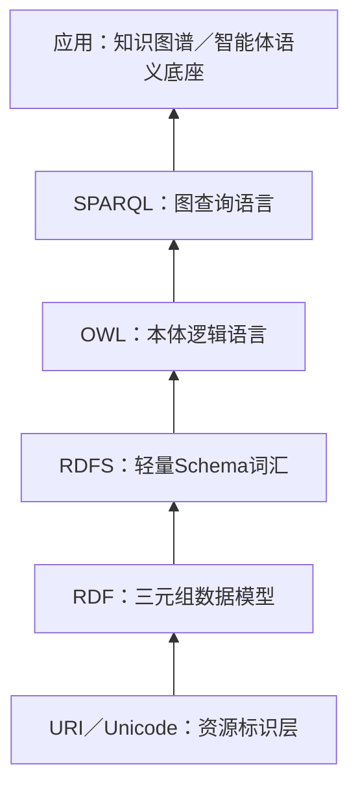
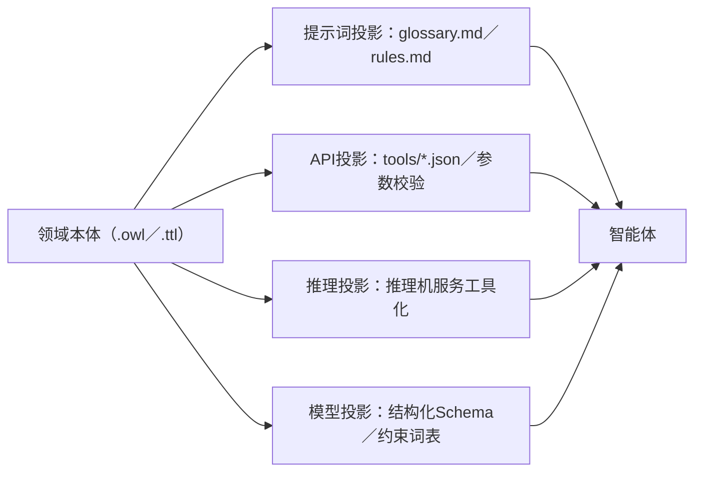
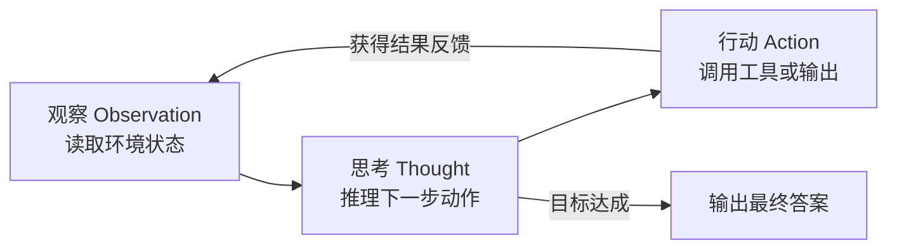
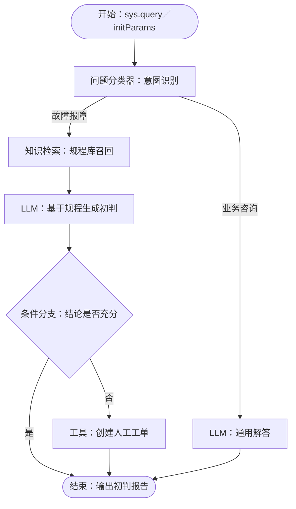

# 基于智能体、本体论和FDE落地经验的知识点详情

> 本文档与《ontology.xlsx（知识点框架）》通过知识点编号一一对应：编号1~5为一级知识点，a.b为二级知识点，a.b.c为三级知识点，两份文件配套使用。

## 1 本体论基础

**知识点编号：** 1　　**重要性级别：** A

**定义：** 本体论（Ontology）起源于哲学，研究“存在”与“存在者”的根本问题；二十世纪九十年代被人工智能与语义网领域引入，指对某一领域概念及其关系的形式化、显式、可共享的规范说明。它是后续“本体应用于智能体”的全部理论根基。

**特性：** 跨学科渊源；强调形式化与可共享；以类、实例、属性、公理为基本构件；有成熟的描述语言（RDF/OWL）与建模方法论支撑。

**场景：** 任何需要让机器“理解”某个业务领域语义的场景，如通信网管、医疗、金融领域的知识建模。

**方法论：** 先学起源与核心概念建立直觉，再学描述语言掌握表达工具，最后学建模方法完成从理论到实践的闭环。

**样例：** 在通信网管领域，用本体显式定义“网元”“告警”“链路”等概念及“告警发生于网元”等关系，形成全网共享的语义底座。

### 1.1 本体论的起源与演进

**知识点编号：** 1.1　　**重要性级别：** B

**定义：** 本体论从哲学概念演变为计算机可处理的形式化知识表示，经历了哲学本体论、人工智能知识工程、语义网三个阶段，理解来龙去脉有助于把握其设计动机。

**特性：** 历史脉络清晰；每个阶段解决上一阶段的表达力不足；最终落地为W3C标准体系。

**场景：** 讲解本体论时的入门铺垫；回答“为什么需要本体”这类根本性问题。

**方法论：** 按“哲学—人工智能—语义网”三段式讲授，每段说明当时要解决的问题和提出的方案。

**样例：** 哲学阶段解决“世界由什么构成”，人工智能阶段解决“知识如何被机器推理”，语义网阶段解决“知识如何在Web上共享互联”。

#### 1.1.1 哲学本体论

**知识点编号：** 1.1.1　　**重要性级别：** C

**定义：** 哲学本体论（Ontology）源自希腊语on（存在）与logos（学问），由亚里士多德等哲学家奠基，研究存在的本质、范畴与实体间的基本关系，是西方形而上学的核心分支。

**特性：** 抽象思辨；关注范畴划分（实体、属性、关系、事件）；为后世知识分类提供元理论。

**场景：** 理解“本体”一词的词源与思想根源；学术报告中交代概念出处。

**方法论：** 抓住“范畴”这个核心：哲学家试图给出对世界万物最通用的分类体系。

**样例：** 亚里士多德《范畴篇》将存在划分为实体、数量、性质、关系等十个范畴，与今天本体建模中的“类—属性—关系”划分一脉相承。

#### 1.1.2 人工智能中的本体

**知识点编号：** 1.1.2　　**重要性级别：** A

**定义：** 1993年Gruber给出经典定义：本体是“概念化的显式规范”（An ontology is an explicit specification of a conceptualization）。即把领域中的概念、关系显式地形式化，使人和机器都能无歧义地理解。Studer补充其四要素：概念化、显式、形式化、共享。

**特性：** 四要素：概念化（抽象出概念模型）、显式（明确定义）、形式化（机器可读可推理）、共享（群体共识）。

**场景：** 领域知识建模、企业知识库建设、智能体语义底座设计的理论依据。

**方法论：** 以Gruber定义为锚点，逐词解释四要素，并对照一个业务实例说明每个要素的含义。

**样例：** 网管本体中显式定义“nw:网元 a owl:Class”，并约定所有团队共用同一命名空间nw:，即体现了显式与共享。

#### 1.1.3 语义网与知识图谱

**知识点编号：** 1.1.3　　**重要性级别：** B

**定义：** 1998年Tim Berners-Lee提出语义网（Semantic Web）构想，让Web数据带有机可读语义，W3C随之制定RDF、OWL等标准；2012年Google提出知识图谱（Knowledge Graph），将本体思想工程化、大规模化，本体由此成为知识图谱的Schema层。

**特性：** 标准驱动（W3C）；分层技术栈（URI→RDF→RDFS→OWL→SPARQL）；知识图谱=本体Schema+实例数据。

**场景：** 理解本体与知识图谱的关系；技术选型时判断是否需要OWL级推理或只需图查询。

**方法论：** 用“语义网技术栈分层图”讲解各层职责，再用“Schema与数据的关系”类比数据库的表结构与表数据。

**样例：** “网元—承载—链路”是本体Schema层的定义，而“杭州某机房的具体路由器R1承载链路L2”是知识图谱中的实例数据。

语义网技术栈（自下而上表达力增强）：

### 1.2 本体核心概念

**知识点编号：** 1.2　　**重要性级别：** A

**定义：** 本体由类、实例、属性、公理四类基本构件组成，四者配合完成对领域知识的完整刻画，是阅读和编写OWL/Turtle文件的前提。

**特性：** 构件少而精；概念间存在严格的层级与约束关系；与面向对象思想相似但表达能力更强。

**场景：** 阅读或编写任何本体文件；评审他人本体模型的完整性。

**方法论：** 按“类→实例→属性→公理”的顺序学习，每个概念都给出一个OWL代码片段印证。

**样例：** “路由器是网元类的实例”“告警发生于网元是对象属性”“发生于的定义域是告警类”分别对应四个构件。

#### 1.2.1 类与实例

**知识点编号：** 1.2.1　　**重要性级别：** A

**定义：** 类（Class）是对具有共同特征事物的抽象集合，如“网元”；实例（Individual）是类的具体成员，如某台具体路由器。类之间可通过subClassOf形成层级，实例通过rdf:type声明所属类。

**特性：** 层级继承（子类继承父类约束）；实例可多类型归属；类层级是推理展开的基础。

**场景：** 梳理业务名词并建立分类体系，如把“OLT、ONU、路由器、交换机”归为“网元”的子类。

**方法论：** 遵循“先抽共性成父类、再分差异成子类、最后落具体对象为实例”的三步归类法。

**样例：** nw:OLT rdfs:subClassOf nw:网元；nw:杭州OLT01 rdf:type nw:OLT，则推理机可推出杭州OLT01也是网元。

#### 1.2.2 属性体系

**知识点编号：** 1.2.2　　**重要性级别：** A

**定义：** 属性（Property）描述类与实例的特征及相互关系，分两类：对象属性（ObjectProperty）连接两个实例，如“承载于”；数据属性（DatatypeProperty）连接实例与字面量，如“设备序列号为某字符串”。属性可定义定义域（domain）与值域（range）。

**特性：** 二元区分（对象/数据属性）；domain/range约束可参与推理；支持属性层级（subPropertyOf）。

**场景：** 刻画业务实体间关系与实体的字段特征；校验数据录入是否符合关系约束。

**方法论：** 识别业务语句中的谓词：宾语是“事物”则建对象属性，宾语是“数值/文本”则建数据属性。

**样例：** nw:告警A01 nw:发生于 nw:OLT01（对象属性）；nw:OLT01 nw:序列号 “HW-X87”（数据属性）。

#### 1.2.3 公理与推理

**知识点编号：** 1.2.3　　**重要性级别：** A

**定义：** 公理（Axiom）是本体中被断言为真的逻辑陈述，包括类的包含、属性的传递性、对称性、互逆性、定义域值域约束等。推理机（Reasoner）基于描述逻辑（Description Logic）对公理做演绎，推出未显式声明的隐含知识。例如类包含写作 $C \sqsubseteq D$，存在限制写作 $\exists r.C$。

**特性：** 演绎能力（由已知推未知）；一致性检查（发现矛盾建模）；开放世界假设（未知不视为假）。

**场景：** 需要自动发现隐含故障链路的网管场景；需要校验本体模型自相矛盾的建模评审场景。

**方法论：** 掌握常用公理类型清单（subClassOf、TransitiveProperty、inverseOf、domain、range），用HermiT或Pellet推理机跑一致性检查并查看推理结果。

**样例：** 若“上联于”声明为传递属性，且ONU上联于OLT、OLT上联于BRAS，则推理机自动得出ONU上联于BRAS，无需人工录入。

### 1.3 本体描述语言

**知识点编号：** 1.3　　**重要性级别：** A

**定义：** 本体需要机器可读的表达载体，W3C标准体系提供了从RDF到OWL的语言族：RDF负责数据建模，RDFS提供轻量Schema，OWL提供完整逻辑表达，Turtle是常用书写语法，SPARQL是查询语言。

**特性：** 层层递进的标准族；均为W3C推荐标准；表达力与推理复杂度成反比（表达力越强推理越慢）。

**场景：** 编写本体文件、搭建知识图谱、实现语义查询时的语言选型。

**方法论：** 按“RDF→RDFS→OWL→Turtle→SPARQL”顺序学习，每学一门语言就用同一网管例子改写一遍加深理解。

**样例：** 同一条知识“告警A01发生于OLT01”，RDF中是三元组，Turtle中是nw:告警A01 nw:发生于 nw:OLT01，SPARQL中可被SELECT查询检索。

#### 1.3.1 RDF与RDFS

**知识点编号：** 1.3.1　　**重要性级别：** A

**定义：** RDF（Resource Description Framework）是语义网的数据模型，把一切知识表示为主谓宾三元组 $(s,\, p,\, o)$；RDFS（RDF Schema）在RDF之上提供Class、subClassOf、domain、range等轻量建模词汇，是OWL的简化前身。

**特性：** 三元组原子化表达；资源用URI全局唯一标识；图结构天然可合并（不同来源的图直接拼接）。

**场景：** 异构系统数据交换；需要把多张业务表统一成图的集成场景。

**方法论：** 把每条业务事实拆成“谁—什么关系—谁/什么值”的三元组；用rdfs:domain/rdfs:range约束属性两端类型。

**样例：** 三元组（nw:OLT01, nw:位于机房, nw:杭州城西机房）；声明nw:位于机房的domain为nw:网元、range为nw:机房，则误填“机房位于机房”可被检出。

#### 1.3.2 OWL

**知识点编号：** 1.3.2　　**重要性级别：** A

**定义：** OWL（Web Ontology Language）是W3C发布的本体描述语言，在RDFS之上增加等价类、不相交、传递、互逆、基数约束等丰富逻辑构造。历史上分OWL Lite、OWL DL、OWL Full三个子语言，2012年标准化的OWL 2是当前主流，OWL 2 DL兼顾表达力与可判定性。

**特性：** 
1. 表达力最强（覆盖描述逻辑SROIQ）；支持自动推理与一致性校验；与Protégé等建模工具生态成熟。

2. OWL（Web Ontology Language）是一种用于描述本体论的语言，而Turtle是一种用于序列化RDF数据的格式。OWL本体论可以被序列化为RDF数据，因此可以使用Turtle格式来表示OWL本体论。Turtle格式具有以下特点：
易于阅读和编写，具有类似于自然语言的语法。
支持RDF三元组的紧凑表示，提高数据的可读性和可维护性。
与RDF/XML等其他RDF序列化格式兼容。
OWL本体论使用Turtle作为后缀（.ttl），主要有以下原因：
- Turtle是RDF数据的一种常用序列化格式，OWL作为RDF数据的一种，使用Turtle格式可以保持一致性。
- Turtle格式的可读性和紧凑性使其成为表示OWL本体论的理想选择。
- 使用Turtle格式可以方便地与其他RDF工具和库进行互操作。
总之，OWL本体论使用Turtle作为后缀，是因为Turtle是RDF数据的一种常用且高效的序列化格式，可以很好地表示OWL本体论，并与其他RDF工具和库进行互操作

**场景：** 需要复杂逻辑推理的领域建模，如网管故障传播关系、医学诊断规则。

**方法论：** 先掌握常用构造子清单，再用Protégé建模并运行HermiT推理机验证；理解“开放世界假设”避免误用唯一名假设。

**样例：** 声明nw:OLT owl:disjointWith nw:ONU后，若某实例同时被标为OLT和ONU，推理机会报不一致，帮助发现数据质量问题。
#### 1.3.3 Turtle语法

**知识点编号：** 1.3.3　　**重要性级别：** B

**定义：** Turtle（Terse RDF Triple Language）是RDF的紧凑文本序列化语法，通过@prefix前缀缩写、分号共用主语、逗号共用主谓、a代替rdf:type等简写，使本体文件简洁易读。与RDF/XML相比，Turtle表达同样的图，只是书写形式不同。

**特性：** 人类可读性最好；简写规则丰富；是Protégé、TopBraid等工具的默认导出格式之一。

**场景：** 手工编写或评审本体文件；在文档与提示词中内嵌本体片段。

**方法论：** 掌握四个核心简写（@prefix、a、分号、逗号）即可读懂绝大多数Turtle文件；练习把RDF/XML改写成Turtle。

**样例：** nw:告警A01 a nw:告警 ; nw:发生于 nw:OLT01 ; nw:级别 “严重” 。——用分号让三条三元组共享主语，等价于三条独立陈述。

#### 1.3.4 SPARQL查询

**知识点编号：** 1.3.4　　**重要性级别：** B

**定义：** SPARQL是W3C制定的RDF图查询语言，地位相当于关系数据库的SQL。通过三元组模式匹配（WHERE子句）、FILTER过滤、OPTIONAL可选匹配等构造，从知识图谱中检索数据，也可做CONSTRUCT构造新图与ASK存在性判断。

**特性：** 图模式匹配而非表连接；支持联邦查询（跨多个SPARQL端点）；与推理机配合可查隐含三元组。

**场景：** 从知识图谱取数喂给智能体；运维系统中做“某机房下所有OLT及其严重告警”类语义查询。

**方法论：** 先写SELECT+WHERE三元组模式的最小查询，再逐步加FILTER、OPTIONAL、子查询；在Jena Fuseki等端点上实操。

**样例：** SELECT ?olt WHERE { ?olt a nw:OLT . ?alarm a nw:告警 ; nw:发生于 ?olt ; nw:级别 “严重” . } 查出所有存在严重告警的OLT。

### 1.4 本体建模与存储

**知识点编号：** 1.4　　**重要性级别：** A

**定义：** 把领域知识变成可用的本体资产，需要一套建模方法论指导建模过程，并明确本体的物理存储方式与在系统中的引用方式，这是本体从理论走向工程的最后一公里。

**特性：** 方法工程化（有公认步骤）；存储形态多样（文件/三元组库/图数据库）；引用方式决定本体如何被智能体消费。

**场景：** 从零建设一个业务领域本体；将已有.owl文件接入智能体系统。

**方法论：** 先按七步法完成建模，再根据规模选存储，最后按“提示词、API、推理、模型设置”四种投影方式接入应用。

**样例：** 网管本体建模后用Protégé导出为5个按网元拆分的.owl文件，核心三元组同时加载进Jena Fuseki供SPARQL查询。

#### 1.4.1 七步建模法

**知识点编号：** 1.4.1　　**重要性级别：** A

**定义：** 斯坦福大学Noy与McGuinness提出的本体开发七步法：①确定领域与范围②考虑复用现有本体③枚举重要术语④定义类及层级⑤定义属性⑥定义属性的约束（定义域、值域、基数）⑦创建实例。是本体建模最经典的方法论。

**特性：** 步骤明确可操作；迭代式（允许回退修改）；强调术语先行与复用优先。

**场景：** 新领域本体从零建模；评审既有本体是否遗漏关键步骤。

**方法论：** 严格按七步顺序产出各步交付物（范围说明书、术语表、类层级图、属性表、实例集），每步评审后再进下一步。

**样例：** 网管本体建模：范围定为“家宽故障诊断”，术语表含网元/告警/工单，类层级为网元下分OLT/ONU，属性含“发生于/承载于”，约束含“告警必须发生于网元”，最后录入真实网元实例。

#### 1.4.2 本体的存储与引用

**知识点编号：** 1.4.2　　**重要性级别：** A

**定义：** 本体逻辑上是一份语义规范，物理上有三种存储形态：独立.owl/.ttl文件、三元组库（Jena Fuseki、GraphDB）、图数据库（Neo4j）。在智能体系统中通过四种“投影”被引用：提示词投影（抽取术语规则注入System Prompt）、API投影（作为工具出入参的Schema与校验依据）、推理投影（推理机服务包装为可调用工具）、模型投影（作为微调语料或约束解码词表）。

**特性：** 一份本体、四种投影；存储与消费解耦；不同投影对应不同工程接口。

**场景：** 回答“定义好的.owl文件到底怎么被智能体用起来”这一工程关键问题。

**方法论：** 将本体按用途派生出glossary.md（提示词用）、rules.md（规则校验用）、tools/*.json（工具语义用）、shapes/*.ttl（SHACL校验用）、diagnosis.schema.json（结构化输出用），分别挂接到提示词、API参数、推理服务和模型设置。

**样例：** 智能体接到“OLT严重告警分析”请求时：提示词中的术语表统一语义，工具JSON约束查询参数，推理服务补全故障链路，JSON Schema约束输出结构，四层投影协同工作。

#### 1.4.3 本体的模块化拆分

**知识点编号：** 1.4.3　　**重要性级别：** B

**定义：** 大型本体按业务边界拆分为多个模块文件（如按网元类型拆为OLT本体、ONU本体、机房本体等），模块间通过owl:imports互相引用，共享统一的命名空间与核心上层概念，兼顾可维护性与一致性。

**特性：** 单一职责（每模块聚焦一个子域）；通过imports组合复用；命名空间统一是合并的前提。

**场景：** 多人协作建模；本体随业务演进需要局部更新而不影响全局。

**方法论：** 先抽公共上层本体（核心类与属性），再按子域拆分子模块并import上层本体；变更时只改对应模块并重跑一致性检查。

**样例：** nw-core.ttl定义“网元/告警/链路”核心概念，nw-olt.ttl、nw-onu.ttl分别扩展各自细节并owl:imports nw-core.ttl，加载后形成完整知识图。

## 2 本体论在智能体中的应用

**知识点编号：** 2　　**重要性级别：** A

**定义：** 大模型智能体的短板在于缺乏稳定、共享、可校验的领域语义。本体作为语义底座，从知识底座、工具调用、输出约束、多智能体协作四个方向为智能体提供确定性支撑，形成“一份本体、四种投影”的应用格局。

**特性：** 以确定性语义弥补大模型的概率性输出；四种投影覆盖智能体运行的提示词、工具、输出、协作四个环节；工程落地物为glossary、rules、tools JSON、shapes、schema五类文件。

**场景：** 在垂直领域（如通信网管故障处理）构建可靠智能体，需要抑制幻觉、统一术语、校验输出的场景。

**方法论：** 先建知识底座解决“懂不懂”，再语义对齐工具解决“调得对不对”，再输出约束解决“说得准不准”，最后共享本体解决“协作乱不乱”。

**样例：** 网管故障处理智能体：术语表统一“掉线/脱管/LOS”等口径，工具JSON约束查询参数，JSON Schema约束诊断报告结构，共享本体支撑告警分析与工单派发两个子智能体协作。

本体在智能体中的四种投影关系：

### 2.1 领域知识底座

**知识点编号：** 2.1　　**重要性级别：** A

**定义：** 领域知识底座是把本体中的概念、术语、规则抽取成智能体可直接消费的知识资产层，通常以术语表、规则库、知识图谱三种形态存在，解决智能体“领域知识从哪来”的问题。

**特性：** 源于同一本体（口径天然一致）；形态多样（Markdown/规则文件/图数据库）；可被提示词与RAG双通道消费。

**场景：** 智能体需要准确使用业务术语、遵守业务规则、查询领域事实的一切场景。

**方法论：** 从本体派生glossary.md与rules.md注入提示词，将实例数据导入图谱供RAG检索，保持三者同源同步更新。

**样例：** 把“nw:LOS告警 定义：光信号丢失，常见于ONU与OLT间光纤中断”写入glossary.md，智能体解释LOS时口径与全网一致。

#### 2.1.1 术语表与数据词典

**知识点编号：** 2.1.1　　**重要性级别：** A

**定义：** 术语表（glossary）是从本体类与属性中抽取的“术语—定义—同义词—上下位关系”清单，通常落地为glossary.md注入System Prompt，使智能体对业务词汇的理解与组织内共识严格一致。

**特性：** 权威唯一（单一事实源）；支持同义词映射（用户口语→标准术语）；轻量可读（Markdown表格）。

**场景：** 用户提问夹杂口语、缩写、方言式叫法时，智能体需归一化为标准术语再处理。

**方法论：** 从OWL文件用脚本抽取所有类的label与comment生成术语表初稿，人工补充同义词列，随本体版本同步重新生成。

**样例：** 用户说“光猫掉了”，术语表将“光猫”映射到标准术语“ONU”、“掉了”映射到“脱管”，智能体据此检索ONU脱管相关告警。

#### 2.1.2 业务规则库

**知识点编号：** 2.1.2　　**重要性级别：** A

**定义：** 业务规则库（rules.md）是把领域中的判定逻辑、处理流程、约束条件显式沉淀的规则集合，常以“IF-THEN”或自然语言条目形式存在，注入提示词或挂在校验环节，约束智能体的决策行为。

**特性：** 显式可审计（每条规则可追溯来源）；与本体公理互补（本体管概念结构、规则管行为逻辑）；可版本化管理。

**场景：** 故障定级、工单派发、变更审批等有明确业务判定标准的场景。

**方法论：** 与业务专家逐条梳理规则，标注来源文档与生效范围，按“规则编号+条件+动作+例外”四段式编写。

**样例：** 规则R012：IF OLT下挂ONU离线数>50% THEN 判定为OLT级故障而非单户故障，优先派发OLT侧工单。

#### 2.1.3 知识图谱与RAG

**知识点编号：** 2.1.3　　**重要性级别：** B

**定义：** 知识图谱承载本体的实例数据，RAG（检索增强生成）负责在生成前检索相关图谱事实注入上下文，二者结合让智能体回答建立在真实数据之上而非参数记忆之上。

**特性：** 事实可溯源（回答可附查询路径）；更新即生效（改图谱不必重训模型）；与向量检索互补（图谱管关系、向量管语义相似）。

**场景：** 需要查询实时业务数据（当前告警、现网拓扑）的问答与诊断场景。

**方法论：** 将用户问题先经术语归一化，再转成SPARQL或Cypher查询图谱，把结果作为上下文交给LLM组织回答；语义模糊的问题走向量RAG通道。

**样例：** “OLT01下哪些ONU有严重告警”被转为SPARQL查询，返回3条实例，LLM基于这三条事实生成带依据的回答。

### 2.2 工具调用语义对齐

**知识点编号：** 2.2　　**重要性级别：** A

**定义：** 智能体通过Function Calling调用外部工具时，工具名、参数名、参数含义必须与领域本体语义对齐，否则会出现参数填错、工具选错。语义对齐通过工具Schema本体化与参数校验两个手段实现。

**特性：** 双向对齐（工具定义对齐本体、调用参数对齐约束）；预防性（在调用前拦截错误）；以tools/*.json为落地文件。

**场景：** 智能体需要调用网管API、数据库查询接口、工单系统接口等外部工具的场景。

**方法论：** 为每个工具编写JSON Schema并在description字段中绑定本体术语，调用前用本体约束校验参数语义合法性。

**样例：** 工具query_alarm的参数neType在description中注明“对应本体nw:网元子类”，智能体填参时把用户说的“光猫”正确转换为ONU。

#### 2.2.1 工具Schema本体化

**知识点编号：** 2.2.1　　**重要性级别：** A

**定义：** 工具Schema本体化指在编写工具（函数）的JSON Schema定义时，让工具名、参数名、枚举值与本体中的类和属性一一对应，并在description中引用本体定义，使大模型在选工具、填参数时能借助领域语义做正确决策。

**特性：** 命名即语义（参数名自带领域含义）；枚举值受控（取值来自本体实例或子类清单）；人机和团队三方对齐。

**场景：** 设计智能体工具集（tools/*.json）；评审工具定义是否存在语义歧义。

**方法论：** 工具命名采用本体动词短语；参数类型用JSON Schema声明，取值范围引用本体类层级；description中写清“对应本体概念+业务含义+示例”。

**样例：** {“name”:“query_alarm_by_ne”,“parameters”:{“ne_id”:{“description”:“网元ID，对应本体nw:网元的实例标识”,“type”:“string”}}}，模型据此不会把工单号误填进ne_id。

#### 2.2.2 参数语义校验

**知识点编号：** 2.2.2　　**重要性级别：** B

**定义：** 参数语义校验是在工具调用执行前，用本体中声明的定义域、值域、枚举约束对实参做合法性检查，拦截“语法合法但语义错误”的调用，如把机房的值填进网元参数。

**特性：** 调用前拦截（fail-fast）；基于本体公理自动判定；错误可解释（能说明违反哪条约束）。

**场景：** 高风险操作工具（重启网元、派发工单）调用前的安全校验。

**方法论：** 在工具执行器前加校验中间件：取出参数值，查询其在本体中的类型归属，比对工具Schema声明的期望类，不符则拒绝并返回可读的违例说明。

**样例：** 调用restart_ne(ne_id=“杭州城西机房”)被拦截：该ID在本体中类型为nw:机房，而restart_ne的domain要求nw:网元，校验器返回“参数类型违例：期望网元，实为机房”。

### 2.3 输出约束与幻觉抑制

**知识点编号：** 2.3　　**重要性级别：** A

**定义：** 大模型输出是概率采样结果，存在幻觉风险。用本体衍生的结构化Schema与形状约束对输出做硬性校验，可把“不可信的自由文本”变成“可校验的结构化数据”，是智能体工程可信化的关键环节。

**特性：** 三层防线（生成时约束、生成后校验、事实性核对）；校验规则与本体同源；不合格输出可自动重生成。

**场景：** 智能体输出需入库、需驱动下游流程、需对外正式呈现的场景，如诊断报告、派单指令。

**方法论：** 用JSON Schema约束输出结构、用SHACL约束输出语义、用知识库核对关键事实，三层依次启用。

**样例：** 诊断报告智能体必须输出符合diagnosis.schema.json的JSON，校验发现缺少必填字段root_cause时自动要求模型补全后重新输出。

#### 2.3.1 结构化输出与JSON Schema

**知识点编号：** 2.3.1　　**重要性级别：** A

**定义：** 结构化输出指强制智能体按预定义的JSON Schema输出数据而非自由文本，Schema由本体的类与属性派生生成（如diagnosis.schema.json），声明字段名、类型、必填性与枚举值，从结构上杜绝漏项与乱填。

**特性：** 机器可校验（程序化检查必填与类型）；下游可直接消费（无需二次解析）；Schema与本体同源演进。

**场景：** 智能体输出需写入数据库或驱动工单、报表等下游系统。

**方法论：** 先在本体中定义输出对应的概念结构，再脚本化生成JSON Schema，调用模型时以response_format或提示词双管齐下地施加约束，最后代码校验不通过则重试。

**样例：** diagnosis.schema.json规定{“fault_type”:枚举[光缆中断,设备故障,配置错误],“evidence”:数组必填}，模型输出缺evidence字段即被判不合格。

#### 2.3.2 SHACL形状校验

**知识点编号：** 2.3.2　　**重要性级别：** B

**定义：** SHACL（Shapes Constraint Language）是W3C的RDF数据校验标准，通过形状文件（shapes/*.ttl）声明“某类实例应具备哪些属性、取值范围如何”，对知识图谱数据或智能体输出的RDF化结果做语义级校验，是JSON Schema在语义网世界的对应物。

**特性：** 声明式约束（NodeShape/PropertyShape）；校验报告标准化（Validation Report）；与OWL互补（OWL做推理、SHACL做校验）。

**场景：** 入库数据质量校验；智能体输出RDF三元组后的合规性检查。

**方法论：** 为每个核心类编写NodeShape，声明必备属性及minCount/maxCount与datatype，用pySHACL等引擎执行校验并解读违例报告。

**样例：** AlarmShape规定nw:告警必须恰好有一个nw:级别且取值在{轻微,一般,严重,紧急}内，输出“致命”级别即被检出。

#### 2.3.3 幻觉抑制机制

**知识点编号：** 2.3.3　　**重要性级别：** A

**定义：** 幻觉抑制是一套组合机制：用RAG让回答基于检索到的事实，用本体约束让术语与关系不越界，用输出校验让结构合规，用引用溯源让关键结论附带来源，从而系统性地降低大模型编造内容的风险。

**特性：** 多手段叠加（单一手段均有漏网）；区分事实性幻觉与逻辑性幻觉分别设防；可度量（抽检准确率）。

**场景：** 对输出正确性要求高的生产环境智能体，如故障诊断、合规咨询。

**方法论：** 按“检索 grounding→术语归一→结构校验→事实核对→溯源展示”五步搭建防线，并建立抽检机制持续度量幻觉率。

**样例：** 智能体回答“OLT01故障原因是板卡过热”时，必须附带来源告警ID与查询时间；无法溯源的结论在报告中标注“推断”而非“事实”。

### 2.4 多智能体协作

**知识点编号：** 2.4　　**重要性级别：** B

**定义：** 复杂业务往往需要多个专职智能体协作完成。共享本体为协作各方提供统一的语义协议，避免“同名异义、异名同义”的协作混乱；推理层则可封装为公共服务供各方调用。

**特性：** 语义协议化（消息内容受本体约束）；分工明确化（角色对应子域）；推理服务化（推理能力即工具）。

**场景：** 告警分析、故障定位、工单派发、结果通报等多角色串联的网管运维流程。

**方法论：** 先定义协作消息的本体词汇表，再按业务子域划分角色，最后把公共推理能力封装为共享工具。

**样例：** “告警分析智能体”输出符合本体的故障事件JSON，“工单派发智能体”读取同一词汇表的事件结构执行派发，双方无需自然语言对齐成本。

#### 2.4.1 共享本体协作协议

**知识点编号：** 2.4.1　　**重要性级别：** B

**定义：** 共享本体协作协议指多个智能体之间交换的消息结构与词汇统一遵循同一份本体定义，消息的字段名、枚举值、关系含义都有形式化依据，相当于为多智能体系统制定了“语义层通信协议”。

**特性：** 消歧（各角色对字段理解一致）；可校验（消息可按Schema验收）；可演进（本体版本即协议版本）。

**场景：** 多智能体接力处理长流程，环节间需要传递结构化中间结果。

**方法论：** 将协作消息建模为本体中的“事件类”，定义其必备属性；各智能体收发消息时以该类Schema做序列化与校验。

**样例：** FaultEvent类定义fault_type、ne_id、severity、evidence四字段，分析智能体产出、派发智能体消费，均以FaultEvent Schema校验。

#### 2.4.2 角色分工与任务分解

**知识点编号：** 2.4.2　　**重要性级别：** B

**定义：** 多智能体系统按业务子域把复杂任务分解给专职角色（如调研、分析、执行、审核智能体），每个角色只加载与其子域相关的本体模块、术语与工具，实现关注点分离与能力聚焦。

**特性：** 专职化（小上下文高准确）；可独立演进（单角色升级不影响全局）；与本体模块化拆分一一对应。

**场景：** 端到端流程长、各环节知识差异大的业务，如从告警到归档的故障处理全流程。

**方法论：** 按业务泳道图切分角色，为每个角色配置最小必要的本体模块+术语表+工具集+输出Schema，角色间通过协作协议传递结果。

**样例：** 网管场景分四个角色：告警研判智能体（加载告警本体）、根因分析智能体（加载拓扑本体）、工单派发智能体（加载流程本体）、复盘报告智能体（加载案例库）。

#### 2.4.3 推理层的实现与工具化

**知识点编号：** 2.4.3　　**重要性级别：** B

**定义：** 推理层是把OWL推理机（HermiT、Pellet、Jena Rules）包装成可被智能体调用的工具服务的实现层：加载本体与实例数据，对外提供一致性检查、分类推断、链路推导等接口，使智能体能通过普通工具调用获得逻辑推理能力。

**特性：** 服务化封装（REST API或MCP工具）；推理与生成分离（确定性的归推理机、创造性的归LLM）；结果可缓存复用。

**场景：** 智能体需要“推导隐含关系”而非“检索显式数据”的场景，如故障影响面传播分析。

**方法论：** 用Jena或OWL API加载本体，实现reason()、checkConsistency()、inferChain(from,to)等接口，注册为智能体工具并在Schema中注明语义。

**样例：** 智能体调用infer_chain(“ONU-37”,“BRAS-2”)，推理服务利用传递性公理返回完整上联路径，LLM再据此生成影响面分析说明。

## 3 智能体基础

**知识点编号：** 3　　**重要性级别：** A

**定义：** 智能体（Agent）是以大模型为决策核心，具备感知、规划、工具调用与记忆能力的自治系统。理解其基本概念与关键技术，是进入Dify编排与FDE落地的前提。

**特性：** 大模型驱动；目标导向自治执行；四大能力支柱（规划、记忆、工具、行动）；与传统脚本自动化的本质区别在于处理开放性任务。

**场景：** 一切需要AI自主完成多步骤任务的场景，从问答助手到运维故障处理。

**方法论：** 先建立“智能体=大模型+规划+记忆+工具”的整体模型，再逐项学习关键技术，最后用ReAct框架把各部件串成运行闭环。

**样例：** 网管故障智能体接收“OLT01告警”输入后，自主规划查询步骤、调用告警接口、结合历史案例记忆，输出诊断结论。

### 3.1 智能体核心概念

**知识点编号：** 3.1　　**重要性级别：** A

**定义：** 智能体的概念源于分布式人工智能，在大模型时代被重新定义为：以LLM为“大脑”，通过感知环境、规划步骤、调用工具、利用记忆来完成目标的系统。

**特性：** 自主性（无需逐步人工指令）；反应性与主动性兼备；能力边界由工具集与知识底座共同决定。

**场景：** 辨析“一个带提示词的LLM调用”与“一个智能体”的差别；设计智能体系统时的概念对齐。

**方法论：** 用“大脑（LLM）+感官（输入）+手脚（工具）+经验（记忆）”的人体类比建立直觉。

**样例：** 单次调用LLM总结一段告警文本不是智能体；能自主决定先查告警、再查拓扑、再生成报告的系统才是智能体。

#### 3.1.1 智能体的定义与特征

**知识点编号：** 3.1.1　　**重要性级别：** A

**定义：** 智能体是能感知环境并采取行动以达成目标的自治实体。大模型时代的智能体具备四个标志性特征：目标驱动、自主规划、工具使用、记忆积累，其能力来自模型推理与外部资源的组合。

**特性：** 目标驱动而非指令驱动；任务可分解为中间步骤；行动结果会反馈影响后续决策（闭环）。

**场景：** 评估一个AI系统是否属于智能体；向上级或客户解释智能体与传统自动化的区别。

**方法论：** 用四特征清单逐项核对：有无目标？能否自己拆步骤？能否用工具？有无记忆？四项皆具方为完整智能体。

**样例：** 传统巡检脚本按固定顺序执行命令；巡检智能体发现某端口异常后会自主决定追加光功率查询，体现反馈闭环。

#### 3.1.2 大模型与智能体的关系

**知识点编号：** 3.1.2　　**重要性级别：** A

**定义：** 大模型是智能体的推理核心但不是全部：LLM负责理解、规划与生成，智能体在其外围加上工具调用、记忆管理、环境交互与约束机制，形成完整系统。形象地说，LLM是发动机，智能体是整车。

**特性：** 核心与系统的关系；LLM的概率性短板由外围确定性机制（本体约束、工具校验）弥补；同一LLM可支撑多个不同智能体。

**场景：** 技术选型时判断“需要调模型API”还是“需要搭智能体平台”；向非技术干系人解释系统构成。

**方法论：** 画出“LLM居中、工具/记忆/知识/约束环绕”的架构图，逐层说明每圈组件补了LLM的哪个短板。

**样例：** 同一个GPT-4模型，配上网管工具集与故障本体就是网管智能体，配上法律库与文书模板就是法律智能体——差异在外围系统。

#### 3.1.3 感知-规划-行动循环

**知识点编号：** 3.1.3　　**重要性级别：** A

**定义：** ReAct（Reasoning+Acting）框架描述了智能体的基本运行循环：观察（Observation）环境状态→思考（Thought）推理下一步→行动（Action）调用工具→再观察行动结果，循环直至目标达成。该循环是Dify中Agent应用与各类智能体框架的共同内核。

**特性：** 推理与行动交替显式化（每步可解释）；循环上限可控（防止死循环）；中间轨迹可审计。

**场景：** 调试智能体“为什么多查了三次接口”或“为什么提前终止”等行为问题。

**方法论：** 阅读智能体运行日志时按O-T-A三元组逐段还原决策链，定位错误发生在哪次思考或哪次行动。

**样例：** 处理告警时：观察“OLT01有LOS告警”→思考“需确认影响范围”→行动“调用query_onu_list”→观察“52台ONU离线”→思考“判断为OLT级故障”→行动“生成诊断报告”。

ReAct运行循环：

### 3.2 智能体关键技术

**知识点编号：** 3.2　　**重要性级别：** A

**定义：** 支撑智能体运行的四项关键技术：提示词工程塑造行为，记忆机制维持上下文，工具调用扩展能力，RAG注入外部知识。四者质量直接决定智能体的可用性。

**特性：** 均为工程性技术（可迭代优化而不必重训模型）；相互协同（记忆供给提示词、RAG供给事实）；均有成熟评估手段。

**场景：** 智能体效果不佳时的调优切入点定位：话术问题调提示词、遗忘问题调记忆、能力问题加工具、事实问题补RAG。

**方法论：** 按“行为—上下文—能力—知识”四个维度分别建立调优 checklist，逐项排查。

**样例：** 智能体把“光猫”理解错→改提示词中的术语表；多轮对话忘前文→检查会话记忆配置；查不到实时告警→接入告警API工具；答错专业概念→补充领域RAG知识库。

#### 3.2.1 提示词工程

**知识点编号：** 3.2.1　　**重要性级别：** A

**定义：** 提示词工程是通过设计System Prompt与用户提示来塑造智能体行为的技术，要素包括角色设定、任务描述、约束规则、输出格式、少样本示例（Few-shot）。领域本体以术语表、规则库形式注入提示词，是语义一致性的重要保障。

**特性：** 零训练成本（即改即生效）；结构化模板（角色/任务/约束/输出四段）；示例驱动（Few-shot显著提升格式稳定性）。

**场景：** 定义智能体的身份与行为边界；修正答非所问、格式错乱、越界回答等问题。

**方法论：** 按“角色→任务→约束→输出格式→示例”模板编写；修改后用固定测试集回归验证，防止顾此失彼。

**样例：** 网管智能体提示词片段：“你是网络运维专家…仅基于提供的告警事实作答，禁止编造设备型号…输出须为{fault_type,evidence}结构”，并附两个示例问答。

#### 3.2.2 记忆机制

**知识点编号：** 3.2.2　　**重要性级别：** B

**定义：** 智能体记忆分短期记忆（当前会话的上下文窗口内容，如Dify的conversation会话变量）与长期记忆（跨会话持久化的用户画像、历史案例，常以向量库或数据库实现）。记忆机制解决多轮交互中的连贯性与个性化问题。

**特性：** 长短结合（窗口内靠上下文、窗口外靠存储）；容量有限需压缩（摘要、滑动窗口）；可按作用域分级（会话级/用户级/全局级）。

**场景：** 多轮对话追问；需要记住用户偏好或历史处理记录的运维助手。

**方法论：** 短期靠会话变量原样传递，长期靠“写入（关键信息入库）+读取（相似检索召回）”接口实现；定期评估记忆噪声并清理。

**样例：** 用户第二轮问“那它影响多少用户”，智能体从会话记忆中得知“它”指上一轮讨论的OLT01，无需用户重复。

#### 3.2.3 工具调用与MCP

**知识点编号：** 3.2.3　　**重要性级别：** A

**定义：** 工具调用（Function Calling）让模型以结构化参数请求外部函数执行，是智能体“动手能力”的来源。MCP（Model Context Protocol）是Anthropic于2024年提出的开放协议，把工具、数据源的接入标准化为“MCP Server”，避免每个工具都做定制集成，正成为工具生态的事实标准。

**特性：** 声明式注册（Schema描述能力）；协议标准化（MCP统一接入面）；权限与审计可控。

**场景：** 为智能体接告警查询、拓扑查询、工单创建等网管接口；评估自研Function Calling还是采用MCP生态。

**方法论：** 工具定义遵循“名称动词化、参数语义化、错误可读化”三原则；接口多时优先考虑MCP Server统一托管。

**样例：** 把query_alarm、query_topology、create_ticket三个接口注册为工具（或封装进一个网管MCP Server），智能体在ReAct循环中按需调用。

#### 3.2.4 RAG检索增强生成

**知识点编号：** 3.2.4　　**重要性级别：** A

**定义：** RAG（Retrieval-Augmented Generation）在生成答案前先从知识库检索相关片段注入上下文，使回答基于外部事实。典型流程：文档切分→向量化→相似度检索→重排序→注入提示词→生成。向量相似度常用余弦相似度：$\text{sim}(q,d)=\frac{q\cdot d}{\|q\|\,\|d\|}$。

**特性：** 知识可热更新（改库即生效）；回答可溯源（附检索来源）；检索质量是瓶颈（切分与召回决定上限）。

**场景：** 领域知识问答、制度规程查询、历史故障案例参考。

**方法论：** 优化顺序：先调切分粒度（按语义段落而非固定长度），再调召回数量与重排序，最后评估是否引入混合检索（向量+关键词）。

**样例：** 查询“OLT PON口频繁掉线处理经验”，RAG从案例库召回3篇相似工单摘要注入提示词，LLM据此生成处理建议并附案例编号。

## 4 Dify平台与编排

**知识点编号：** 4　　**重要性级别：** A

**定义：** Dify是开源的LLM应用开发平台，以可视化编排方式把提示词、模型、工具、知识库、流程节点组装为可发布的智能体应用。掌握其平台架构、节点体系与编排实践，是把智能体设计快速工程化的关键。

**特性：** 低代码可视化编排；模型与工具生态开放；自托管开源（社区版）；从原型到生产一体化的发布与观测能力。

**场景：** 企业快速搭建问答机器人、工作流自动化、Agent应用的落地实施。

**方法论：** 先理解平台架构与应用类型选型，再逐个掌握核心节点，最后通过典型流程实战形成编排直觉。

**样例：** 用Dify搭建“网管故障初判助手”：表单收集告警信息→问题分类器分流→知识检索调取规程→LLM生成初判报告→分支决定是否需要人工介入。

### 4.1 Dify平台基础

**知识点编号：** 4.1　　**重要性级别：** A

**定义：** Dify由苏州语灵（LangGenius）团队于2023年3月开源，名称源自“Define+Modify”，定位为一站式LLM应用开发与运营平台（LLMOps），覆盖构建、测试、发布、观测全生命周期。

**特性：** 开源且可私有化部署；BaaS理念（后端能力API化）；可视化编排与提示词IDE一体；内置RAG与Agent能力。

**场景：** 技术选型时对比Dify、Coze、LangChain等方案；向团队介绍平台来历与定位。

**方法论：** 从“它解决了什么问题”（LLM应用开发碎片化）讲起，再讲架构组成，再按场景讲应用类型选型。

**样例：** 过去要用LangChain写代码拼装检索与提示词，现在在Dify画布上拖拽节点即可完成同样流程并可一键发布API。

#### 4.1.1 Dify的来龙去脉与定位

**知识点编号：** 4.1.1　　**重要性级别：** B

**定义：** Dify诞生于2023年大模型应用爆发期，针对“每个团队都在重复搭建提示词管理、检索、工具接入、发布API”的痛点，把这些公共能力平台化，定位为LLMOps平台：让开发者专注业务逻辑而非基础设施。

**特性：** 开源社区版免费可自部署；同时提供云服务与商业版；生态含插件市场与模型供应商接入。

**场景：** 回答“Dify是什么、为什么用Dify”；评估社区版与商业版差异。

**方法论：** 用“重复造轮子→平台化沉淀”的演进逻辑讲解其产生背景，用LLMOps概念框定其定位。

**样例：** 某运营商用Dify社区版私有化部署，两周内上线三个运维助手，无需自研RAG与发布管线。

#### 4.1.2 Dify架构与组成

**知识点编号：** 4.1.2　　**重要性级别：** A

**定义：** Dify采用前后端分离的微服务架构：Web前端（编排画布）、API服务（应用运行时）、Worker（异步任务队列）、核心数据组件（PostgreSQL存配置、Redis做缓存队列、向量库做检索、对象存储存文件），通过Docker Compose或K8s部署。

**特性：** 组件职责清晰（API与Worker分离保障长任务不阻塞）；向量库可插拔（Weaviate、Qdrant、Milvus等）；所有应用能力均可API化输出。

**场景：** 私有化部署规划（资源申请、端口规划）；排查“知识库索引卡住”类平台级故障。

**方法论：** 记“一前端两服务三存储”口诀：Web、API+Worker、PG+Redis+向量库；部署后先验证各容器健康状态。

**样例：** 知识库文档索引由Worker异步执行，若文档一直“索引中”，应查celery worker容器日志而非API容器。

#### 4.1.3 Dify应用类型

**知识点编号：** 4.1.3　　**重要性级别：** A

**定义：** Dify提供五类应用：聊天助手（Chatbot，简单对话）、Agent（自主规划调工具的对话）、Chatflow（带流程编排的对话）、工作流（Workflow，无对话的批处理自动化）、文本生成（单轮生成型）。选型关键看两点：是否需要多轮对话、是否需要流程控制。

**特性：** 五类互补覆盖全场景；Chatflow与Workflow共用编排引擎；选错类型会导致能力受限（如Workflow无会话记忆）。

**场景：** 立项时决定应用形态；已有应用需要加对话能力时的重构判断。

**方法论：** 两问选型法：要不要对话上下文？要不要分支循环等流程控制？答案组合对应四类主流形态。

**样例：** 故障受理需要多轮交互且流程复杂→Chatflow；每日定时生成巡检报告无需交互→Workflow；让模型自主决定查哪些接口→Agent。

### 4.2 编排节点体系

**知识点编号：** 4.2　　**重要性级别：** A

**定义：** Dify编排通过在画布上连接节点构建处理流程，节点类型涵盖开始/结束、LLM、问题分类器、条件分支、知识检索、代码执行、工具、变量赋值、迭代等，节点间通过变量引用传递数据。

**特性：** 声明式连线即流程；节点输出变量化（可被下游引用）；分支与迭代支持复杂逻辑；每节点可单独调试。

**场景：** 设计与实现一切Dify流程；阅读与排障他人编排的流程图。

**方法论：** 按“输入→处理→分支→输出”骨架记核心节点，重点掌握变量引用语法与上下游数据契约。

**样例：** 开始节点输出sys.query→问题分类器输出class_name→IF分支按类别路由→LLM节点引用{{#start.sys.query#}}生成答复→结束节点输出。

典型Dify编排流程（故障初判助手）：

#### 4.2.1 LLM节点

**知识点编号：** 4.2.1　　**重要性级别：** A

**定义：** LLM节点是编排中调用大模型的核心节点，配置项包括模型选择、System/User提示词、上下文变量引用、温度等参数，以及结构化输出Schema。其输入来自上游节点变量，输出（文本或JSON）成为下游可引用的新变量。

**特性：** 提示词内可插值引用上游变量；支持结构化输出与视觉输入；单次调用无记忆（多轮记忆由会话变量机制承载）。

**场景：** 流程中任何需要理解、生成、改写、抽取的环节。

**方法论：** 写提示词时遵循“变量最小化”原则：只引入本节点真正需要的上游变量，并用结构化输出约束下游依赖的结果。

**样例：** LLM节点接收知识检索节点的result变量作为上下文，提示词写“仅依据以下资料回答：{{#knowledge.result#}}”，抑制模型自由发挥。

#### 4.2.2 问题分类器与条件分支

**知识点编号：** 4.2.2　　**重要性级别：** A

**定义：** 问题分类器节点利用LLM把用户输入归入预定义类别（如故障咨询/投诉/闲聊），输出类别变量驱动后续路由；条件分支（IF/ELSE）节点按变量值的逻辑判断走不同路径，二者是实现流程分流的双引擎。

**特性：** 分类器用语义理解分流（适合意图路由）；IF节点用确定性条件分流（适合状态判断）；均可多级嵌套。

**场景：** 一个入口处理多种业务；表单重新提交后按字段值走不同处理分支。

**方法论：** 意图层面的路由用分类器（定义类别名+描述），数值与状态层面的路由用IF节点；二者输出变量命名要见名知义以便下游引用。

**样例：** 分类器把“我家网上不去”归为“故障报障”走诊断子流程；IF节点判断{{initParams.finishConclusion}}非空则跳过重复调研直接进入汇报分支。

#### 4.2.3 知识检索节点

**知识点编号：** 4.2.3　　**重要性级别：** A

**定义：** 知识检索节点在流程中执行RAG召回：以指定查询变量检索已关联的知识库，输出检索结果（result）供下游LLM节点作为上下文。关键配置包括查询变量来源、召回数量、重排序（Rerank）与得分阈值。

**特性：** 查询源可动态（引用上游变量而非固定文本）；多库并行召回；召回结果含元数据可溯源。

**场景：** 流程中需要实时调取规程、案例、产品资料支撑生成的环节。

**方法论：** 查询变量尽量用“术语归一化后”的文本；阈值从高往低调，观察召回相关性；启用Rerank提升Top-K质量。

**样例：** 查询变量设为{{#normalize.term#}}，知识库关联“故障处理规程库”，Top-3结果注入LLM节点上下文生成处理建议。

#### 4.2.4 代码执行与工具节点

**知识点编号：** 4.2.4　　**重要性级别：** B

**定义：** 代码执行节点在沙箱中运行Python/JavaScript片段，做结构化数据处理（JSON解析、字段抽取、格式转换）；工具节点调用已配置的外部工具（HTTP API、插件、自定义工具）完成系统交互。二者是编排连接确定性逻辑与外部系统的桥梁。

**特性：** 代码节点有资源与时间限制（沙箱）；工具节点入参出参均为变量；二者常配合（代码节点预处理→工具节点调用→代码节点后处理）。

**场景：** 从initParams这类JSON变量中抽取字段；调用工单系统创建接口；把上游数组按条件过滤。

**方法论：** 纯数据变换放代码节点（函数式：输入参数→return字典），系统交互放工具节点；代码节点只暴露必要入参，避免传大对象。

**样例：** 代码节点从initParams中取出finishConclusion字段返回{“finish”: value}，下游IF节点引用该输出判断是否走第二分支。

#### 4.2.5 变量体系

**知识点编号：** 4.2.5　　**重要性级别：** A

**定义：** Dify变量分四类：系统变量（sys.query、sys.conversation_id等，平台注入）、环境变量（API密钥等部署级常量，只读）、会话变量（conversation级，跨节点跨轮次读写，随会话持久）、节点局部变量（各节点输入输出，仅下游引用）。另有开始节点接收的自定义输入变量（如initParams）。

**特性：** 作用域分明（平台/部署/会话/节点四级）；读写规则不同（环境变量只读、会话变量可写）；引用语法统一为{{#节点.变量#}}。

**场景：** 理解formNo、initParams等值从哪来；设计跨节点、跨轮次的数据传递方案。

**方法论：** 记四级作用域表；数据要跨轮保留就写入会话变量，只在当次流程内传递就用节点输出变量。

**样例：** 用户在表单填写的initParams是输入变量；代码节点解析出的finishConclusion经变量赋值节点写入会话变量后，重新提交的流程仍能读到，实现“已填过结论则走分支二”。

### 4.3 编排实践

**知识点编号：** 4.3　　**重要性级别：** A

**定义：** 掌握节点只是基础，真正的能力在于把业务过程翻译成健壮的流程：合理的数据流设计、表单交互的处理、调试与发布的工程化操作。

**特性：** 业务翻译能力优先于节点熟练度；调试工具链完整（单节点试运行、变量追踪、日志）；发布即API化。

**场景：** 从需求到上线的完整Dify项目实施。

**方法论：** 先在纸上画数据流图（谁产出谁消费哪个变量），再上画布实现，再按“单节点→分支→全链路”三级调试。

**样例：** 故障受理流程先画出“表单输入→分类→检索→生成→分支”的数据流图，确认每环节的变量契约后再动手编排。

#### 4.3.1 工作流设计方法

**知识点编号：** 4.3.1　　**重要性级别：** A

**定义：** 工作流设计遵循“数据流优先”方法：先识别业务的输入输出与中间产物，为每份中间产物指定生产节点与消费节点（变量契约），再决定节点类型与分支结构，最后才在画布上连线。避免边拖节点边想逻辑导致的流程混乱。

**特性：** 契约先行（变量名与结构先定）；流程分层（主干清晰、细节下沉子流程）；异常路径显式化（每个外部调用都有失败分支）。

**场景：** 复杂流程（超过10个节点）的从零设计；评审既有流程的可维护性。

**方法论：** 三步走：列变量契约表→画主干流程图（只画happy path）→补异常分支与边界处理。

**样例：** 设计前约定：start输出initParams、code1输出finishConclusion、llm1输出report；任何下游只引用这三个名字，改内部实现不影响流程。

#### 4.3.2 表单交互流程

**知识点编号：** 4.3.2　　**重要性级别：** B

**定义：** Dify支持在开始节点配置表单（文本、下拉、文件等输入项）收集结构化参数，表单值作为输入变量进入流程。典型模式是“首提收集→处理→需要补充时再次提交表单”，通过会话变量记忆已收信息，配合条件分支实现多轮表单交互。

**特性：** 表单字段即变量（强类型）；重复提交可由会话变量识别；与IF分支配合实现“填过则跳过”。

**场景：** 故障工单受理、信息采集类应用，需要用户分步提供材料。

**方法论：** 把“是否已收齐”的判断做成会话变量驱动的IF分支：首轮无值走收集路径并写入会话变量，重新提交时有值走处理路径。

**样例：** 首次提交finishConclusion为空→走第一分支展示待填项；用户补充后重新提交→IF判断finishConclusion非空→走第二分支直接生成结论报告。

#### 4.3.3 调试发布与运维

**知识点编号：** 4.3.3　　**重要性级别：** B

**定义：** Dify提供单节点试运行、整流程追踪（Tracing）、变量检查面板三级调试手段；发布后应用获得独立API与访问链接，配合日志、标注、运营观测（对话量、满意度）完成上线后运维。

**特性：** 调试粒度细（可逐节点重放）；发布形式多（Web应用、API、嵌入）；运行数据可回溯（完整调用链与变量快照）。

**场景：** 流程输出不符合预期时的定位；应用上线后的监控与迭代。

**方法论：** 排障口诀“先看追踪时间线，再查异常节点入参，后验提示词”；上线后每周复盘低分对话改进知识库或提示词。

**样例：** 用户反馈答非所问，在Tracing中发现知识检索节点召回为空，定位为查询变量未做术语归一化，修正后召回正常。

## 5 FDE落地方法

**知识点编号：** 5　　**重要性级别：** A

**定义：** FDE（Forward Deployed Engineer，驻场工程师）源自Palantir的工程模式，指深入客户现场，把平台能力与客户业务结合完成端到端交付的工程师角色。其工作主线是：业务调研→本体建模→智能体构建→部署调测→交付运营，本体论与Dify是这条主线上的两大工具。

**特性：** 驻场贴身（贴近业务一线）；端到端负责（从调研到运营全程）；产品化思维（把一次性项目沉淀为可复用资产）。

**场景：** 运营商、政企等行业客户的AI智能体定制化交付项目。

**方法论：** 按“调研建模→构建调测→交付运营”三阶段推进，每阶段有明确交付物与验收标准，强调知识资产随项目沉淀。

**样例：** 某省移动网管智能体项目：FDE驻场两周完成故障业务调研与网管本体建模，四周完成Dify编排与调测，上线后持续运营迭代三个月。

FDE端到端落地主线：

### 5.1 业务调研与本体建模

**知识点编号：** 5.1　　**重要性级别：** A

**定义：** FDE进场后的第一阶段：用本体论方法做业务调研，梳理存量系统与数据资产，产出领域本体，为智能体构建奠定语义与数据基础。

**特性：** 以本体为调研框架（问概念、问关系、问规则）；交付物即资产（本体、术语表可直接复用）；与业务专家高频对齐。

**场景：** 新项目启动；接手已有系统需要AI化改造。

**方法论：** 调研三问法：这个领域有哪些“东西”（类）？它们之间什么关系（属性）？业务上怎么判断和处理（规则）？

**样例：** 调研家宽故障业务，两周内产出术语表86条、类层级3层、对象属性12个、业务规则23条，形成网管本体v1.0。

#### 5.1.1 基于本体的业务调研

**知识点编号：** 5.1.1　　**重要性级别：** A

**定义：** 以本体建模七步法为骨架开展业务调研：通过访谈、跟班、文档研读收集领域术语与业务规则，边调研边用类图沉淀共识，调研结束即得到领域本体草案，避免传统调研“文档一堆、无法机读”的问题。

**特性：** 产出机读（直接是.owl而非Word）；共识可视化（类图评审代替文字确认）；歧义显式化（同名异义当场暴露）。

**场景：** 与业务专家高频短会逐步确认概念体系；多方口径不一致时的对齐工作坊。

**方法论：** 每次访谈后24小时内更新类图与术语表并发回确认；用“举例反例”法检验概念边界（让对方给出属于和不属于该概念的例子）。

**样例：** 对“脱管”概念，专家A指设备失联、专家B指SNMP不响应，通过反例检验拆分为“链路脱管”与“协议脱管”两个子概念。

#### 5.1.2 存量系统梳理

**知识点编号：** 5.1.2　　**重要性级别：** A

**定义：** 对客户已有的网管、工单、资源管理等存量系统做能力盘点：系统清单、数据字典、可调用接口、数据质量四个维度，产出系统集成地图，明确智能体哪些能力靠工具调用、哪些数据需入库、哪些系统暂不可达。

**特性：** 四维盘点（系统/数据/接口/质量）；结论直接映射为智能体工具清单与知识库清单；暴露集成风险于早期。

**场景：** 智能体需要接现网数据与接口的一切项目；评估“这个需求能不能做”的可行性论证。

**方法论：** 用四列表格逐系统盘点，接口逐个调通验证（不轻信文档），数据质量抽样核对（不轻信口径）。

**样例：** 梳理发现告警系统有北向REST接口可接为工具，资源系统仅支持每周导出Excel则入知识库，工单系统无接口则本期人工闭环。

#### 5.1.3 领域本体构建

**知识点编号：** 5.1.3　　**重要性级别：** A

**定义：** 在调研成果基础上完成正式领域本体：确定命名空间与核心类层级，定义属性与公理，按子域模块化拆分，经推理机一致性检查与业务专家评审后发布v1.0，并同步派生术语表、规则库等消费形态。

**特性：** 双评审（推理机查逻辑矛盾、专家查业务符合度）；版本化管理（与代码同库）；多形态派生（一份本体多份投影）。

**场景：** 调研成果固化为可演进的本体资产；本体上线前的质量把关。

**方法论：** 先核心后扩展（核心概念稳定后再建子域模块）；每发布一个版本跑HermiT一致性检查并附变更说明。

**样例：** nw-core.ttl核心本体经推理机检出“OLT既声明为网元又被实例化为机房”的矛盾并修正后，方进入智能体接入阶段。

### 5.2 智能体构建与部署

**知识点编号：** 5.2　　**重要性级别：** A

**定义：** 第二阶段：准备语料与知识库，在Dify上完成编排实现与调测，并规划生产部署架构，把设计变成可运行的系统。

**特性：** 语料质量决定效果上限；调测以场景用例驱动；部署架构匹配客户安全与规模要求。

**场景：** 本体就绪后的实施期；从测试环境到生产环境的上线过程。

**方法论：** 语料先行（边建边测），编排以业务用例为单元逐个打通，部署按“接入层—平台层—AI处理层—数据层”规划资源。

**样例：** 用30个真实故障案例做调测基准集，编排的每个分支都有对应用例验证，上线前按并发量测算出AI处理层需2台8C32G服务器。

#### 5.2.1 语料与知识库准备

**知识点编号：** 5.2.1　　**重要性级别：** A

**定义：** 语料准备包括三块：知识库文档（规程、案例的清洗切分入库）、提示词语料（术语表、规则、Few-shot示例）、评测语料（典型问题与标准答案基准集）。语料质量而非数量决定智能体效果上限。

**特性：** 三类语料分工明确；清洗重于收集（去噪、脱敏、结构化）；基准集驱动迭代（效果可度量）。

**场景：** 知识库上线准备；智能体效果调优期的素材补充。

**方法论：** 文档切分按语义块（章节级）而非固定字数；评测基准集覆盖主流程+边界+对抗三类用例各若干条。

**样例：** 故障规程PDF按章节切为42个知识块；评测集含20个常见故障问法、5个跨系统复合问题、5个诱导幻觉的陷阱问题。

#### 5.2.2 编排实现与调测

**知识点编号：** 5.2.2　　**重要性级别：** A

**定义：** 在Dify上按数据流设计实现编排，并以用例驱动调测：每个业务用例对应一条端到端验证路径，逐个打通后做全链路回归；调测重点在提示词、检索质量、分支条件三处。

**特性：** 用例驱动（非碰运气式调参）；问题三分法定位（话术/检索/分支）；每轮修改跑回归基准集。

**场景：** 本体就绪后的编排开发期；上线前全链路回归；运行期效果劣化时的再调测。

**方法论：** 建立“用例表”：输入、预期路径、预期输出三列；失败用例先定位到节点再定位到原因类型，一次只改一个变量。

**样例：** 用例“ONU离线且同PON口多用户报障”预期走故障分支并输出OLT侧初判，实测走了咨询分支，定位为分类器类别描述边界不清，补充描述后回归通过。

#### 5.2.3 部署架构与资源规划

**知识点编号：** 5.2.3　　**重要性级别：** B

**定义：** 按客户环境规划部署：典型分层为接入层（负载均衡、前端）、平台层（Dify API与Worker）、AI处理层（模型推理或MaaS对接）、数据层（PostgreSQL、Redis、向量库、对象存储）；资源测算依据并发量、模型规模、数据量三要素。

**特性：** 分层解耦（各层独立扩缩）；安全合规（内外网隔离、模型本地化选项）；测算有据（并发×单请求资源）。

**场景：** 编制资源申请单；回答“为什么要两台8C32G”的立项质询。

**方法论：** 先定峰值并发与模型规格，再按“单实例承载能力×冗余系数”推算各层台数，存储按“知识库体量×3年增长”预留。

**样例：** 预估峰值50并发问答、使用本地化Embedding与外部MaaS大模型，则AI处理层2台8C32G承载向量检索与编排运行时，数据层2台8C16G1T满足PG+向量库存储。

### 5.3 交付与运营

**知识点编号：** 5.3　　**重要性级别：** B

**定义：** 第三阶段：以量化指标完成验收，建立持续运营机制，让智能体在真实使用中持续改进，并把项目成果沉淀为可复用资产。

**特性：** 验收指标量化（准确率、解决率、满意度）；运营闭环（反馈→改进→再发布）；资产沉淀（本体、语料、模板复用）。

**场景：** 项目验收汇报；上线后的月度运营。

**方法论：** 验收用基准集跑分+用户试用双轨；运营建立“低分对话周复盘”机制；每季度评估资产沉淀清单。

**样例：** 验收指标定为首答准确率≥85%、故障初判一致率≥90%，运营期每月更新知识库并扩充评测集。

#### 5.3.1 验收与效果评估

**知识点编号：** 5.3.1　　**重要性级别：** B

**定义：** 以预先约定的量化指标验收智能体：技术指标（基准集准确率、幻觉率、响应时延）与业务指标（故障初判一致率、人工替代率、用户满意度）双轨并行，用评测语料自动跑分加人工抽检结合得出验收结论。

**特性：** 指标事先约定（写入合同或任务书）；自动跑分可重复（同一基准集随时复测）；业务指标由客户方确认。

**场景：** 项目里程碑验收；效果争议时的事实仲裁。

**方法论：** 验收前冻结基准集与评分口径；跑分报告附失败案例明细；业务指标取试运行期真实数据统计。

**样例：** 基准集30题自动跑分准确率86.7%达标，幻觉陷阱题5题全对被记录为亮点，试运行两周初判一致率91%通过验收。

#### 5.3.2 持续运营与迭代

**知识点编号：** 5.3.2　　**重要性级别：** C

**定义：** 上线后进入运营期：监控对话质量与知识缺口，定期更新知识库、提示词与本体版本，扩充评测基准集防止效果回退，形成“使用—反馈—改进—再发布”的闭环。

**特性：** 闭环机制化（固定节奏复盘）；版本可追溯（每次变更关联评测结果）；知识缺口驱动（从低分对话挖改进点）。

**场景：** 智能体长期运维；新业务类型接入时的能力扩展。

**方法论：** 每周复盘低分对话归类为知识缺失/话术问题/流程缺陷，分别对应更新知识库、改提示词、改编排；每次发布前跑全量基准集。

**样例：** 运营第二月发现“5G专网故障”类问题准确率仅60%，归类为知识缺失，补充专网规程入库后该类别升至88%。
