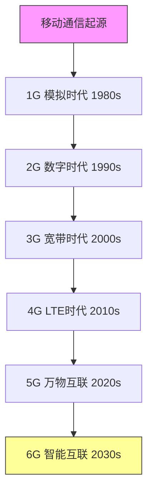
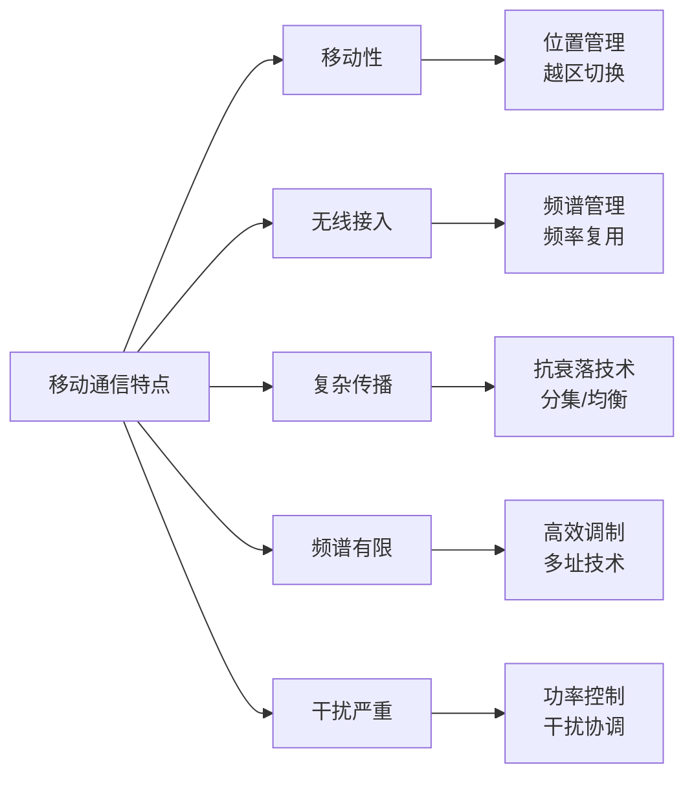
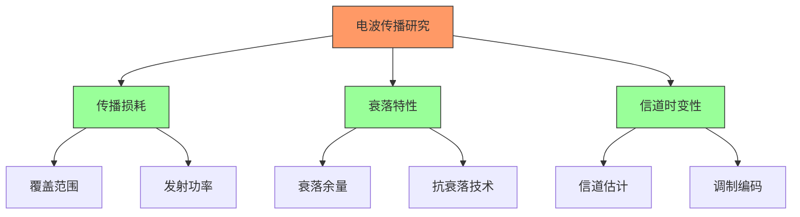
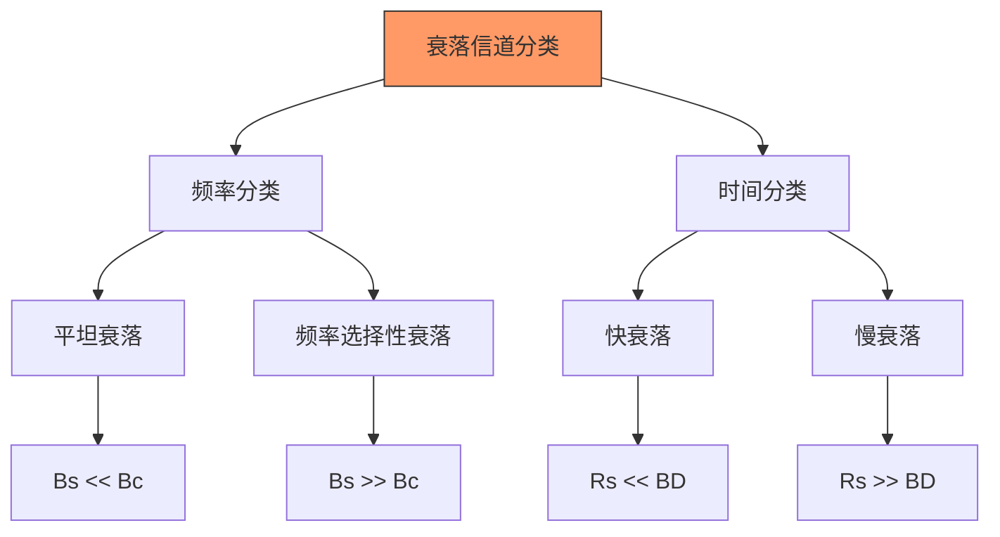

# 第1章 移动通信概述 - 知识点详细内容

---

## 知识点 1.1.1：移动通信的起源与发展

### 定义

移动通信是指通信双方至少有一方在运动中进行信息交换的通信方式。其发展经历了从模拟到数字、从窄带到宽带、从语音到多媒体的演进过程。从20世纪初的无线电报发展至今，移动通信已历经五代技术变革，成为现代社会最重要的信息基础设施之一。

移动通信的起源可以追溯到19世纪末马可尼首次实现无线电通信。20世纪20年代，警用移动通信系统出现；70年代，贝尔实验室提出蜂窝概念，奠定了现代移动通信的理论基础；80年代，1G商用开启移动通信新纪元。

### 重要性级别

A（必须掌握）

### 特性

- 移动性是移动通信区别于其他通信方式的根本特征
- 技术发展呈指数级加速趋势，大约每10年更新换代一次
- 从军事和专用领域逐步走向大众商用

### 知识关系图

### 二级结论

- 蜂窝概念的提出是移动通信发展史上的里程碑，通过频率复用解决了频谱资源有限的问题
- 从1G到5G，每代技术性能提升约1000倍，体现了摩尔定律在通信领域的延伸

---

## 知识点 1.1.2：1G到5G的发展阶段

### 定义

移动通信按技术代际分为五代，每代都有标志性的技术特征和业务能力：

- **1G（第一代）**：采用模拟蜂窝技术（如AMPS、TACS），仅支持语音通话，频谱效率低，安全性差，1980年代商用
- **2G（第二代）**：采用数字技术（如GSM、CDMA），支持语音和短信，频谱效率显著提升，引入SIM卡，1990年代商用
- **3G（第三代）**：支持移动互联网接入（如WCDMA、CDMA2000、TD-SCDMA），数据速率可达2Mbps，支持视频通话，2000年代商用
- **4G（第四代）**：采用LTE技术，支持高速宽带多媒体业务，数据速率可达100Mbps以上，全IP网络架构，2010年代商用
- **5G（第五代）**：支持eMBB（增强移动宽带）、mMTC（海量机器类通信）和uRLLC（超高可靠低时延通信）三大应用场景，2020年代商用

### 重要性级别

A（必须掌握）

### 运算方式/关键参数

| 代际 | 典型速率 | 多址方式 | 核心网 | 主要业务 |
|------|---------|---------|--------|---------|
| 1G | < 10kbps | FDMA | 电路交换 | 语音 |
| 2G | < 100kbps | TDMA/CDMA | 电路+分组 | 语音+短信 |
| 3G | ~2Mbps | CDMA | 分组交换 | 语音+数据+视频 |
| 4G | ~100Mbps | OFDMA | 全IP | 宽带多媒体 |
| 5G | ~10Gbps | OFDMA+NOMA | 云化核心网 | 万物互联 |

### 二级结论

- 每代技术的跃升都源于关键技术的突破：1G的蜂窝概念、2G的数字化、3G的CDMA、4G的OFDM+MIMO、5G的大规模MIMO+毫米波
- 5G首次同时定义了三种差异化场景，标志着移动通信从服务于人走向服务于全行业

---

## 知识点 1.1.3：移动通信发展史上的标志性事件

### 定义

移动通信发展史上有若干标志性事件，深刻影响了行业走向：

- **1978年**：贝尔实验室推出AMPS系统，标志着蜂窝移动通信的诞生
- **1983年**：摩托罗拉推出首款商用手机DynaTAC（"大哥大"），开启了个人移动通信时代
- **1991年**：GSM在欧洲商用，开启数字移动通信时代
- **2007年**：苹果发布iPhone，推动智能手机和移动互联网爆发式增长
- **2019-2020年**：5G正式商用，开启万物互联新时代

### 重要性级别

A（必须掌握）

### 特性

- 标志性事件往往是技术创新与市场需求交汇的产物
- 终端创新（如iPhone）对产业发展的推动作用不亚于网络技术进步
- 商用化时间节点反映技术成熟度与产业链准备情况

---

## 知识点 1.2.1：移动通信的基本特点

### 定义

移动通信利用无线电波在移动环境中进行信息传输，相比有线通信具有鲜明的特点。这些特点既是移动通信的优势所在，也带来了独特的技术挑战。

### 重要性级别

A（必须掌握）

### 特性

| 特点 | 描述 | 影响 |
|------|------|------|
| 移动性 | 用户可在任何时间、任何地点通信 | 需要位置管理和切换机制 |
| 无线接入 | 利用无线电波传输，无需线缆 | 频谱资源有限，干扰严重 |
| 复杂传播环境 | 多径、衰落、多普勒效应 | 信号质量不稳定，需要抗衰落技术 |
| 频率资源有限 | 可用频段有限且需统一管理 | 需频率复用和高效调制技术 |
| 干扰严重 | 同频、邻频、互调干扰 | 需功率控制和干扰协调 |
| 网络管理复杂 | 移动性导致信令开销大 | 需高效移动性管理 |

### 知识关系图

### 二级结论

- 移动通信的六大特点相互关联：移动性导致复杂的传播环境，无线接入导致频谱受限和干扰，这些共同决定了移动通信的技术路线
- 移动通信系统设计的核心任务就是在这些约束条件下实现可靠、高效的通信

---

## 知识点 1.2.2：无线电波传播环境复杂

### 定义

移动环境中，无线电波从发射端到接收端的传播路径复杂多变。由于发射机和接收机之间可能存在直射、反射、绕射和散射等多种传播机制，接收信号是多条路径信号的叠加，导致信号强度随时间和地点快速变化。

### 重要性级别

A（必须掌握）

### 特性

- **多径传播**：信号经不同路径到达接收端，时延和相位各不相同
- **阴影衰落**：大型障碍物（建筑物、山丘）遮挡引起的信号强度中值变化
- **多普勒频移**：移动终端运动导致接收信号频率发生偏移
- **信号时变性**：信道特性随时间快速变化，呈现随机性

### 二级结论

- 传播环境的复杂性是移动通信面临的最大技术挑战
- 为对抗复杂传播环境，移动通信采用了分集、均衡、信道编码、OFDM等一系列先进技术

---

## 知识点 1.2.3：频谱资源有限与干扰严重

### 定义

可用于移动通信的无线电频谱资源是有限的，通常指300MHz至6GHz范围内的频段最为宝贵（传播特性好、设备成本低）。随着用户数量激增和业务需求增长，频谱资源日益紧张。同时，同频干扰、邻频干扰、互调干扰等多种干扰制约着系统容量。

### 重要性级别

A（必须掌握）

### 特性

- 频谱是战略性稀缺资源，由各国政府和国际组织统一管理
- 频率复用是提高频谱利用率的核心手段
- 干扰是影响蜂窝系统容量的主要因素
- 不同业务频段之间存在干扰协调问题

### 二级结论

- 频谱资源的稀缺性推动了频谱利用技术的不断创新：从FDMA到TDMA、CDMA、OFDMA，频谱效率持续提升
- 频谱管理政策（如频谱拍卖、频谱共享）直接影响产业发展格局

---

## 知识点 1.2.4：移动性与网络管理复杂性

### 定义

用户随时随地移动是移动通信的核心特征，但这给网络管理带来了巨大挑战。网络需要实时跟踪用户位置，支持跨基站切换，保证通话不中断，处理漫游和越区切换等复杂场景。

### 重要性级别

A（必须掌握）

### 特性

- **位置管理**：通过位置登记和寻呼机制跟踪移动用户
- **越区切换**：用户移动过程中从当前基站切换到新基站的过程
- **漫游管理**：支持用户在不同网络甚至不同国家间连续通信
- **信令开销**：移动性管理消耗大量网络信令资源

### 二级结论

- 移动性管理是移动通信网络区别于固定网络的核心功能
- 切换成功率是衡量网络质量的关键指标，切换失败会导致掉话

---

## 知识点 1.3：移动通信频段概述

### 定义

移动通信使用无线电波中的VHF（30-300MHz）和UHF（300MHz-3GHz）频段进行通信，部分系统也使用微波频段（3-30GHz）和毫米波频段（30-300GHz）。工作频段的选择直接影响传播特性、覆盖范围、系统容量和设备成本。

### 重要性级别

A（必须掌握）

### 特性

- 频段越低，传播损耗越小，覆盖范围越大，但可用带宽越小
- 频段越高，可用带宽越大，容量越高，但传播损耗越大，覆盖越小
- 频段划分由国际电信联盟（ITU）统一协调，各国分配遵循国际规则
- Sub-6GHz（6GHz以下）是广覆盖的主力频段
- 毫米波频段（24GHz以上）是5G高速率的关键

### 公式

频率与波长关系：

$$\lambda = \frac{c}{f}$$

其中 $c = 3 \times 10^8$ m/s 为光速，$f$ 为频率，$\lambda$ 为波长。

### 二级结论

- 频率选择需要在覆盖范围和系统容量之间权衡
- 低频段用于广覆盖（如700MHz用于农村覆盖），高频段用于热点容量（如3.5GHz用于城市容量）

---

## 知识点 1.3.1：我国移动通信频段划分

### 定义

我国移动通信频段划分遵循ITU规定，由国家无线电管理机构统一规划。主要覆盖700MHz至3.5GHz范围，不同运营商分配不同频段，需兼顾覆盖和容量的平衡。

### 重要性级别

A（必须掌握）

### 特性

- 700MHz-900MHz：低频广覆盖，穿透能力强
- 1.8GHz-2.1GHz：中频均衡覆盖
- 2.6GHz-3.5GHz：中高频容量覆盖
- 4.9GHz-6GHz：高频热点容量
- 频谱资源通过牌照方式分配给运营商

---

## 知识点 1.3.2：第三代移动通信频段

### 定义

3G系统主要工作在1.8GHz至2.1GHz频段，包括WCDMA、CDMA2000和TD-SCDMA三种标准。我国主要采用WCDMA（FDD模式，工作于1.9-2.1GHz）和TD-SCDMA（TDD模式，工作于1.88-1.92GHz/2.01-2.025GHz）。

### 重要性级别

B（重要）

### 特性

- 3G频段主要位于2GHz附近
- TDD和FDD频段划分方式不同
- 频段划分需考虑国际漫游兼容性

---

## 知识点 1.3.3：4G LTE频率划分

### 定义

4G LTE工作在700MHz至2.6GHz多个频段，包括FDD-LTE和TD-LTE两种模式。低频段用于广覆盖，高频段用于大容量，支持载波聚合技术整合多个频段。

### 重要性级别

A（必须掌握）

### 特性

- LTE FDD使用成对频谱（上行/下行不同频段）
- LTE TDD使用非成对频谱（上下行时分复用）
- 载波聚合技术可整合最多5个分量载波，提升峰值速率

---

## 知识点 1.3.4：5G频率划分

### 定义

5G使用FR1（Sub-6GHz，450MHz至6GHz）和FR2（毫米波，24.25GHz至52.6GHz）两个频段范围。低频段提供广覆盖，毫米波提供超大带宽和超高容量。

### 重要性级别

A（必须掌握）

### 特性

- FR1（Sub-6GHz）：包括n1至n79等频段，覆盖广，是5G主力频段
- FR2（毫米波）：包括n257至n261等频段，带宽大（单载波400-800MHz），覆盖小
- 我国5G主要部署在2.6GHz、3.5GHz和4.9GHz
- 毫米波频段是未来超高速率的关键

### 二级结论

- 5G采用高中低频协同组网策略：低频打底覆盖、中频基础容量、高频热点容量
- 毫米波面临传播损耗大、穿透能力差的挑战，适合热点区域和室内覆盖

---

## 知识点 1.4.1：单工通信

### 定义

单工通信是指信息只能在一个方向上传输的通信方式。发送端只能发送不能接收，接收端只能接收不能发送。典型应用包括广播电台、电视台、寻呼系统等。

### 重要性级别

A（必须掌握）

### 特性

- 设备简单、成本低
- 信道利用率低
- 适用于广播式业务（一对多）
- 不需要双工器，终端设计简单

---

## 知识点 1.4.2：双工通信

### 定义

双工通信是指通信双方可以同时收发信息的通信方式，是现代移动通信系统的主要工作方式。分为频分双工（FDD）和时分双工（TDD）两种：

- **FDD（频分双工）**：上下行使用不同频率，通过双工器实现同时收发
- **TDD（时分双工）**：上下行使用相同频率，通过不同时隙区分收发

### 重要性级别

A（必须掌握）

### 特性

| 特性 | FDD | TDD |
|------|-----|-----|
| 频谱需求 | 需要成对频谱 | 不需要成对频谱 |
| 上下行对称性 | 固定对称 | 灵活可调 |
| 覆盖范围 | 较大 | 较小（受保护时隙限制） |
| 时延 | 较小 | 较大（需等待上行时隙） |
| 互干扰 | 存在邻频干扰 | 存在交叉时隙干扰 |
| 应用场景 | 广域覆盖 | 热点区域/非对称业务 |

### 二级结论

- FDD适合对称业务（如语音），覆盖性能好
- TDD适合非对称业务（如下行为主的互联网），频谱配置灵活
- 5G NR统一支持FDD和TDD，其中TDD是主流模式

---

## 知识点 1.4.3：半双工通信

### 定义

半双工通信是指通信双方都可以收发信，但不能同时进行，需要通过按键（PTT，Push-To-Talk）切换收发状态。典型应用如对讲机。

### 重要性级别

B（重要）

### 特性

- 设备简单，不需要双工器
- 信道利用率介于单工和双工之间
- 使用时需按键切换，操作不够方便
- 适用于专业调度通信场景（如物业、安保）

---

## 知识点 1.5.1：按覆盖范围分类

### 定义

按覆盖范围，移动通信网络可分为：

- **WPAN（无线个人域网）**：覆盖范围约10米，如蓝牙、Zigbee
- **WLAN（无线局域网）**：覆盖范围约100米，如Wi-Fi
- **WMAN（无线城域网）**：覆盖范围数公里，如WiMAX
- **WWAN（无线广域网）**：覆盖范围数十至数百公里，如蜂窝移动网络

### 重要性级别

A（必须掌握）

### 特性

- 覆盖范围越大，信号传播环境越复杂
- 不同网络可以互补形成层次化覆盖
- 蜂窝网络通过小区分裂实现覆盖扩展

---

## 知识点 1.5.2：按多址方式分类

### 定义

按多址接入方式可分为：

- **FDMA（频分多址）**：将频带划分为多个信道分配给不同用户，1G采用
- **TDMA（时分多址）**：将时间划分为多个时隙分配给不同用户，2G采用
- **CDMA（码分多址）**：所有用户同时使用全部频带，通过正交码区分，3G采用
- **OFDMA（正交频分多址）**：将信道划分为多个正交子载波动态分配给用户，4G/5G采用

### 重要性级别

A（必须掌握）

### 特性

- 多址方式决定了系统容量上限和频谱效率
- 从FDMA到OFDMA，频谱利用率持续提高
- 多址方式与代际技术演进密切相关

---

## 知识点 1.5.3：按信号形式分类

### 定义

按信号形式可分为模拟通信和数字通信：

- **模拟通信**：传输连续变化的模拟信号，抗干扰能力弱，保密性差，1G采用
- **数字通信**：传输离散的数字信号，抗干扰能力强，支持加密和差错控制，2G及以后采用

### 重要性级别

A（必须掌握）

### 特性

- 数字通信是移动通信的主流方向
- 数字化带来频谱效率提升和业务多样化
- 数字信号便于处理、存储和加密

---

## 知识点 1.5.4：按业务类型分类

### 定义

按业务类型可分为：

- **语音业务**：传统电话通话，是1G/2G的核心业务
- **数据业务**：互联网接入、文件传输等，3G开始支持
- **多媒体业务**：视频通话、流媒体等，4G开始支持
- **物联网业务**：机器间通信、传感器数据采集等，5G支持

### 重要性级别

A（必须掌握）

### 特性

- 业务多样化是技术演进的主要驱动力
- 5G首次同时支持eMBB、mMTC、uRLLC三种差异化业务场景

---

## 知识点 1.5.5：主要移动通信系统简介

### 定义

主要移动通信系统包括：

- **GSM**：全球最广泛的2G系统，采用TDMA技术
- **WCDMA**：最主流的3G系统，采用CDMA技术
- **LTE**：4G主流标准，采用OFDMA+MIMO技术
- **5G NR**：新一代移动通信标准，支持三大应用场景
- **集群通信**：专网通信系统，用于公安、消防等
- **卫星通信**：覆盖全球的通信方式，不受地面基础设施限制

### 重要性级别

A（必须掌握）

### 特性

- 各系统在不同场景下发挥各自优势
- 从2G到5G，系统架构从电路交换演进为全IP
- 系统演进注重后向兼容性

---

## 知识点 1.6.1：从1G到5G的演进趋势

### 定义

移动通信呈现清晰的演进趋势：从模拟向数字、从窄带向宽带、从电路交换向分组交换、从单一语音向多媒体融合、从人与人通信向万物互联演进。每十年左右更新换代一次，呈指数级发展趋势。

### 重要性级别

A（必须掌握）

### 特性

- 技术迭代周期约10年
- 每代性能提升约1000倍
- 从单一业务走向多场景融合

---

## 知识点 1.6.2：5G及未来6G的发展方向

### 定义

5G向增强移动宽带eMBB、海量机器类通信mMTC和超高可靠低时延通信uRLLC三大方向发展。6G预计将在2030年左右商用，支持太比特速率、空天地海一体化、全息通信和语义通信。

### 重要性级别

B（重要）

### 特性

- 6G将实现空天地海全域覆盖
- 太赫兹通信和智能超表面是关键技术
- 语义通信将改变传统比特传输范式

---

## 知识点 1.6.3：移动通信与互联网融合

### 定义

移动通信与互联网深度融合形成移动互联网，催生了移动支付、移动社交、移动电商、共享经济等新业态。OTT业务（Over-The-Top）成为主流，改变了传统通信产业格局。

### 重要性级别

A（必须掌握）

### 特性

- 移动通信成为互联网的主要接入方式
- 移动互联网重塑了社会经济生活
- 流量经营模式替代了传统语音收入模式

---

# 第2章 移动通信电波传播与传播预测模型 - 知识点详细内容

---

## 知识点 2.1.1：电波传播研究的重要性

### 定义

电波传播特性是移动通信系统设计的基础，直接影响覆盖范围、信号质量和系统容量。理解传播特性对于网络规划、优化和性能评估至关重要。传播特性决定了无线通信系统的基本性能边界，是一切无线通信理论的基础。

### 重要性级别

A（必须掌握）

### 特性

- 传播特性决定了发射功率、天线高度、频率选择等关键设计参数
- 传播模型是网络规划和仿真的基础输入
- 传播损耗直接影响覆盖范围和系统容量
- 衰落特性决定了所需的衰落余量和抗衰落技术

### 知识关系图

### 二级结论

- 电波传播研究的核心是回答三个问题：信号衰减多少（传播损耗）、信号如何波动（衰落特性）、信道如何时变（时变特性）
- 这三个问题的答案直接指导着通信系统的参数设计和技术选择

---

## 知识点 2.1.2：电波传播的基本问题

### 定义

电波传播研究主要解决三个基本问题：

1. **传播损耗有多大**：信号从发射端到接收端的总衰减程度，决定了覆盖范围
2. **衰落特性如何**：信号强度随时间和空间的波动特性，决定了通信可靠性
3. **信道时变特性如何**：信道参数随时间变化的快慢，决定了信号处理方式

### 重要性级别

A（必须掌握）

### 特性

- 传播损耗决定覆盖范围
- 衰落特性决定通信可靠性
- 信道时变性决定信号处理方案

---

## 知识点 2.1.3：电波传播的研究方法

### 定义

电波传播研究方法包括三种：

1. **理论分析**：基于电磁场理论建立数学模型，如自由空间模型、两径模型
2. **现场测量**：通过实际路测获取数据，验证和修正理论模型
3. **计算机仿真**：结合理论模型和实测数据进行预测，如射线追踪

### 重要性级别

A（必须掌握）

### 特性

- 三种方法相互验证、互为补充
- 理论分析提供物理解释，测量提供实测数据，仿真提供灵活预测

---

## 知识点 2.2.1：自由空间传播模型的定义

### 定义

自由空间是指充满均匀、无损耗、各向同性理想介质的无限大空间。在自由空间中，电波沿直线传播不受任何障碍物影响，是电波传播的最理想参考环境。自由空间传播损耗是其他传播模型的基础，提供了传播损耗的下限参考。

### 重要性级别

A（必须掌握）

### 特性

- 自由空间是最基础的传播模型
- 实际传播损耗总是大于自由空间损耗
- 自由空间模型是链路预算的基础

---

## 知识点 2.2.2：自由空间传播损耗公式

### 定义

自由空间传播损耗（Free Space Path Loss, FSPL）描述了在理想环境中电波从发射端到接收端的功率衰减。

### 公式

自由空间传播损耗公式为：

$$L_{fs} = \left(\frac{4\pi d}{\lambda}\right)^2 = \left(\frac{4\pi d f}{c}\right)^2$$

用分贝（dB）表示为：

$$L_{fs}(\text{dB}) = 32.45 + 20\log_{10} f(\text{MHz}) + 20\log_{10} d(\text{km})$$

其中：
- $d$：收发天线距离（km）
- $f$：载波频率（MHz）
- $\lambda$：波长（m）
- $c = 3 \times 10^8$ m/s：光速

### 重要性级别

A（必须掌握）

### 特性

- 传播损耗与距离平方成正比（$d^2$）
- 传播损耗与频率平方成正比（$f^2$）
- 距离增加10倍，损耗增加20dB
- 频率增加10倍，损耗增加20dB

### 定理/公式详细说明

自由空间传播损耗公式的推导基于球面波扩散原理。发射天线辐射的电磁波以球面波形式向外传播，随着距离增大，能量均匀分布在更大的球面上，功率密度与距离平方成反比。

### 二级结论

- 自由空间损耗是所有传播模型的基准，实际环境损耗总是更大
- 高频段信号传播损耗更大，覆盖范围更小，这是5G毫米波覆盖受限的根本原因

---

## 知识点 2.2.3：自由空间接收功率公式

### 定义

接收功率等于发射功率乘以天线增益再除以传播损耗，是链路预算的基础公式。

### 公式

$$P_r = \frac{P_t G_t G_r}{L_{fs}} = P_t G_t G_r \left(\frac{\lambda}{4\pi d}\right)^2$$

用分贝表示：

$$P_r(\text{dBm}) = P_t(\text{dBm}) + G_t(\text{dBi}) + G_r(\text{dBi}) - L_{fs}(\text{dB})$$

其中：
- $P_t$：发射功率
- $G_t, G_r$：发射和接收天线增益
- $L_{fs}$：自由空间传播损耗

### 重要性级别

A（必须掌握）

### 特性

- 接收功率与距离平方成反比
- 接收功率与波长平方成正比
- 是链路预算的基础公式

---

## 知识点 2.2.4：有效全向辐射功率EIRP

### 定义

EIRP（Effective Isotropic Radiated Power）定义为发射机输出功率与发射天线增益的乘积，表示发射机在特定方向上的等效辐射功率。

### 公式

$$EIRP = P_t \cdot G_t$$

用分贝表示：

$$EIRP(\text{dBm}) = P_t(\text{dBm}) + G_t(\text{dBi})$$

### 重要性级别

B（重要）

### 特性

- EIRP是链路预算中的重要参数
- 反映了发射系统的有效辐射能力
- 受法规限制，各频段有最大EIRP限制

---

## 知识点 2.3：电波传播三种基本机制概述

### 定义

移动通信中电波传播主要通过三种机制：反射、绕射和散射。这三种机制决定了信号的传播路径和接收信号的特性，是理解和分析多径传播的基础。

### 重要性级别

A（必须掌握）

### 特性

| 机制 | 障碍物尺寸 | 传播特性 |
|------|-----------|---------|
| 反射 | 远大于波长 | 方向性强，形成多径 |
| 绕射 | 与波长相当 | 弯曲传播，越障能力 |
| 散射 | 与波长相当或更小 | 多方向扩散，能量分散 |

---

## 知识点 2.3.1：反射与多径信号

### 定义

反射是指电波遇到比波长大得多的障碍物（如地面、建筑物墙面）时发生的方向改变。地面和建筑物表面都会发生反射，反射导致多径传播，即信号通过多条路径到达接收端。多条路径信号相互叠加形成干涉。

### 重要性级别

A（必须掌握）

### 特性

- 反射系数取决于入射角、极化方式和材料特性
- 地面反射是移动通信中最重要的反射来源
- 多径信号相互叠加导致信号增强或抵消

---

## 知识点 2.3.1.1：反射系数的计算

### 定义

反射系数取决于入射角、极化方式（垂直或水平）和介质电磁特性。

### 公式

对于地面反射，反射系数为：

$$\Gamma = \frac{\sin\theta - \sqrt{\varepsilon_r - \cos^2\theta}}{\sin\theta + \sqrt{\varepsilon_r - \cos^2\theta}}$$

其中：
- $\theta$ 为入射角
- $\varepsilon_r$ 为相对介电常数

### 重要性级别

A（必须掌握）

### 特性

- 反射系数可以是复数，表示幅度和相位变化
- 水平极化和垂直极化反射系数不同
- 入射角接近0度时反射系数接近-1（全反射反相）

---

## 知识点 2.3.1.2：两径传播模型

### 定义

两径模型考虑直射路径和地面反射路径，接收场强为两路信号的叠加。这是最简单的多径传播模型，能解释移动通信中许多重要现象。

### 公式

两径模型传播损耗：

$$P_r = P_t G_t G_r \left(\frac{\lambda}{4\pi d}\right)^2 \left|1 + \Gamma e^{-j\Delta\phi}\right|^2$$

当距离较大时（$d \gg h_t h_r$），近似为：

$$P_r \approx P_t G_t G_r \frac{(h_t h_r)^2}{d^4}$$

传播损耗近似与距离的四次方成正比。

其中：
- $h_t$：发射天线高度
- $h_r$：接收天线高度
- $d$：收发天线水平距离

### 重要性级别

A（必须掌握）

### 特性

- 当距离较大时，传播损耗与距离的四次方成正比（$d^4$），而非自由空间的$d^2$
- 接收功率与天线高度平方成正比，提高天线高度可显著改善覆盖
- 两径模型解释了为什么移动环境中传播损耗指数通常大于2

### 二级结论

- 两径模型表明，在大距离条件下，传播损耗指数n约为4，远大于自由空间的n=2
- 提高基站天线高度是改善覆盖的有效手段，因为接收功率与天线高度平方成正比
- 地面反射会导致信号在中等距离处出现深衰落（信号相消干涉）

---

## 知识点 2.3.2：绕射

### 定义

绕射（衍射）是指电波遇到障碍物边缘时发生的弯曲现象，使电波能够绕过障碍物到达视线（LOS）以外的区域。菲涅尔区理论是分析绕射效应的重要工具。绕射使得非视距通信成为可能。

### 重要性级别

A（必须掌握）

### 特性

- 绕射损耗取决于障碍物相对于菲涅尔区的位置和尺寸
- 绕射使非视距通信成为可能
- 绕射损耗通常较大，但仍是覆盖盲区的重要手段

---

## 知识点 2.3.2.1：菲涅尔区理论

### 定义

菲涅尔区是以发射点和接收点为焦点的椭球区域，用于评估视距传播条件和绕射损耗。

### 公式

第一菲涅尔区半径：

$$F_1 = \sqrt{\frac{\lambda d_1 d_2}{d_1 + d_2}}$$

其中 $d_1, d_2$ 分别为障碍物到发射端和接收端的距离。

### 重要性级别

A（必须掌握）

### 特性

- 当障碍物阻挡不超过第一菲涅尔区面积的40%时，绕射损耗较小
- 第一菲涅尔区无遮挡是设计视距链路的基本要求
- 菲涅尔区半径与波长和距离有关

### 二级结论

- 第一菲涅尔区无遮挡是微波链路设计的工程准则
- 频率越高（波长越短），菲涅尔区半径越小，绕射能力越弱
- 这就是为什么低频段信号绕射能力更强、覆盖更好的原因

---

## 知识点 2.3.3：散射

### 定义

散射是指电波遇到粗糙表面或小尺寸物体（如树叶、路灯、交通标志等）时向各个方向随机反射的现象。散射信号在接收端形成多个弱反射分量，增加了多径分量数量。

### 重要性级别

B（重要）

### 特性

- 散射使能量向各个方向扩散
- 散射信号通常功率较弱
- 散射增加了多径分量的丰富度
- 散射对MIMO信道有利（提供去相关路径）

---

## 知识点 2.4.1：阴影衰落的定义

### 定义

阴影衰落（Shadow Fading）是指由于地形起伏、建筑物和树林等大型障碍物阻挡而引起的信号强度中值变化，也称为慢衰落。其统计特性服从对数正态分布。变化速率较慢（秒级），是引起信号大范围波动的主要原因。

### 重要性级别

A（必须掌握）

### 特性

- 变化速率慢（秒级或更长）
- 服从对数正态分布
- 由大型障碍物遮挡引起
- 与位置相关，与频率关系不大

---

## 知识点 2.4.2：对数正态分布模型

### 定义

阴影衰落的概率密度函数服从对数正态分布。

### 公式

阴影衰落的概率密度函数：

$$p(L) = \frac{1}{\sqrt{2\pi}\sigma_L} \exp\left[-\frac{(L-\mu_L)^2}{2\sigma_L^2}\right]$$

其中：
- $L$ 为路径损耗的对数形式（dB）
- $\mu_L$ 为均值（dB）
- $\sigma_L$ 为标准差（dB），典型值为6至10dB

### 重要性级别

A（必须掌握）

### 特性

- 对数正态分布是阴影衰落的经典模型
- 标准差反映环境的不规则程度
- 城市环境通常8至10dB，郊区4至6dB

---

## 知识点 2.4.3：阴影衰落的标准差

### 定义

阴影衰落标准差 $\sigma$ 反映环境的不规则程度，典型值因环境而异。

### 重要性级别

B（重要）

### 特性

| 环境类型 | 标准差范围 |
|---------|-----------|
| 密集城区 | 8-10 dB |
| 一般城区 | 6-8 dB |
| 郊区 | 4-6 dB |
| 农村 | 3-5 dB |

- 标准差越大表示信号波动越大
- 覆盖规划时需考虑衰落余量
- 标准差越大，所需衰落余量越大

---

## 知识点 2.4.4：阴影衰落与距离的关系

### 定义

阴影衰落引起的路径损耗与距离的关系是对数距离路径损耗模型，结合了确定性的大尺度路径损耗和随机性的阴影衰落。

### 公式

$$PL(d)(\text{dB}) = PL(d_0) + 10n\log_{10}\left(\frac{d}{d_0}\right) + X_\sigma$$

其中：
- $PL(d_0)$：参考距离 $d_0$ 处的路径损耗
- $n$ 为路径损耗指数（自由空间n=2，典型值2-4）
- $X_\sigma$ 为阴影衰落分量（零均值高斯随机变量，标准差为$\sigma$）

### 重要性级别

A（必须掌握）

### 特性

- 路径损耗指数n在城市环境典型值为2.7至4.0
- 阴影衰落分量 $X_\sigma$ 服从零均值高斯分布
- 该模型是结合大尺度路径损耗和阴影衰落的综合模型

### 二级结论

- 路径损耗指数n>2时，实际传播损耗比自由空间更大，这是因为存在地面反射和其他障碍物损耗
- 阴影衰落的标准差越大，为保证相同覆盖率所需的衰落余量越大
- 典型蜂窝系统中，为保证90%的边缘覆盖概率，需预留约8-12dB的衰落余量

---

## 知识点 2.5.1：多径衰落的基本特性

### 定义

多径衰落是指信号通过多条不同路径传播到达接收端，由于各路径长度不同导致信号相位不同，相互叠加后引起接收信号幅度和相位的快速波动，也称为快衰落。多径衰落引起信号在短距离（约半个波长）内的剧烈波动，变化速率快（毫秒级）。

### 重要性级别

A（必须掌握）

### 特性

- 变化速率快（毫秒级）
- 在空间上约半个波长距离内信号可能剧烈变化
- 由多条路径信号的相长或相消干涉引起
- 是移动通信系统设计中需要克服的主要技术障碍

---

## 知识点 2.5.2：多普勒频移

### 定义

多普勒频移是指由于移动终端运动导致的接收信号频率偏移。当移动台朝向信号源运动时频率升高，远离时频率降低。

### 公式

多普勒频移：

$$f_d = f_c \cdot \frac{v\cos\theta}{c} = \frac{v\cos\theta}{\lambda}$$

最大多普勒频移：

$$f_{d,max} = \frac{v}{\lambda}$$

其中：
- $v$ 为移动速度
- $\theta$ 为入射波与运动方向的夹角
- $f_c$ 为载波频率

### 重要性级别

A（必须掌握）

### 特性

- 多普勒频移正比于速度和频率
- 多普勒频移反比于波长
- 最大多普勒频移发生在运动方向与信号传播方向一致时
- 多普勒频移导致信号频谱展宽

---

## 知识点 2.5.2.1：多普勒扩展

### 定义

多普勒扩展是指由于多径信号从不同方向到达，各路径的多普勒频移不同，导致接收信号频谱展宽。

### 公式

多普勒扩展：

$$B_D = f_{d,max} = \frac{v}{\lambda}$$

### 重要性级别

A（必须掌握）

### 特性

- 多普勒扩展与相干时间成反比
- 是衡量信道时变速率的重要参数
- 多普勒扩展越大，信道变化越快，相干时间越短

---

## 知识点 2.5.2.2：相干时间

### 定义

相干时间 $T_c$ 表示信道保持基本不变的时间间隔，与多普勒扩展成反比。

### 公式

$$T_c \approx \frac{1}{2f_{d,max}} = \frac{\lambda}{2v}$$

### 重要性级别

A（必须掌握）

### 特性

- 相干时间越短表示信道变化越快
- 在相干时间内信道可视为准静态
- 相干时间是设计信道估计和均衡算法的关键参数
- 发射信号周期应远小于相干时间以保证慢衰落

---

## 知识点 2.5.3：多径信道的信道模型

### 定义

多径信道可用时变冲激响应描述，是多径信道分析的基础模型。

### 公式

$$h(\tau, t) = \sum_{i=0}^{N-1} a_i(t)e^{j\phi_i(t)}\delta(\tau - \tau_i(t))$$

其中：
- $a_i(t)$：第i条路径的幅度
- $\tau_i(t)$：第i条路径的时延
- $\phi_i(t)$：第i条路径的相位
- $N$：多径分量数量

### 重要性级别

A（必须掌握）

### 特性

- N条路径的叠加形成了复杂的多径信道特性
- 信道模型是分析和仿真多径信道的基础
- 每条路径由幅度、时延和相位三个参数描述

---

## 知识点 2.5.3.1：多径信道的频域响应

### 定义

信道的频率响应是冲激响应的傅里叶变换。

### 公式

$$H(f, t) = \int h(\tau, t)e^{-j2\pi f\tau}d\tau$$

### 重要性级别

B（重要）

### 特性

- 信道在不同频率上的响应不同
- 形成了频率选择性或平坦衰落特性
- 频域分析与时域分析互为补充

---

## 知识点 2.5.4.1：时延扩展

### 定义

时延扩展 $\tau_{rms}$ 是各路径时延的均方根值，反映多径信号在时域上的弥散程度。

### 公式

$$\tau_{rms} = \sqrt{\overline{\tau^2} - (\overline{\tau})^2}$$

其中：

$$\overline{\tau^n} = \frac{\sum_i P_i \tau_i^n}{\sum_i P_i}$$

$P_i$ 为第i条路径的功率。

### 重要性级别

A（必须掌握）

### 特性

- 时延扩展越大，码间干扰越严重
- 相干带宽越小
- 时延扩展与相干带宽成反比

---

## 知识点 2.5.4.2：相干带宽

### 定义

相干带宽 $B_c$ 是信道频率响应保持相关的频率范围，与均方根时延扩展成反比。

### 公式

$$B_c \approx \frac{1}{2\tau_{rms}}$$

### 重要性级别

A（必须掌握）

### 特性

- 相干带宽内信号经历平坦衰落
- 超出相干带宽则经历频率选择性衰落
- 相干带宽与信号带宽的相对关系决定了衰落类型

### 二级结论

- 若信号带宽 $B_s \ll B_c$，信道为平坦衰落，信号波形不失真
- 若信号带宽 $B_s \gg B_c$，信道为频率选择性衰落，产生码间干扰
- OFDM技术将宽带信道划分为多个窄带子信道，使每个子信道经历平坦衰落，有效对抗频率选择性衰落

---

## 知识点 2.5.4.3：多径信道统计参数总结

### 定义

多径信道用四个关键参数描述，分别描述信道的色散特性和时变特性。

### 重要性级别

A（必须掌握）

### 公式

| 参数 | 名称 | 计算公式 | 物理意义 |
|------|------|---------|---------|
| $\tau_{rms}$ | 均方根时延扩展 | $\sqrt{\overline{\tau^2}-(\overline{\tau})^2}$ | 时域弥散程度 |
| $B_c$ | 相干带宽 | $\approx 1/(2\tau_{rms})$ | 频域相关范围 |
| $B_D$ | 多普勒扩展 | $v/\lambda$ | 频域弥散程度 |
| $T_c$ | 相干时间 | $\approx 1/(2B_D)$ | 时域相关时间 |

关系：

- $\tau_{rms} \cdot B_c \approx \text{常数}$ （时频对偶）
- $B_D \cdot T_c \approx \text{常数}$ （频时对偶）

### 二级结论

- 时延扩展和相干带宽描述信道的色散特性（多径效应）
- 多普勒扩展和相干时间描述信道的时变特性（移动性）
- 这两对参数共同决定了衰落信道的类型，指导调制方式、编码方案和保护技术的选择

---

## 知识点 2.5.5：多径信道的统计分析

### 定义

接收信号的包络服从瑞利分布或莱斯分布，取决于是否存在直射路径分量。纯多径无直射时服从瑞利分布，有直射分量时服从莱斯分布。包络统计特性决定了调制和编码方案的设计。

### 重要性级别

A（必须掌握）

### 特性

- 包络统计是抗衰落技术和差错性能分析的基础
- 瑞利衰落是最严重的衰落情况
- 莱斯因子K越大，衰落越轻微

---

## 知识点 2.5.5.1：瑞利分布

### 定义

当不存在直射路径时，接收信号包络r服从瑞利分布。

### 公式

概率密度函数：

$$p(r) = \frac{r}{\sigma^2}\exp\left(-\frac{r^2}{2\sigma^2}\right), \quad r \geq 0$$

其中 $\sigma^2$ 为多径信号的平均功率。

包络均值：

$$E[r] = \sigma\sqrt{\frac{\pi}{2}}$$

方差：

$$\text{Var}[r] = \left(2 - \frac{\pi}{2}\right)\sigma^2$$

### 重要性级别

A（必须掌握）

### 特性

- 瑞利分布是无直射路径时的标准模型
- 典型场景为密集城区
- 瑞利衰落深度可达20至30dB

---

## 知识点 2.5.5.2：莱斯分布

### 定义

当存在直射路径分量时，接收信号包络服从莱斯分布。

### 公式

概率密度函数：

$$p(r) = \frac{r}{\sigma^2}\exp\left(-\frac{r^2 + A^2}{2\sigma^2}\right)I_0\left(\frac{rA}{\sigma^2}\right), \quad r \geq 0$$

其中：
- $A$ 为直射分量幅度
- $I_0(\cdot)$ 为第一类零阶修正贝塞尔函数

莱斯因子：

$$K = \frac{A^2}{2\sigma^2}$$

### 重要性级别

A（必须掌握）

### 特性

- K值越大越接近高斯分布（衰落越轻）
- K值越小越接近瑞利分布
- K=0退化为瑞利分布
- $K \to \infty$ 退化为高斯分布（无衰落）

---

## 知识点 2.5.6：多径衰落信道的分类

### 定义

根据信号带宽与信道相干带宽的关系，衰落信道分为平坦衰落和频率选择性衰落；根据多普勒扩展与符号速率的关系，分为快衰落和慢衰落。

### 重要性级别

A（必须掌握）

### 知识关系图

### 特性

- 分类取决于信号参数与信道参数的相对关系
- 同一信道对不同速率信号可能呈现不同衰落类型

---

## 知识点 2.5.6.1：平坦衰落

### 定义

当信号带宽远小于信道相干带宽时（$B_s \ll B_c$），信号所有频率分量经历相同增益的衰落，称为平坦衰落或频率非选择性衰落。

### 公式

信道冲激响应近似为：

$$h(t) = a(t)e^{j\phi(t)}$$

仅有一个可分辨路径。

### 重要性级别

A（必须掌握）

### 特性

- 仅有一个可分辨路径
- 信号波形不失真，仅幅度和相位随机变化
- 平坦衰落时主要采用分集技术对抗

---

## 知识点 2.5.6.2：频率选择性衰落

### 定义

当信号带宽远大于信道相干带宽时（$B_s \gg B_c$），信道对不同频率成分增益不同，信号波形发生失真，称为频率选择性衰落。

### 重要性级别

A（必须掌握）

### 特性

- 存在多个可分辨路径
- 产生码间干扰ISI
- 需要均衡器或OFDM等技术消除ISI
- OFDM将宽带信道划分为多个窄带子信道使每个子信道经历平坦衰落

---

## 知识点 2.5.6.3：快衰落信道

### 定义

当符号周期远大于信道相干时间时（$T_s \gg T_c$），信道在一个符号周期内变化显著，称为快衰落信道。

### 重要性级别

A（必须掌握）

### 特性

- 信道冲激响应在符号周期内发生变化
- 导致信号严重失真
- 快衰落信道较为罕见
- 在低速数据和高速移动组合下可能出现

---

## 知识点 2.5.6.4：慢衰落信道

### 定义

当符号周期远小于信道相干时间时（$T_s \ll T_c$），信道在一个符号周期内近似不变，称为慢衰落信道。这是大多数实际移动通信场景的情况。

### 重要性级别

A（必须掌握）

### 特性

- 信道可视为准静态
- 便于进行信道估计和均衡
- 绝大多数实际系统工作于慢衰落信道

### 二级结论

- 四种衰落类型的组合：平坦慢衰落（最常见）、平坦快衰落、频率选择性慢衰落（宽带系统常见）、频率选择性快衰落（最恶劣）
- OFDM技术将频率选择性衰落信道转化为多个平坦衰落的子信道，大幅简化接收机设计

---

## 知识点 2.5.7：衰落特性的特征量

### 定义

描述衰落特性的主要特征量包括电平通过率（LCR）和平均衰落持续时间（AFD），用于评估中断概率和设计分集接收。

### 重要性级别

B（重要）

### 特性

- LCR和AFD描述了衰落过程的动态特性
- 用于评估中断概率和设计分集接收
- 特征量帮助工程师定量评估衰落对通信质量的影响

---

## 知识点 2.5.7.1：电平通过率LCR

### 定义

电平通过率表示信号包络以正斜率通过某阈值R的平均速率。

### 公式

$$N_R = \sqrt{2\pi} f_{d,max} \rho e^{-\rho^2}$$

其中：
- $\rho = R/R_{rms}$ 为归一化电平
- $f_{d,max}$ 为最大多普勒频移

### 重要性级别

B（重要）

### 特性

- LCR与最大多普勒频移成正比
- 最大多普勒频移越大LCR越高
- LCR用于计算系统中断概率

---

## 知识点 2.5.7.2：平均衰落持续时间AFD

### 定义

平均衰落持续时间表示信号包络低于阈值R的平均持续时间。

### 公式

$$\tau_R = \frac{P(r \leq R)}{N_R} = \frac{e^{\rho^2} - 1}{\sqrt{2\pi} f_{d,max} \rho}$$

其中 $P(r \leq R)$ 为累积分布函数。

### 重要性级别

B（重要）

### 特性

- AFD与最大多普勒频移成反比
- AFD用于设计交织深度和编码长度
- AFD决定了交织和编码需要克服的衰落持续时间

---

## 知识点 2.5.8：衰落信道的建模与仿真简介

### 定义

衰落信道建模旨在用数学模型或计算机仿真复现真实信道的传播特性，在系统设计、算法验证和性能评估中发挥重要作用。

### 重要性级别

B（重要）

### 特性

- 常用方法包括Clarke参考模型、Jakes仿真模型和基于几何的随机信道模型GSCM
- 好的信道模型应能准确复现信道的统计特性和物理特性
- 3GPP定义了标准化的信道模型用于系统评估

---

## 知识点 2.6：MIMO技术概述

### 定义

MIMO（Multi-Input Multi-Output，多输入多输出）技术利用多个发射和接收天线提高通信系统容量和可靠性。MIMO信道描述了多天线之间多径传播的特性，是4G和5G系统的关键技术。

### 重要性级别

A（必须掌握）

### 特性

- MIMO是4G LTE和5G NR的核心技术之一
- 利用空间维度提升频谱效率
- 相比单天线系统可显著提升容量

---

## 知识点 2.6.1：MIMO信道分析模型

### 定义

MIMO信道可用矩阵 $\mathbf{H}$ 描述，基于随机矩阵理论进行分析。

### 公式

MIMO信道矩阵：

$$\mathbf{y} = \mathbf{H}\mathbf{x} + \mathbf{n}$$

其中 $\mathbf{H}$ 为 $N_r \times N_t$ 信道矩阵，元素 $h_{ij}$ 表示第j个发射天线到第i个接收天线的信道响应。

MIMO信道容量：

$$C = \log_2 \det\left(\mathbf{I} + \frac{SNR}{N_t}\mathbf{H}\mathbf{H}^H\right) \quad \text{bps/Hz}$$

### 重要性级别

A（必须掌握）

### 特性

- 信道矩阵的秩决定了并行数据流数量
- MIMO信道容量与天线数量和信道矩阵条件数密切相关
- 分析模型基于随机矩阵理论，适用于理论分析

---

## 知识点 2.6.2：MIMO信道物理模型

### 定义

物理模型基于几何光学和射线追踪，考虑天线阵列结构和散射体分布。

### 重要性级别

A（必须掌握）

### 特性

- 包括基于几何的随机信道模型（GSCM）和确定性射线追踪模型
- 物理模型能更好地复现信道在空间上的相关性
- 对大规模MIMO和波束赋形设计尤为重要

---

## 知识点 2.6.2.1：MIMO信道相关性

### 定义

MIMO信道矩阵元素之间的相关性影响系统性能。

### 重要性级别

A（必须掌握）

### 特性

- 天线间距越小、角度扩展越小，相关性越高
- 相关性高会降低MIMO信道容量
- 去相关需要天线间距大于相干距离（约10个波长）
- 低相关性是实现高MIMO容量的关键

---

## 知识点 2.7：传播预测模型概述

### 定义

传播预测模型用于估算特定环境下电波传播的路径损耗，是网络规划和覆盖预测的必备工具。分为经验模型、半经验模型和确定性模型。

### 重要性级别

A（必须掌握）

### 特性

- 不同模型适用于不同场景和频段
- 模型精度直接影响网络规划质量
- 经验模型基于大量实测数据
- 确定性模型基于电磁场理论

---

## 知识点 2.7.1：室外传播模型

### 定义

室外传播模型用于预测宏蜂窝、微蜂窝和微微蜂窝环境的传播损耗，包括多种经典模型。

### 重要性级别

A（必须掌握）

### 特性

- 包括Okumura-Hata模型、COST-231 Hata模型、COST-231 Walfisch-Ikegami模型和射线追踪模型
- 不同模型适用于不同频段和环境
- 模型的选择取决于频段、小区类型和精度要求

---

## 知识点 2.7.1.1：Okumura-Hata模型

### 定义

Okumura-Hata模型是最经典的宏蜂窝传播模型，基于Okumura的实测数据，由Hata拟合为经验公式。

### 公式

$$L(\text{dB}) = 69.55 + 26.16\log f_c - 13.82\log h_t - a(h_r) + (44.9 - 6.55\log h_t)\log d$$

移动台天线高度修正因子：

$$a(h_r) = (1.1\log f_c - 0.7)h_r - (1.56\log f_c - 0.8) \quad \text{（中小城市）}$$

适用条件：
- 频率：150-1500 MHz
- 距离：1-20 km
- 基站天线高度：30-200 m
- 移动台天线高度：1-10 m

### 重要性级别

A（必须掌握）

### 特性

- 2G网络规划最常用的经验模型
- 适用于宏蜂窝场景
- 频率低于1500MHz

---

## 知识点 2.7.1.2：COST-231 Hata模型

### 定义

COST-231 Hata模型是Okumura-Hata模型的扩展，适用于更高的频段。

### 公式

$$L(\text{dB}) = 46.3 + 33.9\log f_c - 13.82\log h_t - a(h_r) + (44.9 - 6.55\log h_t)\log d + C_M$$

其中：
- $C_M = 3$ dB（中等城市和郊区）
- $C_M = 0$ dB（大城市中心）

适用条件：
- 频率：1500-2000 MHz
- 距离：1-20 km

### 重要性级别

A（必须掌握）

### 特性

- 将Hata模型扩展到2GHz频段
- 3G网络规划的常用模型
- 适用于1.8-2.1GHz频段

---

## 知识点 2.7.1.3：COST-231 Walfisch-Ikegami模型

### 定义

COST-231 Walfisch-Ikegami模型适用于微蜂窝环境，考虑了建筑物高度、街道宽度和街道方向等因素。

### 重要性级别

A（必须掌握）

### 特性

- 适用于800MHz至2GHz
- 将传播分为视距LOS和非视距NLOS两种情况
- NLOS时包括自由空间损耗、屋顶到街道损耗和建筑物遮挡损耗
- 适用于城市微蜂窝场景，考虑了街道峡谷效应

---

## 知识点 2.7.1.4：射线追踪模型

### 定义

射线追踪模型基于几何光学原理，通过追踪从发射机到接收机的大量射线来预测场强。

### 重要性级别

A（必须掌握）

### 特性

- 包括镜像法、射线发射法和混合法
- 精度高但计算量大
- 适用于微蜂窝和室内环境
- 是一种确定性传播模型

---

## 知识点 2.7.2：室内传播模型

### 定义

室内传播模型用于预测建筑物内部的电波传播特性。室内传播环境复杂，受墙体材料、楼层结构、家具布局等影响。

### 重要性级别

A（必须掌握）

### 特性

- 室内传播损耗通常比室外大
- 5G室内覆盖是重要应用场景
- 室内传播与室外传播特性差异大

---

## 知识点 2.7.2.1：室内传播损耗模型

### 定义

室内路径损耗的经验模型，考虑了路径损耗、楼层衰减和阴影衰落。

### 公式

$$L(\text{dB}) = L(d_0) + 10n\log\left(\frac{d}{d_0}\right) + X_\sigma + \sum FAF$$

其中：
- $n$：路径损耗指数，室内典型值2至4
- $FAF$：楼层衰减因子
- $X_\sigma$：阴影衰落（对数正态随机变量）

### 重要性级别

B（重要）

### 特性

- 楼层穿透损耗通常为10至20dB/层
- 不同建筑材料和结构导致显著不同的传播损耗
- 室内传播预测难度高于室外

### 二级结论

- 室内路径损耗指数n通常大于2（典型值3-4），表示室内信号衰减比自由空间更快
- 楼层穿透损耗是室内覆盖的主要挑战，通常需要室内分布系统（DAS）或室内小基站来解决
- 5G毫米波由于穿透能力差，室内覆盖问题更加突出
