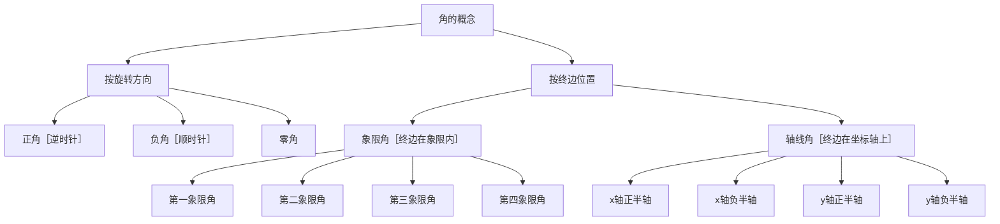
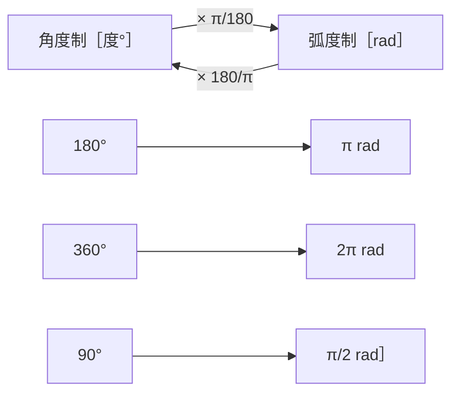
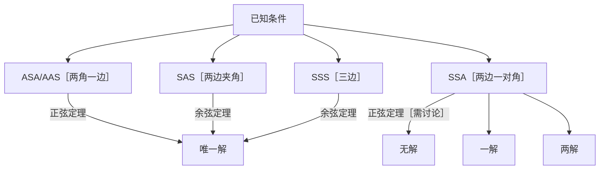
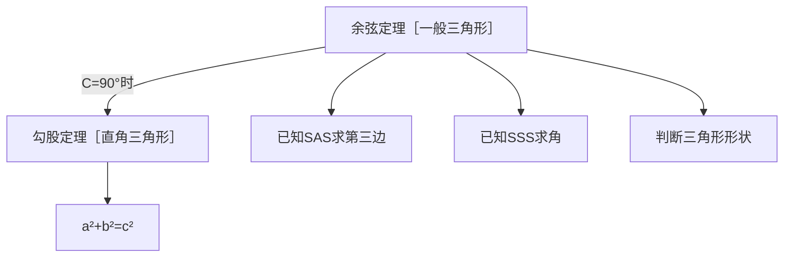
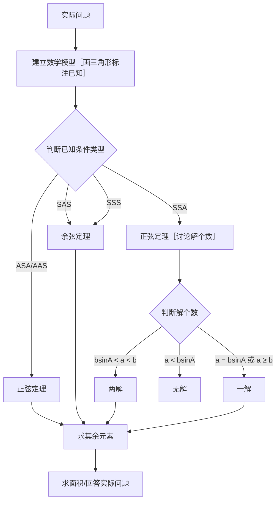
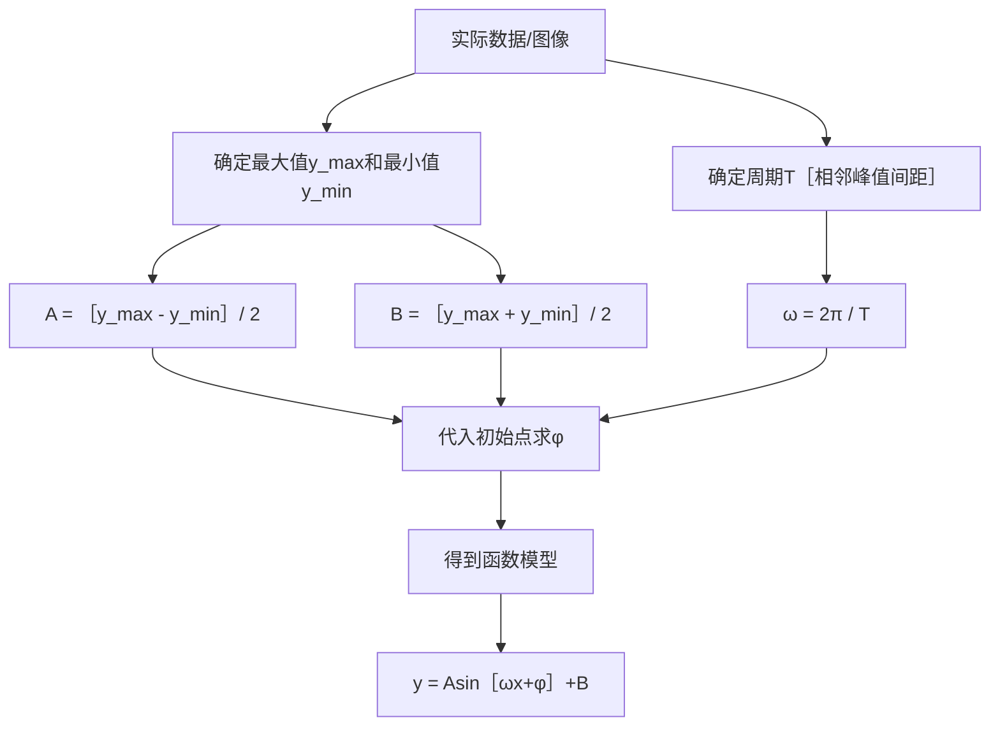

# 高中数学-三角函数 知识点详细内容

> 本文档系统整理了高中数学三角函数模块的全部知识点，包含概念、定义、特性、运算方式、定理、公式及二级结论（重要推论）。知识点编号与 `math01.xlsx` 框架文件严格一一对应。

---

## 2.4.1 任意角的概念

**知识点编号**: 2.4.1

**重要性级别**: A

**定义**: 角可以看作平面内一条射线绕着端点从一个位置旋转到另一个位置所形成的图形。按旋转方向分为正角（逆时针旋转）、负角（顺时针旋转）和零角（不作旋转）。按终边位置分为象限角（终边落在某一象限内）和轴线角（终边落在坐标轴上）。

**特性**: 终边相同的角相差 $360°$ 的整数倍，即与角 $\alpha$ 终边相同的角的集合为 $\{\beta\mid\beta=\alpha+k\cdot 360°, k\in\mathbb{Z}\}$。象限角判断需先将角化为 $0°～360°$（或 $0～2\pi$）范围内的等价角。

**运算方式**: 角度加减运算，终边相同的角的化简。若角 $\alpha$ 大于 $360°$，则通过减去 $360°$ 的整数倍化为 $0°～360°$ 范围内的等价角。

**mermaid关系图**:

---

## 2.4.2 弧度制

**知识点编号**: 2.4.2

**重要性级别**: A

**定义**: 长度等于半径长的弧所对的圆心角叫做 $1$ 弧度的角，记作 $1\text{ rad}$。弧度与角度的换算关系：$180° = \pi\text{ rad}$，$1° = \dfrac{\pi}{180}\text{ rad}$，$1\text{ rad} = \dfrac{180°}{\pi} \approx 57.3°$。

**特性**: 弧度制下角的集合与实数集 $\mathbb{R}$ 建立了一一对应关系。弧度制使三角函数的微积分公式更加简洁，如 $(\sin x)' = \cos x$ 在弧度制下成立。

**公式**:
- 弧长公式：$l = |\alpha| \cdot r$（$\alpha$ 为弧度）
- 扇形面积公式：$S = \dfrac{1}{2}|\alpha| \cdot r^2 = \dfrac{1}{2}lr$

**mermaid换算关系图**:

---

## 2.4.3 任意角的三角函数定义

**知识点编号**: 2.4.3

**重要性级别**: A

**定义**: 设 $\alpha$ 是任意角，$\alpha$ 终边上任一点 $P(x,y)$，$r = |OP| = \sqrt{x^2+y^2}$，则：
$$\sin\alpha = \dfrac{y}{r}, \quad \cos\alpha = \dfrac{x}{r}, \quad \tan\alpha = \dfrac{y}{x}\ (x\neq 0)$$
$$\cot\alpha = \dfrac{x}{y}\ (y\neq 0), \quad \sec\alpha = \dfrac{r}{x}\ (x\neq 0), \quad \csc\alpha = \dfrac{r}{y}\ (y\neq 0)$$

**特性**: 三角函数值只与角的终边位置有关，与终边上点的位置无关。当 $\alpha$ 为锐角时，此定义与初中直角三角形中的三角函数定义完全一致。

**各象限三角函数值的符号规律**: 一全正、二正弦、三两切、四余弦。

| 象限 | $\sin\alpha$ | $\cos\alpha$ | $\tan\alpha$ |
|:---:|:---:|:---:|:---:|
| 第一象限 | $+$ | $+$ | $+$ |
| 第二象限 | $+$ | $-$ | $-$ |
| 第三象限 | $-$ | $-$ | $+$ |
| 第四象限 | $-$ | $+$ | $-$ |

---

## 2.4.4 单位圆与三角函数线

**知识点编号**: 2.4.4

**重要性级别**: B

**定义**: 单位圆是半径为 $1$、圆心在原点的圆。三角函数线是有向线段，可以直观表示三角函数值：正弦线 $\overrightarrow{MP}$ 是终边与单位圆交点的纵坐标，余弦线 $\overrightarrow{OM}$ 是终边与单位圆交点的横坐标，正切线 $\overrightarrow{AT}$ 是过点 $A(1,0)$ 的切线上有向线段。

**特性**: 三角函数线可以直观表示三角函数值的大小和符号，长度表示绝对值，方向表示符号。是理解三角函数性质的重要几何工具，特别有助于理解三角不等式。

---

## 2.4.5 同角三角函数基本关系

**知识点编号**: 2.4.5

**重要性级别**: A

**定义**: 同一个角的六个三角函数之间存在确定的关系，称为同角三角函数的基本关系。

**公式**:
- **平方关系**: $\sin^2\alpha + \cos^2\alpha = 1$
- **商数关系**: $\tan\alpha = \dfrac{\sin\alpha}{\cos\alpha}$（$\alpha \neq \dfrac{\pi}{2} + k\pi$）
- **倒数关系**: $\cot\alpha = \dfrac{1}{\tan\alpha}$，$\sec\alpha = \dfrac{1}{\cos\alpha}$，$\csc\alpha = \dfrac{1}{\sin\alpha}$
- **变式**: $1 + \tan^2\alpha = \sec^2\alpha$，$1 + \cot^2\alpha = \csc^2\alpha$

**使用场合**: 已知一个三角函数值求其余三角函数值；化简三角函数表达式；证明三角恒等式。

**前提条件**: 需根据角 $\alpha$ 所在象限确定开方后的符号。

**特性**: 已知一个三角函数值可求其余三角函数值。需注意根据角所在象限确定符号，体现了六个三角函数之间的内在联系。

**二级结论（重要推论）**:
- 若 $\sin\alpha + \cos\alpha = t$，则 $\sin\alpha\cos\alpha = \dfrac{t^2-1}{2}$
- 若 $\sin\alpha - \cos\alpha = t$，则 $\sin\alpha\cos\alpha = \dfrac{1-t^2}{2}$

---

## 2.4.6 诱导公式

**知识点编号**: 2.4.6

**重要性级别**: A

**定义**: 将任意角的三角函数化为锐角三角函数的公式，共六组。

**公式**: 以正弦为例（$k \in \mathbb{Z}$）：
| 公式组 | 公式 | 记忆口诀对应 |
|:---:|:---|:---|
| 第一组 | $\sin(2k\pi + \alpha) = \sin\alpha$ | 周期为 $2\pi$ |
| 第二组 | $\sin(\pi + \alpha) = -\sin\alpha$ | 第三象限正弦为负 |
| 第三组 | $\sin(\pi - \alpha) = \sin\alpha$ | 第二象限正弦为正 |
| 第四组 | $\sin(-\alpha) = -\sin\alpha$ | 正弦是奇函数 |
| 第五组 | $\sin\left(\dfrac{\pi}{2} - \alpha\right) = \cos\alpha$ | 奇变：正弦变余弦 |
| 第六组 | $\sin\left(\dfrac{\pi}{2} + \alpha\right) = \cos\alpha$ | 奇变：正弦变余弦 |

**记忆口诀**: 奇变偶不变，符号看象限。
- 奇变偶不变：$\dfrac{\pi}{2}$ 的奇数倍时函数名改变（正弦 $\leftrightarrow$ 余弦，正切 $\leftrightarrow$ 余切），偶数倍时不变。
- 符号看象限：将 $\alpha$ 看作锐角后原函数在对应象限的符号。

**使用场合**: 化任意角的三角函数为锐角三角函数，从而求值或比较大小。

---

## 2.4.7 三角函数的周期性

**知识点编号**: 2.4.7

**重要性级别**: A

**定义**: 对于函数 $f(x)$，如果存在非零常数 $T$，使得当 $x$ 取定义域内的每一个值时都有 $f(x+T) = f(x)$，则称 $f(x)$ 为周期函数，$T$ 为它的一个周期。

**公式**:
- $y = \sin x$ 的最小正周期为 $2\pi$
- $y = \cos x$ 的最小正周期为 $2\pi$
- $y = \tan x$ 的最小正周期为 $\pi$
- 一般形式 $y = A\sin(\omega x + \varphi) + B$ 的最小正周期 $T = \dfrac{2\pi}{|\omega|}$

**特性**: 若 $T$ 是周期，则 $kT$（$k \in \mathbb{Z}$ 且 $k \neq 0$）也是周期。最小正周期是最小的正周期。周期函数图像每隔一个周期重复出现。

---

## 2.4.8 三角函数的奇偶性

**知识点编号**: 2.4.8

**重要性级别**: A

**定义**: 根据函数奇偶性的定义来判断三角函数的奇偶性。

**公式**:
- $\sin(-x) = -\sin x$（正弦函数是**奇函数**）
- $\cos(-x) = \cos x$（余弦函数是**偶函数**）
- $\tan(-x) = -\tan x$（正切函数是**奇函数**）

**特性**: 奇偶性可用于简化计算和判断图像对称性。奇函数图像关于原点对称，满足 $f(0) = 0$（若在 $x=0$ 处有定义）；偶函数图像关于 $y$ 轴对称。

**二级结论（重要推论）**:
- $y = \sin x$ 是奇函数，定义域关于原点对称
- $y = \cos x$ 是偶函数，定义域关于原点对称
- $y = \tan x$ 是奇函数，定义域关于原点对称

---

## 2.4.9 三角函数的单调性

**知识点编号**: 2.4.9

**重要性级别**: A

**定义**: 根据函数单调性的定义，研究三角函数在不同区间上的增减性（$k \in \mathbb{Z}$）。

**公式/单调区间**:
- $y = \sin x$：在 $\left[-\dfrac{\pi}{2}+2k\pi, \dfrac{\pi}{2}+2k\pi\right]$ 上**单调递增**，在 $\left[\dfrac{\pi}{2}+2k\pi, \dfrac{3\pi}{2}+2k\pi\right]$ 上**单调递减**
- $y = \cos x$：在 $\left[-\pi+2k\pi, 2k\pi\right]$ 上**单调递增**，在 $\left[2k\pi, \pi+2k\pi\right]$ 上**单调递减**
- $y = \tan x$：在 $\left(-\dfrac{\pi}{2}+k\pi, \dfrac{\pi}{2}+k\pi\right)$ 上**单调递增**

**特性**: 单调性是解三角不等式的基础，也是求最值的重要依据。注意正切函数在每个周期内都单调递增，但在整个定义域上不是增函数（因为定义域不连续）。

---

## 2.4.10 三角函数的最值与值域

**知识点编号**: 2.4.10

**重要性级别**: A

**定义**: 研究三角函数的最大值、最小值和值域。

**公式**:
- $y = \sin x$：值域 $[-1, 1]$，最大值 $1$ 在 $x = \dfrac{\pi}{2} + 2k\pi$ 取到，最小值 $-1$ 在 $x = -\dfrac{\pi}{2} + 2k\pi$ 取到
- $y = \cos x$：值域 $[-1, 1]$，最大值 $1$ 在 $x = 2k\pi$ 取到，最小值 $-1$ 在 $x = \pi + 2k\pi$ 取到
- $y = \tan x$：值域为 $\mathbb{R}$，无最大值也无最小值
- 复合函数 $y = A\sin(\omega x + \varphi) + B$：最大值为 $|A| + B$，最小值为 $-|A| + B$，值域为 $[-|A|+B, |A|+B]$

**特性**: 值域问题常与参数范围问题结合。复合函数的值域需逐层分析。

**二级结论（重要推论）**: 若 $x$ 的范围受限（如在某个闭区间内），则最值可能在区间端点或极值点取到，需结合图像分析。对于 $y = A\sin(\omega x + \varphi) + B$，当 $x \in [x_1, x_2]$ 时，需先求 $\omega x + \varphi$ 的范围，再确定 $\sin(\omega x + \varphi)$ 的取值范围。

---

## 2.4.11 正弦函数的图像

**知识点编号**: 2.4.11

**重要性级别**: A

**定义**: 正弦函数 $y = \sin x$ 的图像称为正弦曲线。

**五点法作图**: 取一个周期 $[0, 2\pi]$ 内的五个关键点：

| $x$ | $0$ | $\dfrac{\pi}{2}$ | $\pi$ | $\dfrac{3\pi}{2}$ | $2\pi$ |
|:---:|:---:|:---:|:---:|:---:|:---:|
| $y = \sin x$ | $0$ | $1$ | $0$ | $-1$ | $0$ |

连接成光滑曲线后向左右周期性延伸。

**特性**: 图像呈周期性波浪状，关于原点对称，是奇函数，最大值为 $1$，最小值为 $-1$，周期为 $2\pi$。

---

## 2.4.12 余弦函数的图像

**知识点编号**: 2.4.12

**重要性级别**: A

**定义**: 余弦函数 $y = \cos x$ 的图像称为余弦曲线。

**五点法作图**: 取一个周期 $[0, 2\pi]$ 内的五个关键点：

| $x$ | $0$ | $\dfrac{\pi}{2}$ | $\pi$ | $\dfrac{3\pi}{2}$ | $2\pi$ |
|:---:|:---:|:---:|:---:|:---:|:---:|
| $y = \cos x$ | $1$ | $0$ | $-1$ | $0$ | $1$ |

连接成光滑曲线后向左右周期性延伸。

**特性**: 图像可由正弦曲线向左平移 $\dfrac{\pi}{2}$ 得到（即 $\cos x = \sin\left(x + \dfrac{\pi}{2}\right)$），关于 $y$ 轴对称，是偶函数，最大值为 $1$，最小值为 $-1$，周期为 $2\pi$。

---

## 2.4.13 正切函数的图像

**知识点编号**: 2.4.13

**重要性级别**: A

**定义**: 正切函数 $y = \tan x$ 的图像称为正切曲线。

**作图方法**: 在 $\left(-\dfrac{\pi}{2}, \dfrac{\pi}{2}\right)$ 内取关键点：过原点 $(0, 0)$，渐近线为 $x = \pm\dfrac{\pi}{2}$，取 $x = \pm\dfrac{\pi}{4}$ 对应 $y = \pm 1$，向上下延伸。

**特性**: 图像在每个周期内单调递增，定义域不包含渐近点 $x = \dfrac{\pi}{2} + k\pi$（$k \in \mathbb{Z}$），关于原点对称，值域为全体实数 $\mathbb{R}$。

---

## 2.4.14 三角函数图像的变换

**知识点编号**: 2.4.14

**重要性级别**: A

**定义**: 研究 $y = A\sin(\omega x + \varphi) + k$ 型函数的图像如何通过变换 $y = \sin x$ 的图像得到。

**变换规则**:
| 参数 | 变换类型 | 具体效果 |
|:---:|:---|:---|
| $A$ | 振幅变换 | 纵向伸缩，$|A|$ 为振幅，$A<0$ 时图像关于 $x$ 轴翻转 |
| $\omega$ | 周期变换 | 横向伸缩，$\omega > 1$ 压缩，$0 < \omega < 1$ 拉伸 |
| $\varphi$ | 相位变换 | 左右平移，平移量 $\left|\dfrac{\varphi}{\omega}\right|$，$\varphi > 0$ 向左平移 |
| $k$ | 上下平移 | 纵向平移，$k > 0$ 向上平移 |

**公式**:
- 振幅：$|A|$
- 周期：$T = \dfrac{2\pi}{|\omega|}$
- 频率：$f = \dfrac{1}{T} = \dfrac{|\omega|}{2\pi}$
- 相位：$\omega x + \varphi$
- 初相（初相位）：$\varphi$

**特性**: 变换顺序不同结果可能不同。先平移后伸缩与先伸缩后平移需注意 $x$ 的系数对平移量的影响。

**二级结论（重要推论）**: 五点法作 $y = A\sin(\omega x + \varphi) + B$ 的图，令 $\omega x + \varphi$ 分别取 $0$、$\dfrac{\pi}{2}$、$\pi$、$\dfrac{3\pi}{2}$、$2\pi$，求出对应 $x$ 值，计算 $y$ 值后描点连线。

---

## 2.4.15 两角和与差的正弦公式

**知识点编号**: 2.4.15

**重要性级别**: A

**定义**: 推导和应用两角和与差的正弦公式。

**公式**:
$$\sin(\alpha + \beta) = \sin\alpha\cos\beta + \cos\alpha\sin\beta$$
$$\sin(\alpha - \beta) = \sin\alpha\cos\beta - \cos\alpha\sin\beta$$

**使用场合**: 化简三角函数式、求值、证明恒等式。

**前提条件**: 适用于任意角 $\alpha$ 和 $\beta$。

**特性**: 公式特点为正余交错，符号与角度符号一致（和取 $+$，差取 $-$）。是推导其他公式的基础。

---

## 2.4.16 两角和与差的余弦公式

**知识点编号**: 2.4.16

**重要性级别**: A

**定义**: 推导和应用两角和与差的余弦公式。

**公式**:
$$\cos(\alpha + \beta) = \cos\alpha\cos\beta - \sin\alpha\sin\beta$$
$$\cos(\alpha - \beta) = \cos\alpha\cos\beta + \sin\alpha\sin\beta$$

**使用场合**: 化简三角函数式、求值、证明恒等式。

**前提条件**: 适用于任意角 $\alpha$ 和 $\beta$。

**特性**: 公式特点为余余正正，符号与角度符号相反（和取 $-$，差取 $+$）。

---

## 2.4.17 两角和与差的正切公式

**知识点编号**: 2.4.17

**重要性级别**: A

**定义**: 推导和应用两角和与差的正切公式。

**公式**:
$$\tan(\alpha + \beta) = \dfrac{\tan\alpha + \tan\beta}{1 - \tan\alpha\tan\beta}$$
$$\tan(\alpha - \beta) = \dfrac{\tan\alpha - \tan\beta}{1 + \tan\alpha\tan\beta}$$

**使用条件**: $\tan\alpha$、$\tan\beta$、$\tan(\alpha \pm \beta)$ 都存在，即 $\alpha$、$\beta$、$\alpha \pm \beta \neq \dfrac{\pi}{2} + k\pi$（$k \in \mathbb{Z}$）。分母不能为零。

**特性**: 使用时需检验分母是否为零。

---

## 2.4.18 二倍角公式

**知识点编号**: 2.4.18

**重要性级别**: A

**定义**: 令和角公式中 $\beta = \alpha$，得到二倍角公式。

**公式**:
$$\sin 2\alpha = 2\sin\alpha\cos\alpha$$
$$\cos 2\alpha = \cos^2\alpha - \sin^2\alpha = 2\cos^2\alpha - 1 = 1 - 2\sin^2\alpha$$
$$\tan 2\alpha = \dfrac{2\tan\alpha}{1 - \tan^2\alpha}$$

**使用场合**: 降幂升角、化简三角函数式、求值。

**前提条件**: $\tan 2\alpha$ 使用时需保证 $2\alpha \neq \dfrac{\pi}{2} + k\pi$ 且 $\tan\alpha$ 有意义（$\alpha \neq \dfrac{\pi}{2} + k\pi$）。

**特性**: $\cos 2\alpha$ 的三种形式需根据已知条件灵活选择：已知 $\cos\alpha$ 用第一种，已知 $\sin\alpha$ 用第三种，已知 $\tan\alpha$ 用第二种变式。是降幂升角的重要工具。

**二级结论（重要推论）**——降幂公式:
$$\sin^2\alpha = \dfrac{1 - \cos 2\alpha}{2}, \quad \cos^2\alpha = \dfrac{1 + \cos 2\alpha}{2}$$

---

## 2.4.19 半角公式

**知识点编号**: 2.4.19

**重要性级别**: B

**定义**: 由二倍角公式变形得到的半角公式。

**公式**:
$$\sin^2\dfrac{\alpha}{2} = \dfrac{1 - \cos\alpha}{2}, \quad \cos^2\dfrac{\alpha}{2} = \dfrac{1 + \cos\alpha}{2}$$
$$\tan^2\dfrac{\alpha}{2} = \dfrac{1 - \cos\alpha}{1 + \cos\alpha}$$
$$\tan\dfrac{\alpha}{2} = \dfrac{\sin\alpha}{1 + \cos\alpha} = \dfrac{1 - \cos\alpha}{\sin\alpha}$$

**使用场合**: 降角升幂、积分运算、化简半角表达式。

**前提条件**: 开方形式符号由 $\dfrac{\alpha}{2}$ 所在象限决定。$\tan\dfrac{\alpha}{2}$ 的有理形式避免了开方运算，但需 $\sin\alpha \neq 0$ 且 $\cos\alpha \neq -1$。

**特性**: 是降角升幂的重要工具，积分中经常使用。

**二级结论（重要推论）**——万能代换公式:
令 $t = \tan\dfrac{\alpha}{2}$，则:
$$\sin\alpha = \dfrac{2t}{1+t^2}, \quad \cos\alpha = \dfrac{1-t^2}{1+t^2}, \quad \tan\alpha = \dfrac{2t}{1-t^2}$$

---

## 2.4.20 辅助角公式

**知识点编号**: 2.4.20

**重要性级别**: A

**定义**: 将 $a\sin x + b\cos x$ 形式的表达式化为单一三角函数。

**公式**:
$$a\sin x + b\cos x = \sqrt{a^2+b^2}\sin(x + \varphi)$$
其中 $\tan\varphi = \dfrac{b}{a}$，$\cos\varphi = \dfrac{a}{\sqrt{a^2+b^2}}$，$\sin\varphi = \dfrac{b}{\sqrt{a^2+b^2}}$

也可写成 $\sqrt{a^2+b^2}\cos(x - \theta)$ 的形式，其中 $\tan\theta = \dfrac{a}{b}$。

**使用场合**: 求三角函数最值、化简表达式、物理简谐振动。

**前提条件**: $a$、$b$ 不全为零。使用时需根据 $a$、$b$ 的符号确定 $\varphi$ 所在象限。

**特性**: 将两个三角函数的线性组合化为一个三角函数。是求最值的重要工具。物理中的简谐振动常用此公式。

**二级结论（重要推论）**:
- $\sin x \pm \cos x = \sqrt{2}\sin\left(x \pm \dfrac{\pi}{4}\right)$
- $\sin x \pm \sqrt{3}\cos x = 2\sin\left(x \pm \dfrac{\pi}{3}\right)$
- $\sqrt{3}\sin x \pm \cos x = 2\sin\left(x \pm \dfrac{\pi}{6}\right)$

---

## 2.4.21 积化和差公式

**知识点编号**: 2.4.21

**重要性级别**: C

**定义**: 将三角函数的乘积化为和差形式。

**公式**:
$$\sin\alpha\cos\beta = \dfrac{\sin(\alpha+\beta) + \sin(\alpha-\beta)}{2}$$
$$\cos\alpha\sin\beta = \dfrac{\sin(\alpha+\beta) - \sin(\alpha-\beta)}{2}$$
$$\cos\alpha\cos\beta = \dfrac{\cos(\alpha+\beta) + \cos(\alpha-\beta)}{2}$$
$$\sin\alpha\sin\beta = -\dfrac{\cos(\alpha+\beta) - \cos(\alpha-\beta)}{2}$$

**使用场合**: 化简三角乘积表达式、积分计算。

**前提条件**: 适用于任意角 $\alpha$ 和 $\beta$。

**特性**: 可由和差公式变形得到。适用于化简复杂的三角乘积表达式。积分计算中经常使用。

---

## 2.4.22 和差化积公式

**知识点编号**: 2.4.22

**重要性级别**: C

**定义**: 将三角函数的和差化为乘积形式。

**公式**:
$$\sin\alpha + \sin\beta = 2\sin\dfrac{\alpha+\beta}{2}\cos\dfrac{\alpha-\beta}{2}$$
$$\sin\alpha - \sin\beta = 2\cos\dfrac{\alpha+\beta}{2}\sin\dfrac{\alpha-\beta}{2}$$
$$\cos\alpha + \cos\beta = 2\cos\dfrac{\alpha+\beta}{2}\cos\dfrac{\alpha-\beta}{2}$$
$$\cos\alpha - \cos\beta = -2\sin\dfrac{\alpha+\beta}{2}\sin\dfrac{\alpha-\beta}{2}$$

**使用场合**: 化简和合并三角函数项、证明三角恒等式。

**前提条件**: 适用于任意角 $\alpha$ 和 $\beta$。

**特性**: 可由积化和差公式推导。适用于化简和合并三角函数项。注意右边系数 $2$ 不要遗漏。

---

## 2.4.23 正弦定理

**知识点编号**: 2.4.23

**重要性级别**: A

**定义**: 在任意三角形 $ABC$ 中，各边与其对角的正弦之比相等，且等于外接圆直径。

**公式**:
$$\dfrac{a}{\sin A} = \dfrac{b}{\sin B} = \dfrac{c}{\sin C} = 2R$$

其中 $R$ 为三角形外接圆半径，$a$、$b$、$c$ 为角 $A$、$B$、$C$ 的对边。

**使用场合**:
- 已知两角一边（ASA 或 AAS），求其他元素
- 已知两边及其中一边对角（SSA），求其他元素（需讨论解的个数）

**前提条件**: 适用于任意三角形（包括锐角、直角、钝角三角形）。

**特性**: 可以判断三角形解的个数（$0$ 个、$1$ 个或 $2$ 个）。SSA 情况需要讨论。是连接边角关系的重要定理。

**二级结论（重要推论）**:
- 正弦定理面积公式：$S = \dfrac{1}{2}ab\sin C = \dfrac{abc}{4R}$
- 边角关系：$a : b : c = \sin A : \sin B : \sin C$

**mermaid解三角形判断图**:

---

## 2.4.24 余弦定理

**知识点编号**: 2.4.24

**重要性级别**: A

**定义**: 在任意三角形中，一边的平方等于其他两边平方和减去这两边与夹角余弦的乘积的两倍。

**公式**:
$$a^2 = b^2 + c^2 - 2bc\cos A$$
$$b^2 = a^2 + c^2 - 2ac\cos B$$
$$c^2 = a^2 + b^2 - 2ab\cos C$$

**变式（求角公式）**:
$$\cos A = \dfrac{b^2+c^2-a^2}{2bc}, \quad \cos B = \dfrac{a^2+c^2-b^2}{2ac}, \quad \cos C = \dfrac{a^2+b^2-c^2}{2ab}$$

**使用场合**:
- 已知两边及夹角（SAS），求第三边
- 已知三边（SSS），求角

**前提条件**: 适用于任意三角形。

**特性**: 是勾股定理在一般三角形中的推广。当 $C = 90°$ 时，$c^2 = a^2 + b^2$ 即为勾股定理。可用于判断三角形形状：
- $a^2 + b^2 > c^2$ $\Rightarrow$ 锐角三角形
- $a^2 + b^2 = c^2$ $\Rightarrow$ 直角三角形
- $a^2 + b^2 < c^2$ $\Rightarrow$ 钝角三角形

**mermaid定理关系图**:

---

## 2.4.25 三角形面积公式

**知识点编号**: 2.4.25

**重要性级别**: A

**定义**: 三角形面积可用多种方式表达，根据已知条件选择合适的形式。

**公式**:
- **两边及夹角公式**: $S = \dfrac{1}{2}ab\sin C = \dfrac{1}{2}bc\sin A = \dfrac{1}{2}ac\sin B$
- **海伦公式**: $S = \sqrt{p(p-a)(p-b)(p-c)}$，其中 $p = \dfrac{a+b+c}{2}$ 为半周长
- **底高公式**: $S = \dfrac{1}{2}ah$（底乘高除以二）

**使用场合**:
- 已知两边及夹角时，用正弦面积公式
- 已知三边时，用海伦公式
- 已知底和高时，用底高公式

**前提条件**: 三角形三边满足两边之和大于第三边。

**特性**: 面积公式有多种表达形式，需根据已知条件选择合适的形式。结合正弦定理和余弦定理使用。

**二级结论（重要推论）**:
- 内切圆半径：$r = \dfrac{S}{p}$（$p$ 为半周长）
- 外接圆半径：$R = \dfrac{abc}{4S}$

---

## 2.4.26 解三角形的综合应用

**知识点编号**: 2.4.26

**重要性级别**: A

**定义**: 综合运用正弦定理、余弦定理和面积公式解决三角形相关问题，包括测量问题、航海问题、物理问题等。

**已知条件组合与解法对照**:

| 已知条件 | 简称 | 适用定理 | 解的个数 |
|:---:|:---:|:---:|:---:|
| 三角 | AAA | 无法确定大小 | 无穷多 |
| 两边及夹角 | SAS | 余弦定理 | 唯一解 |
| 两角一边 | ASA/AAS | 正弦定理 | 唯一解 |
| 三边 | SSS | 余弦定理 | 唯一解 |
| 两边及其中一边对角 | SSA | 正弦定理 | 0、1或2个解 |

**使用场合**: 测量问题（不可达距离）、航海问题（方位角）、物理问题（力的分解）、几何证明。

**特性**: 实际问题需先建立数学模型，画出图形标注已知条件，选择合适的定理解题。SSA 情况可能有两解、一解或无解。

**二级结论（重要推论）**——判断 SSA 解的个数:
已知 $a$、$b$、$A$，则:
- 若 $a < b\sin A$，则**无解**
- 若 $a = b\sin A$ 或 $a \geq b$，则**一解**
- 若 $b\sin A < a < b$，则**两解**

**mermaid解题流程图**:

---

## 2.4.27 三角函数的实际应用

**知识点编号**: 2.4.27

**重要性级别**: B

**定义**: 三角函数在物理、工程、天文、导航等领域的应用。建立三角函数模型 $y = A\sin(\omega x + \varphi) + B$ 解决周期性问题。

**公式**: $y = A\sin(\omega x + \varphi) + B$ 是最常见的三角函数模型。

**参数含义**:
| 参数 | 名称 | 含义 |
|:---:|:---:|:---|
| $A$ | 振幅 | 偏离平衡位置的最大距离，$A > 0$ |
| $\omega$ | 角频率 | $\omega = \dfrac{2\pi}{T}$，决定周期 |
| $\varphi$ | 初相 | 由初始条件确定，$\varphi \in [0, 2\pi)$ |
| $B$ | 平衡位置 | 图像的上下平移量 |
| $T$ | 周期 | 完成一次完整振动所需时间 |

**使用场合**:
- 简谐振动（位移-时间关系）
- 交流电（电流-时间关系）
- 潮汐变化
- 季节温度变化
- 单摆运动

**前提条件**: 实际问题需满足周期性或近似周期性。

**特性**: 实际问题中需根据数据确定 $A$、$\omega$、$\varphi$、$B$ 四个参数的值。注意实际问题的定义域限制。

**二级结论（重要推论）**——由数据确定参数:
- $A = \dfrac{\text{最大值} - \text{最小值}}{2}$
- $B = \dfrac{\text{最大值} + \text{最小值}}{2}$
- $T =$ 相邻两最大值之差的横坐标距离
- $\omega = \dfrac{2\pi}{T}$
- $\varphi$ 由初始值代入确定

**mermaid参数确定流程图**:

---

> **文档说明**: 本文档涵盖高中数学三角函数模块的全部27个知识点（编号 2.4.1～2.4.27），编号与 `math01.xlsx` 框架文件严格一一对应。A级知识点22个为必须掌握，B级知识点3个为重要内容，C级知识点2个为补充拓展内容。
