# 第3章　移动通信中的信源编码和调制解调技术 — 知识点详细内容

---

## 3.1 移动通信中的信源编码和调制解调技术概述

**知识点编号**：3.1

**重要性级别**：A

**定义**：移动通信中的信源编码和调制解调技术是数字通信系统物理层的核心，信源编码负责将模拟语音或视频信号转换为数字比特流并尽可能压缩数据量，调制技术则将基带数字信号变换为适合无线信道传输的射频信号。两者协同工作，在保证通信质量的前提下最大化频谱利用率和功率效率，是理解和设计移动通信系统的关键基础。

**特性**：
- 信源编码主要追求压缩效率和重建质量，以去除信源冗余为目的
- 调制技术主要追求频谱效率和功率效率，以适应信道特性为目的
- 移动通信中需同时考虑带宽受限、功率受限、衰落信道和干扰等复杂环境因素
- 信源编码与调制技术的发展推动了移动通信从2G到5G的演进

**二级结论**：信源编码降低数据速率，调制将数字信号适配到无线信道，两者共同决定了系统的频谱效率和传输质量。

---

## 3.2.1 信源编码基本概念

**知识点编号**：3.2.1

**重要性级别**：B

**定义**：信源编码是将信息源（如语音、图像、视频）产生的模拟或数字信号变换为 fewer 比特数的数字表示的过程。其核心思想是利用信源信号的统计特性和感知冗余，通过压缩编码去除冗余信息，从而降低传输所需的数据速率，在接收端通过解码恢复原始信号。信源编码效率用压缩比或每样值比特数衡量。

**定理**：
- 香农信源编码定理（无失真编码定理）：对于离散无记忆信源，存在一种编码方法，使得编码后的平均码长任意接近信源的熵 H(X)

**公式**：

信源熵的定义：

$$H(X) = -\sum_{i=1}^{n} p(x_i) \log_2 p(x_i) \quad \text{(bit/符号)}$$

编码效率：

$$\eta = \frac{H(X)}{\bar{L}} \times 100\%$$

其中 $\bar{L}$ 为平均码长。

**特性**：
- 分为无损编码（完全可恢复，压缩比有限）和有损编码（存在一定失真，压缩比高）
- 波形编码直接对信号波形进行编码，质量高但速率也高
- 参量编码提取信号特征参数进行编码，速率低但质量受限
- 混合编码结合波形编码和参量编码的优点

**运算方式**：信源编码过程包括采样→量化→编码三个步骤，对于语音信号还有短时分析、参数提取等操作。

**二级结论**：信源编码效率的理论上限是信源熵，实际编码方案的速率越接近熵则效率越高。

---

## 3.2.2 移动通信中的信源编码

**知识点编号**：3.2.2

**重要性级别**：A

**定义**：移动通信中的信源编码面临比有线通信更严峻的挑战：无线信道带宽有限、多径衰落导致误码、终端功耗受限等，因此需要编码方案在低码率、高音质、抗误码能力和编解码复杂度之间取得平衡。现代移动通信系统普遍采用参数化或混合编码方案，并结合速率自适应技术。

**特性**：
- 低码率要求：无线频谱资源宝贵，需尽可能降低每路通话的带宽占用
- 抗误码能力：信道误码会导致解码信号质量严重下降，需设计具有一定容错能力的编码方案
- 低复杂度：移动终端功耗和运算能力有限，编解码算法需可实时实现
- 速率自适应：根据信道条件动态调整编码速率

**二级结论**：移动通信信源编码方案的选择需要在质量、速率、复杂度和抗误码能力四者间折中，AMR等自适应编码方案能根据信道条件动态调整，是现代系统的优选方案。

---

## 3.2.3 信源编码举例

**知识点编号**：3.2.3

**重要性级别**：B

**定义**：实际移动通信系统中采用了多种信源编码方案，各代系统根据其技术特点和业务需求选择了不同的编码标准。RPE-LTP用于GSM系统，EVRC用于CDMA系统，AMR用于3G及后续系统。

**特性**：
- GSM系统：采用RPE-LTP（规则脉冲激励-长期预测编码），速率为13kbit/s，属于混合编码
- CDMA系统：采用QCELP（ Qualcomm 码激励线性预测，8kbit/s）和EVRC（增强型可变速率编解码器）
- 3G/4G系统：采用AMR（自适应多速率）编码，支持多种速率模式（4.75~12.2kbit/s），根据信道条件自适应选择

**运算方式**：
- RPE-LTP编码流程：预处理→LP分析→LTP分析→RPE编码→比特打包
- AMR编码速率自适应：根据信道质量反馈动态调整编码速率，信道好时用高速率保证质量，信道差时用低速率保证可懂度

**二级结论**：从2G到4G，信源编码从固定速率向自适应变速率发展，速率不断降低而质量持续提升，体现了信源编码技术的进步。

---

## 3.3.1 相位连续的FSK

**知识点编号**：3.3.1

**重要性级别**：A

**定义**：相位连续的频移键控（CPFSK）是二进制FSK的一种改进形式，通过在相邻码元转换时刻保持载波相位的连续性，避免了传统FSK中因相位跳变导致的频谱扩展问题。当CPFSK的调制指数 $h = 2\Delta f \cdot T_b = 0.5$ 时，即为最小移频键控（MSK），此时频差 $\Delta f = 1/(4T_b)$ 为能保持正交性的最小频差。

**公式**：

CPFSK信号的一般表达式：

$$s(t) = A\cos\left[\omega_c t + \theta(t)\right]$$

其中瞬时频率偏移与调制信号成正比：

$$\frac{d\theta(t)}{dt} = 2\pi h \cdot \frac{m(t)}{T_b}$$

调制指数定义：

$$h = \frac{2\Delta f}{R_b} = 2\Delta f \cdot T_b$$

对于MSK，$h = 0.5$，即 $2\Delta f = \frac{1}{2T_b}$，所以频偏 $f_d = \frac{1}{4T_b}$。

**特性**：
- 相位连续性消除了码元切换时的高频分量，使功率谱更加紧凑
- 调制指数h决定频偏大小，h=0.5时频差最小且信号正交
- MSK是CPFSK的特例，也是h=0.5时唯一的连续相位调制
- 恒包络特性，适合使用非线性功率放大器

**二级结论**：MSK中h=0.5使得两频率信号满足正交条件且频差最小，相位连续性使旁瓣衰减更快，是后续GMSK的基础。

---

## 3.3.2 MSK信号的相位路径频率及功率谱

**知识点编号**：3.3.2

**重要性级别**：A

**定义**：MSK信号是一种特殊的连续相位FSK信号，其相位路径在每个码元周期内线性变化 $\pm \pi/2$，调制指数为0.5。MSK可等效为偏移正交幅度调制（OQPSK）的一种特殊形式，经半正弦脉冲成形后具有恒包络特性。MSK的功率谱按频率四次方衰减，旁瓣抑制优于传统PSK和FSK。

**公式**：

MSK信号的时域表达式：

$$s_{MSK}(t) = \cos\left[\omega_c t + \frac{\pi t}{2T_b} \cdot a_n + \theta_n\right], \quad nT_b \leq t \leq (n+1)T_b$$

其中 $a_n \in \{+1, -1\}$ 为第n个数据比特，$\theta_n$ 为第n个码元起始相位。

相位路径：

$$\theta(t) = \theta_n + \frac{\pi a_n}{2T_b}(t - nT_b), \quad nT_b \leq t \leq (n+1)T_b$$

在一个码元周期内相位变化：

$$\Delta\theta = \theta((n+1)T_b) - \theta(nT_b) = \frac{\pi a_n}{2} = \pm \frac{\pi}{2}$$

MSK功率谱密度：

$$P_{MSK}(f) = \frac{16T_b}{\pi^2}\left[\frac{\cos\left(2\pi(f-f_c)T_b\right)}{1 - \left(4(f-f_c)T_b\right)^2}\right]^2$$

**特性**：
- 相位路径为连续的折线，每个码元期线性变化 $\pm \pi/2$
- 功率谱主瓣宽度为 $1.5R_b$（3dB带宽约为 $0.7R_b$）
- 旁瓣按 $(f-f_c)^{-4}$ 衰减，比QPSK的 $(f-f_c)^{-2}$ 快得多
- 99%功率带宽约为 $1.2R_b$

**二级结论**：MSK具有恒包络、相位连续、功率谱紧凑等优点，可看作经半正弦脉冲成形的OQPSK，是GSM系统选用GMSK的基础。

---

## 3.4.1 高斯滤波器传输特性

**知识点编号**：3.4.1

**重要性级别**：A

**定义**：GMSK调制中，在MSK调制前增加一个高斯低通滤波器对基带信号进行预滤波处理。高斯滤波器的传输函数呈高斯函数形式，其时域冲激响应也是高斯函数，关键设计参数是3dB带宽B与码元周期T的乘积 $Bt$（或称 $BT$）。该滤波器平滑了基带信号的矩形跳变，使输出信号的频率变化更加平缓。

**公式**：

高斯滤波器的传输函数：

$$H(f) = \exp\left[-\alpha^2 \left(\frac{f}{B}\right)^2\right]$$

其中 $\alpha = \frac{\sqrt{\ln 2}}{\sqrt{2}} \approx 0.5887$，B为3dB带宽。

冲激响应：

$$h(t) = \frac{\sqrt{\pi}}{\alpha} B \exp\left[-\left(\frac{\pi B t}{\alpha}\right)^2\right]$$

高斯滤波器的等效噪声带宽：

$$B_N = \sqrt{\frac{\pi}{2}} \frac{B}{\alpha} = 1.065 B$$

**特性**：
- $Bt$ 参数是关键设计变量，GSM系统取 $Bt = 0.3$
- $Bt$ 越小，滤波越平滑，相位路径越缓，频谱越紧凑，但码间干扰越严重
- $Bt$ 越大，码间干扰越小，但频谱特性趋近于MSK
- 高斯滤波器具有线性相位特性，不引入相位失真

**二级结论**：$Bt = 0.3$ 是频谱紧凑性与码间干扰的良好折中，GSM系统选用此参数使邻道干扰满足蜂窝系统频率复用要求。

---

## 3.4.2 GMSK波形和相位路径

**知识点编号**：3.4.2

**重要性级别**：A

**定义**：GMSK信号的产生过程为：输入数据先经过高斯低通滤波器平滑处理，然后用滤波后的信号进行频率调制（MSK调制）。由于高斯滤波器的平滑作用，GMSK的相位路径不再是MSK那样的线性折线，而是更为光滑的连续曲线，但信号仍保持恒包络特性，适用于非线性功率放大器。

**公式**：

GMSK信号的相位路径：

$$\theta(t) = \frac{\pi}{2T_b} \int_{-\infty}^{t} \sum_{n=-\infty}^{\infty} a_n g(\tau - nT_b) d\tau$$

其中 $g(t) = h(t) * \text{rect}(t/T_b)$ 是矩形脉冲经高斯滤波后的波形，$h(t)$ 为高斯滤波器冲激响应。

GMSK信号表达式：

$$s_{GMSK}(t) = A\cos\left[\omega_c t + \theta(t)\right]$$

**特性**：
- 相位路径是平滑连续曲线，无MSK那样的折线拐点
- 保持恒包络特性，$|s(t)| = A$ 为常数
- 频率变化不再瞬时完成，而是逐渐过渡
- 引入可控的码间干扰（ISI），是频谱效率提升的代价

**mermaid**：

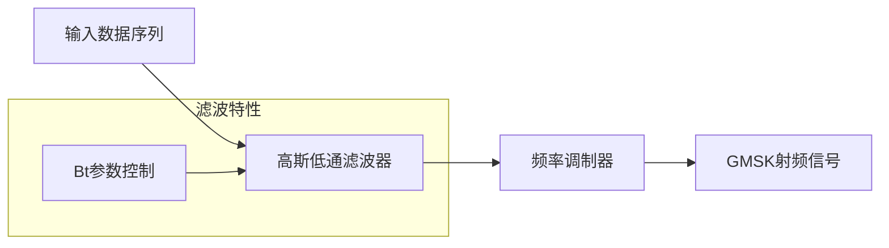

**二级结论**：GMSK的相位路径平滑度由 $Bt$ 参数控制，$Bt$ 越小相位越平滑，频谱越紧凑，但引入的码间干扰越多，需通过均衡器补偿。

---

## 3.4.3 GMSK调制与解调

**知识点编号**：3.4.3

**重要性级别**：B

**定义**：GMSK调制通常采用正交调制（I/Q调制）方式实现：先将高斯滤波后的基带信号分别乘以同相和正交载波，然后叠加产生射频信号。解调可采用相干解调或非相干解调方式，相干解调性能更优但需要精确的载波恢复，差分解调实现简单但有性能损失。

**公式**：

I/Q正交调制表达式：

$$s_{GMSK}(t) = I(t)\cos(\omega_c t) - Q(t)\sin(\omega_c t)$$

其中：

$$I(t) = \cos[\theta(t)], \quad Q(t) = \sin[\theta(t)]$$

一比特差分解调输出：

$$y_k = \cos\left[\theta(kT_b) - \theta((k-1)T_b)\right]$$

二比特差分解调输出：

$$y_k = \cos\left[\theta(kT_b) - \theta((k-2)T_b)\right]$$

**运算方式**：
- 调制流程：数据序列→NRZ编码→高斯滤波→I/Q分量产生→正交调制→射频输出
- 相干解调：接收信号→载波恢复→I/Q相干检波→判决输出
- 差分解调：接收信号→延迟相乘→低通滤波→判决输出

**二级结论**：实际GSM系统采用维特比均衡器与差分解调相结合的方案，补偿GMSK引入的码间干扰，在复杂度和性能间取得平衡。

---

## 3.4.4 GMSK功率谱

**知识点编号**：3.4.4

**重要性级别**：A

**定义**：GMSK的功率谱特性相比MSK有显著改善，主瓣更窄且旁瓣衰减更快，具体特性取决于 $Bt$ 参数。$Bt$ 越小，频谱越紧凑，邻道干扰越小。GSM系统选用 $Bt = 0.3$，在频谱效率和码间干扰之间取得了良好折中。

**公式**：

GMSK功率谱的数值近似（$Bt = 0.3$ 时）：

- 主瓣3dB带宽：约 $0.57R_b$
- 99%功率带宽：约 $1.22R_b$
- 邻道功率比（ACPR，间隔200kHz）：低于-60dB（GSM要求）

功率谱近似表达式（Proakis近似）：

$$S_{GMSK}(f) \approx S_{MSK}(f) \cdot |H(f-f_c)|^2$$

**特性**：
- GMSK($Bt=0.3$)的主瓣宽度约为MSK的85%
- 旁瓣衰减速度比MSK更快
- $Bt$ 从$\infty$减小到0.3时，邻道干扰降低约10dB以上
- $Bt = 0.3$ 时引入的码间干扰可通过维特比算法有效处理

**mermaid**：

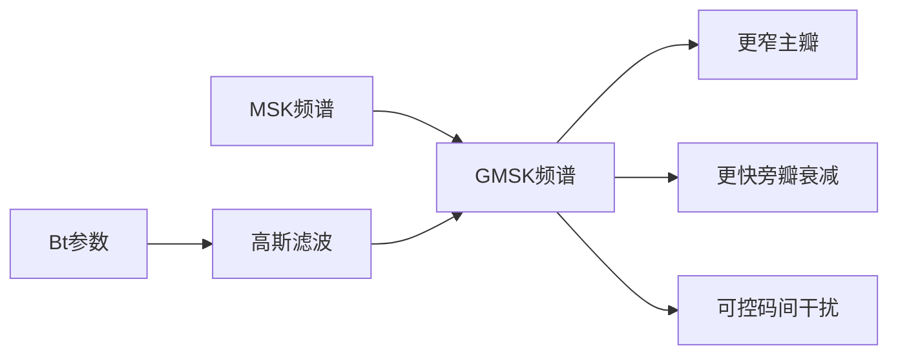

**二级结论**：GMSK($Bt=0.3$)的99%功率带宽约为1.22倍码元速率，满足GSM系统200kHz信道间隔的邻道干扰要求，是GSM选择此调制方式的主要原因。

---

## 3.5.1 二相调制BPSK

**知识点编号**：3.5.1

**重要性级别**：B

**定义**：二进制相移键控（BPSK）是最基本的数字相位调制方式，利用载波的两种相位（0和$\pi$）分别表示二进制数据0和1。BPSK信号可表示为双极性不归零（NRZ）基带信号对载波进行抑制载波的双边带调幅，具有恒包络特性和最优的抗噪声性能。

**公式**：

BPSK信号表达式：

$$s_{BPSK}(t) = A \cdot d(t) \cdot \cos(\omega_c t)$$

其中 $d(t) \in \{+1, -1\}$ 为双极性基带信号。

BPSK信号的功率谱密度：

$$P_{BPSK}(f) = \frac{A^2 T_b}{4} \left[\text{sinc}\left((f-f_c)T_b\right)\right]^2$$

BPSK误码率（AWGN信道）：

$$P_e = Q\left(\sqrt{\frac{2E_b}{N_0}}\right)$$

**特性**：
- 星座图只有两个点：位于实轴上的 $+A$ 和 $-A$
- 频谱效率为1 bit/s/Hz
- 相干解调误码率性能在二进制调制中最优
- 载波恢复存在$\pi$相位模糊问题，需采用差分编码解决

**二级结论**：BPSK是理解所有数字相位调制的基础，其误码率公式 $P_e = Q(\sqrt{2E_b/N_0})$ 是评价其他调制方式性能的基准。

---

## 3.5.2 四相调制QPSK

**知识点编号**：3.5.2

**重要性级别**：A

**定义**：四相相移键控（QPSK）利用载波的四种相位（通常为$\pi/4$、$3\pi/4$、$5\pi/4$、$7\pi/4$）分别表示两位二进制数据（00、01、10、11），每个码元传输2比特信息。QPSK可看作两路正交BPSK信号的叠加，频谱效率为2 bit/s/Hz，在相同误码率下所需功率与BPSK相同。

**公式**：

QPSK信号表达式：

$$s_{QPSK}(t) = \frac{A}{\sqrt{2}}\left[I(t)\cos(\omega_c t) - Q(t)\sin(\omega_c t)\right]$$

其中 $I(t), Q(t) \in \{+1, -1\}$ 分别为同相和正交分量。

星座图映射（格雷编码）：

| 比特对 | I | Q | 相位 $\\phi$ |
|--------|---|---|------------|
| 00     | +1| +1| $\\pi/4$   |
| 01     | -1| +1| $3\\pi/4$  |
| 10     | -1| -1| $5\\pi/4$  |
| 11     | +1| -1| $7\\pi/4$  |

误码率（AWGN信道）：

$$P_e \approx Q\left(\sqrt{\frac{2E_b}{N_0}}\right)$$

每比特能量 $E_b = E_s/2$，其中 $E_s$ 为每符号能量。

**特性**：
- 频谱效率是BPSK的两倍（2 bit/s/Hz）
- 在相同误码率下所需 $E_b/N_0$ 与BPSK相同
- 包络波动较大，180°相位跳变时包络过零
- 对功率放大器的线性度要求较高

**二级结论**：QPSK在频谱效率翻倍的同时保持了与BPSK相同的功率效率，是WCDMA等3G系统的基本调制方式。

---

## 3.5.3 偏移QPSK-OQPSK

**知识点编号**：3.5.3

**重要性级别**：B

**定义**：偏移四相相移键控（OQPSK）是QPSK的改进型，将正交支路（Q路）的码元相对于同相支路（I路）偏移半个码元周期（$T_s/2 = T_b$），使得两路信号不会同时发生跳变，从而避免了QPSK中180°相位跳变的问题，最大相位跳变限制为$\pm 90°$。

**公式**：

OQPSK信号表达式：

$$s_{OQPSK}(t) = \frac{A}{\sqrt{2}}\left[I(t)\cos(\omega_c t) - Q(t - T_s/2)\sin(\omega_c t)\right]$$

相位跳变限制：

$$|\Delta\phi|_{max} = \frac{\pi}{2} \quad \text{（QPSK为 } \pi \text{）}$$

包络波动：

$$\frac{A_{min}}{A_{max}} = \frac{1}{\sqrt{2}} \approx 0.707 \quad \text{（QPSK为0）}$$

**特性**：
- 最大相位跳变90°，不会出现180°跳变
- 包络波动范围减小，最小包络为最大包络的$1/\sqrt{2}$
- 误码率性能与QPSK相同
- 更适合使用非线性功率放大器的系统

**mermaid**：

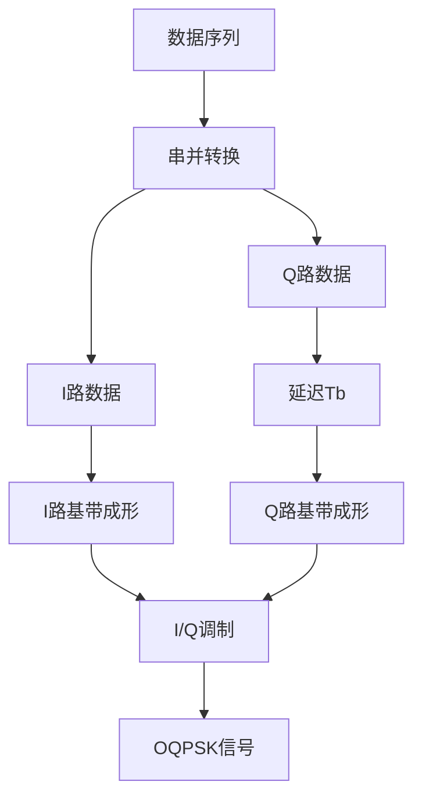

**二级结论**：OQPSK通过$\lambda$路偏移消除了180°相位跳变，包络波动减小约3dB，使功率放大器可工作于更高效率的非线性区。

---

## 3.5.4 π/4-QPSK

**知识点编号**：3.5.4

**重要性级别**：A

**定义**：$\pi/4$-QPSK是对QPSK的另一种改进方式，相邻码元之间的相位跳变只能是$\pm\pi/4$或$\pm 3\pi/4$，避免了通过原点的大幅度相位跳变。信号点在两组各四个相位的星座图（分别在$\pi/4$奇数倍和偶数倍）之间交替切换，可采用相干解调或差分解调，降低了接收机复杂度。

**公式**：

$\pi/4$-QPSK信号相位变化规则：

$$\phi_n = \phi_{n-1} + \Delta\phi_n$$

其中相位跳变 $\Delta\phi_n$ 由输入比特对决定：

| 输入比特 | 相位跳变 $\Delta\\phi_n$ |
|----------|----------------------|
| 00       | $\\pi/4$             |
| 01       | $3\\pi/4$            |
| 10       | $-3\\pi/4$           |
| 11       | $-\\pi/4$            |

差分解调输出：

$$r_k = r_I(k) + j r_Q(k) = s_k \cdot s_{k-1}^*$$

判决规则基于 $\arg(r_k)$ 所在象限。

**特性**：
- 相位跳变不通过原点，避免了包络过零
- 可采用差分检测，无需载波恢复电路
- 频谱特性优于普通QPSK
- 误码率比相干QPSK约差1-2dB

**mermaid**：

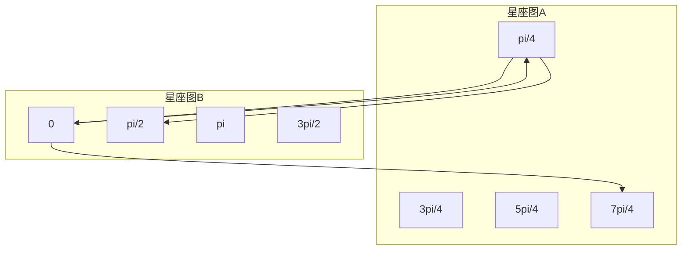

**二级结论**：$\pi/4$-QPSK通过在两组星座之间交替切换避免了通过原点的跳变，使包络波动更小且支持差分解调，是PHS和IS-136系统的选用调制方式。

---

## 3.6.1 数字调制的信号空间原理

**知识点编号**：3.6.1

**重要性级别**：A

**定义**：信号空间分析（也称矢量空间分析）是一种将数字调制信号表示为多维正交基函数线性组合的数学框架，为分析和比较不同调制方式提供了统一的方法论。每个调制信号对应信号空间中的一个点（信号矢量），信号点间的欧氏距离直接决定了调制的抗噪声性能，星座图是信号空间在二维平面上的几何表示。

**公式**：

信号空间表示：

$$s_i(t) = \sum_{j=1}^{N} s_{ij} \phi_j(t), \quad 0 \leq t \leq T, \quad i = 1, 2, \ldots, M$$

其中 $\{\phi_j(t)\}$ 为一组标准正交基函数：

$$\int_0^T \phi_i(t) \phi_j(t) dt = \delta_{ij} = \begin{cases} 1, & i=j \\ 0, & i \neq j \end{cases}$$

信号矢量：

$$\mathbf{s}_i = [s_{i1}, s_{i2}, \ldots, s_{iN}]^T$$

两信号点间的欧氏距离：

$$d_{ij} = \|\mathbf{s}_i - \mathbf{s}_j\| = \sqrt{\sum_{k=1}^{N}(s_{ik} - s_{jk})^2}$$

误码率近似（高信噪比）：

$$P_e \approx Q\left(\frac{d_{min}}{2\sqrt{N_0/2}}\right) = Q\left(\sqrt{\frac{d_{min}^2}{4N_0}}\right)$$

其中 $d_{min}$ 为最小欧氏距离。

**定理**：
- 在AWGN信道中，最大似然（ML）判决准则等价于选择信号空间中与接收信号欧氏距离最近的信号点
- 误码率仅取决于信号点间的最小欧氏距离和噪声功率谱密度

**特性**：
- 信号空间的维数N不超过码元时间内可区分的独立信号数
- 星座图中信号点越密集（$d_{min}$越小），抗噪声性能越差
- 信号功率与信号点到原点距离的平方成正比
- 相同的 $d_{min}$ 下，平均功率最小的星座图最优

**mermaid**：

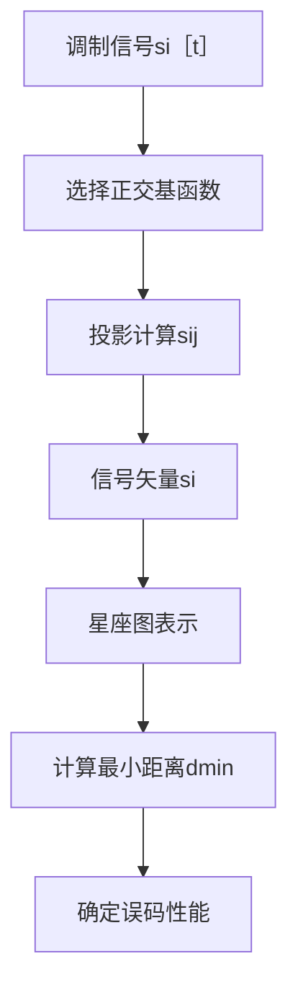

**二级结论**：信号空间理论表明，在相同信号功率下，最小欧氏距离 $d_{min}$ 越大的星座图抗噪声性能越好，这为高阶星座优化设计提供了理论依据。

---

## 3.6.2 M进制数字调制及高阶调制

**知识点编号**：3.6.2

**重要性级别**：A

**定义**：M进制调制每个码元传输 $\log_2 M$ 比特信息，常见方式有MPSK（多相相移键控）和MQAM（正交幅度调制）。高阶调制如16QAM、64QAM在相同带宽下可传输更多比特，但星座点间距减小导致抗噪声性能下降，需要在频谱效率和功率效率之间权衡。

**公式**：

MPSK信号表达式：

$$s_{MPSK}(t) = A\cos\left(\omega_c t + \frac{2\pi}{M}(m-1)\right), \quad m = 1, 2, \ldots, M$$

MQAM信号表达式：

$$s_{MQAM}(t) = A[I(t)\cos(\omega_c t) - Q(t)\sin(\omega_c t)]$$

其中 $I(t), Q(t) \in \{\pm 1, \pm 3, \ldots, \pm (\sqrt{M}-1)\}$

频谱效率：

$$\eta = \frac{R_b}{B} = \log_2 M \quad \text{(bit/s/Hz)}$$

MPSK误码率（AWGN信道，Gray编码近似）：

$$P_e \approx \frac{2}{\log_2 M} Q\left(\sqrt{\frac{2E_b \log_2 M}{N_0}} \sin\frac{\pi}{M}\right)$$

MQAM误码率（AWGN信道，方形QAM）：

$$P_e \approx \frac{4}{\log_2 M}\left(1 - \frac{1}{\sqrt{M}}\right) Q\left(\sqrt{\frac{3\log_2 M}{M-1} \cdot \frac{2E_b}{N_0}}\right)$$

**特性**：
- MPSK：所有信号点分布在圆周上，恒包络，但M>8时性能急剧下降
- MQAM：信号点分布在二维网格上，非恒包络，频谱效率优于MPSK
- 调制阶数M每增加一倍，频谱效率增加1 bit/s/Hz，但所需信噪比增加约3-4dB
- 实际系统中常用16QAM、64QAM，256QAM用于近距离高质量信道

**mermaid**：

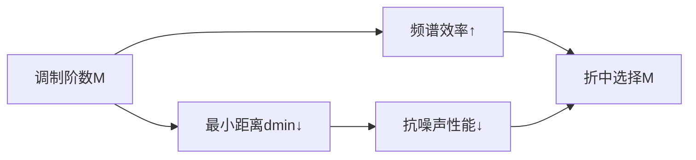

**二级结论**：在AWGN信道中，要达到相同误码率，64QAM比16QAM需要约6-7dB更高的信噪比，但频谱效率提高50%，体现了频谱效率与功率效率的基本折中。

---

## 3.6.3 高阶调制在3G及4G中的应用

**知识点编号**：3.6.3

**重要性级别**：A

**定义**：3G系统（WCDMA、CDMA2000）主要采用QPSK作为基本调制方式，支持16QAM用于高速下行数据业务；4G LTE系统下行最高支持64QAM，上行最高支持16QAM，结合OFDM和MIMO技术实现百兆级峰值速率；LTE-A进一步支持256QAM，结合高阶MIMO实现吉比特级传输。

**特性**：
- WCDMA HSPA下行：QPSK和16QAM自适应切换
- LTE下行（PDSCH）：QPSK、16QAM、64QAM自适应调制编码
- LTE-A下行：增加256QAM支持，单流峰值速率进一步提升
- 调制方式选择与信道质量（CQI反馈）自适应匹配

**运算方式**：

有效信息速率：

$$R = N_{RB} \cdot N_{SC} \cdot R_{coding} \cdot \log_2 M \cdot N_{layer} \cdot \frac{N_{symb}}{T_{subframe}}$$

其中 $N_{RB}$ 为资源块数，$N_{SC}$ 为每RB子载波数，$R_{coding}$ 为编码速率，$M$ 为调制阶数，$N_{layer}$ 为MIMO层数。

**二级结论**：LTE下行采用64QAM和4x4 MIMO时，20MHz带宽下单用户峰值速率可达300Mbit/s，频谱效率达15 bit/s/Hz，是单一调制方式无法实现的。

---

## 3.7.1 OFDM概述

**知识点编号**：3.7.1

**重要性级别**：A

**定义**：正交频分复用（OFDM）是一种多载波调制技术，将高速数据流分散到多个低速率的正交子载波上并行传输。各子载波频谱相互重叠但保持正交性，使总带宽远小于传统频分复用（FDM），频谱利用率接近奈奎斯特极限。OFDM能有效对抗频率选择性衰落，是现代宽带无线通信的基石技术。

**特性**：
- 多载波并行传输使每个子信道近似平坦衰落
- 子载波正交性保证频谱高效重叠而无子载波间干扰（ICI）
- 循环前缀（CP）消除多径引起的码间干扰（ISI）
- 采用FFT/IFFT实现高效的数字信号处理
- 峰值平均功率比（PAPR）较高是主要缺点

**mermaid**：

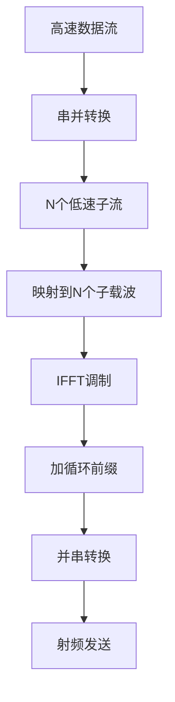

**二级结论**：OFDM将频率选择性衰落信道分解为多个平坦衰落子信道，从根本上简化了信道均衡问题，是4G/5G系统物理层的核心技术基础。

---

## 3.7.2 OFDM原理

**知识点编号**：3.7.2

**重要性级别**：A

**定义**：OFDM将数据分配到N个正交子载波上并行传输，各子载波间隔 $\Delta f = 1/T_s$（$T_s$ 为OFDM符号周期），相邻子载波频率间隔恰好为一个码元速率的倒数，保证了子载波间的正交性。通过在每个符号前加入循环前缀（CP），OFDM将线性卷积变为循环卷积，完全消除了多径引起的码间干扰。

**公式**：

OFDM信号表达式：

$$s(t) = \sum_{k=0}^{N-1} X_k \cdot e^{j2\pi f_k t}, \quad 0 \leq t \leq T_s$$

其中 $f_k = f_0 + k\Delta f$，$\Delta f = 1/T_s$ 为子载波间隔。

子载波正交条件：

$$\frac{1}{T_s}\int_0^{T_s} e^{j2\pi k\Delta f \cdot t} \cdot e^{-j2\pi m\Delta f \cdot t} dt = \delta_{km}$$

循环前缀长度要求：

$$T_{CP} \geq \tau_{max}$$

其中 $\tau_{max}$ 为信道最大时延扩展。

总符号周期：

$$T_{total} = T_s + T_{CP}$$

频谱利用率：

$$\eta = \frac{N}{N + N_{CP}} \cdot \log_2 M \quad \text{(bit/s/Hz)}$$

其中 $N_{CP}$ 为循环前缀样点数。

**定理**：
- 循环前缀使线性卷积信道变为循环卷积，保证子载波正交性不受多径破坏
- 在CP长度大于信道最大时延扩展时，子载波间完全正交，无ISI和ICI

**特性**：
- 子载波数N通常为2的幂次方（64、128、256、512、1024、2048）
- CP引入的频谱效率损失约为 $T_{CP}/T_{total}$（LTE中约7%）
- 每个子载波上的信道响应可视为常数（平坦衰落）
- 各子载波可独立采用不同调制方式

**二级结论**：CP的长度选择是OFDM系统设计的关键：CP越长抗多径能力越强但频谱效率越低，CP必须大于信道最大多径时延才能保证正交性。

---

## 3.7.3 DFT实现

**知识点编号**：3.7.3

**重要性级别**：A

**定义**：OFDM调制和解调可通过离散傅里叶变换（DFT）及其逆变换（IDFT）高效实现。发送端对N路子载波上的数据符号进行N点IDFT运算，接收端进行N点DFT运算恢复各路数据。利用快速傅里叶变换（FFT/IFFT）算法将计算复杂度从 $O(N^2)$ 降低到 $O(N\log_2 N)$，使OFDM在实际系统中得以广泛应用。

**公式**：

发送端IDFT运算：

$$x_n = \frac{1}{N}\sum_{k=0}^{N-1} X_k \cdot e^{j2\pi kn/N}, \quad n = 0, 1, \ldots, N-1$$

接收端DFT运算：

$$Y_k = \sum_{n=0}^{N-1} y_n \cdot e^{-j2\pi kn/N}, \quad k = 0, 1, \ldots, N-1$$

FFT算法复杂度：

$$\text{乘法次数} \approx \frac{N}{2}\log_2 N$$

直接DFT复杂度：

$$\text{乘法次数} = N^2$$

计算节省：

$$\text{节省倍数} = \frac{N^2}{\frac{N}{2}\log_2 N} = \frac{2N}{\log_2 N}$$

对于N=2048，节省倍数约为185倍。

**特性**：
- IFFT实现OFDM调制，FFT实现OFDM解调
- FFT点数N等于子载波总数
- 计算效率提升使OFDM在硬件上可实时实现
- 实际系统中N取64（WiFi）、512/1024/2048（LTE）等

**mermaid**：


**二级结论**：N点IFFT/FFT使OFDM的调制解调复杂度从 $O(N^2)$ 降至 $O(N\log_2 N)$，当N=1024时运算量减少约200倍，这是OFDM在20世纪末得以工程实现的关键。

---

## 3.7.4 OFDM的应用

**知识点编号**：3.7.4

**重要性级别**：A

**定义**：OFDM技术已广泛应用于各类宽带无线通信系统中，包括4G LTE（下行OFDMA、上行SC-FDMA）、IEEE 802.11 WiFi系列、DVB-T/H数字电视广播、WiMAX等。在LTE中，OFDM与MIMO技术结合（MIMO-OFDM），根据信道条件对不同子载波采用自适应调制编码，实现了高频谱效率传输。

**特性**：
- LTE下行采用OFDMA（正交频分多址）：不同用户分配不同子载波组
- LTE上行采用SC-FDMA（单载波FDMA）：降低PAPR，延长终端电池寿命
- WiFi（802.11a/g/n/ac/ax）：采用OFDM作为基本调制技术
- OFDM易于与MIMO结合，实现空间复用

**运算方式**：

MIMO-OFDM系统容量：

$$C = B \sum_{i=1}^{r} \log_2\left(1 + \frac{P_i \lambda_i}{N_0 B}\right)$$

其中 $r$ 为信道矩阵秩，$\lambda_i$ 为信道特征值。

**mermaid**：

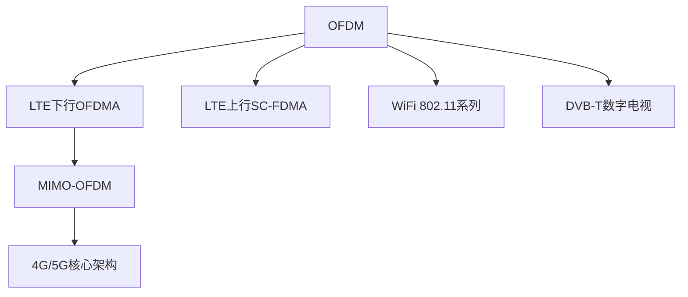

**二级结论**：MIMO-OFDM架构是4G/5G系统物理层的统一框架，OFDM提供频率维度资源分配，MIMO提供空间维度资源分配，两者结合使系统频谱效率达到传统单载波系统的数十倍。


---

# 第4章　抗衰落和链路性能增强技术 — 知识点详细内容

---

## 4.1 抗衰落和链路性能增强技术概述

**知识点编号**：4.1

**重要性级别**：A

**定义**：移动通信信道存在严重的衰落问题（大尺度衰落和小尺度衰落），导致接收信号功率剧烈波动和误码率显著增加。本章介绍一系列对抗衰落、提升链路传输可靠性的关键技术：分集技术利用多径或多位置信号的不相关性改善质量；信道编码与交织通过添加冗余和打散突发错误提升纠错能力；均衡技术补偿信道引起的码间干扰；扩频通信利用宽带传输获得处理增益和多径分辨能力；多天线技术利用空间资源实现分集或复用增益。这些技术是现代移动通信系统保证服务质量的基石。

**特性**：
- 衰落是导致移动通信性能恶化的根本原因
- 对抗衰落的技术途径包括：分集、编码、均衡、扩频、多天线等
- 实际系统中通常多种技术联合使用，获得累积增益
- 从2G到5G，抗衰落技术不断演进，链路性能持续提升

**mermaid**：

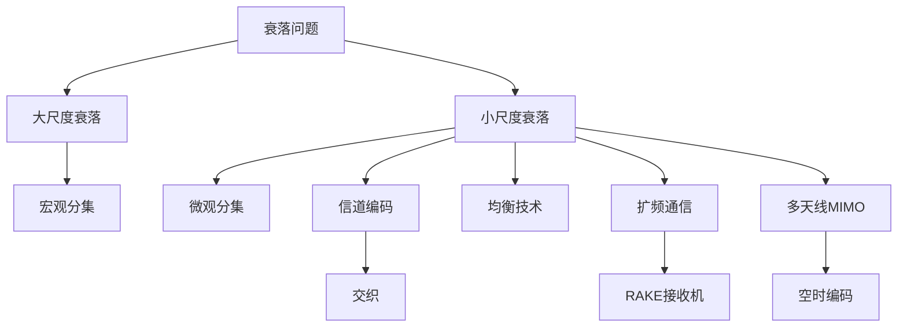

**二级结论**：单一抗衰落技术的增益有限，实际系统采用分集+编码+交织+MIMO等技术的组合方案，可获得显著的累积性能改善。

---

## 4.2.1 宏观分集

**知识点编号**：4.2.1

**重要性级别**：A

**定义**：宏观分集（Macro Diversity）也称基站分集或多基站分集，是用于对抗大尺度衰落（阴影衰落）的技术。它利用两个或多个相隔较远（通常数百米以上）的基站天线分别接收来自移动台的信号，通过选择信号较强的基站进行通信或合并多个基站的信号，显著降低因地形遮挡和建筑物阴影造成的大面积信号衰落。

**公式**：

阴影衰落模型（对数正态分布）：

$$p(L) = \frac{1}{\sqrt{2\pi}\sigma_L} \exp\left[-\frac{(L - \mu_L)^2}{2\sigma_L^2}\right]$$

其中 $L$ 为路径损耗（dB），$\mu_L$ 为均值，$\sigma_L$ 为标准差（通常4-10dB）。

宏观分集选择合并后的衰落余量改善：

设两个基站阴影衰落相互独立，则两个中较小值的累积分布函数：

$$P(\min(L_1, L_2) \leq l) = 1 - [1 - F_L(l)]^2$$

在1%中断概率下，双站选择分集可获得约10dB的衰落余量改善（$\sigma_L = 8$dB时）。

**特性**：
- 对抗大尺度衰落（阴影衰落），衰落周期为数秒至数十秒
- 基站间距离需远大于一个波长（通常数百米以上）
- 需配合软切换机制实现平滑过渡
- 在CDMA系统中可通过宏分集合并提升反向链路性能

**mermaid**：

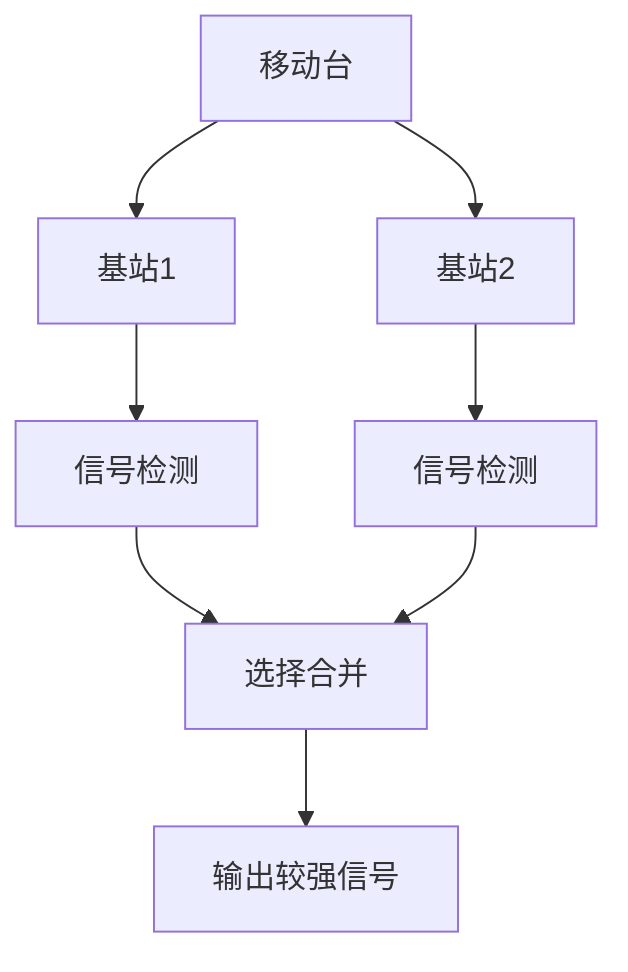

**二级结论**：宏观分集的核心是两个基站处的阴影衰落统计独立，使深度衰落的概率从单站的1%降低到双站的0.01%，显著提升了覆盖范围和通信可靠性。

---

## 4.2.2 微观分集类型

**知识点编号**：4.2.2

**重要性级别**：A

**定义**：微观分集（Micro Diversity）用于对抗小尺度衰落（多径衰落），通过获取统计独立的衰落信号副本，利用分集合并降低深衰落的影响。根据获取独立信号副本的方式不同，分为空间分集、频率分集、时间分集、极化分集和角度分集等多种类型，各种方式的本质都是利用不同维度上信号的独立性。

**公式**：

信号独立性的基本条件：

- 空间分集：天线间距 $d \geq 10\lambda$（瑞利衰落），$d \geq 0.5\lambda$（均匀角分布）
- 频率分集：频率间隔 $\Delta f \geq B_c$（相干带宽）
- 时间分集：时间间隔 $\Delta t \geq T_c$（相干时间）

瑞利衰落信道分集增益：

$$P_{out} \propto \frac{1}{(SNR)^L}$$

其中 $L$ 为分集阶数。

**特性**：
- 空间分集：多天线接收，最简单有效，天线间距0.5-10波长
- 频率分集：利用不同频率信道的独立性，需额外带宽
- 时间分集：利用信道时变特性，通过交织和编码实现
- 极化分集：正交极化信道的独立性，天线紧凑但增益有限
- 角度分集：利用不同入射角的多径信号，需定向天线阵列

**mermaid**：

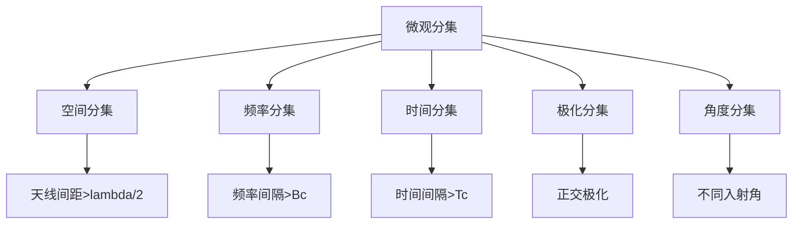

**二级结论**：微观分集各方式的本质都是获得统计独立的衰落信号副本，独立性的判断标准是相关系数小于0.7，分集阶数直接决定了衰落改善的程度。

---

## 4.2.3 分集合并方式及性能

**知识点编号**：4.2.3

**重要性级别**：A

**定义**：分集合并是将多个分集支路接收的信号按一定准则合并为一路输出的技术，主要方式包括选择合并（SC，选择信噪比最大的支路）、等增益合并（EGC，各支路等幅度加权相干合并）、最大比合并（MRC，各支路按信噪比加权合并）。MRC是理论上最优的合并方式，可获得最大分集增益。

**公式**：

选择合并（SC）输出信噪比：

$$\gamma_{SC} = \max\{\gamma_1, \gamma_2, \ldots, \gamma_L\}$$

等增益合并（EGC）输出信噪比：

$$\gamma_{EGC} = \frac{1}{L}\left(\sum_{i=1}^{L}\sqrt{\gamma_i}\right)^2$$

最大比合并（MRC）输出信噪比：

$$\gamma_{MRC} = \sum_{i=1}^{L}\gamma_i$$

各支路信噪比相同时（$\gamma_i = \gamma$）：

$$\gamma_{MRC} = L\gamma, \quad \gamma_{EGC} = L\gamma, \quad \gamma_{SC} = \gamma$$

瑞利衰落下MRC平均输出信噪比：

$$\bar{\gamma}_{MRC} = L \cdot \bar{\gamma}$$

MRC输出信噪比累积分布：

$$P(\gamma_{MRC} \leq \gamma) = 1 - e^{-\gamma/\bar{\gamma}} \sum_{k=0}^{L-1} \frac{(\gamma/\bar{\gamma})^k}{k!}$$

**特性**：
- MRC性能最优，输出信噪比为各支路信噪比之和
- EGC性能接近MRC，实现更简单（无需精确估计各支路SNR）
- SC最简单但性能最差，只需检测和切换电路
- 分集阶数L越大，三种合并方式的性能差距越小

**二级结论**：MRC是理论性能上限，实际系统中EGC是良好的折中选择，SC因实现最简单常用于低成本设备；MRC的分集增益为 $10\log_{10}L$（dB）。

---

## 4.2.4 性能比较

**知识点编号**：4.2.4

**重要性级别**：B

**定义**：三种合并方式在性能和复杂度上各有特点，需要根据应用场景进行权衡。MRC性能最优但需精确估计各支路信噪比和相位，实现复杂度最高；EGC不需要估计信噪比，只需相干相位对齐，性能接近MRC；SC最简单但增益较小。在分集支路数 $L$ 较大时，三种方式的性能差距缩小。

**公式**：

误码率对比（BPSK，瑞利衰落，$L$ 阶分集）：

MRC误码率：

$$P_{b,MRC} = \left[\frac{1}{2}(1 - \mu)\right]^L \sum_{k=0}^{L-1} \binom{L-1+k}{k} \left[\frac{1}{2}(1 + \mu)\right]^k$$

其中 $\mu = \sqrt{\frac{\bar{\gamma}}{1+\bar{\gamma}}}$

高信噪比近似：

$$P_{b,MRC} \approx \binom{2L-1}{L} \frac{1}{(4\bar{\gamma})^L}$$

EGC误码率（近似）：介于MRC和SC之间，比MRC差约1dB

SC误码率：

$$P_{b,SC} = L \sum_{k=0}^{L-1} \binom{L-1}{k} \frac{(-1)^k}{k+1} P_b((k+1)\bar{\gamma})$$

**特性**：
- MRC提供最大的分集增益，但需信道状态信息
- EGC性能接近MRC（差约1dB），实现更简单
- SC在 $L=2$ 时比MRC差约2dB，$L$ 增大差距增大
- MRC的分集阶数为 $L$，误码率随SNR按 $L$ 次方下降

**mermaid**：

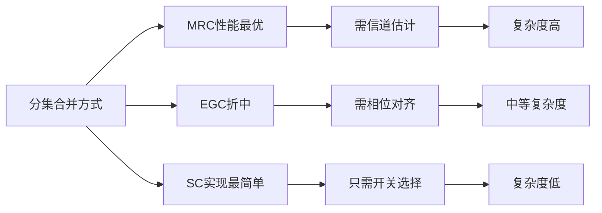

**二级结论**：在瑞利衰落信道中，要达到相同误码率 $10^{-3}$，双支路SC比MRC约差2dB，EGC比MRC约差1dB，随着分集阶数增加，三种方式的误码率曲线斜率趋于一致。

---

## 4.2.5 分集对数字移动通信误码的影响

**知识点编号**：4.2.5

**重要性级别**：A

**定义**：分集技术能显著改善数字通信系统在衰落信道中的误码性能。采用 $L$ 阶分集后，瑞利衰落信道下的误码率随信噪比的 $L$ 次方反比下降，而单链路衰落信道误码率仅与信噪比一次方成反比。分集将衰落信道的性能特性转变为近似AWGN信道特性，是实现可靠移动通信传输的核心技术。

**公式**：

无分集时BPSK在瑞利衰落中的平均误码率：

$$\bar{P}_b = \frac{1}{2}\left(1 - \sqrt{\frac{\bar{\gamma}}{1+\bar{\gamma}}}\right) \approx \frac{1}{4\bar{\gamma}} \quad (\bar{\gamma} \gg 1)$$

有 $L$ 阶MRC分集时：

$$\bar{P}_b \approx \binom{2L-1}{L} \frac{1}{(4\bar{\gamma})^L} \propto \frac{1}{\bar{\gamma}^L}$$

分集增益（定义：达到相同误码率所需SNR的降低量）：

$$G_d = \frac{\bar{\gamma}_{no div}}{\bar{\gamma}_{with div}} \bigg|_{P_b = const}$$

对于MRC（$L=2$），在 $P_b = 10^{-3}$ 时，分集增益约为15-18dB。

**特性**：
- 分集使误码率曲线的斜率从 $-1$（无分集）变为 $-L$（$L$ 阶分集）
- 分集不仅改善平均误码率，更重要的是大幅降低深衰落时的突发误码
- 实际系统中分集与交织、编码联合使用效果更好
- 分集阶数超过4后，增益增加趋于饱和

**mermaid**：

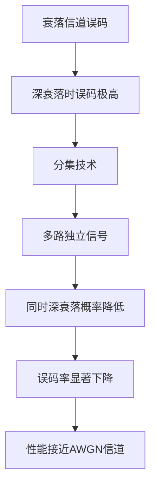

**二级结论**：分集技术的核心原理是 $L$ 路独立信号同时处于深衰落的概率为单路的 $p^L$（$p$ 为单路深衰落概率），4阶分集可将深衰落概率降低4个数量级。

---

## 4.3.1 信道编码概述

**知识点编号**：4.3.1

**重要性级别**：A

**定义**：信道编码是数字通信系统中通过在传输信息中人为添加可控冗余信息，使接收端能够检测和纠正传输过程中因噪声、干扰和衰落引起的传输差错的技术。编码效率（码率）$R = k/n$（$k$ 为信息位数，$n$ 为码长），分为检错码和纠错码两大类，是香农信道编码定理的实践体现，是保证数字通信可靠性的基本手段。

**公式**：

香农信道编码定理：

$$C = B \cdot \log_2(1 + SNR) \quad \text{(bit/s)}$$

只要信息速率 $R < C$，就存在一种编码方案使误码率任意小。

码率定义：

$$R_c = \frac{k}{n}$$

编码增益定义：

$$G_{coding} = \frac{SNR_{uncoded}}{SNR_{coded}} \bigg|_{P_b = const}$$

汉明距离与纠错能力：

$$t = \left\lfloor \frac{d_{min} - 1}{2} \right\rfloor$$

其中 $d_{min}$ 为码组间最小汉明距离，$t$ 为可纠正的错码数。

**特性**：
- 以带宽或速率换取可靠性
- 检错码（如CRC）只能检测错误，需配合重传机制
- 纠错码（如分组码、卷积码）可自动纠正一定数量的错误
- 编码增益通常为2-10dB，取决于编码类型和信道条件

**mermaid**：

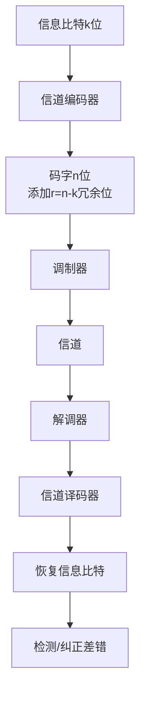

**二级结论**：香农信道编码定理证明了可靠通信的极限是信道容量，实际编码方案通过添加冗余逼近此极限，Turbo码和LDPC码已接近香农极限。

---

## 4.3.2 分组码

**知识点编号**：4.3.2

**重要性级别**：B

**定义**：分组码将每 $k$ 位信息分为一组，按线性规则产生 $r$ 位监督码元，构成 $n = k + r$ 长的码字。线性分组码的编码可用生成矩阵 $\mathbf{G}$ 实现，译码用监督矩阵 $\mathbf{H}$ 进行校验。汉明码是第一种能纠正单错的线性分组码，循环码是线性分组码的重要子类，可用移位寄存器实现编解码。

**公式**：

编码运算：

$$\mathbf{c} = \mathbf{m} \cdot \mathbf{G}$$

其中 $\mathbf{m}$ 为信息矢量（$1 \times k$），$\mathbf{G}$ 为生成矩阵（$k \times n$），$\mathbf{c}$ 为码字（$1 \times n$）。

系统码生成矩阵：

$$\mathbf{G} = [\mathbf{I}_k | \mathbf{P}]$$

监督矩阵：

$$\mathbf{H} = [\mathbf{P}^T | \mathbf{I}_r]$$

校验方程：

$$\mathbf{c} \cdot \mathbf{H}^T = \mathbf{0}$$

伴随式（用于检错和纠错）：

$$\mathbf{s} = \mathbf{r} \cdot \mathbf{H}^T$$

汉明码参数：

$$n = 2^m - 1, \quad k = 2^m - m - 1, \quad d_{min} = 3$$

可纠正 $t = 1$ 个错误。

编码增益（硬判决，AWGN信道，BPSK）：

$$P_b \approx \frac{d_{min}}{n} \sum_{j=t+1}^{d_{min}} A_j P_2(j)$$

其中 $A_j$ 为重量 $j$ 的码字数。

**特性**：
- 分组码编解码相对简单，适合短码长应用
- 汉明码 $d_{min} = 3$，可纠1位错
- 循环码可用简单的移位寄存器电路实现
- 硬判决译码比软判决译码性能差约2-3dB

**二级结论**：分组码的最小汉明距离 $d_{min}$ 决定了纠错能力，每增加2个 $d_{min}$ 可增加1位纠错能力，但实际设计中需在码长、码率和纠错能力间权衡。

---

## 4.3.3 卷积码

**知识点编号**：4.3.3

**重要性级别**：A

**定义**：卷积码是一种非分组码，编码输出不仅与当前 $k$ 位信息有关，还与之前 $m$ 组信息有关（约束长度为 $m+1$）。编码器由 $k$ 个输入位、$n$ 个输出位和 $m$ 级移位寄存器组成，可用生成多项式或格状图（Trellis）描述。常用维特比（Viterbi）算法进行最大似然译码，性能优于分组码。

**公式**：

编码速率：

$$R = \frac{k}{n}$$

常用 $k=1$ 时的编码器结构：$n$ 个模2加法器输出。

状态数：

$$N_s = 2^{m}$$

其中 $m$ 为移位寄存器级数。

维特比算法复杂度：

每步运算量 $\propto N_s = 2^m$（随约束长度指数增长）。

自由距离 $d_{free}$ 决定纠错性能：

$$P_b \approx N(d_{free}) \cdot Q\left(\sqrt{2R \cdot d_{free} \cdot \frac{E_b}{N_0}}\right)$$

常用卷积码（约束长度 $K=7$）：

- GSM系统：$R=1/2$，生成多项式 $g_1 = (171)_8$，$g_2 = (133)_8$
- 3G系统：$R=1/2$ 或 $R=1/3$，$K=9$

**特性**：
- 记忆性编码：输出与当前及历史输入有关
- 维特比算法是最大似然序列估计（MLSE）的有效实现
- 约束长度越长性能越好，但译码复杂度呈指数增长
- 软判决维特比比硬判决性能好2-3dB
- 实际系统约束长度一般不超过10（$K=7$或$K=9$最常用）

**mermaid**：

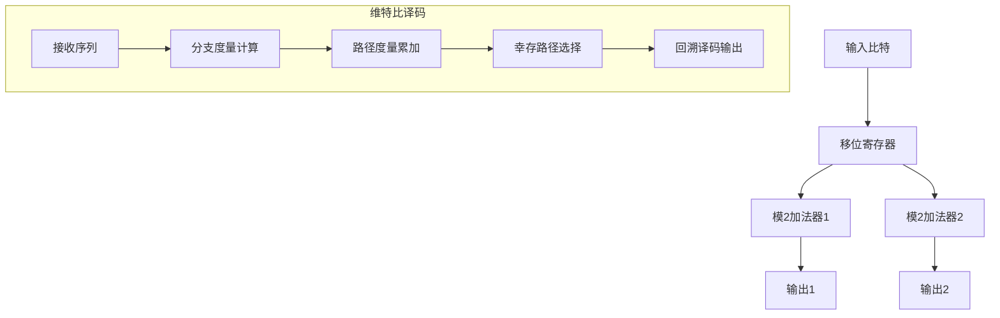

**二级结论**：卷积码配合维特比软判决译码在 $E_b/N_0 = 3$dB 时可达到 $10^{-5}$ 的误码率，比未编码BPSK改善约5dB，是2G/3G系统广泛采用的编码方式。

---

## 4.3.4 Turbo码

**知识点编号**：4.3.4

**重要性级别**：A

**定义**：Turbo码是一种采用迭代译码的并行级联卷积码（PCCC），由两个或多个递归系统卷积码（RSC）通过交织器并行级联构成，通过软输入软输出（SISO）迭代译码算法（如MAP算法）在极低信噪比下获得接近香农极限的误码性能。Turbo码的发现是信道编码领域的里程碑，首次实现了接近香农极限的实用编码方案。

**公式**：

Turbo码编码结构：

- 信息序列 $d_k$ 直接输出
- 第一个RSC编码器输出校验位 $p_{1k}$
- 经交织后的信息序列进入第二个RSC编码器输出 $p_{2k}$
- 总码率 $R = 1/3$（不含删余）

MAP译码算法（BCJR算法）：

后验概率比（APP ratio）：

$$\Lambda(d_k) = \log\frac{P(d_k = 1 | \mathbf{y})}{P(d_k = 0 | \mathbf{y})} = L_{sys} + L_{ext}^{(1)} + L_{ext}^{(2)}$$

其中 $L_{sys}$ 为系统信息，$L_{ext}^{(1)}$ 和 $L_{ext}^{(2)}$ 为两个译码器的外信息。

迭代译码过程（第 $i$ 次迭代）：

$$\Lambda^{(i)}(d_k) = L_{sys} + L_{ext}^{(2,i-1)}(d_k) + L_{ext}^{(1,i)}(d_k)$$

编码增益：Turbo码在BER=$10^{-5}$时可获得约10dB的编码增益，距香农极限仅约0.5dB。

**特性**：
- 两个RSC编码器通过交织器产生不同的校验序列
- 交织器设计是关键，通常采用伪随机交织
- 迭代次数通常为4-8次，性能改善趋于饱和
- 在 $E_b/N_0$ 较低时存在误码平层（error floor）
- 译码复杂度随码长线性增长，适合中等长度（几千比特）

**mermaid**：

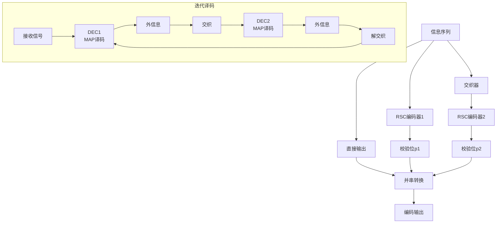

**二级结论**：Turbo码在BER=$10^{-5}$、码率1/2时仅需 $E_b/N_0 \approx 0.7$dB，距香农极限仅约0.5dB，是3G/4G数据信道编码的核心技术。

---

## 4.3.5 交织技术

**知识点编号**：4.3.5

**重要性级别**：A

**定义**：交织技术是将编码后的码元序列按照一定规则重新排列顺序的处理技术，其目的是将信道引起的突发错误分散为随机错误，以便信道编码能有效纠正。交织深度越大，抗突发错误能力越强，但引入的传输时延也越大。常用方式有块交织和卷积交织，常与信道编码联合使用。

**公式**：

块交织器：将 $m \times n$ 的数据按行写入、按列读出。

交织深度（块交织）：

$$D = m \times n$$

去交织后的突发错误分散度：

长度 $B$ 的突发错误经交织后分散为至少 $\lceil B/n \rceil$ 个独立错误。

卷积交织器延迟：

第 $i$ 条支路的延迟为 $i \times M$ 个符号，$i = 0, 1, \ldots, B-1$

总端到端时延：

$$T_{delay} = M \times B \times T_s$$

其中 $B$ 为支路数，$M$ 为增量延迟，$T_s$ 为符号周期。

**特性**：
- 交织不改变码字的统计特性，只改变传输顺序
- 块交织实现简单但有固定时延
- 卷积交织时延减半，常用于DVB等标准
- 交织深度需大于信道相干时间以充分打散突发错误
- 交织与信道编码联合使用是抗衰落信道突发错误的有效方案

**mermaid**：

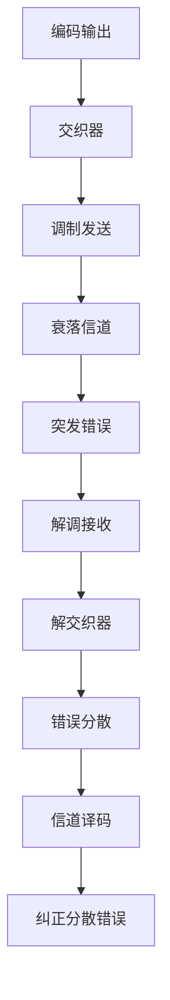

**二级结论**：在衰落信道中，交织深度大于信道相干时间时，可将相关性突发错误转化为近似独立的随机错误，使信道编码的纠错能力充分发挥。

---

## 4.4.1 均衡技术基本原理

**知识点编号**：4.4.1

**重要性级别**：A

**定义**：均衡技术是用于补偿信道多径效应引起的码间干扰（ISI）的接收端信号处理技术。信道多径传播导致发送信号的不同延迟分量叠加，造成前后码元间的干扰。均衡器通过构造与信道特性相反的滤波器来消除或减小码间干扰，分为线性均衡和非线性均衡，是单载波宽带通信系统（如GSM）的关键技术。

**公式**：

信道模型（等效基带）：

$$y(t) = \sum_{k=0}^{L-1} h_k \cdot x(t - kT) + n(t)$$

其中 $\{h_k\}$ 为信道冲激响应采样，$L$ 为多径数。

码间干扰来源：

$$y_n = h_0 x_n + \underbrace{\sum_{k \neq 0} h_k x_{n-k}}_{\text{ISI}} + n_n$$

均衡器目标：

设计滤波器 $\mathbf{w}$ 使得 $y_n * w_n \approx x_n$，即：

$$\mathbf{W}(z) \cdot \mathbf{H}(z) \approx 1$$

迫零均衡器（ZF）：

$$\mathbf{W}_{ZF} = \mathbf{H}^{-1}$$

最小均方误差均衡器（MMSE）：

$$\mathbf{W}_{MMSE} = \arg\min_{\mathbf{W}} E\left[|x_n - \hat{x}_n|^2\right]$$

$$\mathbf{W}_{MMSE} = \mathbf{R}_{yy}^{-1} \mathbf{r}_{xy}$$

**特性**：
- 线性均衡器结构简单但性能有限，对严重ISI信道效果不佳
- 迫零均衡器完全消除ISI但可能放大噪声
- MMSE均衡器在消除ISI和抑制噪声间取得平衡
- 时域均衡适用于单载波系统，OFDM中由循环前缀替代

**二级结论**：均衡器的核心思想是逆信道响应，当信道频率响应存在深衰落时，迫零均衡会放大噪声，此时MMSE均衡是更优选择。

---

## 4.4.2 非线性均衡器

**知识点编号**：4.4.2

**重要性级别**：A

**定义**：非线性均衡器中最重要的是判决反馈均衡器（DFE），由前馈滤波器（FFF）和反馈滤波器（FBF）组成。反馈滤波器利用已判决的符号来消除当前符号中由先前符号引入的码间干扰。DFE性能优于线性均衡器，但存在误差传播问题（误判会引起后续更多误判）。

**公式**：

DFE输出：

$$\hat{x}_n = \sum_{i=-N_1}^{0} c_i \cdot y_{n-i} + \sum_{j=1}^{N_2} b_j \cdot \tilde{x}_{n-j}$$

其中 $\{c_i\}$ 为前馈滤波器系数，$\{b_j\}$ 为反馈滤波器系数，$\tilde{x}_{n-j}$ 为已判决符号。

前馈滤波器消除未来ISI（前驱干扰），反馈滤波器消除过去ISI（后驱干扰）。

MMSE-DFE优化目标：

$$\min_{\mathbf{c}, \mathbf{b}} E\left[|x_n - \hat{x}_n|^2\right]$$

判决反馈的误差传播：

发生误判时，错误通过反馈回路传播，影响后续 $N_2$ 个符号的判决。

**特性**：
- DFE对严重码间干扰信道性能显著优于线性均衡器
- 反馈滤波器使DFE本质上是一种非线性处理
- 误差传播限制了DFE在信噪比较低时的性能
- 适用于没有严重频谱零点的信道

**mermaid**：

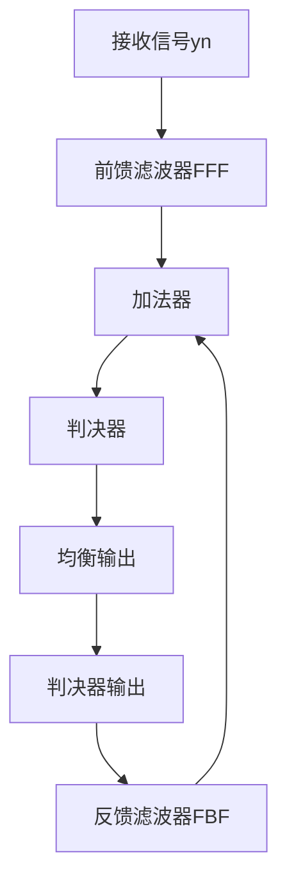

**二级结论**：DFE通过将ISI分解为前驱和后驱两部分分别处理，反馈部分消除了后驱ISI的主要贡献，在相同复杂度下比线性均衡器性能改善3-5dB。

---

## 4.4.3 自适应均衡器

**知识点编号**：4.4.3

**重要性级别**：A

**定义**：自适应均衡器能够根据信道特性的变化自动调整均衡系数，适用于时变衰落信道。常用自适应算法包括最小均方（LMS）算法和递推最小二乘（RLS）算法。LMS算法复杂度低但收敛慢，RLS算法收敛快但复杂度高。实际系统中通常采用训练序列进行初始收敛，之后转为判决引导模式进行跟踪。

**公式**：

LMS算法：

$$\mathbf{w}(n+1) = \mathbf{w}(n) + \mu \cdot e(n) \cdot \mathbf{y}(n)$$

其中 $e(n) = x(n) - \hat{x}(n)$ 为误差信号，$\mu$ 为步长参数。

LMS收敛条件：

$$0 < \mu < \frac{2}{\lambda_{max}}$$

其中 $\lambda_{max}$ 为输入自相关矩阵的最大特征值。

RLS算法：

$$\mathbf{w}(n) = \mathbf{w}(n-1) + \mathbf{k}(n) \cdot e(n)$$

其中增益矢量：

$$\mathbf{k}(n) = \frac{\mathbf{P}(n-1)\mathbf{y}(n)}{\lambda + \mathbf{y}^H(n)\mathbf{P}(n-1)\mathbf{y}(n)}$$

遗忘因子 $\lambda$ 通常取0.95-0.999。

**特性**：
- LMS算法复杂度 $O(N)$，收敛时间与特征值分散度有关
- RLS算法复杂度 $O(N^2)$，收敛速度比LMS快约一个数量级
- 训练序列长度需大于均衡器收敛时间
- 判决引导模式在信噪比较低时不稳定

**mermaid**：

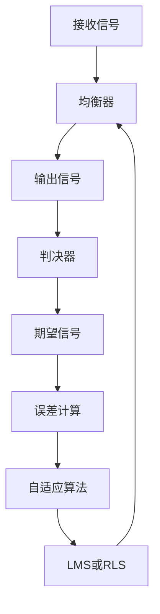

**二级结论**：LMS算法的收敛速度与输入信号特征值分散度成反比，对于多径衰落信道，RLS的快速收敛特性更适合快速时变环境，但其 $O(N^2)$ 复杂度限制了在实际系统中的广泛应用。

---

## 4.5.1 伪噪声序列

**知识点编号**：4.5.1

**重要性级别**：B

**定义**：伪噪声（PN）序列是一种具有类似随机噪声统计特性的确定性周期序列，由线性反馈移位寄存器（LFSR）产生。最常用的m序列（最长线性移位寄存器序列）具有良好的自相关和互相关特性，周期为 $2^n-1$（$n$ 为移位寄存器级数），是扩频通信、同步、信道分离和加密的基础。

**公式**：

m序列周期：

$$N = 2^n - 1$$

其中 $n$ 为LFSR级数。

自相关函数（归一化）：

$$R(\tau) = \begin{cases} 1, & \tau = 0, \pm N, \pm 2N, \ldots \\ -\frac{1}{N}, & \tau \neq 0 \pmod{N} \end{cases}$$

m序列的平衡特性：

一个周期内：
- "1"的个数：$2^{n-1}$
- "0"的个数：$2^{n-1} - 1$

游程特性：

长度为 $k$ 的游程数占总游程数的 $1/2^k$（$1 \leq k \leq n-1$）。

LFSR生成多项式（特征多项式）：

$$g(x) = 1 + g_1 x + g_2 x^2 + \cdots + g_{n-1}x^{n-1} + x^n$$

当 $g(x)$ 为本原多项式时，产生m序列。

**特性**：
- m序列自相关峰值尖锐，利于同步和信号检测
- 互相关函数有界（Welch界），不同m序列间干扰可控
- 平衡性、游程特性和自相关特性类似随机序列
- Gold序列由两个m序列优选对模2加产生，互相关更小

**二级结论**：m序列的自相关峰值与旁瓣比为 $N:1$（约 $20\log_{10}N$ dB），当 $N=1023$ 时，自相关旁瓣低于主峰约30dB，这一特性是CDMA系统区分不同用户的基础。

---

## 4.5.2 扩频通信原理

**知识点编号**：4.5.2

**重要性级别**：A

**定义**：扩频通信是将窄带信号扩展到远宽于原始信号带宽的频带上传输的通信技术。直接序列扩频（DS-SS）通过将数据信号与高速PN码相乘实现频谱扩展，扩频增益（处理增益）$G_p = B_w/B_s$ 是衡量扩频系统性能的关键指标。扩频通信具有抗干扰、低截获概率、多址接入（CDMA）和精确定位等优点。

**公式**：

DS-SS发射信号：

$$s(t) = d(t) \cdot c(t) \cdot \cos(\omega_c t)$$

其中 $d(t)$ 为数据信号（速率 $R_b$），$c(t)$ 为PN码（码片速率 $R_c$）。

处理增益：

$$G_p = \frac{B_w}{B_s} = \frac{R_c}{R_b} = \frac{T_b}{T_c} = N$$

其中 $N$ 为每个数据比特对应的PN码片数。

解扩输出信噪比改善：

$$SNR_{out} = SNR_{in} + G_p \quad \text{(dB)}$$

干扰容限：

$$M_j = G_p - L_s - SNR_{out} + G_{coding}$$

其中 $L_s$ 为系统损耗，$G_{coding}$ 为编码增益。

CDMA多址用户数（近似）：

$$K \approx \frac{G_p}{E_b/I_0 \cdot (1 + f)}$$

其中 $f$ 为邻小区干扰因子。

**特性**：
- 处理增益 $G_p$ 是扩频系统抗干扰能力的度量
- 扩频信号功率谱密度极低，类似噪声背景
- PN码正交性（或准正交性）实现多用户分离
- CDMA是扩频技术的典型多址应用

**mermaid**：

```mermaid
graph TD
    A[数据信号d［t］] --> B[乘法器]
    C[PN码c［t］] --> B
    B --> D[扩频信号]
    D --> E[射频调制]
    E --> F[信道传输]
    F --> G[接收端解扩]
    H[本地PN码] --> G
    G --> I[解调输出]
    
    J[窄带干扰] --> F
    F --> G
    G --> K[干扰被扩频]
    K --> L[低通滤波消除]
```

**二级结论**：处理增益 $G_p = N$ 是扩频系统的核心指标，它同时决定了系统的抗干扰能力、多用户容量和低截获概率，CDMA系统的用户数直接受 $G_p$ 限制。

---

## 4.5.3 抗多径干扰和RAKE接收机

**知识点编号**：4.5.3

**重要性级别**：A

**定义**：RAKE接收机是CDMA系统中利用扩频信号的高时间分辨率来分离和收集多径信号能量的接收技术。它将多径信号中的各条可分辨径分量分别进行相干接收（每个"指峰"对应一条多径），然后按最大比合并（MRC）准则合并各径输出，将原本有害的多径干扰转化为有益的分集信号，有效对抗频率选择性衰落。

**公式**：

RAKE接收机输出：

$$\hat{d} = \sum_{l=1}^{L} \alpha_l^* \cdot y_l$$

其中 $y_l$ 为第 $l$ 条径的解扩输出，$\alpha_l$ 为第 $l$ 条径的信道增益估计。

输出信噪比（MRC合并）：

$$SNR_{out} = \sum_{l=1}^{L} SNR_l = \frac{E_b}{N_0} \sum_{l=1}^{L} |\alpha_l|^2$$

多径可分辨条件（时延差大于码片周期）：

$$|\tau_i - \tau_j| > T_c$$

RAKE接收机分集阶数受限于可分辨多径数：

$$L \leq \frac{T_m}{T_c} + 1$$

其中 $T_m$ 为信道最大时延扩展。

**特性**：
- 每个"指峰"（Finger）对应一条可分辨的多径分量
- RAKE实现了隐性的时间分集，将多径能量有效收集
- 需要精确的多径时延估计和信道估计
- 实际系统中通常采用3-6个指峰

**mermaid**：

```mermaid
graph TD
    A[接收信号] --> B[多径分离]
    B --> C[指峰1<br>tau1]
    B --> D[指峰2<br>tau2]
    B --> E[指峰L<br>tauL]
    C --> F[解扩+信道估计]
    D --> G[解扩+信道估计]
    E --> H[解扩+信道估计]
    F --> I[MRC合并]
    G --> I
    H --> I
    I --> J[合并输出]
```

**二级结论**：RAKE接收机的分集增益等于可收集的多径数 $L$，当 $L=4$ 时，相对于单径接收可获得约6-8dB的SNR改善，是CDMA系统对抗多径衰落的核心技术。

---

## 4.5.4 跳频扩频通信系统

**知识点编号**：4.5.4

**重要性级别**：B

**定义**：跳频扩频（FH-SS）是另一种扩频方式，载波频率按照伪随机序列控制的规律在多个频点间快速跳变。根据跳频速率与码元速率的关系，分为慢跳频（SFH，每跳多个码元）和快跳频（FFH，每跳少于一个码元）。跳频系统利用频率分集对抗窄带干扰和衰落，在军事通信（抗干扰）、蓝牙（共存）等系统中有广泛应用。

**公式**：

跳频信号：

$$s_{FH}(t) = A\cos\left[2\pi(f_c + f_{h_n})t + \phi_n\right], \quad nT_h \leq t < (n+1)T_h$$

其中 $f_{h_n}$ 为第 $n$ 跳的频偏，由PN序列控制；$T_h$ 为跳频驻留时间。

处理增益：

$$G_p = N_{hop}$$

其中 $N_{hop}$ 为可用跳频点数。

误码率（部分频带干扰，慢跳频BFSK）：

$$P_b = \frac{1}{2}\exp\left(-\frac{E_b}{2N_0}\right) \cdot \frac{K}{N_{hop}}$$

其中 $K$ 为受干扰的频带数。

**特性**：
- 慢跳频（SFH）：$R_h < R_b$，每跳传输多个码元，频率分集增益较低
- 快跳频（FFH）：$R_h > R_b$，一个码元跨多个频点，抗干扰更强
- 跳频系统不要求严格的码片同步（相比DS-SS）
- 蓝牙采用1600次/秒的快跳频，实现与WiFi等系统共存

**mermaid**：

```mermaid
graph TD
    A[数据信号] --> B[调制器]
    B --> C[混频器]
    D[PN序列] --> E[频率合成器]
    E --> C
    C --> F[跳频射频信号]
    F --> G[信道]
    G --> H[接收端]
    H --> I[同步PN序列]
    I --> J[频率合成器]
    J --> K[混频解跳]
    K --> L[解调输出]
```

**二级结论**：跳频系统对窄带干扰和跟踪干扰具有天然免疫力，干扰信号只影响部分频点，处理增益 $G_p = N_{hop}$ 决定了系统能容忍的干扰带宽比例。

---

## 4.6.1 多天线技术

**知识点编号**：4.6.1

**重要性级别**：A

**定义**：多天线技术（MIMO）是在发射端和/或接收端配置多根天线，利用空间维度资源来提升系统性能的技术。根据天线配置不同，分为：接收分集（SIMO，1发多收）、发射分集（MISO，多发1收，利用空时编码）、空间复用（多发多收，同时传输多个数据流）。MIMO信道容量随最小天线数线性增长，显著提升了频谱效率。

**公式**：

MIMO信道模型：

$$\mathbf{y} = \mathbf{H}\mathbf{x} + \mathbf{n}$$

其中 $\mathbf{y}$ 为 $N_r \times 1$ 接收矢量，$\mathbf{x}$ 为 $N_t \times 1$ 发射矢量，$\mathbf{H}$ 为 $N_r \times N_t$ 信道矩阵，$\mathbf{n}$ 为噪声矢量。

MIMO信道容量（平坦衰落，发射端未知CSI）：

$$C = B \cdot \log_2\det\left(\mathbf{I}_{N_r} + \frac{SNR}{N_t}\mathbf{H}\mathbf{H}^H\right) \quad \text{(bit/s)}$$

等效并行信道容量：

$$C = B \sum_{i=1}^{r} \log_2\left(1 + \frac{SNR \cdot \lambda_i^2}{N_t}\right)$$

其中 $r = \text{rank}(\mathbf{H})$，$\lambda_i$ 为信道矩阵的奇异值。

分集增益：$G_d = N_t \times N_r$

复用增益：$G_m = \min(N_t, N_r)$

**特性**：
- 接收分集：$N_r$ 根接收天线可获得 $N_r$ 阶分集增益
- 发射分集（空时编码）：$N_t$ 根发射天线可获得 $N_t$ 阶分集
- 空间复用：同时传输 $\min(N_t, N_r)$ 个独立数据流
- 信道矩阵秩决定可同时传输的独立数据流数

**mermaid**：

```mermaid
graph TD
    A[MIMO技术] --> B[接收分集SIMO]
    A --> C[发射分集MISO]
    A --> D[空间复用MIMO]
    B --> E[提升可靠性]
    C --> E
    D --> F[提升数据速率]
    E --> G[覆盖改善]
    F --> H[容量提升]
    
    subgraph MIMO系统
    X1[TX1] --> Y1[RX1]
    X1 --> Y2[RX2]
    X2[TX2] --> Y1
    X2 --> Y2
    end
```

**二级结论**：当 $N_t = N_r = N$ 且信道矩阵满秩时，MIMO信道容量约为SISO的 $N$ 倍，4x4 MIMO在20MHz带宽下可实现约4倍的频谱效率提升。

---

## 4.6.2 空时编码技术

**知识点编号**：4.6.2

**重要性级别**：A

**定义**：空时编码是MIMO系统中在发射端采用的一种编码技术，同时利用空间（多根天线）和时间（多个时隙）维度进行编码。主要包括空时分组码（STBC，如Alamouti码，实现全分集、简单线性解码）和空时格码（STTC，实现分集与编码增益但解码复杂）。发射分集不需要发射端知道信道状态信息，是MIMO实用化的关键技术。

**公式**：

Alamouti空时分组码（$N_t = 2$）：

发射矩阵：

$$\mathbf{X} = \begin{bmatrix} x_1 & x_2 \\ -x_2^* & x_1^* \end{bmatrix}$$

第一行：时隙1和时隙2在天线1上发送 $x_1$ 和 $-x_2^*$

第二行：时隙1和时隙2在天线2上发送 $x_2$ 和 $x_1^*$

码率 $R = 1$（每时隙传输1个符号）。

接收信号：

$$\begin{bmatrix} y_1 \\ y_2^* \end{bmatrix} = \begin{bmatrix} h_1 & h_2 \\ h_2^* & -h_1^* \end{bmatrix} \begin{bmatrix} x_1 \\ x_2 \end{bmatrix} + \begin{bmatrix} n_1 \\ n_2^* \end{bmatrix}$$

等效信道矩阵 $\mathbf{H}_{eq}$ 满足 $\mathbf{H}_{eq}^H \mathbf{H}_{eq} = (|h_1|^2 + |h_2|^2)\mathbf{I}$。

解码（线性处理）：

$$\hat{x}_1 = h_1^* y_1 + h_2 y_2^* = (|h_1|^2 + |h_2|^2)x_1 + \tilde{n}_1$$

$$\hat{x}_2 = h_2^* y_1 - h_1 y_2^* = (|h_1|^2 + |h_2|^2)x_2 + \tilde{n}_2$$

Alamouti码的SNR：

$$SNR_{Alamouti} = \frac{(|h_1|^2 + |h_2|^2)E_s}{N_0}$$

获得2阶分集增益。

**特性**：
- Alamouti码实现全分集（2阶），码率=1，线性解码
- 空时格码（STTC）可获得分集+编码增益，但需维特比译码
- 不需要发射端知道信道状态信息
- 适用于下行链路（基站发射，移动台接收）

**mermaid**：

```mermaid
graph TD
    A[输入数据x1 x2] --> B[Alamouti编码器]
    B --> C[天线1: x1, -x2*]
    B --> D[天线2: x2, x1*]
    C --> E[时隙1]
    C --> F[时隙2]
    D --> E
    D --> F
    
    subgraph 接收端
    G[接收信号y1 y2] --> H[线性合并]
    H --> I[恢复x1]
    H --> J[恢复x2]
    end
```

**二级结论**：Alamouti码是双发射天线系统的最优空时码，它以线性复杂度实现了全分集，误码性能等效于2分支MRC接收分集，开创了MIMO实用化的先河，被WiFi和LTE系统广泛采用。

---

## 4.7.1 自适应调制编码

**知识点编号**：4.7.1

**重要性级别**：A

**定义**：自适应调制编码（AMC）是一种根据信道条件动态调整调制方式和编码速率的链路自适应技术。当信道条件良好时，系统采用高阶调制（如64QAM）和高码率，以最大化数据吞吐量；当信道条件恶化时，切换到低阶调制（如QPSK）和低码率，以保证传输可靠性。AMC需要接收端进行信道质量测量并反馈给发射端。

**公式**：

信道质量指示（CQI）：

$$CQI = f(SNR, \text{多普勒频移}, \text{干扰水平})$$

AMC吞吐量（瞬时值）：

$$R = B \cdot R_c \cdot \log_2 M \cdot (1 - BLER)$$

其中 $R_c$ 为编码速率，$M$ 为调制阶数，$BLER$ 为误块率。

切换门限（基于目标BLER）：

$$SNR_{threshold}(M, R_c) = \arg\min_{SNR}\{BLER(SNR, M, R_c) \leq BLER_{target}\}$$

调制编码方案（MCS）选择：

$$MCS^* = \arg\max_{MCS_i}\{R_i | BLER_i \leq BLER_{target}\}$$

**特性**：
- AMC使系统在各种信道条件下都接近最优传输效率
- 需要及时准确的信道状态反馈
- 信道变化速度影响AMC性能（快衰落下反馈可能过时）
- 通常与HARQ配合使用，获得额外增益

**mermaid**：

```mermaid
graph TD
    A[发射端] --> B[发送数据+导频]
    B --> C[信道]
    C --> D[接收端]
    D --> E[信道估计]
    E --> F[CQI计算]
    F --> G[CQI反馈]
    G --> H[发射端MCS选择]
    H --> I[选择调制编码]
    I --> B
```

**二级结论**：AMC在AWGN信道中可获得的分集增益称为"多用户分集"，用户数越多，信道条件最优用户的选择增益越大，调度增益与用户数成正比。

---

## 4.7.2 混合自动请求重传HARQ

**知识点编号**：4.7.2

**重要性级别**：A

**定义**：混合自动请求重传（HARQ）是将前向纠错（FEC）编码与自动请求重传（ARQ）相结合的技术。接收端先尝试纠错解码，若失败则通过反馈信道请求发送端重传，重传数据与先前接收的数据合并解码，利用增量冗余（IR）或Chase合并方式提升解码成功率。HARQ是LTE和5G系统中保证数据可靠传输的关键机制。

**公式**：

HARQ类型：

- Type I（Chase合并）：每次重传相同编码数据，接收端进行SNR合并

$$SNR_{CC} = \sum_{i=1}^{N_{tx}} SNR_i$$

- Type II（增量冗余IR）：每次重传不同校验位，接收端合并所有信息

- Type III（部分冗余）：每次重传可独立解码的版本

Chase合并增益：

$$G_{CC} = 10\log_{10}(N_{tx}) \quad \text{(dB)}$$

其中 $N_{tx}$ 为传输次数。

HARQ的等效编码速率（IR）：

$$R_{eff} = \frac{k}{n_1 + n_2 + \cdots + n_{N_{tx}}}$$

其中 $n_i$ 为第 $i$ 次传输的比特数。

吞吐量效率：

$$\eta = \frac{R_c \cdot (1 - PER)}{1 + \bar{N}_{retx}} \quad \text{(bit/s/Hz)}$$

其中 $\bar{N}_{retx}$ 为平均重传次数。

**特性**：
- HARQ性能优于单纯的FEC或ARQ
- Chase合并简单易实现，增量冗余性能更优
- 软合并（Soft Combining）比硬合并性能好
- 反馈时延限制了HARQ在快速时变信道中的性能
- LTE中采用同步HARQ（固定时序）和异步HARQ（灵活调度）

**mermaid**：

```mermaid
graph TD
    A[发送数据包] --> B[接收端解码]
    B --> C{校验CRC?}
    C -->|失败| D[发送NACK]
    C -->|成功| E[发送ACK]
    D --> F[重传数据]
    F --> G[与先前数据合并]
    G --> B
    E --> H[发送新数据包]
    
    subgraph HARQ类型
    I[Type I<br>Chase合并] --> J[相同数据重传]
    K[Type II<br>增量冗余] --> L[不同冗余版本]
    M[Type III<br>部分冗余] --> N[可自解码版本]
    end
```

**二级结论**：HARQ的IR方式在多次重传后有效码率逐渐降低，当4次传输仍失败时等效码率降至原始码率的1/4，几乎可保证解码成功，使LTE系统的BLER目标可设定为10%（而非传统系统的1%），显著提升了吞吐量。

---

*知识点整理完成。本文档覆盖啜钢《移动通信原理与系统》第3章和第4章全部知识点，编号与CSV文件一一对应。*
