# 第5章 蜂窝组网技术——知识点详细内容

---

## 5.1 移动通信网的基本概念

### 知识点编号：5.1

**知识点名称**：移动通信网的基本概念

**定义**：移动通信网是由多个基站、移动台、交换中心及传输链路组成的通信网络，目的是在移动环境下为用户提供无缝的通信服务。蜂窝组网技术是移动通信网的核心理论基础，通过将覆盖区域划分为多个小区，实现频率复用和系统容量的大幅提升。

**重要性级别**：A

**特性**：
- 覆盖范围广，支持用户在移动中通信
- 支持用户跨小区移动时的无缝切换
- 通过频率复用提高频谱利用效率

**运算方式**：网络拓扑分析、覆盖规划计算

**定理**：蜂窝组网定理——通过将服务区域划分为多个六边形小区并合理复用频率，系统容量与小区面积成反比。

**公式**：
- 系统总容量公式：$N_{total} = N_{cluster} \times M$，其中 $N_{cluster}$ 为每簇的小区数，$M$ 为簇的复用次数

**二级结论**：移动通信网的核心设计理念是在覆盖、容量、质量之间取得平衡，蜂窝概念的提出使这一平衡成为可能。

---

### 知识点编号：5.1.1

**知识点名称**：网络基本组成要素

**定义**：移动通信网由移动台（MS）、基站子系统（BSS）、网络子系统（NSS）及操作维护子系统（OSS）四部分组成。这种模块化设计使得各功能单元职责清晰，便于系统的部署、维护和升级。

**重要性级别**：A

**特性**：
- 四部分协同构成完整网络
- 模块化结构便于扩展
- 接口标准化保证互操作性

**运算方式**：各子系统功能划分依据通信流程确定

**定理**：移动通信网的四层功能分离定理——将接入、交换、控制、管理功能分离到不同子系统，可使系统各部分的耦合度降低，便于独立升级。

**公式**：
- 网络功能完整集：$F_{net} = F_{MS} \cup F_{BSS} \cup F_{NSS} \cup F_{OSS}$

**二级结论**：各子系统的功能分离使得2G到4G的演进中，接入网可独立升级而核心网保持相对稳定。

---

### 知识点编号：5.1.1.1

**知识点名称**：移动台MS

**定义**：移动台（Mobile Station，MS）是用户使用的终端设备，包括手机、数据卡等，具备无线收发功能。它是通信的起点和终点，负责信令交互、语音编解码和数据处理。

**重要性级别**：A

**特性**：
- 便携性、低功耗设计
- 多模支持以适应不同网络制式
- 具备测量和报告功能

**运算方式**：发射功率控制、信号测量与上报

**定理**：移动台的性能直接影响用户体验，其发射功率、灵敏度和处理能力是关键指标。

**公式**：
- 移动台发射功率范围：$P_{MS} \in [P_{min}, P_{max}]$，例如GSM中 $P_{max} = 2W$（33dBm）

**二级结论**：移动台的测量报告是网络进行切换判决和资源调度的重要依据。

---

### 知识点编号：5.1.1.2

**知识点名称**：基站子系统BSS

**定义**：基站子系统（Base Station Subsystem，BSS）负责管理无线资源，由一个基站控制器（BSC）和多个基站收发信台（BTS）组成。BTS完成射频信号的收发和调制解调，BSC负责多个BTS的控制和管理。

**重要性级别**：A

**特性**：
- BSC集中控制多个BTS
- 处理无线资源分配和切换控制
- 语音编解码和速率适配

**运算方式**：信道分配算法、切换控制流程

**定理**：BSC的集中控制设计减少了MSC的负担，使无线相关功能在接入网层面即可完成。

**公式**：
- 一个BSC管理的BTS数量：$N_{BTS/BSC}$ 典型值为数十至数百个

**二级结论**：BSC的存在使得切换判决可以在不占用核心网信令资源的情况下完成，提高了切换效率。

---

### 知识点编号：5.1.1.3

**知识点名称**：网络子系统NSS

**定义**：网络子系统（Network and Switching Subsystem，NSS）是移动通信网的交换和控制核心，核心部件是移动交换中心（MSC）。NSS负责呼叫控制、用户数据管理、移动性管理和与其他网络的互联。

**重要性级别**：A

**特性**：
- MSC是NSS的核心节点
- 支持呼叫建立、路由选择和计费
- 与PSTN、其他PLMN互联

**运算方式**：呼叫处理流程、路由选择算法

**定理**：NSS的设计决定了网络的业务处理能力和对外互联能力。

**公式**：
- MSC处理容量：$C_{MSC}$ 通常以支持的同时呼叫数（爱尔兰）衡量

**二级结论**：NSS中的VLR和HLR数据库共同支持移动性管理，VLR存储当前位置区内的漫游用户数据，HLR存储用户的签约信息。

---

### 知识点编号：5.1.1.4

**知识点名称**：操作维护子系统OSS

**定义**：操作维护子系统（Operation Support Subsystem，OSS）负责网络的运行、管理和维护，包括性能监控、故障管理、配置管理、安全管理等功能，确保网络正常运行和服务质量。

**重要性级别**：B

**特性**：
- 集中化的网络监控平台
- 支持远程配置和故障诊断
- 性能数据统计和分析

**运算方式**：性能指标计算、故障定位算法

**定理**：完善的OSS可将网络故障定位时间缩短至分钟级。

**公式**：
- 网络可用性：$A = \frac{MTBF}{MTBF + MTTR}$，其中MTBF为平均无故障时间，MTTR为平均修复时间

**二级结论**：OSS的性能直接影响网络的运维成本和用户满意度，5G时代的自组织网络（SON）技术正在逐步替代传统人工运维。

---

### 知识点编号：5.1.2

**知识点名称**：网络基本功能

**定义**：移动通信网主要实现四大基本功能：无线接入功能为移动用户提供无线连接到核心网的通道；呼叫控制功能负责呼叫的建立、维持和释放；移动性管理功能负责跟踪用户位置和处理切换；无线资源管理功能对有限的无线频谱资源进行合理分配和调度。

**重要性级别**：A

**特性**：
- 四大功能协同工作
- 缺一不可
- 共同支撑网络正常运转

**运算方式**：功能模块间的信令交互流程

**定理**：四大功能之间存在耦合关系——移动性管理依赖无线资源管理提供的测量信息，呼叫控制依赖移动性管理提供的位置信息。

**公式**：
- 网络功能完备条件：$F_{net} = F_{access} \cap F_{call} \cap F_{mobility} \cap F_{resource} = 1$

**二级结论**：四大功能中，无线资源管理技术最为核心，因为它直接影响系统的容量和服务质量，是各代移动通信技术演进的关键。

---

### 知识点编号：5.1.2.1

**知识点名称**：无线接入功能

**定义**：无线接入功能为移动用户提供无线连接到核心网的通道。移动台通过空中接口（Um接口）与基站建立无线链路，实现信令和用户数据的传输。

**重要性级别**：A

**特性**：
- 覆盖范围受限于发射功率和干扰
- 信号质量受多径衰落和干扰影响
- 需要功率控制以克服远近效应

**运算方式**：无线链路预算分析、覆盖范围计算

**定理**：无线链路预算定理——链路预算决定了小区的最大覆盖半径。

**公式**：
- 接收功率公式：$P_r = P_t + G_t + G_r - L_p - L_{other}$（dB形式）
- 其中 $P_t$ 为发射功率，$G_t$、$G_r$ 为天线增益，$L_p$ 为路径损耗，$L_{other}$ 为其他损耗

**二级结论**：无线链路预算分析是网络规划的第一步，通过链路预算可确定基站密度和覆盖能力。

---

### 知识点编号：5.1.2.2

**知识点名称**：呼叫控制功能

**定义**：呼叫控制功能负责呼叫的建立、维持和释放。包括寻呼被叫用户、路由选择、信道分配、计费记录等功能，是通信过程的管理核心。

**重要性级别**：A

**特性**：
- 端到端连接管理
- 信令交互复杂
- 涉及多个网络实体

**运算方式**：呼叫处理状态机、信令流程分析

**定理**：呼叫建立时间由信令交互次数和各节点处理时延共同决定。

**公式**：
- 呼叫建立时间：$T_{setup} = \sum_{i=1}^{N} (T_{trans,i} + T_{proc,i})$

**二级结论**：呼叫建立时间在2G时代约为2-5秒，4G LTE时代可缩短至100毫秒以内。

---

### 知识点编号：5.1.2.3

**知识点名称**：移动性管理功能

**定义**：移动性管理功能负责跟踪用户位置、处理切换和漫游。当用户移动时，网络需实时更新用户位置信息，确保呼叫能够正确路由到用户当前所在的小区。

**重要性级别**：A

**特性**：
- 位置登记和更新
- 切换判决和执行
- 跨网络漫游支持

**运算方式**：位置更新流程、切换判决算法

**定理**：位置更新频率与位置区大小成反比，过大的位置区导致寻呼开销增加，过小的位置区导致位置更新频繁。

**公式**：
- 位置更新信令开销：$S_{LU} = \lambda_{cross} \times S_{msg}$，其中 $\lambda_{cross}$ 为跨越位置区的频率

**二级结论**：移动性管理是移动通信区别于固定通信的核心特征，其设计需要在位置更新开销和寻呼开销之间取得平衡。

---

### 知识点编号：5.1.2.4

**知识点名称**：无线资源管理功能

**定义**：无线资源管理功能负责对有限的无线频谱、功率、时隙等资源的动态管理和优化分配，以最大化系统性能并满足用户的服务质量（QoS）需求。

**重要性级别**：A

**特性**：
- 频谱资源有限
- 多用户动态分配
- 多目标优化

**运算方式**：接纳控制、动态信道分配、功率控制、分组调度

**定理**：资源管理的全局最优解是NP-hard问题，实际系统中采用启发式算法获得近似最优解。

**公式**：
- 资源分配优化目标：$\max \sum_{i=1}^{K} U_i(R_i)$，约束条件：$\sum_{i=1}^{K} R_i \leq C_{sys}$

**二级结论**：无线资源管理技术的演进是各代移动通信性能提升的主要驱动力，从2G的简单固定分配到5G的智能AI驱动调度。

---

## 5.2 频率复用和蜂窝小区

### 知识点编号：5.2

**知识点名称**：蜂窝概念的提出

**定义**：蜂窝概念由贝尔实验室的MACDonald于20世纪70年代提出，核心思想是将大区域划分为多个小区域（小区），每个小区由一个基站覆盖，不同小区使用不同频率组，相距足够远的小区可复用相同频率，从而在不增加频谱的前提下大幅提升系统容量。

**重要性级别**：A

**特性**：
- 几何规律性覆盖
- 频率空间复用
- 系统化的网络规划方法

**运算方式**：蜂窝几何分析、频率复用规划

**定理**：蜂窝定理——在均匀话务分布下，采用正六边形蜂窝结构可以实现平面无缝覆盖且所需基站数最少。

**公式**：
- 系统总容量：$M = K \times m$，其中 $K$ 为簇内小区数，$m$ 为每簇可用信道数

**二级结论**：蜂窝概念的提出是移动通信发展的里程碑，它使得有限的频谱资源可以通过空间复用支持大规模商用。

---

### 知识点编号：5.2.1

**知识点名称**：蜂窝的基本形状

**定义**：蜂窝小区采用正六边形作为理想形状。这是因为正六边形是最接近圆形的可平面镶嵌正多边形，能以最小的重叠实现对整个平面的无缝覆盖。

**重要性级别**：A

**特性**：
- 覆盖效率最高
- 无缝拼接无重叠
- 面积最大的镶嵌多边形

**运算方式**：几何覆盖分析

**定理**：正六边形是唯一能实现平面无缝镶嵌且面积最大的正多边形（相比正方形和正三角形）。

**公式**：
- 正六边形面积：$A = \frac{3\sqrt{3}}{2} R^2 \approx 2.598 R^2$，其中 $R$ 为小区半径

**二级结论**：正六边形小区模型虽然是理想化的，但实际工程中以此为基础进行网络规划，实际覆盖形状受地形、建筑物等因素影响。

---

### 知识点编号：5.2.2

**知识点名称**：小区cluster的概念

**定义**：小区簇（Cluster）是由多个使用不同频率组的小区组成的集合。一个簇内的所有频率不重复，整个簇作为一个整体可以复制到覆盖区域的其他位置，从而实现频率的重复使用。

**重要性级别**：A

**特性**：
- 簇内频率不重复
- 簇可以几何复制
- 规则排列便于规划

**运算方式**：簇大小确定、频率分配规划

**定理**：对于正六边形蜂窝，满足同频复用距离要求的簇大小（小区数）$K$ 只能取某些特定值。

**公式**：
- 簇大小公式：$K = i^2 + ij + j^2$，其中 $i, j = 0, 1, 2, 3, ...$ 且不同时为零
- 常用 $K$ 值：$K \in \{1, 3, 4, 7, 9, 12, 13, ...\}$

**二级结论**：$K=7$ 是最经典的簇大小，在容量和干扰之间取得良好平衡；$K=1$ 在CDMA系统中成为可能。

---

### 知识点编号：5.2.3

**知识点名称**：频率复用原理

**定义**：频率复用是指在空间上分离的多个小区中重复使用相同的频率信道。通过将同频小区间距控制在足够大，使同频干扰降至可接受水平，从而在有限频谱下大幅提升系统容量。

**重要性级别**：A

**特性**：
- 距离隔离降低干扰
- 同频干扰可控
- 容量提升的关键手段

**运算方式**：复用距离计算、干扰评估

**定理**：频率复用定理——在保证通信质量的前提下，频率复用越紧密（$K$ 越小），系统容量越大。

**公式**：
- 总信道数：$N_{total} = \frac{S}{K \cdot B_c}$，其中 $S$ 为总频谱，$B_c$ 为每信道带宽

**二级结论**：频率复用是频谱受限的蜂窝系统中提高容量的根本手段，其限制来自同频干扰。

---

### 知识点编号：5.2.3.1

**知识点名称**：频率复用因子K

**定义**：频率复用因子（或称簇大小）$K$ 表示一个簇中包含的小区数量。总共需要 $K$ 组不同的频率信道，每组在一个簇内只使用一次。

**重要性级别**：A

**特性**：
- $K$ 值越小容量越大
- $K$ 值越小同频干扰越大
- $K$ 的选择需要折中

**运算方式**：$K = i^2 + ij + j^2$

**定理**：在给定载干比要求下，存在最小允许复用因子 $K_{min}$。

**公式**：
- 常用 $K$ 值由公式 $K = i^2 + ij + j^2$ 产生：
  - $i=1, j=1: K=3$
  - $i=2, j=0: K=4$
  - $i=2, j=1: K=7$
  - $i=2, j=2: K=12$

**二级结论**：GSM系统通常采用 $K=3$ 或 $K=4$ 的复用模式；CDMA系统由于抗干扰能力强，可采用 $K=1$。

---

### 知识点编号：5.2.3.2

**知识点名称**：同频小区距离

**定义**：同频小区是指使用相同频率信道的小区。两个最近同频小区中心之间的距离称为同频复用距离，用 $D$ 表示。

**重要性级别**：A

**特性**：
- $D$ 越大同频干扰越小
- $D$ 越大频谱利用率越低
- 是干扰控制的关键参数

**运算方式**：正六边形蜂窝几何计算

**定理**：同频复用距离与簇大小和小区半径的关系为 $D = \sqrt{3K} \cdot R$。

**公式**：
- 同频复用距离：$D = R\sqrt{3K}$
- 其中 $R$ 为小区半径

**二级结论**：同频复用距离是蜂窝网络规划的核心参数，$D$ 和 $R$ 的比值直接决定了系统能承受的干扰水平。

---

### 知识点编号：5.2.3.3

**知识点名称**：同频复用比D/R

**定义**：同频复用比 $D/R$ 是同频小区中心距离 $D$ 与小区半径 $R$ 的比值，是衡量频率复用紧密程度的重要参数。

**重要性级别**：A

**特性**：
- 直接反映复用紧密程度
- 与簇大小 $K$ 一一对应
- 越大干扰越小

**运算方式**：由簇大小计算得出

**定理**：同频复用比与簇大小的关系为 $D/R = \sqrt{3K}$。

**公式**：
- 同频复用比：$q = \frac{D}{R} = \sqrt{3K}$
- $K=3$ 时：$q = 3$
- $K=4$ 时：$q = \sqrt{12} \approx 3.46$
- $K=7$ 时：$q = \sqrt{21} \approx 4.58$

**二级结论**：$D/R$ 直接决定了同频干扰水平，是蜂窝系统设计中需要在容量和干扰之间折中的核心参数。

---

### 知识点编号：5.2.4

**知识点名称**：同频干扰的产生

**定义**：同频干扰是由使用相同频率信道的小区之间的信号相互干扰造成的。在蜂窝系统中，同频干扰是主要的干扰类型，它限制了频率复用的紧密程度，是影响系统性能的关键因素。

**重要性级别**：A

**特性**：
- 随距离增加而衰减
- 多个同频干扰源累积
- 难以完全消除

**运算方式**：干扰功率叠加计算

**定理**：蜂窝系统中的同频干扰主要来自第一层（最近）的6个同频小区。

**公式**：
- 第一层同频干扰小区数量：$N_I = 6$
- 总干扰功率（假设全向天线）：$I = \sum_{i=1}^{6} I_i$

**二级结论**：减小同频干扰是提高系统容量的关键，常用方法包括扇区化、功率控制和智能天线技术。

---

### 知识点编号：5.2.4.1

**知识点名称**：载干比C/I

**定义**：载干比（Carrier-to-Interference Ratio，C/I）是接收到的有用信号功率 $C$ 与同频干扰总功率 $I$ 的比值。它是决定通信质量和系统容量的关键指标。

**重要性级别**：A

**特性**：
- 直接决定通信质量
- 门限值由调制方式决定
- 影响系统容量规划

**运算方式**：信号功率与干扰功率的比值计算

**定理**：为保证一定的通信质量（如误码率要求），接收端的载干比必须高于门限值 $(C/I)_{min}$。

**公式**：
- 载干比定义：$\frac{C}{I} = \frac{P_r}{\sum_{i} P_{I,i}}$
- GSM要求：$(C/I)_{min} \geq 9$ dB
- AMPS要求：$(C/I)_{min} \geq 18$ dB

**二级结论**：不同的多址技术和调制方式对 $C/I$ 的要求不同，这是影响频率复用因子选择的重要因素。

---

### 知识点编号：5.2.4.2

**知识点名称**：同频干扰与复用因子关系

**定义**：同频干扰强度与频率复用因子 $K$ 密切相关。$K$ 越小则同频距离越近，干扰越强；$K$ 越大则干扰越弱但容量越低。

**重要性级别**：A

**特性**：
- 折中设计
- 平衡容量与质量
- 是网络规划的核心

**运算方式**：路径损耗模型分析

**定理**：在理想路径损耗模型下（$L \propto d^{-n}$），载干比与复用比的关系为 $C/I \propto (D/R)^n = (\sqrt{3K})^n$。

**公式**：
- 载干比估算：$\frac{C}{I} \approx \frac{1}{6} (\sqrt{3K})^n$，其中 $n$ 为路径损耗指数（典型值3-4）
- 当 $n=4$ 时：$\frac{C}{I} \approx \frac{(3K)^2}{6} = \frac{9K^2}{6} = 1.5 K^2$

**二级结论**：路径损耗指数 $n$ 越大，同频干扰衰减越快，可采用更紧密的复用模式，这也是城市和室内环境可采用小 $K$ 值的原因。

---

### 知识点编号：5.2.4.3

**知识点名称**：最坏情况载干比分析

**定义**：最坏情况是指移动台位于小区边缘且指向同频小区方向时，此时移动台距离同频小区最近、距离服务小区最远，载干比最低。

**重要性级别**：B

**特性**：
- 边缘位置最恶劣
- 多干扰源叠加
- 是系统设计的保守依据

**运算方式**：几何最坏情况分析

**定理**：最坏情况载干比是系统设计必须满足的最低要求，实际系统性能通常优于最坏情况。

**公式**：
- 最坏情况载干比：$(\frac{C}{I})_{worst} \approx \frac{(D-R)^{-n}}{6 \cdot D^{-n}} = \frac{1}{6}(\frac{D}{D-R})^n$
- 当 $n=4, K=7$ 时：$(\frac{C}{I})_{worst} \approx \frac{1}{6}(\frac{4.58R}{3.58R})^4 \approx \frac{1}{6} \times 2.68 \approx 0.447$（线性）$\approx -3.5$ dB

**二级结论**：最坏情况分析表明全向天线配置下 $K=7$ 才能满足传统系统的载干比要求，这是引入扇区化的主要动机。

---

### 知识点编号：5.2.5

**知识点名称**：小区分裂概念

**定义**：小区分裂是将较大的小区分割为多个较小的小区，通过减小小区半径使单位面积内可复用的频率次数增加，从而大幅提升系统容量。

**重要性级别**：A

**特性**：
- 容量可倍增
- 覆盖范围缩小
- 需要增加基站

**运算方式**：容量增益计算

**定理**：小区分裂使系统容量与 $1/R^2$ 成正比增长，其中 $R$ 为小区半径。

**公式**：
- 分裂后容量增益：$G_{split} = \frac{A_{old}}{A_{new}} = (\frac{R_{old}}{R_{new}})^2$
- 例如半径减半：$G_{split} = 4$，即容量变为4倍

**二级结论**：小区分裂是应对话务增长的经典手段，但分裂到一定程度后将受到切换开销和干扰控制的限制。

---

### 知识点编号：5.2.5.1

**知识点名称**：小区分裂的适用场景

**定义**：小区分裂适用于话务密度高的区域，如城市中心、商业区、交通枢纽等。这些区域用户密度大，需要更大的系统容量。

**重要性级别**：B

**特性**：
- 话务分布不均匀
- 按需分裂
- 渐进实施

**运算方式**：话务密度分析

**定理**：最优的小区分裂策略应与话务密度分布匹配，在话务热点区域采用更小的微小区。

**公式**：
- 话务密度：$\rho = \frac{A_{traffic}}{A_{area}}$（爱尔兰/平方公里）

**二级结论**：实际网络中通常形成宏小区、微小区、微微小区的多层覆盖结构，即分层小区结构（HCS）。

---

### 知识点编号：5.2.6

**知识点名称**：扇区化技术

**定义**：扇区化是将一个全向小区用定向天线分成多个扇区，每个扇区只服务特定方向的区域。扇区化减少了同频干扰源数量，允许更紧密的频率复用。

**重要性级别**：A

**特性**：
- 干扰源数量减少
- 允许更紧密的频率复用
- 增加了切换次数

**运算方式**：干扰源数量计算

**定理**：扇区化使第一层的同频干扰小区数从6个减少到约2-3个，显著提高了载干比。

**公式**：
- 扇区化后干扰小区数：$N_I' \approx 2$（120度扇区）
- 容量增益：$G_{sector} \approx \frac{6}{N_I'}$

**二级结论**：引入120度三扇区后，GSM系统可将复用模式从 $K=7$ 降低到 $K=3$ 或 $K=4$，容量提升约1倍。

---

### 知识点编号：5.2.6.1

**知识点名称**：120度扇区与60度扇区

**定义**：常用的扇区化方案有120度三扇区和60度六扇区。扇区越窄干扰抑制越好但天线数量越多、切换越频繁。

**重要性级别**：B

**特性**：
- 120度方案最常用
- 60度干扰抑制更好
- 需权衡性能与成本

**运算方式**：不同扇区宽度的载干比比较

**定理**：扇区越窄，主瓣覆盖越小，接收到来自同频小区的干扰越少。

**公式**：
- 120度扇区：$N_I \approx 2$，载干比改善约 $\frac{6}{2} = 4.77$ dB
- 60度扇区：$N_I \approx 1$，载干比改善约 $\frac{6}{1} = 7.78$ dB

**二级结论**：120度三扇区方案是实际系统中最广泛采用的方案，因其在性能和复杂度之间取得了良好平衡。

---

## 5.3 多址接入技术

### 知识点编号：5.3

**知识点名称**：多址接入基本概念

**定义**：多址接入技术允许多个用户共享同一通信资源（频率、时间、码字等），使多个用户能同时进行通信而不会互相干扰。它是蜂窝系统实现多用户通信的核心理论基础。

**重要性级别**：A

**特性**：
- 资源在用户间共享
- 用户之间可区分
- 互不干扰

**运算方式**：资源分配策略

**定理**：多址接入的本质是正交或非正交地划分通信资源维度，使不同用户占据不同的资源子集。

**公式**：
- 资源划分：$R_{total} = \bigcup_{i=1}^{K} R_i$，其中 $R_i \cap R_j = \emptyset$（正交多址）或 $R_i \cap R_j \neq \emptyset$（非正交多址）

**二级结论**：从FDMA到NOMA，多址技术经历了从正交划分到非正交复用的演进，频谱利用效率不断提升。

---

### 知识点编号：5.3.1

**知识点名称**：多址与复用的区别

**定义**：多址是指不同用户在不同地点共享资源的方式，解决的是多个用户如何接入网络的问题；复用是指同一传输链路上传输多路信号的技术，解决的是如何高效利用传输资源的问题。

**重要性级别**：B

**特性**：
- 应用场景不同
- 技术目标不同
- 密切相关但概念不同

**运算方式**：概念辨析

**定理**：多址技术一定包含复用思想，但复用技术不一定用于多址场景。

**公式**：
- 多址：解决"谁接入"的问题
- 复用：解决"如何高效传输"的问题

**二级结论**：在蜂窝系统中，多址和复用通常同时存在，如TDMA既是多址方式也是复用技术。

---

### 知识点编号：5.3.2

**知识点名称**：FDMA基本原理

**定义**：频分多址（Frequency Division Multiple Access，FDMA）将总频带划分为多个互不重叠的窄带信道，每个用户分配一个专用信道进行通信。每个信道占用不同的频带宽度，各信道之间保留保护频带以防止邻道干扰。

**重要性级别**：A

**特性**：
- 频谱分割
- 信道独占
- 实现简单

**运算方式**：频谱规划计算

**定理**：FDMA系统中，每用户占用固定带宽，系统容量直接与可用频谱成正比。

**公式**：
- 信道带宽：$B_c = B_{total} / N$（忽略保护带）
- 总用户数：$N = \frac{B_{total} - B_{guard,total}}{B_c}$

**二级结论**：FDMA是最早商用的多址技术，用于1G模拟移动通信系统（如AMPS、TACS），但频谱效率较低。

---

### 知识点编号：5.3.2.1

**知识点名称**：FDMA的优缺点

**定义**：FDMA优点在于技术简单、无需复杂同步、适合模拟通信；缺点是频谱利用率低、频率资源浪费、不支持变速率业务。

**重要性级别**：B

**特性**：
- 优点：简单可靠
- 缺点：频谱利用率低
- 适合用户少、业务单一的场景

**运算方式**：频谱效率分析

**定理**：FDMA的频谱效率受保护带宽和信道利用率的双重制约。

**公式**：
- FDMA频谱效率：$\eta_{FDMA} = \frac{N \cdot B_c}{B_{total}} < 100\%$
- 由于保护带存在，频谱利用率通常只能达到80%-90%

**二级结论**：FDMA在1G系统中广泛应用，2G及以后被更高效的TDMA和CDMA所取代。

---

### 知识点编号：5.3.3

**知识点名称**：TDMA基本原理

**定义**：时分多址（Time Division Multiple Access，TDMA）将时间轴划分为周期性重复的帧，每帧再分为多个时隙，每个用户分配一个时隙进行通信。每个用户仅在分配的时隙内发送数据，时隙之间保留保护时间。

**重要性级别**：A

**特性**：
- 时隙分配
- 突发传输
- 需要精确同步

**运算方式**：帧结构设计

**定理**：TDMA通过在时间维度上正交划分资源，使多个用户共享同一载频，频谱利用率高于FDMA。

**公式**：
- 每载频用户数：$N = \frac{T_{frame}}{T_{slot}}$（每帧时隙数）
- GSM每帧8时隙，即每载频支持8个用户

**二级结论**：TDMA在2G数字移动通信系统（GSM）中广泛应用，是2G的核心技术。

---

### 知识点编号：5.3.3.1

**知识点名称**：TDMA的帧结构

**定义**：TDMA帧由多个时隙组成，每个时隙包含保护时间、同步序列、训练序列、用户信息等字段。帧结构设计直接影响传输效率和系统可靠性。

**重要性级别**：B

**特性**：
- 结构紧凑
- 效率与可靠性平衡
- 帧结构设计影响系统性能

**运算方式**：帧结构分析

**定理**：帧开销（非有效信息部分）越大，传输效率越低，但同步和均衡性能越好。

**公式**：
- 帧效率：$\eta_{frame} = \frac{\sum T_{payload}}{T_{frame}}$
- GSM帧效率约为70%

**二级结论**：GSM的帧结构设计是TDMA帧结构的经典范例，影响了后续多种TDMA系统的设计。

---

### 知识点编号：5.3.3.2

**知识点名称**：TDMA的优缺点

**定义**：TDMA优点包括频谱利用率高于FDMA、支持变速率、保密性好；缺点包括需要精确同步、存在多径干扰问题。

**重要性级别**：B

**特性**：
- 频谱利用率高
- 需要复杂同步
- 在2G中广泛应用

**运算方式**：优缺点综合评估

**定理**：TDMA相对于FDMA的容量增益约为3-6倍。

**公式**：
- 容量增益：$G_{TDMA/FDMA} \approx 3 \sim 6$ 倍

**二级结论**：TDMA是2G的核心技术，但其对同步的严格要求限制了在某些场景下的应用。

---

### 知识点编号：5.3.4

**知识点名称**：CDMA基本原理

**定义**：码分多址（Code Division Multiple Access，CDMA）让所有用户在同一时间使用相同频率，通过不同的扩频码字来区分用户。各用户的码字之间具有良好的正交性，接收端通过相关检测分离出目标信号。

**重要性级别**：A

**特性**：
- 码分复用
- 软容量特性
- 抗干扰能力强

**运算方式**：扩频码设计、相关检测

**定理**：CDMA的容量是干扰受限的而非频谱受限的，通过功率控制可将容量提升至理论极限。

**公式**：
- 扩频后信号带宽：$B_{SS} = G_p \cdot B_{info}$
- 其中 $G_p$ 为处理增益：$G_p = \frac{T_b}{T_c} = \frac{R_c}{R_b}$

**二级结论**：CDMA是3G移动通信系统的核心技术，其软容量和频率复用系数为1的特性使其容量显著高于GSM。

---

### 知识点编号：5.3.4.1

**知识点名称**：CDMA的关键特征

**定义**：CDMA具有软容量、软切换、高保密性、频率复用系数为1等关键特征。这些特征使CDMA在3G中获得广泛应用。

**重要性级别**：A

**特性**：
- 软容量：用户增加时性能平滑下降
- 软切换：先连后断
- 频率复用系数为1

**运算方式**：特征分析

**定理**：CDMA的软容量特性允许系统在峰值话务时接纳更多用户，虽然通话质量略有下降但不会导致阻塞。

**公式**：
- 软容量特性：当用户数 $N$ 增加时，$C/I \propto \frac{1}{N-1}$ 平滑下降

**二级结论**：软容量是CDMA的独特优势，使系统在忙时具有更好的服务灵活性。

---

### 知识点编号：5.3.4.2

**知识点名称**：CDMA的优缺点

**定义**：CDMA优点包括容量大、通话质量好、保密性强；缺点包括系统复杂、需要功率控制、存在远近效应问题。

**重要性级别**：A

**特性**：
- 容量优势明显
- 系统复杂度高
- 远近效应是主要挑战

**运算方式**：容量优势量化分析

**定理**：CDMA的容量通常为TDMA的4-6倍，为FDMA的20倍以上。

**公式**：
- 容量比较：$N_{CDMA} \approx 4 \sim 6 \times N_{TDMA} \approx 20 \times N_{FDMA}$

**二级结论**：CDMA的容量优势使其成为3G标准的核心技术，但系统复杂度也显著增加。

---

### 知识点编号：5.3.4.3

**知识点名称**：远近效应问题

**定义**：远近效应是指在CDMA系统中，不同距离的用户信号到达基站时功率差异巨大。如果近端用户不降低发射功率，其强信号将淹没有远端用户的弱信号，导致远端用户无法通信。

**重要性级别**：A

**特性**：
- 功率差异大
- 需要功率控制
- 影响系统性能

**运算方式**：功率差异分析

**定理**：无功率控制时，远近效应可使系统容量下降90%以上。

**公式**：
- 功率差异：$\frac{P_{near}}{P_{far}} \propto (\frac{d_{far}}{d_{near}})^n$
- 若 $d_{near} = 100m, d_{far} = 2000m, n=4$：$\frac{P_{near}}{P_{far}} \approx (20)^4 = 160000$（52 dB）

**二级结论**：功率控制是CDMA系统必不可少的组成部分，没有精确的功率控制，CDMA系统将无法正常工作。

---

### 知识点编号：5.3.4.4

**知识点名称**：功率控制技术

**定义**：功率控制通过动态调整各用户的发射功率，使得基站接收到的各用户信号功率大致相等，克服远近效应，同时降低对其他小区的干扰。

**重要性级别**：A

**特性**：
- 开环与闭环结合
- 快速精确调整
- 动态适应信道变化

**运算方式**：功率控制算法

**定理**：精确的功率控制可将CDMA系统容量提升至理论值的80%以上。

**公式**：
- 闭环功率控制频率：$f_{PC} = 800 \sim 1500$ Hz（CDMA2000）
- 功率控制步长：$\Delta P = 0.5 \sim 1$ dB
- 功率控制目标：$P_{received,i} = P_{target} \pm \epsilon$

**二级结论**：功率控制的精度直接决定CDMA系统的容量和通话质量，是CDMA系统的核心关键技术。

---

### 知识点编号：5.3.5

**知识点名称**：SDMA基本原理

**定义**：空分多址（Space Division Multiple Access，SDMA）利用空间方向性区分不同用户，通过智能天线技术形成指向目标用户的波束，在空间上实现多址接入。

**重要性级别**：B

**特性**：
- 波束成形
- 空间复用
- 干扰抑制

**运算方式**：波束成形算法

**定理**：SDMA可在相同时间和频率资源上服务多个空间分离的用户，成倍提升系统容量。

**公式**：
- 空间信道数：$N_{spatial} = \min(N_{TX}, N_{RX})$
- 容量提升：$C = \min(N_{TX}, N_{RX}) \times C_{single}$

**二级结论**：SDMA与MIMO技术密切相关，是4G/5G系统提高频谱效率的重要手段。

---

### 知识点编号：5.3.5.1

**知识点名称**：SDMA与MIMO的关系

**定义**：SDMA与MIMO技术密切相关。MIMO通过多天线传输多路数据提升单链路速率，SDMA通过多天线服务多个用户提升系统容量，两者都利用空间维度资源。

**重要性级别**：B

**特性**：
- 技术相辅相成
- 都提升频谱效率
- 现代系统标配

**运算方式**：空间资源利用分析

**定理**：MIMO和SDMA的结合可实现同时提升单用户速率和系统总容量。

**公式**：
- MIMO容量（单用户）：$C_{MIMO} = \log_2 \det(I + \frac{SNR}{N_t} H H^H)$

**二级结论**：LTE和5G系统中的MU-MIMO就是SDMA与MIMO结合的典型应用。

---

### 知识点编号：5.3.6

**知识点名称**：OFDMA基本原理

**定义**：正交频分多址（Orthogonal Frequency Division Multiple Access，OFDMA）将总带宽划分为多个正交子载波，不同用户分配不同的子载波组。OFDMA是OFDM技术在多址接入中的应用，是4G LTE的核心多址技术。

**重要性级别**：A

**特性**：
- 子载波灵活分配
- 抗频率选择性衰落
- 支持宽带业务

**运算方式**：子载波分配算法

**定理**：OFDMA利用子载波的正交性，使不同用户的数据可在频域上完全分离，无需保护频带。

**公式**：
- 子载波间隔：$\Delta f = \frac{1}{T_u}$，LTE中 $\Delta f = 15$ kHz
- 总子载波数：$N_{sc} = \frac{B_{total}}{\Delta f}$

**二级结论**：OFDMA的灵活资源分配能力使其能适配不同用户的信道条件和业务需求，是4G成功的关键技术。

---

### 知识点编号：5.3.6.1

**知识点名称**：OFDMA的优势

**定义**：OFDMA具有频谱利用率高、灵活资源分配、抗多径衰落、支持宽带业务等优势。这些优势使其成为4G LTE系统的首选多址技术。

**重要性级别**：A

**特性**：
- 频谱效率极高
- 资源分配灵活
- 自适应调制

**运算方式**：频谱效率计算

**定理**：OFDMA通过将宽信道分割为窄子信道，将频率选择性衰落转化为平坦衰落，简化了均衡处理。

**公式**：
- OFDMA频谱效率：$\eta_{OFDMA} > \eta_{TDMA} > \eta_{FDMA}$

**二级结论**：OFDMA的优势使其不仅用于4G LTE，也成为5G NR的基础波形技术。

---

## 5.4 码分多址关键技术

### 知识点编号：5.4

**知识点名称**：扩频通信基本概念

**定义**：扩频通信是将窄带信息信号扩展到宽频带上传输的技术。通过扩频码实现信号的频谱扩展，接收端使用相同的扩频码进行解扩恢复原始信号。扩频通信具有抗干扰、抗多径、保密性好等优良特性。

**重要性级别**：A

**特性**：
- 带宽远大于信息带宽
- 抗干扰能力强
- 低功率谱密度

**运算方式**：扩频与解扩过程

**定理**：扩频通信通过扩展带宽换取信噪比增益（处理增益），在干扰环境下可实现可靠通信。

**公式**：
- 扩频信号：$s(t) = d(t) \cdot c(t) \cdot \cos(2\pi f_c t)$
- 其中 $d(t)$ 为信息信号，$c(t)$ 为扩频码

**二级结论**：扩频通信的核心思想是用带宽换功率，在低信噪比环境下仍可实现可靠通信。

---

### 知识点编号：5.4.1

**知识点名称**：扩频通信的分类

**定义**：扩频通信主要分为直接序列扩频（DSSS）、跳频扩频（FHSS）、跳时扩频（THSS）和混合扩频四种类型。不同类型适用于不同应用场景。

**重要性级别**：B

**特性**：
- DSSS最常用
- FHSS抗干扰好
- 混合扩频灵活

**运算方式**：各类扩频方式原理分析

**定理**：直接序列扩频DSSS是CDMA系统的基础技术，通过码片序列实现频谱扩展。

**公式**：
- DSSS信号：$s_{DSSS}(t) = \sum_{n} d_n \cdot c(t-nT_c) \cdot \cos(2\pi f_c t)$

**二级结论**：DSSS因其良好的多址能力和抗干扰性能，成为CDMA蜂窝系统的标准扩频方式。

---

### 知识点编号：5.4.1.1

**知识点名称**：直接序列扩频DSSS

**定义**：DSSS用高速的伪随机码（码片序列）与信息码直接相乘（模2加），将窄带信号扩展到宽带。码片速率远高于信息速率，扩频后信号频谱被展宽。

**重要性级别**：A

**特性**：
- 码片速率远高于信息速率
- 频谱被展宽
- 相关接收解扩

**运算方式**：扩频调制与解扩过程

**定理**：DSSS通过相关接收实现信号解扩和干扰抑制，解扩后的信噪比改善量等于处理增益。

**公式**：
- 处理增益：$G_p = \frac{R_c}{R_b} = \frac{T_b}{T_c}$
- 其中 $R_c$ 为码片速率，$R_b$ 为信息速率
- CDMA2000中：$R_c = 1.2288$ Mcps，语音 $R_b = 9.6$ kbps，$G_p = 128$（21 dB）

**二级结论**：处理增益是扩频通信的核心参数，它量化了扩频系统抗干扰能力的增强程度。

---

### 知识点编号：5.4.1.2

**知识点名称**：跳频扩频FHSS

**定义**：FHSS通过伪随机序列控制载波频率在多个频点间快速跳变，将信号能量分散到宽频带。接收端按照相同的跳频图案同步跳变以接收信号。

**重要性级别**：B

**特性**：
- 频率跳变躲避干扰
- 安全性高
- 蓝牙、军事通信应用广泛

**运算方式**：跳频图案设计

**定理**：FHSS的抗干扰能力与跳变速率和可用频点数成正比。

**公式**：
- 跳频速率：$R_h = \frac{1}{T_h}$，其中 $T_h$ 为驻留时间
- 蓝牙：$R_h = 1600$ hops/s，79个频点

**二级结论**：FHSS的蓝牙应用是短距离无线通信的成功范例，其跳频机制有效避免了同频干扰。

---

### 知识点编号：5.4.1.3

**知识点名称**：扩频处理增益

**定义**：处理增益（Processing Gain）是扩频后带宽（码片速率）与信息带宽（信息速率）的比值，表示扩频系统抗干扰能力的增强程度，是扩频通信的核心指标。

**重要性级别**：A

**特性**：
- 量化了扩频的效益
- 增益越大抗干扰越强
- 带宽换功率

**运算方式**：处理增益计算

**定理**：解扩后信噪比改善量等于处理增益，即 $(SNR)_{out} = (SNR)_{in} + G_p$。

**公式**：
- 处理增益：$G_p = 10\log_{10}(\frac{R_c}{R_b})$ dB
- CDMA2000：$G_p = 10\log_{10}(128) \approx 21$ dB
- WCDMA：$G_p = 10\log_{10}(256) \approx 24$ dB

**二级结论**：处理增益越大，系统对干扰的容忍度越高，但需要更宽的频带资源。

---

### 知识点编号：5.4.1.4

**知识点名称**：香农极限与扩频

**定义**：根据香农定理，信道容量 $C = B \log_2(1 + SNR)$，表明通过增加带宽 $B$ 可以用较低的 $SNR$ 实现相同的信道容量。扩频通信正是这一理论的工程实现。

**重要性级别**：A

**特性**：
- 带宽换信噪比
- 低功率通信
- 理论基础扎实

**运算方式**：香农公式分析

**定理**：在 $SNR \ll 1$ 时，$C \approx B \cdot SNR \cdot \log_2(e)$，即容量与带宽和功率乘积成正比。

**公式**：
- 香农公式：$C = B \log_2(1 + \frac{S}{N})$
- 低信噪比近似：$C \approx 1.44 \cdot B \cdot \frac{S}{N}$（当 $S/N \ll 1$）

**二级结论**：扩频通信在低信噪比环境下仍能可靠通信，适合功率受限的场景如卫星通信和移动通信。

---

### 知识点编号：5.4.2

**知识点名称**：地址码概述

**定义**：地址码（Address Code）用于区分CDMA系统中的不同用户。理想的地址码应具有良好的自相关和互相关特性——尖锐的自相关峰值用于同步检测，低的互相关值用于抑制多址干扰。

**重要性级别**：A

**特性**：
- 区分不同用户
- 正交性要求
- 码容量大

**运算方式**：地址码设计和分析

**定理**：地址码的性能直接影响CDMA系统的容量和通信质量，码的互相关值决定了多址干扰的大小。

**公式**：
- 自相关函数：$R_c(\tau) = \int_{0}^{T} c(t) \cdot c(t+\tau) dt$
- 互相关函数：$R_{c_i,c_j}(\tau) = \int_{0}^{T} c_i(t) \cdot c_j(t+\tau) dt$
- 理想情况：$R_c(0) = 1$，$R_c(\tau \neq 0) = 0$，$R_{c_i,c_j} = 0$

**二级结论**：实际中不存在理想的地址码，因此CDMA系统中存在残余多址干扰，需要功率控制等技术来抑制。

---

### 知识点编号：5.4.2.1

**知识点名称**：m序列

**定义**：m序列（最长线性移位寄存器序列）是由n级线性反馈移位寄存器产生的周期最长的二进制序列，周期为 $N = 2^n - 1$。m序列具有优良的自相关特性，是扩频通信中广泛使用的基本码型。

**重要性级别**：A

**特性**：
- 周期 $N = 2^n - 1$
- 自相关函数尖锐
- 平衡性、游程特性良好

**运算方式**：m序列生成与分析

**定理**：m序列的数量有限，n级移位寄存器最多产生 $\phi(2^n - 1)/n$ 个不同的m序列。

**公式**：
- 自相关函数：$R(\tau) = \begin{cases} 1 & \tau = 0 \\ -\frac{1}{N} & \tau \neq 0 \end{cases}$
- m序列数量：$N_m = \frac{\phi(2^n - 1)}{n}$，$\phi$ 为欧拉函数

**二级结论**：m序列因其优良的自相关特性和简单的产生方法，被广泛应用于扩频通信系统。

---

### 知识点编号：5.4.2.2

**知识点名称**：m序列的产生

**定义**：m序列由线性反馈移位寄存器（LFSR）产生。通过选择不同的反馈系数（对应不同的本原多项式），可以产生不同周期的m序列。

**重要性级别**：B

**特性**：
- LFSR结构简单
- 易于硬件实现
- 本原多项式决定序列

**运算方式**：LFSR电路设计

**定理**：只有选择对应本原多项式的反馈连接，LFSR才能产生周期为 $2^n-1$ 的m序列。

**公式**：
- 本原多项式：$p(x) = x^n + c_{n-1}x^{n-1} + ... + c_1 x + 1$
- 例如n=4：$p(x) = x^4 + x + 1$ 是本原多项式

**二级结论**：m序列的产生电路仅需移位寄存器和异或门，硬件实现非常简单。

---

### 知识点编号：5.4.2.3

**知识点名称**：Gold序列

**定义**：Gold序列由两个优选m序列模2加产生。相比m序列，Gold序列具有更多的码数量和可容忍的互相关特性，解决了m序列数量不足的问题。

**重要性级别**：A

**特性**：
- 码数量多
- 互相关可控
- 适用性好

**运算方式**：Gold码产生与分析

**定理**：n级Gold序列族包含 $2^n + 1$ 个序列，互相关函数有三个取值。

**公式**：
- Gold序列数量：$N_{Gold} = 2^n + 1$
- 互相关值：$R_{Gold} \in \{-t(n), -1, t(n)-2\}$
- 其中 $t(n) = 2^{\lfloor(n+2)/2\rfloor} + 1$

**二级结论**：Gold序列因其码族规模大、互相关特性可控，在CDMA系统中被广泛用作扩频码。

---

### 知识点编号：5.4.2.4

**知识点名称**：Walsh码

**定义**：Walsh码是完全正交的码组，由Hadamard矩阵的行向量产生。在同一时隙内，不同Walsh码之间的互相关为零，适合用作信道化码。

**重要性级别**：A

**特性**：
- 完全正交
- 数量有限
- 同步要求严格

**运算方式**：Walsh码生成

**定理**：长度为 $N$ 的Walsh码组包含 $N$ 个正交码，由Hadamard矩阵 $H_N$ 的行向量产生。

**公式**：
- Hadamard矩阵递推：$H_{2N} = \begin{bmatrix} H_N & H_N \\ H_N & -H_N \end{bmatrix}$
- $H_2 = \begin{bmatrix} 1 & 1 \\ 1 & -1 \end{bmatrix}$

**二级结论**：Walsh码在IS-95/CDMA2000系统中用作前向链路的信道化码，不同用户使用不同的Walsh码以正交分离。

---

### 知识点编号：5.4.2.5

**知识点名称**：OVSF码

**定义**：正交可变扩频因子码（Orthogonal Variable Spreading Factor，OVSF）是既能保持正交性又能提供不同扩频因子的码组。OVSF码采用树状结构生成，支持多种速率业务。

**重要性级别**：A

**特性**：
- 树状结构
- 正交保持
- 灵活分配

**运算方式**：OVSF码树生成与分配

**定理**：OVSF码树中，不同扩频因子的码只要不在同一条分支上，就能保持正交性。

**公式**：
- OVSF码树深度：$n$ 层可产生 $2^n$ 个码
- 码长：$SF = 2^k$，$k = 1, 2, ..., n$

**二级结论**：OVSF码在WCDMA系统中用于区分不同速率的业务信道，是WCDMA支持多速率业务的关键技术。

---

### 知识点编号：5.4.3

**知识点名称**：扩频码的同步

**定义**：扩频码的同步是CDMA接收机正确解扩的前提。同步包括捕获（Acquisition，粗同步）和跟踪（Tracking，精同步）两个过程。

**重要性级别**：A

**特性**：
- 捕获速度快
- 跟踪精度高
- 系统复杂度

**运算方式**：捕获与跟踪算法

**定理**：同步精度直接影响解扩信噪比，码相位误差 $\Delta\tau$ 导致信噪比损失为 $L = 20\log_{10}(1 - \frac{|\Delta\tau|}{T_c})$ dB。

**公式**：
- 相关峰值位置：$\tau_{max} = \arg\max_\tau |R_{xy}(\tau)|$
- 捕获时间：$T_{acq} = \frac{T_{unc}}{\Delta\tau} \times T_{dwell}$

**二级结论**：同步是CDMA接收机设计的关键挑战，通常捕获采用串行或并行搜索，跟踪采用延迟锁定环。

---

### 知识点编号：5.4.3.1

**知识点名称**：捕获技术

**定义**：捕获是使本地码与接收信号码相位差缩小到半个码片以内的过程。常用串行搜索和并行搜索两种方法。

**重要性级别**：A

**特性**：
- 搜索范围大
- 捕获时间不确定
- 方法多样

**运算方式**：搜索策略分析

**定理**：串行搜索简单但捕获慢，并行搜索快速但硬件复杂。

**公式**：
- 串行搜索平均捕获时间：$\bar{T}_{acq} = \frac{T_u}{2\Delta} \times T_{dwell} \times P_d^{-1}$
- 其中 $T_u$ 为不确定范围，$\Delta$ 为搜索步长，$T_{dwell}$ 为驻留时间

**二级结论**：实际系统通常采用串行/并行混合搜索策略，在捕获速度和复杂度之间取得平衡。

---

### 知识点编号：5.4.3.2

**知识点名称**：跟踪技术

**定义**：跟踪是在捕获基础上进一步精确调整本地码相位，使相位误差趋近于零。常用延迟锁定环（Delay Locked Loop，DLL）和抖动环（Tau-Dither Loop）。

**重要性级别**：A

**特性**：
- 精度高
- 动态调整
- 环路稳定

**运算方式**：DLL环路分析

**定理**：DLL的跟踪精度与环路带宽和信噪比有关，带宽越窄精度越高但动态响应越慢。

**公式**：
- DLL鉴相特性：$D(\epsilon) = R_c(\epsilon - \Delta) - R_c(\epsilon + \Delta)$
- 其中 $\Delta = T_c/2$ 为超前/滞后间距

**二级结论**：DLL是扩频接收机中应用最广泛的跟踪技术，其性能直接影响接收机的灵敏度。

---

## 5.5 蜂窝移动通信系统的容量分析

### 知识点编号：5.5

**知识点名称**：系统容量的定义

**定义**：蜂窝系统容量指在给定频谱资源、覆盖区域和服务质量条件下，系统能同时支持的最大用户数或最大业务流量。容量是衡量系统性能的核心指标。

**重要性级别**：A

**特性**：
- 多维因素制约
- 可量化评估
- 持续优化

**运算方式**：容量指标计算

**定理**：系统容量受频谱资源、多址技术、频率复用模式、服务质量要求等多因素影响。

**公式**：
- 容量定义：$C = f(B_{total}, K, G_p, \text{MA Tech}, QoS)$

**二级结论**：容量分析是网络规划的基础，不同的多址技术具有不同的容量特性和分析方法。

---

### 知识点编号：5.5.1

**知识点名称**：容量度量方式

**定义**：系统容量可用多种方式度量，包括爱尔兰容量（Erlang）、每小区用户数、每MHz每平方公里用户数等。

**重要性级别**：B

**特性**：
- 爱尔兰为单位
- 面积归一化
- 频谱效率

**运算方式**：容量度量计算

**定理**：不同度量方式适用于不同场景，需综合考虑业务模型和频谱资源。

**公式**：
- 爱尔兰容量：$A = \lambda \times T_{hold}$（Erlang）
- 频谱效率：$\eta = \frac{C_{total}}{B_{total}}$（bps/Hz）

**二级结论**：频谱效率是衡量不同代移动通信技术性能的重要归一化指标。

---

### 知识点编号：5.5.2

**知识点名称**：FDMA容量分析

**定义**：FDMA系统容量取决于可用频带宽度、信道带宽和频率复用因子。容量计算公式反映了频谱资源与容量的线性关系。

**重要性级别**：B

**特性**：
- 频谱受限
- 容量线性增长
- 复用因子影响

**运算方式**：FDMA容量计算

**定理**：FDMA系统容量与可用频谱成正比，与频率复用因子成反比。

**公式**：
- FDMA用户数：$N_{FDMA} = \frac{B_{total}}{K \times B_c}$
- 每小区信道数：$m = \frac{B_{total}/K}{B_c} = \frac{B_{total}}{K \cdot B_c}$

**二级结论**：FDMA容量受限于频谱资源，是三种多址技术中容量最低的方式。

---

### 知识点编号：5.5.3

**知识点名称**：TDMA容量分析

**定义**：TDMA系统容量在FDMA基础上通过时间分割进一步提升。容量与时隙数成正比，与复用因子成反比。

**重要性级别**：B

**特性**：
- 时分复用增益
- 时隙效率
- 帧结构设计

**运算方式**：TDMA容量计算

**定理**：TDMA容量约为FDMA的3-6倍（取决于每帧时隙数）。

**公式**：
- TDMA用户数：$N_{TDMA} = N_{slots} \times N_{FDMA} = N_{slots} \times \frac{B_{total}}{K \times B_{carrier}}$
- GSM：每载频8时隙，容量为FDMA的8倍

**二级结论**：TDMA通过时分复用显著提升了频谱效率，是2G系统容量优于1G的主要原因。

---

### 知识点编号：5.5.4

**知识点名称**：CDMA容量分析

**定义**：CDMA系统容量受限于干扰水平而非频谱资源。用户越多干扰越大，容量具有软特性。CDMA容量可用负荷因子和干扰余量来分析。

**重要性级别**：A

**特性**：
- 软容量特性
- 自干扰限制
- 功率控制关键

**运算方式**：CDMA容量分析

**定理**：CDMA容量是干扰受限的，单小区容量与用户所需的 $E_b/N_0$ 成反比。

**公式**：
- 单小区容量上限（简化）：$N_{max} \approx \frac{G_p}{(E_b/N_0)_{req} \cdot v_f} + 1$
- 其中 $G_p$ 为处理增益，$(E_b/N_0)_{req}$ 为所需信噪比，$v_f$ 为话音激活因子

**二级结论**：CDMA的软容量特性使其在忙时也能接纳更多用户，但通话质量会有所下降。

---

### 知识点编号：5.5.4.1

**知识点名称**：CDMA容量影响因素

**定义**：CDMA容量受话音激活因子、扇区化因子、频率复用效率、$E_b/N_0$ 要求等多个因素影响。这些因素共同决定了CDMA系统的实际容量。

**重要性级别**：A

**特性**：
- 话音激活增益
- 扇区化增益
- $E_b/N_0$ 门限

**运算方式**：多因素容量修正

**定理**：各因素对容量的贡献可以表示为乘法关系。

**公式**：
- 容量修正公式：$N_{CDMA} = \frac{G_p}{(E_b/N_0)_{req}} \times \frac{1}{\alpha} \times G_v \times G_{sector} \times G_{reuse}$
- $\alpha$：其他小区干扰因子（典型0.55）
- $G_v = 1/v_f$：话音激活增益（典型2）
- $G_{sector}$：扇区化增益（3扇区约2.55）
- $G_{reuse}$：频率复用增益

**二级结论**：话音激活检测使CDMA容量增加约2倍，扇区化再增加约2.5倍，这些增益是CDMA容量优势的重要原因。

---

### 知识点编号：5.5.4.2

**知识点名称**：CDMA容量公式

**定义**：CDMA用户容量与处理增益、信噪比要求、话音激活因子等参数相关，反映了CDMA系统的软容量特性。

**重要性级别**：A

**特性**：
- 处理增益大则容量大
- $E_b/N_0$ 低则容量大
- 多因素影响

**运算方式**：CDMA容量计算

**定理**：CDMA容量公式揭示了各因素对容量的影响方式。

**公式**：
- 反向链路容量（简化）：
  $$N = \frac{W/R_b}{(E_b/N_0)_{req}} \times \frac{1}{1+f} \times \frac{1}{d} + 1$$
  其中 $W$ 为总带宽，$R_b$ 为信息速率，$f$ 为其他小区干扰因子，$d$ 为激活因子
- 正向链路容量受限于总发射功率

**二级结论**：CDMA容量公式是网络规划和优化的理论基础，通过降低 $E_b/N_0$ 要求和增加处理增益可提高容量。

---

### 知识点编号：5.5.5

**知识点名称**：三种多址技术容量比较

**定义**：CDMA容量通常远大于FDMA和TDMA。典型情况下，CDMA容量是FDMA的20倍以上、TDMA的4倍以上，这是CDMA被3G采用的重要原因。

**重要性级别**：A

**特性**：
- CDMA容量最大
- 技术最复杂
- 成本权衡

**运算方式**：容量倍数比较

**定理**：三种技术的容量关系为 $N_{CDMA} > N_{TDMA} > N_{FDMA}$。

**公式**：
- 容量比值：$\frac{N_{CDMA}}{N_{TDMA}} \approx 4 \sim 6$
- $\frac{N_{CDMA}}{N_{FDMA}} \approx 20$

**二级结论**：容量优势是CDMA成为3G核心技术的主要原因，尽管其系统复杂度更高。

---

### 知识点编号：5.5.6

**知识点名称**：提升容量的主要途径

**定义**：提升系统容量的主要途径包括小区分裂、扇区化、智能天线、功率控制、语音激活检测等技术。多种技术手段可组合使用。

**重要性级别**：B

**特性**：
- 分层分级
- 技术组合
- 持续优化

**运算方式**：容量提升技术效果分析

**定理**：各种容量提升技术的增益可近似叠加，但受限于物理条件和成本约束。

**公式**：
- 总容量增益：$G_{total} = G_{split} \times G_{sector} \times G_{voice} \times ...$

**二级结论**：在实际网络中，需要根据话务分布、覆盖需求和投资预算，综合采用多种技术手段来提升容量。

---

## 5.6 切换和位置更新

### 知识点编号：5.6

**知识点名称**：切换基本概念

**定义**：切换（Handover/Handoff）是指移动台在通话过程中从一个基站覆盖区移动到另一个基站覆盖区时，通信连接从原信道转移到新信道的过程。切换保证通话的连续性，是移动通信支持用户移动性的关键技术。

**重要性级别**：A

**特性**：
- 移动性支持
- 实时性要求
- 信令交互复杂

**运算方式**：切换流程分析

**定理**：切换必须在通信中断之前完成，切换延迟必须小于可容忍的中断时间。

**公式**：
- 切换时间要求：$T_{handoff} < T_{max\_interrupt}$
- GSM要求：$T_{handoff} < 300$ ms

**二级结论**：切换是蜂窝系统区别于其他无线系统的关键功能，其性能直接影响用户体验。

---

### 知识点编号：5.6.1

**知识点名称**：切换类型

**定义**：切换按技术分为硬切换、软切换和更软切换；按原因分为边缘切换（信号质量下降）、业务量切换（负载均衡）和紧急切换（信号快速恶化）。

**重要性级别**：A

**特性**：
- 硬切换：先断后连
- 软切换：先连后断
- 更软切换：扇区间切换

**运算方式**：切换类型判别

**定理**：不同切换类型适用于不同场景，选择适当的切换类型可优化系统性能。

**公式**：
- 切换类型判别依据：切换前后是否同时与多个基站通信

**二级结论**：切换类型的选择影响掉话率和系统容量，是网络优化的重要参数。

---

### 知识点编号：5.6.1.1

**知识点名称**：硬切换

**定义**：硬切换是移动台先断开与原基站的连接，再建立与新基站的连接。在两个基站间没有重叠通信，切换过程中通信可能短暂中断。

**重要性级别**：A

**特性**：
- 先断后连
- 可能掉话
- GSM采用

**运算方式**：硬切换流程分析

**定理**：硬切换的切换失败概率与切换执行时间和信号衰落速度有关。

**公式**：
- 掉话概率：$P_{drop} = P(T_{exec} > T_{margin})$

**二级结论**：硬切换实现简单但存在掉话风险，是GSM系统采用的切换方式。

---

### 知识点编号：5.6.1.2

**知识点名称**：软切换

**定义**：软切换是移动台先与新基站建立连接，再断开与原基站的连接。切换过程中通信不会中断，移动台可同时与多个基站通信。

**重要性级别**：A

**特性**：
- 先连后断
- 宏分集效应
- CDMA采用

**运算方式**：软切换流程分析

**定理**：软切换通过宏分集改善通信质量，降低掉话率，但增加了系统资源消耗。

**公式**：
- 宏分集增益：$G_{SHO} \approx 3 \sim 5$ dB
- 软切换比例：$R_{SHO} = \frac{N_{SHO}}{N_{total}}$（典型值20%-40%）

**二级结论**：软切换是CDMA系统的独特优势，通过宏分集效应显著降低了掉话率。

---

### 知识点编号：5.6.1.3

**知识点名称**：更软切换

**定义**：更软切换是在同一基站不同扇区之间的切换。由于不经过基站控制器，切换速度快、处理简单。

**重要性级别**：B

**特性**：
- 扇区间切换
- 无需BSC参与
- 处理简单

**运算方式**：更软切换流程分析

**定理**：更软切换是开销最小的切换类型，完全在BTS内部完成。

**公式**：
- 更软切换延迟：$T_{softer} \ll T_{hard}, T_{soft}$

**二级结论**：更软切换虽开销小，但在扇区间仍需处理信号的合并和分离。

---

### 知识点编号：5.6.1.4

**知识点名称**：切换过程

**定义**：切换过程包括三个阶段：测量阶段（移动台测量邻近小区信号）、判决阶段（网络根据测量结果决定是否切换）、执行阶段（执行信道切换）。

**重要性级别**：A

**特性**：
- 测量触发
- 网络决策
- 快速执行

**运算方式**：切换过程分析

**定理**：三个阶段的协调配合决定了切换的成功率和时延。

**公式**：
- 切换总时延：$T_{HO} = T_{measure} + T_{decide} + T_{execute}$

**二级结论**：测量阶段通常占切换总时延的大部分，测量精度和报告频率直接影响切换性能。

---

### 知识点编号：5.6.1.5

**知识点名称**：切换判决准则

**定义**：切换判决依据接收信号强度（RSSI）、信噪比（SNR）、距离、业务量等多种参数。常用相对信号强度准则和信号质量准则。

**重要性级别**：A

**特性**：
- 多参数综合
- 门限比较
- 滞后避免乒乓

**运算方式**：切换判决算法

**定理**：判决准则中引入滞后（Hysteresis）可防止乒乓切换。

**公式**：
- 相对信号强度准则：切换条件 $P_{new} > P_{current} + H$
  其中 $H$ 为滞后余量（典型2-6 dB）
- 信号质量准则：切换条件 $\frac{C}{I}_{current} < Th_{min}$

**二级结论**：合理的切换参数设置需要在快速响应和避免乒乓之间取得平衡。

---

### 知识点编号：5.6.2

**知识点名称**：位置更新基本概念

**定义**：位置更新是移动台向网络报告其当前位置信息的过程。网络需要知道用户的当前位置才能在呼叫到来时正确寻呼用户。位置更新是寻呼成功的前提。

**重要性级别**：A

**特性**：
- 移动性支持
- 位置登记
- 网络管理

**运算方式**：位置更新流程分析

**定理**：位置更新频率与位置区大小成反比，需要在位置更新信令和寻呼信令之间取得平衡。

**公式**：
- 最优位置区大小：$\min (S_{LU} + S_{paging})$

**二级结论**：位置管理是移动性管理的重要组成部分，包括位置更新和寻呼两个互补的过程。

---

### 知识点编号：5.6.2.1

**知识点名称**：位置区

**定义**：位置区（Location Area，LA）是由多个小区组成的区域。移动台在同一位置区内移动时不需更新位置，只有跨越位置区边界时才需执行位置更新。

**重要性级别**：A

**特性**：
- 大小需要权衡
- 更新频率与寻呼范围平衡
- 是位置管理的基本单元

**运算方式**：位置区规划

**定理**：位置区过大导致寻呼开销增加，位置区过小导致位置更新频繁。

**公式**：
- 位置更新频率：$\lambda_{LU} \propto \frac{1}{\sqrt{A_{LA}}}$
- 寻呼开销：$S_{paging} \propto A_{LA}$

**二级结论**：最优位置区大小取决于用户移动性模式和话务分布，通常通过仿真优化确定。

---

### 知识点编号：5.6.2.2

**知识点名称**：位置更新类型

**定义**：位置更新分为正常位置更新（跨越位置区边界时）、周期性位置更新（定时器超时）和IMSI附着/分离（开关机时）。

**重要性级别**：B

**特性**：
- 触发性更新
- 定时更新
- 开关机更新

**运算方式**：不同类型位置更新触发条件分析

**定理**：周期性位置更新可防止移动台在信号盲区时网络以为用户仍在服务。

**公式**：
- 周期性位置更新周期：$T_{periodic}$（典型值30分钟至数小时）

**二级结论**：多种位置更新机制共同确保网络始终掌握用户的最新位置信息。

---

### 知识点编号：5.6.2.3

**知识点名称**：位置更新流程

**定义**：位置更新流程包括移动台检测位置变化、发送位置更新请求、网络鉴权验证、HLR/VLR数据库更新等步骤。

**重要性级别**：B

**特性**：
- 信令交互
- 鉴权验证
- 数据库操作

**运算方式**：位置更新信令流程分析

**定理**：位置更新流程需要在安全性和效率之间取得平衡。

**公式**：
- 位置更新信令开销：$S_{LU} = N_{msg} \times L_{msg}$

**二级结论**：位置更新过程中的鉴权验证可防止位置信息被恶意篡改，保障网络安全性。

---

## 5.7 无线资源管理技术

### 知识点编号：5.7

**知识点名称**：无线资源管理定义

**定义**：无线资源管理（Radio Resource Management，RRM）是对有限的无线频谱、功率、时间等资源的动态管理和优化分配，目的是最大化系统性能并满足用户的服务质量（QoS）需求。RRM决定系统的整体服务能力和用户体验。

**重要性级别**：A

**特性**：
- 多目标优化
- 动态分配
- 全局协调

**运算方式**：RRM各功能模块分析

**定理**：RRM需要在系统容量、用户公平性、服务质量之间进行多目标优化。

**公式**：
- RRM优化目标：$\max \sum_{i} U_i(R_i) - \lambda \cdot P_{total}$

**二级结论**：RRM是移动通信系统的核心控制功能，其设计水平直接决定了系统的竞争力和用户体验。

---

### 知识点编号：5.7.1

**知识点名称**：RRM的主要功能

**定义**：RRM主要包括接纳控制、动态信道分配、功率控制、负载控制、分组调度等功能模块。各功能模块协同工作，共同实现系统资源的优化配置。

**重要性级别**：A

**特性**：
- 功能模块联动
- 目标一致
- 全局优化

**运算方式**：RRM功能架构分析

**定理**：各RRM功能模块之间存在耦合关系，需要协调设计。

**公式**：
- RRM功能集合：$F_{RRM} = \{AC, DCA, PC, LC, PS, ...\}$

**二级结论**：RRM各模块的协调设计是系统级优化的关键，单独优化某个模块可能降低整体性能。

---

### 知识点编号：5.7.1.1

**知识点名称**：RRM的目标

**定义**：RRM目标是在有限资源约束下最大化系统容量、保证用户服务质量、提高频谱利用率和能源效率。

**重要性级别**：A

**特性**：
- 容量与质量平衡
- 效率与公平平衡
- 多维度目标

**运算方式**：多目标优化分析

**定理**：RRM的各目标之间存在权衡关系，不存在同时最优的解。

**公式**：
- 效用函数：$U = \alpha \cdot C_{total} + \beta \cdot Q_{avg} + \gamma \cdot \eta_{energy}$

**二级结论**：实际系统中RRM通常采用效用最大化框架，在不同目标之间进行加权平衡。

---

### 知识点编号：5.7.2

**知识点名称**：接纳控制概念

**定义**：接纳控制（Admission Control）是新呼叫或切换呼叫请求接入时，系统根据当前资源状况决定是否接受该请求的过程。接纳控制是系统的入口管理功能。

**重要性级别**：A

**特性**：
- 资源评估
- 准入判决
- 保护已有用户

**运算方式**：接纳控制算法

**定理**：接纳控制需要在接纳新用户和保护已有用户QoS之间取得平衡。

**公式**：
- 接纳条件：$C_{remain} \geq C_{req, new}$
- 或 $I_{total} + I_{new} \leq I_{max}$

**二级结论**：接纳控制策略直接影响系统的阻塞率和掉话率，是RRM的重要组成部分。

---

### 知识点编号：5.7.2.1

**知识点名称**：接纳控制策略

**定义**：常见接纳控制策略包括固定门限策略、保护信道策略、基于负载的策略等。不同策略适用于不同业务类型和场景。

**重要性级别**：B

**特性**：
- 新业务与切换业务区分
- 多业务支持
- 策略选择影响性能

**运算方式**：不同策略的性能比较

**定理**：保护信道策略可有效降低切换掉话率，但会增加新呼叫阻塞率。

**公式**：
- 保护信道数：$C_{guard}$ 个信道专门保留给切换呼叫
- 新呼叫可用信道：$C_{new} = C_{total} - C_{guard}$

**二级结论**：保护信道策略是GSM和CDMA系统中广泛采用的策略，_guard信道比例通常为总信道的10%-30%。

---

### 知识点编号：5.7.2.2

**知识点名称**：QoS保障机制

**定义**：接纳控制通过资源预留、优先级设置等机制，保证已接纳用户的服务质量不被新用户影响。QoS保障是接纳控制的核心目标。

**重要性级别**：B

**特性**：
- 资源预留
- 优先级区分
- 公平性

**运算方式**：QoS保障机制分析

**定理**：严格的QoS保障需要准确的资源需求估计和预留。

**公式**：
- QoS约束：$R_i \geq R_{min,i}$，$D_i \leq D_{max,i}$，$P_{loss} \leq P_{max}$

**二级结论**：在多媒体业务场景下，不同业务类型需要不同的QoS保障机制。

---

### 知识点编号：5.7.3

**知识点名称**：动态信道分配概念

**定义**：动态信道分配（Dynamic Channel Allocation，DCA）是根据小区实时话务和干扰情况，动态地将信道分配给用户的资源分配方式。DCA比固定信道分配（FCA）更灵活高效。

**重要性级别**：A

**特性**：
- 自适应
- 干扰避免
- 容量提升

**运算方式**：DCA算法

**定理**：DCA在话务分布不均匀时可获得比FCA更高的容量。

**公式**：
- DCA容量增益：$G_{DCA} = \frac{C_{DCA}}{C_{FCA}} \geq 1$

**二级结论**：DCA特别适合话务分布动态变化的场景，但实现复杂度高于FCA。

---

### 知识点编号：5.7.3.1

**知识点名称**：DCA分类

**定义**：DCA分为慢速DCA（按小时或天调整信道分配）和快速DCA（按帧或时隙调整）。不同时间尺度的DCA适用不同场景。

**重要性级别**：B

**特性**：
- 多时间尺度
- 慢速规划
- 快速调度

**运算方式**：不同DCA时间尺度分析

**定理**：慢速DCA用于网络规划，快速DCA用于实时资源调度。

**公式**：
- 慢速DCA周期：$T_{slow} = 10^2 \sim 10^4$ s
- 快速DCA周期：$T_{fast} = 10^{-3} \sim 10^0$ s

**二级结论**：LTE系统中的ICIC（小区间干扰协调）就是慢速DCA的典型应用，而时频资源调度就是快速DCA。

---

### 知识点编号：5.7.3.2

**知识点名称**：DCA算法

**定义**：常见DCA算法包括最小干扰算法（将信道分配给干扰最小的用户）、最大打包算法（最大化信道复用）、借用信道算法（从邻区借用空闲信道）等。

**重要性级别**：B

**特性**：
- 干扰最小化
- 信道利用率最大化
- 计算复杂度

**运算方式**：DCA算法分析与比较

**定理**：最优DCA是NP-hard问题，实际系统采用启发式算法。

**公式**：
- 最小干扰准则：$k^* = \arg\min_k \sum_{j \in \text{neighbor}} I_{j,k}$

**二级结论**：DCA算法的选择需要在性能和计算复杂度之间取得平衡。

---

### 知识点编号：5.7.4

**知识点名称**：负载控制概念

**定义**：负载控制是监测系统负载状况并采取措施防止系统过载，保证系统稳定运行的功能。负载控制是系统的安全阀。

**重要性级别**：B

**特性**：
- 负载监测
- 拥塞预防
- 负载均衡

**运算方式**：负载控制算法

**定理**：负载控制需要在预防拥塞和保障用户体验之间取得平衡。

**公式**：
- 负载因子：$\eta = \frac{L_{current}}{L_{max}}$
- 过载判断：$\eta > \eta_{threshold}$

**二级结论**：负载控制与接纳控制密切相关，当负载过高时，接纳控制应更加保守以减轻系统负担。

---

### 知识点编号：5.7.4.1

**知识点名称**：负载控制方法

**定义**：负载控制方法包括降低数据速率、切换用户到负载较轻的小区、拒绝低优先级业务等。多种方法可组合应对不同过载情况。

**重要性级别**：B

**特性**：
- 速率自适应
- 业务降质
- 强制切换

**运算方式**：负载控制方法分析

**定理**：分层负载控制策略可根据负载程度选择不同的控制动作。

**公式**：
- 速率调整：$R_{new} = \alpha \cdot R_{orig}$，$\alpha < 1$

**二级结论**：负载控制策略的设计需要考虑对不同业务类型用户的影响，确保公平性。

---

### 知识点编号：5.7.5

**知识点名称**：分组调度概念

**定义**：分组调度是在分组数据业务中，决定何时、以何种顺序、分配多少资源给各个用户的调度机制。调度算法直接影响用户体验和系统效率。

**重要性级别**：A

**特性**：
- 时频资源分配
- 队列管理
- 优先级处理

**运算方式**：调度算法分析与设计

**定理**：调度算法在系统效率和用户公平性之间存在根本的权衡。

**公式**：
- 调度问题：$\pi^* = \arg\max_{\pi} \sum_i U_i(R_i)$

**二级结论**：分组调度是分组数据业务场景下最重要的RRM功能，4G/5G系统中每毫秒进行一次调度决策。

---

### 知识点编号：5.7.5.1

**知识点名称**：常见调度算法

**定义**：常见分组调度算法包括最大载干比调度（Max C/I）、轮询调度（Round Robin，RR）、比例公平调度（Proportional Fair，PF）等。各算法在效率和公平间有不同权衡。

**重要性级别**：A

**特性**：
- 效率与公平权衡
- 信道状态利用
- QoS保证

**运算方式**：调度算法原理分析

**定理**：不存在同时达到最优效率和最优公平的调度算法。

**公式**：
- 最大C/I调度：$k^* = \arg\max_k C_k/I_k$
- 轮询调度：$k^* = (k_{prev} + 1) \mod K$
- 比例公平调度：$k^* = \arg\max_k \frac{R_k(t)}{\bar{R}_k(t)}$

**二级结论**：比例公平调度因其在效率和公平之间的良好平衡，成为实际系统中应用最广泛的调度算法。

---

### 知识点编号：5.7.5.2

**知识点名称**：最大载干比调度

**定义**：最大C/I调度每次选择信道条件最好的用户进行服务，系统吞吐量最大但公平性最差。

**重要性级别**：B

**特性**：
- 吞吐量最大
- 存在starvation问题
- 不公平

**运算方式**：最大C/I调度分析

**定理**：最大C/I调度使系统吞吐量最大化，但可能导致信道条件差的用户长期得不到服务。

**公式**：
- 调度准则：$k^*(t) = \arg\max_{k \in \text{active}} \frac{C_k(t)}{I_k(t)}$
- 系统吞吐量：$T_{max} = \sum_t R_{k^*(t)}(t)$

**二级结论**：最大C/I调度虽然吞吐量最优，但因其不公平性，在实际系统中很少直接使用。

---

### 知识点编号：5.7.5.3

**知识点名称**：轮询调度RR

**定义**：轮询调度按固定顺序循环服务每个用户，每个用户获得相等的调度机会，公平性最好但系统效率最低。

**重要性级别**：B

**特性**：
- 绝对公平
- 效率低下
- 不考虑信道状态

**运算方式**：轮询调度分析

**定理**：轮询调度不考虑信道状态，系统吞吐量远低于最大C/I调度。

**公式**：
- 调度准则：$k^*(t) = (t \mod K)$
- 每个用户获得 $\frac{1}{K}$ 的资源

**二级结论**：轮询调度适用于信道条件相对均匀或公平性要求极高的场景。

---

### 知识点编号：5.7.5.4

**知识点名称**：比例公平调度PF

**定义**：比例公平调度兼顾信道条件和用户公平性，通过用户的瞬时数据速率与平均数据速率的比值进行调度决策。PF调度是目前应用最广泛的调度算法。

**重要性级别**：A

**特性**：
- 对数效用最大化
- 时间尺度补偿
- 广泛采用

**运算方式**：PF调度分析

**定理**：PF调度在长时间尺度上保证每个用户获得相等的调度资源份额。

**公式**：
- 调度准则：$k^*(t) = \arg\max_k \frac{R_k(t)}{\bar{R}_k(t)}$
- 平均速率更新：$\bar{R}_k(t+1) = (1-\frac{1}{T_c})\bar{R}_k(t) + \frac{1}{T_c} R_k(t) \cdot \mathbf{1}_{k=k^*}$
- 时间窗 $T_c$ 典型值为1000个TTI

**二级结论**：PF调度是3G/4G系统中应用最广泛的调度算法，在效率和公平之间取得了最佳平衡。

---

### 知识点编号：5.7.6

**知识点名称**：LTE调度特点

**定义**：LTE系统采用OFDMA技术，调度器在时频二维资源块（RB）上进行调度。调度周期为每个传输时间间隔（TTI=1ms），每个TTI调度一次。

**重要性级别**：A

**特性**：
- 时频二维调度
- 1ms调度周期
- 信道自适应

**运算方式**：LTE调度机制分析

**定理**：LTE的时频二维调度提供了比传统一维调度更灵活的资源分配能力。

**公式**：
- 调度频率：$f_{sched} = 1000$ Hz（每TTI一次）
- 最小调度单元：1 RB = 12子载波 $\times$ 1时隙（0.5ms）

**二级结论**：LTE的快速调度使其能够及时适应信道的快速变化，最大化频谱效率。

---

### 知识点编号：5.7.6.1

**知识点名称**：LTE调度器架构

**定义**：LTE调度器位于eNodeB（基站），综合考虑信道状态信息（CSI）、QoS需求、用户优先级等因素进行资源分配。调度器是eNodeB的核心功能模块。

**重要性级别**：A

**特性**：
- 模块化设计
- 信息综合
- 实时决策

**运算方式**：调度器架构分析

**定理**：调度器的性能取决于输入信息的准确性和决策算法的效率。

**公式**：
- 调度输入：$\{CSI_k, QCI_k, Buffer_k, Priority_k | k=1,...,K\}$
- 调度输出：$\{RB_k | k=1,...,K\}$

**二级结论**：LTE调度器需要在1ms内完成所有调度决策，对计算能力要求较高。

---

### 知识点编号：5.7.6.2

**知识点名称**：LTE资源块RB

**定义**：资源块（Resource Block，RB）是LTE调度的基本单位。一个RB由频域12个连续子载波（180kHz）和时域一个时隙（0.5ms）组成。

**重要性级别**：A

**特性**：
- 时频二维资源单元
- 180kHz带宽
- 最小分配单元

**运算方式**：RB资源计算

**定理**：RB的大小设计兼顾了调度的灵活性和信令开销。

**公式**：
- RB带宽：$B_{RB} = 12 \times 15$ kHz = 180 kHz
- RB时域：$T_{RB} = 0.5$ ms（1时隙）
- 20MHz带宽RB数：$N_{RB} = 110$（下行）

**二级结论**：RB作为调度最小单元，其大小直接影响调度的粒度和信令开销。

---

## 5.8 移动通信网络结构

### 知识点编号：5.8

**知识点名称**：GSM网络结构

**定义**：GSM（Global System for Mobile Communications）系统由移动台（MS）、基站子系统（BSS）、网络交换子系统（NSS）和操作维护中心（OMC）组成，采用模块化设计。GSM是2G最广泛使用的系统。

**重要性级别**：A

**特性**：
- 结构清晰
- 全球漫游
- 标准化

**运算方式**：网络结构分析

**定理**：GSM的模块化设计使其成为全球最成功的2G标准，为后续网络演进奠定了基础。

**公式**：
- GSM子系统：GSM = MS + BSS + NSS + OMC

**二级结论**：GSM的网络结构成为后续移动通信系统（3G/4G）设计的参考模型。

---

### 知识点编号：5.8.1

**知识点名称**：GSM各子系统功能

**定义**：MS完成无线接入和用户交互；BSS（BSC+BTS）管理无线资源；NSS（MSC+VLR+HLR+AUC+EIR）处理交换和移动性管理；OMC负责网络运维。

**重要性级别**：A

**特性**：
- 功能分离
- 接口标准
- 便于维护

**运算方式**：各子系统功能分析

**定理**：各子系统的功能明确分工使系统易于维护和升级。

**公式**：
- BSS = BSC + BTS
- NSS = MSC + VLR + HLR + AUC + EIR

**二级结论**：NSS中的HLR和VLR是移动性管理的关键数据库，分别存储签约信息和当前位置信息。

---

### 知识点编号：5.8.2

**知识点名称**：UMTS网络结构

**定义**：UMTS系统在GSM基础上引入无线接入网（UTRAN）和核心网（CN）分离的概念。UTRAN包含多个RNC，每个RNC控制多个NodeB。UMTS是3G的主流系统。

**重要性级别**：A

**特性**：
- 接入与核心分离
- RNC控制面集中
- 支持软切换

**运算方式**：UMTS网络结构分析

**定理**：UTRAN的引入使无线接入技术可以独立于核心网演进。

**公式**：
- UTRAN = RNC + NodeB集合
- CN = MSC/VLR（CS域）+ SGSN/GGSN（PS域）

**二级结论**：UMTS的网络结构保留了GSM核心网的兼容性，实现了2G到3G的平滑过渡。

---

### 知识点编号：5.8.3

**知识点名称**：CDMA2000网络结构

**定义**：CDMA2000网络结构与IS-95类似，但增加了分组数据支持。包含PCF（分组控制功能）、PDSN（分组数据服务节点）等分组核心网元。CDMA2000是3G另一主流标准。

**重要性级别**：B

**特性**：
- 后向兼容
- 分组演进
- EV-DO高速数据

**运算方式**：CDMA2000网络结构分析

**定理**：CDMA2000 EV-DO通过独立的载波提供高速数据业务，是早期3G数据业务的重要解决方案。

**公式**：
- CDMA2000 1x：支持语音 + 低速数据（153 kbps）
- CDMA2000 EV-DO：独立载波，下行2.4 Mbps

**二级结论**：CDMA2000主要在北美国和部分亚洲国家部署，与WCDMA形成竞争。

---

### 知识点编号：5.8.4

**知识点名称**：LTE网络结构

**定义**：LTE网络采用扁平化架构，仅有eNodeB和EPC（演进分组核心网）两个层级，去掉了RNC/BSC。这种扁平化设计降低了传输时延，简化了网络运维。

**重要性级别**：A

**特性**：
- 扁平化架构
- 低时延
- 全IP化

**运算方式**：LTE网络结构分析

**定理**：LTE的扁平化架构使控制面信令时延从数百毫秒降低到数十毫秒。

**公式**：
- LTE架构：UE + eNodeB + EPC
- 用户面时延：< 10 ms

**二级结论**：LTE的扁平化架构是4G的重要创新，显著降低了用户面和控制面时延。

---

### 知识点编号：5.8.4.1

**知识点名称**：EPC核心网

**定义**：EPC（Evolved Packet Core）是LTE的演进分组核心网，包含MME（移动性管理实体）、S-GW（服务网关）、P-GW（分组数据网关）、HSS（归属用户服务器）等网元。EPC实现控制和承载分离。

**重要性级别**：A

**特性**：
- 全IP化
- 控制承载分离
- 灵活部署

**运算方式**：EPC架构分析

**定理**：EPC的控制承载分离（CUPS）是4G核心网的重要创新，使控制面和用户面可以独立扩展。

**公式**：
- EPC = MME（控制面）+ S-GW/P-GW（用户面）+ HSS + PCRF

**二级结论**：EPC的设计使LTE成为第一个全IP移动通信系统，为VoLTE等业务奠定了基础。

---

### 知识点编号：5.8.4.2

**知识点名称**：LTE网络接口

**定义**：LTE网络接口包括S1接口（eNodeB-EPC）和X2接口（eNodeB-eNodeB）。S1接口包括S1-MME（控制面）和S1-U（用户面），X2接口支持切换信令和数据转发。

**重要性级别**：B

**特性**：
- S1用户面控制面分离
- X2支持切换
- 标准化接口

**运算方式**：接口协议分析

**定理**：X2接口使eNodeB之间可以直接交互切换信息，无需通过核心网。

**公式**：
- S1 = S1-MME + S1-U
- X2：用于切换信令 + 数据转发

**二级结论**：X2接口的存在使LTE切换速度显著快于3G，切换中断时间可控制在50ms以内。

---

### 知识点编号：5.8.5

**知识点名称**：从2G到4G的演进

**定义**：移动通信网络从2G到4G经历了从电路交换到分组交换、从分级架构到扁平架构、从语音为主到数据为主的演进。网络演进反映了业务需求的变化和技术进步。

**重要性级别**：B

**特性**：
- 全IP化趋势
- 扁平化趋势
- 数据驱动

**运算方式**：网络演进趋势分析

**定理**：网络架构的演进趋势是减少网络层级、增加扁平化、全面IP化。

**公式**：
- 架构演进：分级架构（2G/3G）→ 扁平架构（4G/5G）
- 交换方式：电路交换（CS）→ 分组交换（PS）→ 全IP（LTE/5G）

**二级结论**：5G网络进一步将核心网功能下沉到边缘（MEC），并引入SDN/NFV技术实现网络功能虚拟化。

---

# 本章知识结构图

```mermaid
graph TD
    A[蜂窝组网技术] --> B[移动通信网基本概念]
    A --> C[频率复用和蜂窝小区]
    A --> D[多址接入技术]
    A --> E[码分多址关键技术]
    A --> F[蜂窝系统容量分析]
    A --> G[切换和位置更新]
    A --> H[无线资源管理]
    A --> I[移动通信网络结构]

    B --> B1[网络组成: MS/BSS/NSS/OSS]
    B --> B2[网络功能: 接入/呼叫/移动/资源]

    C --> C1[蜂窝概念: 六边形小区]
    C --> C2[频率复用: 复用因子K]
    C --> C3[同频干扰: 载干比C/I]
    C --> C4[小区分裂与扇区化]

    D --> D1[FDMA]
    D --> D2[TDMA]
    D --> D3[CDMA]
    D --> D4[SDMA]
    D --> D5[OFDMA]

    E --> E1[扩频通信基础]
    E --> E2[地址码技术]
    E --> E3[扩频码同步]

    F --> F1[容量定义与度量]
    F --> F2[FDMA/TDMA/CDMA容量]
    F --> F3[容量比较]

    G --> G1[切换技术]
    G --> G2[位置更新]

    H --> H1[接纳控制]
    H --> H2[动态信道分配]
    H --> H3[负载控制]
    H --> H4[分组调度]

    I --> I1[2G GSM]
    I --> I2[3G UMTS/CDMA2000]
    I --> I3[4G LTE]
```

# 核心公式汇总

## 蜂窝与频率复用

| 公式 | 说明 |
|------|------|
| $K = i^2 + ij + j^2$ | 频率复用因子 |
| $D = R\sqrt{3K}$ | 同频复用距离 |
| $C/I \approx \frac{1}{6}(\sqrt{3K})^n$ | 载干比估算 |

## 多址技术

| 公式 | 说明 |
|------|------|
| $G_p = \frac{R_c}{R_b} = \frac{T_b}{T_c}$ | 扩频处理增益 |
| $N_{FDMA} = \frac{B_{total}}{K \times B_c}$ | FDMA用户数 |
| $N_{CDMA} \approx \frac{G_p}{(E_b/N_0)_{req} \cdot v_f}$ | CDMA容量估算 |

## 资源管理

| 公式 | 说明 |
|------|------|
| $k^* = \arg\max_k \frac{R_k(t)}{\bar{R}_k(t)}$ | 比例公平调度 |
| $B_{RB} = 12 \times 15 \text{ kHz} = 180 \text{ kHz}$ | LTE RB带宽 |

---

*本文档为啜钢《移动通信原理与系统》第5章知识点详细内容，由AI辅助生成*
