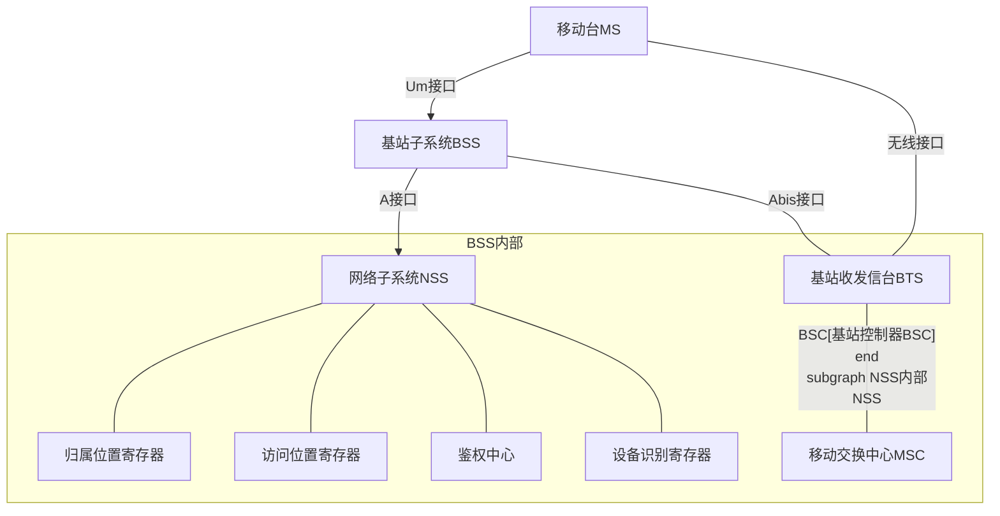
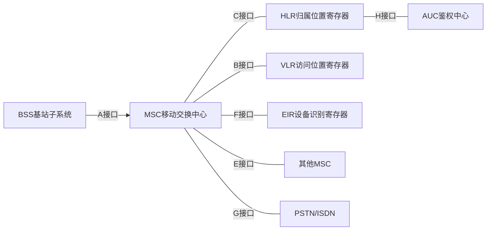
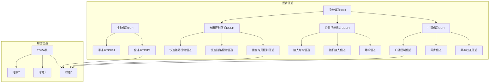
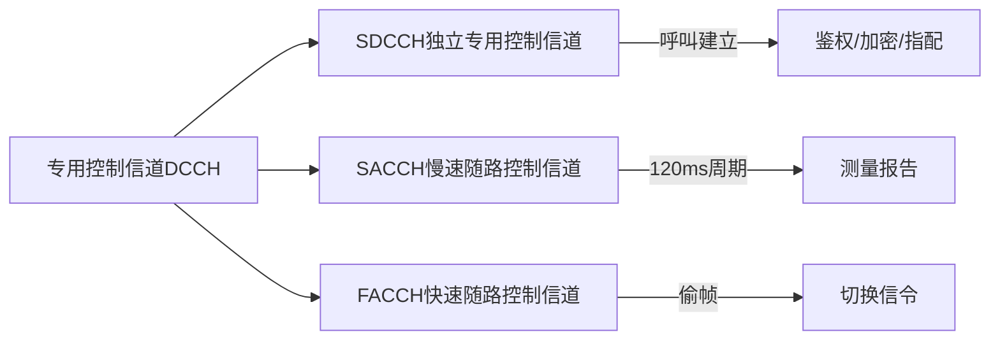
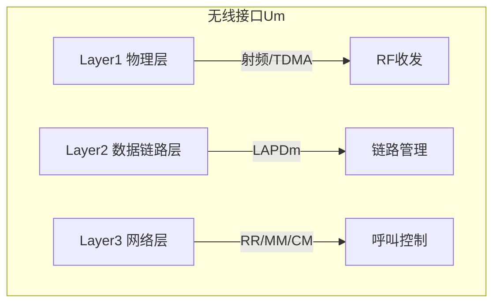
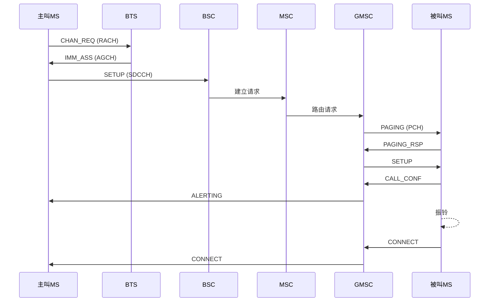
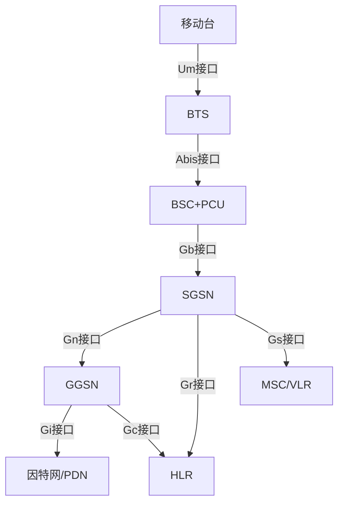
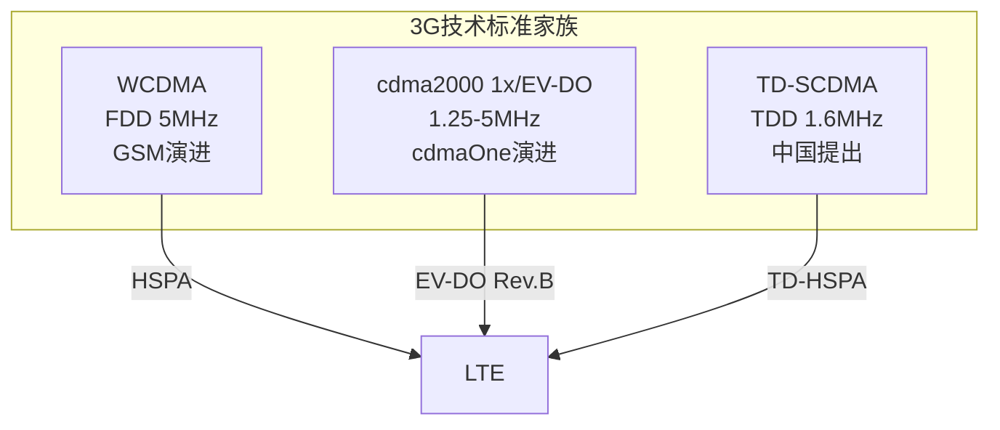

# 《移动通信原理与系统》第6章、第7章 知识点详细内容

> 本文件基于啜钢编著《移动通信原理与系统》教材第6章（GSM及其增强移动通信系统）和第7章（第三代移动通信系统及其增强技术）整理。

---

## 第6章 GSM及其增强移动通信系统

### 知识点 6.1 — GSM系统业务分类

**定义**：GSM系统定义了三大类业务——电信业务、承载业务和补充业务。电信业务为用户提供端到端的完整通信能力（如语音通话、短信），承载业务仅提供信息传输的承载通道，补充业务则是对基本业务的增强和扩展。

**重要性**：A（必须掌握）

**特性**：
- 电信业务直接面向终端用户，包括语音业务和数据业务
- 承载业务不包含终端功能，仅提供透明的信息传输管道
- 补充业务不能独立使用，必须与电信业务或承载业务结合
- GSM业务设计可与ISDN互联互通

**二级结论**：补充业务的存在使GSM能够提供类似固定电话的丰富业务体验，是GSM商业成功的重要因素之一。

---

### 知识点 6.1.1 — 电信业务

**定义**：电信业务是GSM系统中最基本的业务类型，为用户提供端到端的完整通信能力。语音业务包括电话业务和紧急呼叫，数据业务包括短消息业务SMS、小区广播和传真等。

**重要性**：A

**特性**：
- 电话业务：全双工语音通话，是最主要的电信业务
- 紧急呼叫：免费拨打紧急号码（如110、119、120），无需SIM卡
- 短消息业务SMS：文本消息，最多160字符，使用控制信道传输
- 小区广播CBS：单向广播消息，如天气预警、交通信息
- 传真业务：Group 3传真，最高速率9600bps

**二级结论**：SMS短信是GSM时代最成功的发明之一，其控制信道传输的特性使其在信号微弱时仍能成功发送，这一设计理念深刻影响了后续的移动通信系统。

---

### 知识点 6.1.2 — 承载业务

**定义**：承载业务是GSM系统提供的信息传输承载能力，仅负责透明传输用户数据而不改变信息内容，可以作为电信业务的基础，也可单独向用户提供数据传输服务。

**重要性**：B（重要）

**特性**：
- 支持异步数据和同步数据传输
- 速率范围从300bps到9600bps
- 提供透明模式和非透明模式（带差错恢复）
- 可通过调制解调器互联功能IWF与PSTN或ISDN的调制解调器互通

**公式**：数据业务速率

$$R_b = \frac{\text{有效比特数}}{\text{传输时间}}$$

**二级结论**：承载业务的透明传输特性使其适合作为数据通信的底层支撑，是GPRS分组数据业务发展的技术基础。

---

### 知识点 6.1.3 — 补充业务

**定义**：补充业务是对电信业务和承载业务的增强和扩展，用户可以根据需要定制激活，提供个性化的通信体验。补充业务必须与基本业务配合使用。

**重要性**：B

**特性**：
- 呼叫转移：无条件、遇忙、无应答、不可及转移
- 呼叫等待：通话中提醒新来电
- 主叫号码显示/隐藏
- 呼叫保持和多方通话
- 闭合用户群

**二级结论**：补充业务的灵活性体现了GSM信令系统的强大能力，也为后续3G/4G的增值业务（VAS）奠定了基础。

---

### 知识点 6.1.4 — GSM业务特征

**定义**：GSM业务特征反映了GSM作为第二代数字移动通信系统相比第一代模拟系统所具备的技术优势，是GSM获得全球广泛部署的技术基础。

**重要性**：A

**特性**：
- 数字化传输：语音质量清晰，噪声低
- 国际漫游：统一的国际标准，跨越国界无缝通信
- 保密性：数字加密防止窃听
- 频谱效率高：采用FDMA+TDMA和语音压缩
- ISDN兼容：支持与综合业务数字网互联

**二级结论**：GSM的标准化和数字化是其在90年代全球成功部署的根本原因，也为后续向3G的平滑演进创造了条件。

---

### 知识点 6.2 — GSM系统总体结构

**定义**：GSM系统采用模块化的功能结构，将移动通信网络划分为移动台MS、基站子系统BSS和网络子系统NSS三大部分，各部分通过标准化接口互联，构成了开放和可扩展的系统架构。

**重要性**：A

**特性**：
- 移动台MS：用户终端设备
- 基站子系统BSS：负责无线接入和无线资源管理
- 网络子系统NSS：负责交换、数据库管理和与其他网络互联
- 接口标准化是GSM最大优势

**二级结论**：GSM的开放架构使不同厂商的设备可以互联互通，打破了传统电信设备厂商的垄断，推动了移动通信产业的快速发展。

---

### 知识点 6.2.1 — 移动台MS

**定义**：移动台是GSM系统中用户使用的终端设备，包含移动终端ME和用户识别模块SIM卡两部分。SIM卡是可插拔的智能卡，存储用户的身份信息，使移动台可以＂换机不换号＂。

**重要性**：B

**特性**：
- 移动终端ME：完成射频收发、语音编解码和信令处理
- SIM卡：存储IMSI、Ki、鉴权算法等用户敏感信息
- SIM卡的存在实现了用户与终端的分离
- 终端分为车载台、手持台和便携台

**公式**：SIM卡存储的核心安全参数包括永久密钥 $K_i$（64-128位），以及通过 $K_i$ 计算的鉴权响应和加密密钥。

**二级结论**：SIM卡的引入是移动通信技术的革命性创新，它实现了用户身份与终端设备的分离，是国际漫游和业务个人化的基础。

---

### 知识点 6.2.2 — 基站子系统BSS

**定义**：基站子系统是GSM系统中连接移动台与核心网的桥梁，由基站控制器BSC和基站收发信台BTS组成，负责无线信号的收发、无线资源管理和移动台的接入控制。

**重要性**：B

**特性**：
- BSC是BSS的控制核心，一个BSC控制多个BTS
- BTS是无线信号的收发点
- 负责无线信道管理、功率控制和切换执行
- 通过A接口连接NSS

**二级结论**：BSS的设计实现了无线接入功能的集中控制，BSC可以高效管理大量BTS的无线资源，是网络容量优化的关键节点。

---

### 知识点 6.2.3 — 基站收发信台BTS

**定义**：BTS是基站子系统中直接与移动台进行无线通信的设备，完成射频信号的发射与接收、调制解调等功能，是用户接入网络的无线入口。

**重要性**：B

**特性**：
- 包含收发信机、天线系统和接口设备
- 一个BTS覆盖一个小区（cell）
- 可支持全向或扇区化配置（3扇区常见）
- 完成信道编码、交织、调制等基带处理

**二级结论**：BTS的扇区化配置（通常为120度扇区）是GSM网络容量提升的重要手段，扇区化可以将频谱复用距离缩小，提高频谱效率。

---

### 知识点 6.2.4 — 基站控制器BSC

**定义**：BSC是基站子系统的控制核心，对多个BTS进行集中控制，完成无线资源分配、切换控制、功率控制等关键功能，是BSS的智能中心。

**重要性**：A

**特性**：
- 一个BSC可控制数十个BTS
- 负责呼叫建立和释放的无线侧处理
- 通过Abis接口连接BTS（2.048Mbps E1链路）
- 管理无线信道的分配和释放

**二级结论**：BSC的集中控制设计降低了单站（BTS）的复杂度和成本，使大规模网络部署成为可能，同时提高了无线资源管理的效率。

---

### 知识点 6.2.5 — 网络子系统NSS

**定义**：网络子系统是GSM系统的核心网部分，负责呼叫控制、移动性管理、用户数据管理和与其他网络的互联互通。NSS由多个功能实体组成，是整个系统的大脑。

**重要性**：A

**特性**：
- 由MSC、HLR、VLR、AUC、EIR和OMC组成
- 完成交换、数据库管理和网络管理
- 通过A接口连接BSS
- 支持PSTN、ISDN和PSPDN互联

**二级结论**：NSS各功能实体的分离设计是GSM网络灵活性和可靠性的关键，运营商可以根据需求独立扩展交换容量或数据库容量。

---

### 知识点 6.2.6 — 移动交换中心MSC

**定义**：MSC是NSS的核心设备，具有PSTN交换机的基本功能，并增加了移动性管理、位置登记和切换控制等移动特性。MSC是GSM网络与其他网络的关口。

**重要性**：A

**特性**：
- 负责呼叫建立、维持和释放
- 支持位置登记和切换控制
- 通过E接口与其他MSC互联
- 网关MSC（GMSC）连接其他网络
- 采用No.7信令系统

**二级结论**：MSC是GSM网络中最复杂的网元，它需要同时处理电路交换和移动性管理，是网络性能和容量的关键瓶颈。

---

### 知识点 6.2.7 — 归属位置寄存器HLR

**定义**：HLR是存储管辖范围内所有移动用户数据的静态数据库，是用户信息的永久存储中心。每个移动用户有且仅有一个HLR记录。当用户漫游时，HLR向访问地VLR提供用户数据。

**重要性**：A

**特性**：
- 存储IMSI、MSISDN、业务信息等静态数据
- 存储鉴权参数Ki的关联信息
- 记录用户当前所在的VLR地址
- 是网络查询用户数据的首要节点

**二级结论**：HLR是GSM网络安全和漫游功能的数据基础，其可靠性和可用性直接影响整个网络的服务质量，实际网络中通常采用冗余备份部署。

---

### 知识点 6.2.8 — 访问位置寄存器VLR

**定义**：VLR是存储当前位于某个MSC服务区内所有移动用户数据的动态数据库。当移动台进入新的MSC服务区时，VLR从HLR获取该用户的数据。

**重要性**：B

**特性**：
- 存储来访用户的IMSI、TMSI、业务信息和位置信息
- 一个VLR通常与一个MSC合设
- 可服务数万个用户
- 用户离开服务区后数据被删除

**二级结论**：VLR的存在大大减少了MSC对HLR的频繁查询，降低了信令负荷，也提高了呼叫建立的速度，是GSM网络效率优化的巧妙设计。

---

### 知识点 6.2.9 — 鉴权中心AUC

**定义**：AUC是与HLR配合工作的安全功能实体，负责产生和存储用户鉴权所需的安全参数。AUC是GSM安全体系的核心，确保只有合法用户才能接入网络。

**重要性**：B

**特性**：
- 存储每个用户的鉴权键Ki
- 生成随机数RAND、符号响应SRES和加密键Kc
- 采用A3（鉴权）、A5（加密）和A8（密钥生成）算法
- 通常与HLR合设

**公式**：鉴权三参数组

$$\text{三元组} = \langle \text{RAND}, \text{SRES}, K_c \rangle$$

其中：

$$\text{SRES} = A3(\text{RAND}, K_i)$$

$$K_c = A8(\text{RAND}, K_i)$$

**二级结论**：AUC通过随机数RAND确保每次鉴权都是独一无二的，有效防止了重放攻击，是GSM安全机制的设计亮点。

---

### 知识点 6.2.10 — 设备识别寄存器EIR

**定义**：EIR是存储移动台设备标识信息的数据库，用于验证移动台设备的合法性。通过IMEI号码可禁止被盗或非法设备入网。

**重要性**：C（补充）

**特性**：
- 存储IMEI号码及其状态（白名单/灰名单/黑名单）
- 白名单：合法设备
- 灰名单：有问题的设备
- 黑名单：被盗或非法设备
- IMEI由TAC+FAC+SNR+SP组成

**二级结论**：EIR在实际网络中并非强制部署，但其设计理念影响了后续移动通信系统的设备安全管理机制。

---

### 知识点 6.2.11 — 操作维护中心OMC

**定义**：OMC是GSM系统的操作与维护管理中心，负责对整个网络进行监控、管理和维护，确保网络正常运行。

**重要性**：C

**特性**：
- 分为OMC-S（交换侧）和OMC-R（无线侧）
- 性能管理：收集和分析网络性能指标
- 配置管理：管理网络参数
- 故障管理：检测和处理告警
- 计费管理：收集计费信息

**二级结论**：OMC的网络管理功能是电信运营商保障网络质量和优化用户体验的重要工具，其管理理念延续到后续3G/4G/5G网络中。

---

### 知识点 6.2.12 — GSM系统主要接口

**定义**：GSM系统在主要功能实体之间定义了标准化接口，包括Um（空中接口）、Abis接口、A接口等。接口标准化是GSM全球成功部署的关键因素。

**重要性**：A

**特性**：
- Um接口：MS与BTS之间的无线接口
- Abis接口：BTS与BSC之间
- A接口：BSC与MSC之间
- 各接口都有详细的信令和数据规范
- 确保不同厂商设备互联互通

**二级结论**：GSM的开放接口标准化是其在90年代击败其他竞争技术（如D-AMPS、PDC）获得全球主导地位的关键因素，开放标准推动了产业链繁荣。

---

### 知识点 6.2.13 — Um空中接口

**定义**：Um接口是GSM系统最重要的接口，是移动台与基站之间的无线接口。所有无线通信都通过该接口进行，采用FDMA+TDMA混合多址方式。

**重要性**：A

**特性**：
- FDMA：载波间隔200kHz
- TDMA：每个载波8个时隙
- 传输速率：270.833kbps
- 工作频段：GSM900（上行890-915MHz，下行935-960MHz）或DCS1800
- 包含物理层、链路层和网络层协议

**公式**：

$$\text{时隙时长} T_{slot} = \frac{156.25}{270.833 \times 10^3} \approx 0.577 \text{ms}$$

$$\text{帧时长} T_{frame} = 8 \times T_{slot} \approx 4.615 \text{ms}$$

**二级结论**：Um接口的200kHz载波间隔和8时隙TDMA结构是GSM系统的核心物理层设计，这一设计在频谱效率和实现复杂度之间取得了良好的平衡。

---

### 知识点 6.2.14 — Abis接口

**定义**：Abis接口是BTS与BSC之间的有线接口，主要用于传输业务数据和控制信令。Abis接口是基站子系统内部的接口。

**重要性**：B

**特性**：
- 基于2.048Mbps的E1链路
- 可支持多种传输方式（光纤、微波等）
- 传输业务数据、信令和操作维护信息
- 部分规范未完全开放，是厂商锁定策略的体现

**二级结论**：Abis接口的标准化程度不如A接口和Um接口，这在一定程度上限制了运营商混搭不同厂商BTS和BSC的灵活性。

---

### 知识点 6.2.15 — A接口

**定义**：A接口是BSS与NSS之间的接口，是GSM系统中最重要的有线接口。所有呼叫和业务数据都通过该接口进入核心网，采用No.7信令系统。

**重要性**：A

**特性**：
- 采用No.7信令系统
- 基于2.048Mbps的PCM链路
- 传输语音、数据和信令
- BSSMAP和DTAP协议
- 是不同厂商设备互联的关键

**二级结论**：A接口的开放标准化是GSM网络设备市场充分竞争的前提，也是运营商降低设备采购成本、保障供应链安全的制度基础。

---

### 知识点 6.3 — 物理信道与逻辑信道

**定义**：GSM信道分为物理信道和逻辑信道两个层次。物理信道对应实际的频率时隙资源，由频点和时隙共同定义。逻辑信道按功能分类承载不同类型的信息，通过映射关系复用到物理信道上。

**重要性**：A

**特性**：
- 物理信道 = 频点 + 时隙
- 逻辑信道分为业务信道TCH和控制信道CCH
- FDMA+TDMA混合多址
- 一个载波8个时隙

**二级结论**：逻辑信道到物理信道的映射机制是GSM信道管理的核心设计，它使系统可以灵活分配无线资源以满足不同业务场景的需求。

---

### 知识点 6.3.1 — 物理信道

**定义**：物理信道是无线接口上实际的传输资源，由载波频率和时隙位置共同确定，是GSM无线传输的基本物理单元。

**重要性**：A

**特性**：
- GSM900：上行890-915MHz，下行935-960MHz
- DCS1800：上行1710-1785MHz，下行1805-1880MHz
- 载波间隔：200kHz
- 每载波分为8个时隙
- 一个时隙为一个物理信道

**公式**：

$$\text{GSM900载波数} = \frac{25\text{MHz}}{200\text{kHz}} = 125 \text{个载波}$$

$$\text{双工信道数} = 125 \times 8 = 1000 \text{个物理信道}$$

**二级结论**：物理信道的数量直接决定了小区的通信容量，频谱资源是移动通信最宝贵的资源，因此提高频谱效率成为每一代移动通信系统设计的核心目标。

---

### 知识点 6.3.2 — 逻辑信道

**定义**：逻辑信道是按功能划分的信道类型，用于传输不同类型的信息（业务信息、控制信息）。逻辑信道通过映射关系复用到物理信道上。

**重要性**：A

**特性**：
- 业务信道TCH：传输用户语音或数据
- 控制信道CCH：传输控制信令
- 控制信道分为BCH（广播）、CCCH（公共控制）、DCCH（专用控制）
- 通过映射方式复用到物理信道

**二级结论**：逻辑信道的分类设计使系统能够高效地组织信令传输，广播信道、公共控制信道和专用控制信道的层次化设计是GSM信令体系高效运行的基础。

---

### 知识点 6.3.3 — 业务信道TCH

**定义**：业务信道是用于传输用户语音或数据信息的逻辑信道，是用户通信时实际承载业务数据的信道。

**重要性**：A

**特性**：
- 全速率TCH/F：22.8kbps，每帧一个用户
- 半速率TCH/H：11.4kbps，每两帧一个用户
- 语音业务采用RPE-LTP编码
- 数据业务速率最高9.6kbps
- 可传输语音或数据

**公式**：

$$R_{TCH/F} = \frac{456 \text{ bit}}{20 \text{ ms}} = 22.8 \text{ kbps}$$

$$R_{TCH/H} = \frac{228 \text{ bit}}{20 \text{ ms}} = 11.4 \text{ kbps}$$

**二级结论**：全速率TCH/F的22.8kbps传输速率中，实际用户语音数据仅13kbps（RPE-LTP编码），其余比特用于信道编码的冗余保护。

---

### 知识点 6.3.4 — 广播信道BCH

**定义**：广播信道是基站向小区内所有移动台单向广播公共信息的控制信道，用于移动台接入网络前获取必要的系统信息。

**重要性**：A

**特性**：
- 频率校正信道FCCH
- 同步信道SCH
- 广播控制信道BCCH
- 下行单向传输
- 移动台开机后首先搜索BCH

**二级结论**：BCH的设计确保任何移动台在开机后都能快速发现可用小区并获取必要的系统信息，是GSM小区选择、重选和接入的信令基础。

---

### 知识点 6.3.5 — 频率校正信道FCCH

**定义**：FCCH是广播信道的一种，用于向移动台发送频率校正信息，使移动台能够校准本地振荡器频率，实现与基站频率同步。

**重要性**：A

**特性**：
- 发送固定全零序列
- 产生纯正弦波用于频率校正
- 占用一个时隙
- 是移动台搜索小区的标志
- 周期性发送

**二级结论**：FCCH的存在使移动台可以快速锁定基站的载波频率，是移动台开机后搜索小区的第一步，其简单的全零序列设计使检测非常可靠。

---

### 知识点 6.3.6 — 同步信道SCH

**定义**：SCH用于向移动台发送帧同步信息和基站识别码（BSIC），使移动台实现时间同步并获取基站标识。

**重要性**：B

**特性**：
- 携带帧号FN和基站识别码BSIC
- BSIC = NCC（网络色码，3bit）+ BCC（基站色码，3bit）
- 移动台在FCCH之后接收SCH
- 是实现帧同步的关键

**公式**：

$$\text{BSIC} = \text{NCC} \times 8 + \text{BCC}$$

其中NCC为网络色码（0-7），BCC为基站色码（0-7），BSIC取值范围0-63。

**二级结论**：BSIC的唯一性使得移动台可以区分使用相同BCCH载波的不同小区，是GSM网络规划中的关键参数。

---

### 知识点 6.3.7 — 广播控制信道BCCH

**定义**：BCCH是广播信道中信息量最大的一种，用于向移动台广播小区的通用系统信息，包括小区识别码、LAI、邻近小区列表、接入控制参数等。

**重要性**：A

**特性**：
- 广播小区识别码（CI）、位置区识别码（LAI）
- 广播邻近小区列表和频率
- 广播接入控制参数
- 移动台通过BCCH了解系统配置
- 每个小区至少有一个BCCH

**二级结论**：BCCH中广播的邻近小区列表是移动台进行小区重选的依据，合理配置邻区关系是网络优化中的重要工作。

---

### 知识点 6.3.8 — 公共控制信道CCCH

**定义**：CCCH是用于网络与移动台之间传输公共控制信息的信道，主要处理寻呼和接入请求，是多用户共享的信道。

**重要性**：A

**特性**：
- 寻呼信道PCH（下行）：呼叫通知
- 随机接入信道RACH（上行）：接入请求
- 接入允许信道AGCH（下行）：信道分配
- 用于呼叫建立初始阶段

**二级结论**：CCCH的设计实现了移动台初始接入的高效处理，PCH和RACH的分工使寻呼和接入流程可以并行进行，提高了呼叫建立效率。

---

### 知识点 6.3.9 — 寻呼信道PCH

**定义**：PCH是下行公共控制信道，用于网络向移动台发送寻呼请求，通知被叫移动台有来电。

**重要性**：B

**特性**：
- 采用IMSI或TMSI寻呼
- 寻呼组将用户分组以节省移动台功耗
- 在PCH/AGCH组合信道上传输
- 寻呼消息包含被叫用户标识

**二级结论**：采用TMSI代替IMSI进行寻呼可以减少空中接口的信令比特数，同时保护用户身份隐私，是GSM安全设计的重要体现。

---

### 知识点 6.3.10 — 随机接入信道RACH

**定义**：RACH是上行公共控制信道，是移动台主动发起通信或响应寻呼的唯一上行信道，采用时隙ALOHA接入方式。

**重要性**：B

**特性**：
- 采用时隙ALOHA接入方式
- 移动台发送信道请求消息
- 存在碰撞可能需重发
- 是呼叫建立的起点
- 接入突发格式特殊（较长保护间隔）

**公式**：时隙ALOHA吞吐量

$$S = G \cdot e^{-G}$$

其中G为提供的业务量（每个时隙的尝试次数），S为成功传输的吞吐量。当G=1时，最大吞吐率 $S_{max} = e^{-1} \approx 0.368$。

**二级结论**：RACH的时隙ALOHA设计虽然存在碰撞问题，但其简单性和快速响应特性使其非常适合随机接入场景，GSM通过退避算法有效控制了碰撞概率。

---

### 知识点 6.3.11 — 接入允许信道AGCH

**定义**：AGCH是下行公共控制信道，用于网络对移动台的随机接入请求进行响应，向移动台分配专用的信令信道SDCCH。

**重要性**：B

**特性**：
- 分配SDCCH信道给移动台
- 响应RACH上的信道请求
- 采用立即分配消息
- 是网络对移动台接入请求的确认

**二级结论**：AGCH上的立即分配消息使移动台在成功接入后可以快速获得专用控制信道，是呼叫建立流程高效进行的关键环节。

---

### 知识点 6.3.12 — 专用控制信道DCCH

**定义**：DCCH是分配给特定移动台使用的双向控制信道，分为SDCCH、SACCH和FACCH三种类型，分别用于不同场景的信令传输。

**重要性**：A

**特性**：
- SDCCH：呼叫建立和位置更新
- SACCH：测量报告和功率控制
- FACCH：紧急信令（如切换指令）
- 双向传输

**二级结论**：三种DCCH的分工设计是GSM信令体系的精妙之处——SDCCH处理常规信令，SACCH处理周期性低速信令，FACCH通过＂偷帧＂机制处理紧急信令，三者协同满足了不同信令传输需求。

---

### 知识点 6.3.13 — 独立专用控制信道SDCCH

**定义**：SDCCH是在呼叫建立阶段分配给移动台的专用控制信道，用于传输呼叫建立和位置更新所需的信令，不随路于业务信道。

**重要性**：A

**特性**：
- 速率与TCH/F相同（22.8kbps）
- 可进行鉴权、加密建立和分配TCH
- 每个SDCCH可支持若干用户分时使用
- 是呼叫建立过程的信令通道

**二级结论**：SDCCH的使用使呼叫建立信令与业务信道分离，避免了信令对业务传输的干扰，同时也提高了无线资源的利用效率。

---

### 知识点 6.3.14 — 慢速随路控制信道SACCH

**定义**：SACCH是随路于业务信道或SDCCH的低速率控制信道，每26复帧传输一次，携带接收信号强度、接收质量和相邻小区测量结果。

**重要性**：B

**特性**：
- 每26复帧（120ms）传输一次
- 接收信号强度RXLEV
- 接收质量RXQUAL
- 相邻小区测量结果
- 用于功率控制和切换判决

**公式**：

$$T_{SACCH} = 26 \times 4.615 \text{ ms} \approx 120 \text{ ms}$$

即SACCH每120ms周期性传输一次测量报告。

**二级结论**：SACCH的周期性测量报告是GSM功率控制和切换判决的数据来源，480ms的测量周期是功率控制和切换算法的时间基准。

---

### 知识点 6.3.15 — 快速随路控制信道FACCH

**定义**：FACCH是通过偷帧方式占用业务信道时隙传输紧急控制信道的机制，主要用于切换信令的快速传输。

**重要性**：A

**特性**：
- 通过将TCH的2个比特置为偷帧标志来指示
- 可用于切换信令的快速传输
- 传输完成后归还业务信道
- 信令紧急时使用

**公式**：偷帧标志

$$\text{ stealing flag} = \begin{cases} 00 & \text{正常TCH数据} \\ 11 & \text{FACCH偷帧} \end{cases}$$

**二级结论**：FACCH的＂偷帧＂设计巧妙地解决了紧急信令传输与业务信道占用的矛盾——在不额外分配资源的情况下实现了低延迟的紧急信令传输。

---

### 知识点 6.3.16 — 物理信道与逻辑信道的配置

**定义**：逻辑信道到物理信道的映射是将不同类型的逻辑信道按照一定规则安排到物理时隙上，构成复帧结构。GSM定义了26复帧和51复帧两种结构。

**重要性**：A

**特性**：
- 26复帧用于业务信道
- 51复帧用于控制信道
- 映射关系决定了信道容量和信令能力
- 合理配置是网络规划的重要内容

**二级结论**：26复帧和51复帧两种结构的设计巧妙地解决了业务和控制信令的不同周期需求，51和26互质的设计使得两种复帧的超帧同步简单高效。

---

### 知识点 6.3.17 — 26复帧结构

**定义**：26复帧是业务信道的复帧组织形式，由26个TDMA帧组成，周期120ms。其中24帧传TCH，1帧传SACCH，1帧空闲。

**重要性**：B

**特性**：
- 周期120ms
- 24帧传TCH
- 1帧传SACCH
- 1帧空闲
- 51个26复帧构成一个超帧

**公式**：

$$T_{26} = 26 \times 4.615 \text{ ms} = 120 \text{ ms}$$

$$T_{\text{super}} = 51 \times 26 \times 4.615 \text{ ms} = 6.12 \text{ s}$$

**二级结论**：26复帧的120ms周期决定了SACCH测量报告的传输间隔，是GSM功率控制和切换测量算法设计的重要时间基准。

---

### 知识点 6.3.18 — 51复帧结构

**定义**：51复帧是控制信道的复帧组织形式，由51个TDMA帧组成，周期235.4ms，用于传输广播信道和公共控制信令。

**重要性**：B

**特性**：
- 周期235.4ms
- 用于BCCH、CCCH和SDCCH
- 26个51复帧构成一个超帧
- 与26复帧配合完成信令传输

**公式**：

$$T_{51} = 51 \times 4.615 \text{ ms} = 235.385 \text{ ms}$$

**二级结论**：51复帧的较长周期（235.4ms）适合承载系统广播信息，因为广播信息不需要频繁更新，这种设计与26复帧形成了高效的互补。

---

### 知识点 6.3.19 — 超帧与超高帧

**定义**：超帧和超高帧是GSM中更高层次的帧结构。2048个超帧构成一个超高帧，包含2715648个TDMA帧，周期约3.5小时。

**重要性**：C

**特性**：
- 2048个超帧 = 1个超高帧
- 超高帧包含2715648个TDMA帧
- 周期约3.5小时
- 帧号FN用于加密序列同步
- GSM时序的最高层级

**公式**：

$$T_{\text{hyper}} = 2048 \times 6.12 \text{ s} \approx 3.5 \text{ 小时}$$

$$N_{frame} = 51 \times 26 \times 2048 = 2715648 \text{ 帧}$$

**二级结论**：超高帧的设计主要是为加密算法提供足够长的帧号周期，确保加密序列在长时间通话中不会重复，提高通信安全性。

---

### 知识点 6.3.20 — 突发脉冲

**定义**：突发脉冲是GSM无线接口上每个时隙内发送的信号单元，是GSM无线传输的最小单位。分为普通突发NB、频率校正突发FB、同步突发SB、接入突发AB和虚拟突发DB五种。

**重要性**：A

**特性**：
- 时长约0.577ms
- 156.25比特
- 不同突发用于不同逻辑信道
- 包含数据、训练和尾比特等字段

**二级结论**：五种突发脉冲的设计反映了GSM对不同通信场景（正常业务、频率同步、时间同步、随机接入、空闲填充）的精细化考虑，每种突发的结构都针对其特定用途进行了优化。

---

### 知识点 6.3.21 — 普通突发脉冲序列NB

**定义**：NB是GSM中最常用的突发脉冲格式，用于TCH和大部分控制信道。包含2×57数据比特、26训练序列比特、6尾比特和2×1偷帧标志。

**重要性**：A

**特性**：
- 2×57数据比特 = 114比特有效数据
- 26比特训练序列用于信道估计
- 6比特尾比特用于卷积码结尾
- 2×1偷帧标志指示FACCH

**公式**：

$$\text{总比特数} = 57 + 1 + 26 + 1 + 57 + 3 + 3 + 8.25 = 156.25 \text{ bit}$$

实际结构：[尾比特3 + 数据57 + 偷帧标志1 + 训练序列26 + 偷帧标志1 + 数据57 + 尾比特3 + 保护间隔8.25]

**二级结论**：NB中训练序列的存在是GSM相干检测和均衡器设计的基础，接收端利用已知的训练序列进行信道估计，从而补偿多径衰落的影响。

---

### 知识点 6.3.22 — 频率校正突发脉冲序列FB

**定义**：FB是用于FCCH的突发脉冲格式，发送固定全零序列，产生纯正弦波用于频率校正。

**重要性**：B

**特性**：
- 发送固定全零序列
- 产生纯正弦波用于频率校正
- 占用一个时隙
- 是移动台搜索小区的标志
- 格式简单易于识别

**二级结论**：FB的设计简单但极其重要——其纯正弦波特性使移动台可以通过简单的频率扫描算法快速检测到GSM载波，无需任何先验信息。

---

### 知识点 6.3.23 — 同步突发脉冲序列SB

**定义**：SB是用于SCH的突发脉冲格式，携带帧同步信息和基站识别码，使移动台实现帧同步。

**重要性**：B

**特性**：
- 64加密比特
- 39扩展数据比特
- 64比特训练序列
- 携带帧号和BSIC
- 格式较长以容纳更多信息

**二级结论**：SB中携带的帧号（FN）信息是移动台进入网络后加密序列同步的依据，也是后续加密通信的时间基准。

---

### 知识点 6.3.24 — 接入突发脉冲序列AB

**定义**：AB是用于RACH的突发脉冲格式，专为移动台首次接入设计，具有较长的保护间隔以适应定时提前量未知的情况。

**重要性**：A

**特性**：
- 8尾比特
- 41同步序列
- 36加密比特
- 68.25保护比特（最长保护间隔）
- 设计用于克服传播时延不确定性

**公式**：

$$\text{保护时间} = \frac{68.25}{270.833 \times 10^3} \approx 252 \text{ }\mu\text{s}$$

对应最大单程传播时延约126μs，最大小区半径约38km。

**二级结论**：AB的最长保护间隔设计是GSM系统考虑最充分的技术细节之一，它使移动台在不知道自身与基站距离的情况下仍能成功发起随机接入。

---

### 知识点 6.3.25 — 虚拟突发脉冲序列DB

**定义**：DB是下行方向上不发送有用信息时使用的突发脉冲格式，用于填充空闲时隙以维持载波功率稳定。

**重要性**：B

**特性**：
- 不携带用户数据
- 功率恒定
- 维持下行链路功率连续性
- 用于时隙未分配时填充

**二级结论**：DB的存在使基站发射功率保持恒定，避免了功率跳变对其他信道的干扰，也简化了功率放大器的设计。

---

### 知识点 6.3.26 — 帧偏离、定时提前量与半速率信道

**定义**：帧偏离解决收发切换时间，定时提前量补偿传播时延，半速率信道通过时隙间隔使用使容量翻倍。这三项技术是GSM增强演进的重要技术。

**重要性**：A

**特性**：
- 帧偏离：发射和接收时隙之间的时间偏移
- 定时提前量TA：补偿传播时延
- 半速率：时隙间隔使用使容量翻倍

**二级结论**：帧偏离和定时提前量的设计体现了GSM对TDD系统中传播时延问题的深入思考，半速率则是在语音质量与系统容量之间的权衡。

---

### 知识点 6.3.27 — 帧偏离

**定义**：帧偏离是GSM系统中移动台发射和接收时隙之间的时间偏移（3个时隙），使移动台可以在不同时隙进行收发，避免收发同时工作。

**重要性**：B

**特性**：
- 偏移3个时隙（约1.73ms）
- 利用TDMA帧内收发间隔
- 让移动台使用同一频率上下行
- 不需双工器可用开关替代
- 降低终端成本和功耗

**公式**：

$$\Delta t = 3 \times 0.577 \text{ ms} \approx 1.73 \text{ ms}$$

**二级结论**：帧偏离设计使GSM终端可以用简单的射频开关替代昂贵的双工器，大幅降低了终端成本和功耗，是GSM终端普及的技术基础。

---

### 知识点 6.3.28 — 定时提前量TA

**定义**：定时提前量是基站指示移动台提前发射的时间量，用于补偿无线信号从移动台到基站的传播时延，确保信号在正确时隙到达基站。

**重要性**：B

**特性**：
- TA值0-63
- 每单位对应约3.69μs（1比特周期）
- 最大补偿约233μs对应35km小区半径
- 随移动台距离动态调整
- 每480ms更新一次

**公式**：

$$\text{定时提前量} = \text{TA} \times 3.69 \text{ }\mu\text{s}$$

$$d_{max} = \frac{c \times \Delta t_{max}}{2} = \frac{3 \times 10^8 \times 233 \times 10^{-6}}{2} \approx 35 \text{ km}$$

**二级结论**：TA的动态调整机制使GSM可以支持从0到35km范围内不同距离的移动台，同时确保所有信号都能在正确的时隙内到达基站。

---

### 知识点 6.3.29 — 半速率信道

**定义**：半速率信道是将一个全速率物理时隙由两个用户交替使用的信道方式，使系统容量在理论上增加一倍。采用VSELP或AMR编码。

**重要性**：B

**特性**：
- 每两个语音帧交替使用一个时隙
- 需要更复杂的信令配合
- 语音质量略有下降但容量翻倍
- 在网络拥塞时自动启用

**二级结论**：半速率信道是GSM Phase 2引入的重要容量增强功能，在网络拥塞时动态启用可以在语音质量与系统容量之间取得平衡。

---

### 知识点 6.4 — 衰落特性

**定义**：衰落特性描述无线信号在传播过程中因多径效应和环境变化导致的信号强度随机波动现象。包括大尺度衰落（路径损耗和阴影衰落）和小尺度衰落（多径衰落）。

**重要性**：A

**特性**：
- 路径损耗：信号随距离扩散而衰减
- 阴影衰落：障碍物遮挡引起
- 多径衰落：多径传播引起快速起伏
- 不同衰落类型需要不同的对抗技术

**二级结论**：衰落是无线通信中不可避免的现象，理解衰落的特性并设计相应的对抗技术是移动通信系统设计的核心挑战。

---

### 知识点 6.4.1 — 路径损耗

**定义**：路径损耗是信号在自由空间传播中因扩散而引起的功率衰减，与传播距离的幂次方成正比。

**重要性**：A

**特性**：
- 遵循对数距离路径损耗模型
- 传播指数n通常为2-4
- 可用Okumura-Hata模型预测
- 是链路预算的基础

**公式**：对数距离路径损耗模型

$$PL(d) = PL(d_0) + 10n \log_{10}\left(\frac{d}{d_0}\right) + X_\sigma$$

自由空间路径损耗：

$$PL_{FS}(d) = 32.44 + 20\log_{10}(d_{\text{km}}) + 20\log_{10}(f_{\text{MHz}}) \text{ (dB)}$$

**二级结论**：路径损耗模型是GSM网络规划中链路预算和小区覆盖预测的基础，Okumura-Hata模型是900MHz频段最广泛使用的经验模型。

---

### 知识点 6.4.2 — 阴影衰落

**定义**：阴影衰落是由于地形、建筑物等障碍物遮挡引起的信号功率中值慢变化，服从对数正态分布。

**重要性**：B

**特性**：
- 标准差通常为6-10dB
- 缓慢变化可用慢衰落描述
- 通过设置衰落余量克服
- 影响覆盖概率

**公式**：

$$P_r(d) \text{ [dBm]} = \overline{P_r(d)} \text{ [dBm]} - X_\sigma$$

其中 $X_\sigma$ 为对数正态随机变量，均值为0，标准差 $\sigma$ 通常为6-10dB。

**二级结论**：阴影衰落的统计特性决定了GSM网络规划中衰落余量的取值，典型的边缘覆盖概率（如95%）需要通过设置约10dB的衰落余量来实现。

---

### 知识点 6.4.3 — 多径衰落

**定义**：多径衰落是由于信号经过多条不同路径到达接收机产生的干涉现象，导致信号快速起伏和时延扩展。

**重要性**：B

**特性**：
- 时延扩展导致码间干扰
- 相干带宽与多径时散成反比
- 频率选择性衰落影响不同频率分量不同
- 移动速度影响衰落速率
- 瑞利分布描述无直射径情况

**公式**：多径信道冲激响应

$$h(t, \tau) = \sum_{i=0}^{N-1} a_i(t) \cdot e^{-j\phi_i(t)} \cdot \delta(\tau - \tau_i(t))$$

瑞利分布PDF：

$$f(r) = \frac{r}{\sigma^2} \exp\left(-\frac{r^2}{2\sigma^2}\right), \quad r \geq 0$$

**二级结论**：多径衰落是GSM数字传输中码间干扰的主要来源，也是GSM采用均衡、分集和跳频等抗衰落技术的根本原因。

---

### 知识点 6.4.4 — 时延扩展与相干带宽

**定义**：时延扩展是多径信道中最大多径分量与最小多径分量的到达时间差。相干带宽是信道保持恒定增益的频率范围。

**重要性**：A

**特性**：
- 时延扩展典型值：城市1-10μs
- 相干带宽 $B_c \approx 1/(2\pi \cdot \Delta\tau)$
- 信号带宽 > $B_c$ 时产生频率选择性衰落
- 是均衡器设计的依据

**公式**：

$$\Delta\tau = \max(\tau_i) - \min(\tau_i)$$

$$B_c \approx \frac{1}{2\pi \cdot \Delta\tau}$$

GSM系统带宽200kHz远大于典型相干带宽，因此GSM信号经历频率选择性衰落。

**二级结论**：GSM的200kHz信道带宽远大于典型城区环境的相干带宽（约几十kHz），因此GSM必然经历频率选择性衰落，这是GSM采用信道均衡技术的理论依据。

---

### 知识点 6.4.5 — 多普勒扩展与相干时间

**定义**：多普勒扩展是由于移动台运动引起的接收信号频率扩散。相干时间是信道保持不变的平均时间。

**重要性**：B

**特性**：
- 多普勒频移 $f_d = v/\lambda \cdot \cos\theta$
- 相干时间 $T_c \approx 1/(2f_d)$
- 符号周期 > $T_c$ 时产生快衰落
- 影响信道估计精度

**公式**：

$$f_d = \frac{v}{\lambda} \cos\theta = \frac{v \cdot f_c}{c} \cos\theta$$

$$T_c \approx \frac{1}{2f_d} = \frac{c}{2v \cdot f_c}$$

**二级结论**：多普勒扩展决定了信道变化的快慢，在GSM系统中，典型车速下（如120km/h）的信道相干时间远大于一个时隙时长，因此信道在一个时隙内近似恒定。

---

### 知识点 6.4.6 — 抗衰落技术

**定义**：抗衰落技术是GSM系统为克服无线信道衰落而采用的各种信号处理技术，包括分集、均衡、交织、信道编码和跳频等。

**重要性**：A

**特性**：
- 分集：利用多径的不相关性
- 均衡：补偿信道失真
- 交织：将突发错误分散
- 信道编码：增加冗余纠错
- 跳频：频率分集和干扰平均

**二级结论**：GSM采用多种抗衰落技术的组合方案是数字系统优于模拟系统的根本原因，模拟系统只能被动接受衰落的影响。

---

### 知识点 6.4.7 — 分集技术

**定义**：分集技术是通过多个独立衰落的信号支路进行传输和合并，利用各支路衰落的不相关性来减小衰落影响的概率统计方法。

**重要性**：A

**特性**：
- 空间分集：多天线间距>10λ
- 频率分集：跳频实现
- 时间分集：交织实现
- 选择性合并、等增益合并、最大比合并

**公式**：选择性合并的平均信噪比改善

$$\overline{\gamma}_{SC} = \overline{\gamma} \sum_{k=1}^{M} \frac{1}{k}$$

其中M为分集支路数，$\overline{\gamma}$为每支路平均信噪比。

最大比合并的平均信噪比：

$$\overline{\gamma}_{MRC} = M \cdot \overline{\gamma}$$

**二级结论**：GSM基站通常采用二天线空间分集，而移动台由于体积限制难以安装多天线，因此GSM主要通过交织（时间分集）和跳频（频率分集）来补充。

---

### 知识点 6.4.8 — 均衡技术

**定义**：均衡技术是用于补偿信道失真、消除码间干扰的接收信号处理技术。GSM采用判决反馈均衡DFE。

**重要性**：A

**特性**：
- 判决反馈均衡DFE
- 训练序列用于信道估计
- 维特比算法实现最大似然序列估计
- 适应信道时变特性
- 有效对抗频率选择性衰落

**公式**：MLSE（最大似然序列估计）

$$\hat{s} = \arg\min_{s} \sum_{k} |r(k) - \sum_{l} h(l) \cdot s(k-l)|^2$$

**二级结论**：GSM的26比特训练序列（midamble）是为均衡器提供信道估计的参考信号，GSM系统可以在一个时隙内完成信道估计和均衡，这是因为信道在0.577ms的时隙内近似不变。

---

### 知识点 6.4.9 — 交织技术

**定义**：交织技术是将编码后的数据按一定规律重新排列的时域分集方法，将突发错误分散为随机错误，提高信道编码的纠错效率。

**重要性**：B

**特性**：
- GSM采用块交织
- 深度由交织矩阵决定
- 语音交织深度约40ms
- 与卷积编码配合使用
- 不增加冗余但引入时延

**二级结论**：交织技术与信道编码的配合是GSM对抗深衰落的关键——交织将深衰落引起的突发错误分散为随机错误，使卷积码的纠错能力得到充分发挥。

---

### 知识点 6.4.10 — 跳频技术

**定义**：跳频技术是载波频率按照预定伪随机序列快速跳变的传输方式，将窄带干扰分散到宽频带上，同时提供频率分集效果。

**重要性**：B

**特性**：
- GSM采用慢跳频（217跳/秒）
- 与TDMA帧同步
- 分为基带跳频和射频跳频
- 克服频率选择性衰落和窄带干扰
- 改善同频干扰分布

**公式**：跳频速率

$$R_h = \frac{1}{T_{frame}} = \frac{1}{4.615 \times 10^{-3}} \approx 217 \text{ 跳/秒}$$

**二级结论**：GSM的跳频速率为217跳/秒，恰好等于TDMA帧速率，即每个TDMA帧改变一次载波频率，这种慢跳频设计在复杂度降低和跳频增益之间取得了平衡。

---

### 知识点 6.4.11 — 语音编码与处理

**定义**：语音编码与处理是将模拟语音信号转换为适合无线信道传输的数字信号的过程。GSM采用RPE-LTP规则脉冲激励长期预测编码，全速率13kbps。

**重要性**：A

**特性**：
- RPE-LTP编码算法
- 全速率13kbps
- 半速率5.6kbps
- 预处理包括预加重和分帧
- 是GSM数字化的核心

**公式**：RPE-LTP编码原理

$$s(n) = \sum_{i=1}^{p} a_i \cdot s(n-i) + G \cdot e(n)$$

其中 $a_i$ 为LPC系数，G为增益，$e(n)$ 为激励信号。

**二级结论**：RPE-LTP编码将64kbps的PCM语音压缩至13kbps，压缩比近5:1，同时保持较好的语音质量（MOS约3.8），是GSM频谱效率的关键技术。

---

### 知识点 6.4.12 — 语音编解码器类型

**定义**：GSM采用特定的编码算法，在编码速率和语音质量之间取得平衡。

**重要性**：B

**特性**：
- RPE-LTP：全速率13kbps，MOS约3.8
- VSELP：半速率5.6kbps，MOS约3.3
- AMR自适应多速率：增强型GSM
- 评估标准包括MOS分和清晰度

**二级结论**：从RPE-LTP到VSELP再到AMR，GSM语音编码的演进体现了在语音质量和频谱效率之间寻求更好平衡的持续努力。

---

### 知识点 6.4.13 — 语音处理的一般过程

**定义**：语音处理的一般过程是语音信号在发送端和接收端经历的完整信号处理流程。

**重要性**：B

**特性**：

发送端流程：采样→预加重→分帧→LPC分析→RPE编码→LTP预测→信道编码→交织→调制

接收端流程：解调→去交织→信道译码→LTP合成→RPE解码→语音重建

**二级结论**：语音处理的每个环节都有其特定功能——LPC分析去除语音的频谱包络冗余，LTP预测去除基音周期冗余，RPE编码高效量化残差信号，三者共同实现了高效语音压缩。

---

### 知识点 6.5 — GSM信令协议概述

**定义**：GSM信令协议定义了通信网中各功能实体之间交换的控制信息的内容、格式和交换规程，是网络协调运行的基础。

**重要性**：A

**特性**：
- 包括无线信令和No.7信令
- 分层协议模型
- 接口标准化依赖信令规范
- 信令是网络智能化的体现

**二级结论**：GSM信令协议的完善设计是网络功能丰富和业务多样化的基础，信令系统的可靠性直接影响网络的服务质量。

---

### 知识点 6.5.1 — 信令基本概念

**定义**：信令是通信网络中用于建立、维持和释放连接的控制信息，是通信网络的大脑和神经系统。

**重要性**：B

**特性**：
- 用户线信令和局间信令
- 模拟信令和数字信令
- 带内信令和共路信令
- GSM采用No.7共路信令

**二级结论**：共路信令（No.7）相比带内信令具有传输速率高、容量大、可靠性高的优势，是现代通信网络的标配。

---

### 知识点 6.5.2 — No.7信令系统

**定义**：No.7信令系统是GSM网络采用的国际标准化共路信令系统，通过独立的信令链路传输控制信息。

**重要性**：A

**特性**：
- MTP（消息传递部分）
- SCCP（信令连接控制部分）
- TCAP（事务处理能力应用部分）
- MAP（移动应用部分）
- 64kbps信令链路

**二级结论**：MAP（移动应用部分）是No.7信令在移动通信中的扩展，定义了位置更新、鉴权、漫游等移动性管理信令，是GSM网络移动性的信令基础。

---

### 知识点 6.5.3 — 协议模型

**定义**：协议模型是GSM系统各接口通信协议的分层组织方式，采用OSI参考模型思想。

**重要性**：A

**特性**：
- 物理层
- 数据链路层
- 网络层
- 无线接口为Um协议
- A接口采用BSSAP

**二级结论**：GSM协议模型的三层结构与OSI模型不完全对应但思想一致，这种分层设计使得各层可以独立演进，降低了系统升级的难度。

---

### 知识点 6.5.4 — 无线信令接口三层协议

**定义**：无线信令接口三层协议是Um接口上移动台与网络之间信令交换的分层协议。

**重要性**：A

**特性**：
- Layer 1：物理层（TDMA、调制）
- Layer 2：数据链路层（LAPDm）
- Layer 3：网络层（RR、MM、CM）

**二级结论**：LAPDm是ISDN LAPD协议的无线适配版本，针对无线信道的高误码率和时变特性进行了优化。

---

### 知识点 6.5.5 — 无线资源管理RRM

**定义**：RRM是无线信令接口第三层中的一个子层，负责无线资源的分配和管理。

**重要性**：A

**特性**：
- 信道分配和释放
- 切换控制
- 功率控制
- 测量报告处理
- 在BSC中实现

**二级结论**：RR层是呼叫维持的关键，切换控制的实现直接影响了通话质量和掉话率，是网络优化中最重要的指标之一。

---

### 知识点 6.5.6 — 移动性管理MM

**定义**：MM是无线信令接口第三层中的一个子层，负责移动台的位置管理和安全控制。

**重要性**：B

**特性**：
- 位置更新
- 鉴权
- 加密模式设置
- TMSI重分配
- IMSI附着/分离

**二级结论**：MM层的TMSI分配功能有效保护了用户的IMSI隐私，防止通过空中接口窃听获取用户身份。

---

### 知识点 6.5.7 — 连接管理CM

**定义**：CM是无线信令接口第三层中的一个子层，负责呼叫控制和补充业务管理。

**重要性**：B

**特性**：
- 呼叫控制CC
- 补充业务管理SS
- 短消息业务SMS
- 在MSC中实现

**二级结论**：CM层中的SMS短消息业务是GSM时代的杀手级应用，其使用控制信道传输的设计理念使其成为低成本的增值服务。

---

### 知识点 6.6 — 接续和移动性管理概述

**定义**：接续管理是呼叫建立和释放的过程控制，移动性管理是跟踪和管理移动台位置变化的功能。

**重要性**：A

**特性**：
- 接续管理涉及呼叫建立和释放流程
- 移动性管理涉及位置登记和切换
- 通过信令协议实现
- 直接影响用户体验

**二级结论**：接续管理和移动性管理的完善设计使GSM能够提供类似固定电话的通话体验，同时保持移动自由，这是GSM获得商业成功的核心。

---

### 知识点 6.6.1 — 位置更新

**定义**：位置更新是移动台向网络报告其当前位置的过程。包括常规位置更新、周期性位置更新和IMSI附着。

**重要性**：A

**特性**：
- 常规位置更新：进入新位置区时触发
- 周期性位置更新：定时触发
- IMSI附着：开机时触发
- 位置区LAC是更新的基本单位

**二级结论**：位置区（LA）的合理划分是网络规划的重要内容——LA太大则寻呼信令负荷大，LA太小则位置更新频繁。

---

### 知识点 6.6.2 — 常规位置更新

**定义**：移动台发现进入新的位置区时主动发起的位置更新过程。

**重要性**：B

**特性**：
- 移动台比较接收到的LAI与存储的LAI
- 不同时发起位置更新
- 通过SDCCH完成鉴权和加密
- HLR向旧VLR删除数据

**二级结论**：常规位置更新的效率直接影响跨位置区移动时的呼叫成功率，合理的位置区规划可以减少不必要的更新信令。

---

### 知识点 6.6.3 — 周期性位置更新

**定义**：移动台按预设周期定时发起的位置更新过程，防止移动台在异常情况下导致网络位置信息过时。

**重要性**：C

**特性**：
- 由网络通过BCCH广播周期参数
- 移动台计时器到时即发起更新
- 若超时未更新则网络标记用户不可及

**二级结论**：周期性位置更新是GSM网络的一种可靠性保障机制，其周期参数的设置需要在信令开销和用户可达性之间权衡。

---

### 知识点 6.6.4 — 呼叫建立过程

**定义**：从主叫用户发起呼叫到被叫用户接通通话的完整信令流程，涉及移动台、基站子系统和网络子系统的协同工作。

**重要性**：A

**特性**：
- 包括移动主叫、移动被叫和固定到移动三种场景
- 涉及Paging、RACH、AGCH、SDCCH等信道
- 信令流程复杂环节多

**二级结论**：GSM呼叫建立流程的完整性和可靠性使其能够提供类似固定电话的通话体验，这是GSM作为第二代数字移动通信系统相比第一代模拟系统的重大进步。

---

### 知识点 6.6.5 — 移动台主叫过程

**定义**：移动台作为呼叫发起方建立通话的过程。

**重要性**：A

**特性**：
- MS通过RACH请求信道
- AGCH分配SDCCH
- 鉴权加密
- SETUP消息
- 分配TCH→振铃→接通

**二级结论**：主叫过程中的鉴权和加密是GSM安全机制的体现，确保了只有合法用户才能发起呼叫，且通信内容不会被空中窃听。

---

### 知识点 6.6.6 — 移动台被叫过程

**定义**：移动台作为接收方响应来电建立通话的过程。

**重要性**：B

**特性**：
- 网络查询HLR获取VLR地址
- VLR查询获取LAI
- Paging移动台
- MS响应
- 分配SDCCH
- 鉴权加密
- 建立TCH→接通

**二级结论**：被叫过程中Paging消息的发送范围是整个位置区，位置区的大小直接影响了寻呼信令的负荷和寻呼成功率。

---

### 知识点 6.6.7 — 越区切换

**定义**：将正在通话的移动台从一个小区转移到另一个小区的无线信道的过程。

**重要性**：A

**特性**：
- 同一BSC内切换
- 不同BSC间切换
- 不同MSC间切换
- 由BSC根据测量报告判决
- 先建立新连接后释放旧连接

**公式**：切换判决基于接收电平和质量

$$\text{切换触发条件} = \begin{cases} RXLEV < \text{阈值} & \text{信号弱} \\ RXQUAL > \text{阈值} & \text{质量差} \end{cases}$$

**二级结论**：切换成功率是衡量GSM网络质量的重要指标，目标值通常在98%以上，切换失败是导致掉话的主要原因。

---

### 知识点 6.6.8 — 漫游

**定义**：移动台离开归属网络运营商服务区，在其他运营商网络中继续使用移动通信服务的能力。

**重要性**：B

**特性**：
- 需归属和拜访运营商签订漫游协议
- VLR存储来访用户数据
- HLR提供用户数据
- 计费信息传回归属运营商

**二级结论**：GSM的国际漫游能力是其全球成功的关键特性，标准化的信令和接口使不同国家运营商之间的漫游成为可能。

---

### 知识点 6.6.9 — 安全措施

**定义**：GSM系统采用多种安全机制保护用户通信安全和网络免受非法接入。

**重要性**：A

**特性**：
- 用户身份保密（TMSI）
- 用户鉴权（A3/A8算法）
- 无线接口加密（A5算法）
- EIR设备验证

**二级结论**：GSM的安全设计是数字系统相比模拟系统的重要优势，虽然后续发现了A5/1算法的漏洞，但GSM的安全框架为后续3G/4G/5G的安全设计奠定了基础。

---

### 知识点 6.6.10 — 用户鉴权

**定义**：用户鉴权是网络验证移动台用户身份合法性的过程。

**重要性**：B

**特性**：
- AUC生成三参数组（RAND、SRES、Kc）
- MS用A3算法计算SRES响应
- 网络比较SRES
- 一次鉴权一组参数
- SIM卡中存储永久密钥Ki

**公式**：

$$\text{SRES} = A3(\text{RAND}, K_i)$$

$$K_c = A8(\text{RAND}, K_i)$$

**二级结论**：GSM鉴权机制采用挑战-响应（Challenge-Response）模式，Ki永远不会在空中接口传输，这使得即使攻击者截获了RAND和SRES也无法推算出Ki。

---

### 知识点 6.6.11 — 无线加密

**定义**：对Um接口上传输的用户数据和信令进行加密处理。

**重要性**：B

**特性**：
- A5算法生成密钥流与数据异或
- Kc为64位加密密钥
- A5算法有多种版本（A5/1、A5/2、A5/3）

**公式**：

$$C(n) = D(n) \oplus K_c(n)$$

其中C(n)为密文，D(n)为明文，$K_c(n)$ 为A5算法产生的密钥流。

**二级结论**：A5/1算法虽然在其设计年代是先进的，但随着计算能力的提升已被破解，这促使后续3G/4G/5G采用了更强的加密算法。

---

### 知识点 6.6.12 — TMSI临时识别码

**定义**：VLR分配给来访移动台的临时身份标识，用于在空中接口替代IMSI传输。

**重要性**：B

**特性**：
- TMSI在位置区内唯一
- 由VLR分配和管理
- 定期更换增加安全性
- 仅在空中接口使用

**二级结论**：TMSI机制有效保护了用户隐私，使得攻击者无法通过监听空中接口来跟踪用户位置或获取用户真实身份。

---

### 知识点 6.6.13 — 计费

**定义**：GSM网络根据用户使用业务的情况计算费用的运营支撑功能。

**重要性**：C

**特性**：
- 主叫计费、漫游计费
- 详细话单CDR
- 支持预付费和后付费
- 话单包含通话时长、对方号码、漫游信息

**二级结论**：计费数据的准确采集和传送是运营商收入保障的基础，CDR话单也用于网络分析优化。

---

### 知识点 6.7 — GPRS概述

**定义**：GPRS是在GSM网络基础上引入的分组数据业务增强技术，通过在GSM网络中增加分组交换节点，使GSM网络能够提供高速分组数据传输能力。

**重要性**：A

**特性**：
- GPRS是2.5G技术
- 理论峰值速率171.2kbps
- 按流量计费
- 支持永远在线
- 与GSM共用频点和基站设备

**二级结论**：GPRS的＂永远在线＂特性改变了GSM用户的使用习惯——用户无需拨号即可随时收发数据，为移动互联网的普及铺平了道路。

---

### 知识点 6.7.1 — GPRS业务

**定义**：GPRS提供的分组数据业务类型，包括面向因特网接入的各种数据应用。

**重要性**：B

**特性**：
- Web浏览、电子邮件、文件传输
- 按流量计费无需拨号
- 支持多种QoS等级
- 峰值速率最高171.2kbps

**公式**：GPRS峰值速率

$$R_{max} = 8 \times \text{时隙} \times 21.4 \text{ kbps/时隙} = 171.2 \text{ kbps}$$

（使用CS-1编码方案时）

**二级结论**：GPRS的按流量计费模式相比GSM电路数据按时长计费更为经济，是推动移动互联网业务爆发式增长的重要因素。

---

### 知识点 6.7.2 — GPRS网络结构及功能

**定义**：GPRS在GSM网络基础上增加的两个核心网络节点SGSN和GGSN。

**重要性**：A

**特性**：
- SGSN（服务GPRS支持节点）：移动性管理和会话管理
- GGSN（网关GPRS支持节点）：连接外部PDN
- 与GSM共用基站设备
- 通过Gb接口连接SGSN和BSS

**二级结论**：GPRS网络在GSM基础上增加了PCU（分组控制单元）、SGSN和GGSN三个关键网元，其中PCU是无线侧的分组数据处理单元，是BSC的增强功能。

---

### 知识点 6.7.3 — SGSN

**定义**：SGSN是GPRS网络中负责分组数据业务管理和传输的核心节点。

**重要性**：B

**特性**：
- 负责分组路由和转发
- 移动性管理
- 逻辑链路管理
- 鉴权和计费收集
- 与BSC通过Gb接口连接

**二级结论**：SGSN的功能类似于GSM中的MSC/VLR组合，但针对分组数据的特性进行了优化，如支持不连续接收DRX以节省移动台功耗。

---

### 知识点 6.7.4 — GGSN

**定义**：GGSN是GPRS网络与外部分组数据网络PDN之间的网关。

**重要性**：B

**特性**：
- 提供与PDN的接口（Gi接口）
- IP地址分配
- 路由防火墙功能
- 会话管理和计费

**二级结论**：GGSN是GPRS网络的出入口和关口，所有GPRS用户的数据流量都必须经过GGSN，因此GGSN的处理能力和安全性是网络设计的重要考量。

---

### 知识点 6.7.5 — GPRS移动性管理

**定义**：GPRS的移动性管理包括GPRS附着/分离、路由区更新RAU、小区更新等。

**重要性**：B

**特性**：
- 路由区RA比GSM位置区更小
- 空闲模式下移动台监听寻呼
- 就绪模式下可发送接收数据

**公式**：路由区更新流程

$$\text{RAU触发条件} = \begin{cases} \text{进入新RA} & \text{RA更新} \\ \text{周期性定时器超时} & \text{周期性RAU} \\ \text{跨SGSN移动} & \text{SGSN间RAU} \end{cases}$$

**二级结论**：GPRS的路由区比GSM位置区更小的设计是为了更精确地定位移动台，减少寻呼信令，提高分组数据传输的响应速度。

---

### 知识点 6.7.6 — GPRS会话管理

**定义**：建立和维护移动台与外部PDN之间分组数据连接的过程，称为PDP上下文激活。

**重要性**：C

**特性**：
- PDP上下文激活、去激活和修改
- MS获得IP地址
- GGSN分配PDP地址
- QoS协商
- 多个PDP上下文可同时存在

**二级结论**：PDP上下文的概念是GPRS会话管理的核心，每个激活的PDP上下文对应一个IP地址和QoS配置，多个PDP上下文使一个移动台可以同时访问不同的数据网络。

---

### 知识点 6.7.7 — GPRS空中接口

**定义**：GPRS空中接口定义了无线信道结构和分组传输方式。

**重要性**：B

**特性**：
- 编码方案CS-1到CS-4
- 多时隙操作
- RLC/MAC层负责无线资源管理
- USF实现上行复用

**公式**：四种编码方案

| 编码方案 | 数据速率 | 保护能力 |
|---------|---------|---------|
| CS-1 | 9.05kbps/时隙 | 最强 |
| CS-2 | 13.4kbps/时隙 | 较强 |
| CS-3 | 15.6kbps/时隙 | 中等 |
| CS-4 | 21.4kbps/时隙 | 无保护 |

**二级结论**：GPRS的四种编码方案提供了速率与可靠性之间的灵活选择，链路质量自适应（LA）算法根据信道条件动态选择最优编码方案，实现了吞吐量的最大化。

---

### 知识点 6.8 — EDGE概述

**定义**：EDGE是在GSM/GPRS网络基础上通过采用新的调制技术（8PSK）进一步提高数据传输速率的增强技术。

**重要性**：A

**特性**：
- 采用8PSK调制替代GMSK
- 理论峰值速率384kbps-473kbps
- 9种编码调制方案MCS1-MCS9
- 链路自适应技术
- 后向兼容GPRS/GSM

**公式**：

$$\text{8PSK每符号比特数} = \log_2(8) = 3 \text{ bit/符号}$$

$$\text{GMSK每符号比特数} = \log_2(2) = 1 \text{ bit/符号}$$

**二级结论**：EDGE被称为2.75G，其峰值速率已接近早期3G系统的水平，是GSM运营商在不部署3G网络的情况下提供高速数据服务的低成本方案。

---

### 知识点 6.8.1 — EDGE关键技术

**定义**：EDGE为实现高速数据传输而采用的核心技术。

**重要性**：B

**特性**：
- 8PSK调制每个符号携带3比特
- 9种MCS方案
- 增量冗余HARQ
- 链路自适应

**二级结论**：EDGE的链路自适应和增量冗余HARQ技术后来被3G HSDPA和4G LTE广泛采用，体现了GSM技术演进的持续创新能力。

---

### 知识点 6.8.2 — EDGE网络结构

**定义**：EDGE网络在GPRS网络架构基础上通过软件升级和部分硬件增强实现。

**重要性**：C

**特性**：
- 核心网与GPRS相同
- 基站需支持8PSK调制
- 终端需支持EDGE功能
- BSC软件升级

**二级结论**：EDGE的后向兼容性是其最大优势——运营商只需软件升级即可部署，保护了已有投资，这在3G牌照发放延迟的市场中具有重要商业价值。

---

## 第7章 第三代移动通信系统及其增强技术

### 知识点 7.1 — 第三代移动通信系统概念

**定义**：第三代移动通信系统是能够提供宽带多媒体业务的数字移动通信系统，支持高速数据传输、视频通话和互联网接入，是移动通信从语音向数据转型的里程碑。

**重要性**：A

**特性**：
- ITU IMT-2000标准
- 三种主流标准：WCDMA、cdma2000、TD-SCDMA
- 目标速率：2Mbps（室内）、384kbps（步行）、144kbps（车载）
- 支持语音、数据和多媒体

**二级结论**：3G的目标是提供宽带多媒体业务，虽然实际部署中早期3G的速率和覆盖未完全达到预期，但3G开启了移动互联网时代，是移动通信发展的重要里程碑。

---

### 知识点 7.1.1 — 3G主要技术标准

**定义**：3G三大主流技术标准各自的特点和发展背景。

**重要性**：A

**特性**：
- WCDMA：3GPP制定，欧洲主导，GSM演进
- cdma2000：3GPP2制定，北美主导，cdmaOne演进
- TD-SCDMA：中国提出，时分双工

**二级结论**：三大标准的竞争反映了不同产业阵营的利益博弈，最终WCDMA凭借其更大的全球市场份额和生态系统成为事实上的主流标准。

---

### 知识点 7.1.2 — IMT-2000目标与要求

**定义**：IMT-2000是ITU制定的第三代移动通信国际标准。

**重要性**：B

**特性**：
- 支持全球漫游和多媒体业务
- 目标频谱2GHz频段
- 三种使用环境（室内、步行、车载）
- 与2G系统后向兼容

**二级结论**：IMT-2000定义的2GHz频段后来被称为3G核心频段，在全球得到了广泛分配和使用。

---

### 知识点 7.1.3 — 3G频谱规划

**定义**：ITU和各国为3G系统划分的专用工作频段。

**重要性**：C

**特性**：
- 核心频段2GHz附近
- FDD和TDD频段划分
- 中国分配给三大运营商

**公式**：中国3G频段分配

| 运营商 | 标准 | 频段 |
|-------|------|------|
| 中国移动 | TD-SCDMA | 1880-1920/2010-2025MHz |
| 中国联通 | WCDMA | 1940-1955/2130-2145MHz |
| 中国电信 | cdma2000 | 1920-1935/2110-2125MHz |

**二级结论**：频谱资源是3G部署的核心挑战，FDD频段需要成对分配（上下行分离），而TDD频段可以灵活使用非对称频谱。

---

### 知识点 7.1.4 — 3G演进路线

**定义**：各3G标准从R99/R4版本到HSPA/LTE的持续技术演进路径。

**重要性**：B

**特性**：
- 3GPP演进：R99→R4→R5(HSDPA)→R6(HSUPA)→R7(HSPA+)→LTE
- 3GPP2演进：cdma2000 1x→1xEV-DO Rel.0→Rev.A→Rev.B→LTE
- 向全IP网络演进

**二级结论**：3G演进路线体现了移动通信技术向全IP、宽带化、分组化的发展趋势，HSDPA是3G向4G演进的重要中间技术。

---

### 知识点 7.2 — cdma2000 1x标准特色

**定义**：cdma2000 1x是3GPP2制定的基于CDMA技术的3G标准，是cdmaOne（IS-95）的直接演进。

**重要性**：A

**特性**：
- 前向兼容IS-95
- 1.25MHz载波带宽
- 前向和反向均可支持最高153kbps
- 快速前向功率控制
- 支持软切换和更软切换

**二级结论**：cdma2000 1x保持了与IS-95的后向兼容，这使得原有cdma运营商可以平滑升级到3G，是北美和日韩3G部署的主要技术。

---

### 知识点 7.2.1 — cdma2000 1x关键技术

**定义**：cdma2000 1x相比IS-95引入的关键技术改进。

**重要性**：B

**特性**：
- 快速前向功率控制（800次/秒）
- Turbo编码用于高速数据
- 可选发送分集OTD和STS
- 前向补充信道F-SCH支持高速数据

**二级结论**：Turbo编码在cdma2000 1x中的应用是信道编码技术的重要进步，相比卷积码可以提供接近香农极限的编码性能。

---

### 知识点 7.2.2 — cdma2000 1x下行链路

**定义**：cdma2000 1x下行链路（前向链路）是从基站到移动台的传输链路，采用多种码分信道并行传输。

**重要性**：A

**特性**：
- 导频信道提供相干检测参考
- 同步信道传输系统时间
- 寻呼信道通知移动台
- Walsh码正交扩频
- 长码扰码区分小区
- QPSK调制

**公式**：Walsh码正交性

$$\int_0^{T} W_i(t) \cdot W_j(t) dt = \begin{cases} T & i = j \\ 0 & i \neq j \end{cases}$$

**二级结论**：cdma2000前向链路采用Walsh码实现信道正交化，导频信道的发送功率通常占总发射功率的10-20%，是相干检测和切换测量的基础。

---

### 知识点 7.2.3 — cdma2000 1x下行信道组成

**定义**：下行各逻辑信道的功能和特性。

**重要性**：B

**特性**：
- 导频信道Pilot
- 同步信道Sync
- 寻呼信道Paging
- 前向基本信道F-FCH
- 前向补充信道F-SCH
- 功率控制子信道

**二级结论**：前向补充信道F-SCH是cdma2000 1x实现高速数据传输的关键，F-SCH可以动态分配和释放，支持突发数据业务。

---

### 知识点 7.2.4 — cdma2000 1x上行链路

**定义**：cdma2000 1x上行链路（反向链路）是从移动台到基站的传输链路。

**重要性**：A

**特性**：
- 反向导频信道辅助相干检测
- Walsh码用于正交调制
- 长码区分用户
- 非相干检测变为相干检测
- 功率控制至关重要

**二级结论**：cdma2000反向链路引入导频信道是其相比IS-95的重要改进，导频辅助的相干检测使反向链路性能提升约3dB，等效于容量翻倍。

---

### 知识点 7.2.5 — cdma2000 1x上行信道组成

**定义**：上行各逻辑信道的功能和特性。

**重要性**：B

**特性**：
- 反向导频信道R-PICH
- 反向基本信道R-FCH
- 反向补充信道R-SCH
- 反向接入信道R-ACH

**二级结论**：反向补充信道R-SCH支持多时隙操作，通过多码并行传输可以显著提高反向链路数据速率。

---

### 知识点 7.2.6 — EV-DO介绍

**定义**：EV-DO（演进数据最优化）是专门为分组数据业务优化的cdma2000演进技术。

**重要性**：A

**特性**：
- DO即Data Only
- 前向链路时分复用
- 最高速率2.4Mbps（Rel.0）
- 自适应编码调制
- 虚拟软切换

**二级结论**：EV-DO的设计理念是将语音和数据完全分离，数据业务单独使用载波，通过时分调度最大化扇区吞吐量，这种设计后来被LTE继承发扬。

---

### 知识点 7.2.7 — EV-DO前向链路技术

**定义**：EV-DO前向链路采用时分复用和自适应调制编码技术。

**重要性**：B

**特性**：
- 时分复用取代码分复用
- 全功率全码资源发送给一个用户
- 自适应速率控制
- 最高速率2.4Mbps

**公式**：

$$\text{扇区吞吐量} = \sum_{i} R_i \cdot T_i$$

其中$R_i$为用户i的传输速率，$T_i$为分配给用户的时隙比例。

**二级结论**：EV-DO前向链路的时分调度采用比例公平（Proportional Fair）算法，在最大化吞吐量和保证用户公平性之间取得平衡，该算法后来被LTE和5G广泛采用。

---

### 知识点 7.2.8 — EV-DO反向链路技术

**定义**：EV-DO反向链路采用多用户码分复用和混合ARQ技术。

**重要性**：C

**特性**：
- 混合ARQ增量冗余重传
- 速率控制而非功率控制
- Rev.A上行速率提高到1.8Mbps
- 支持QoS和VoIP

**二级结论**：EV-DO Rev.A反向链路的QoS支持使其能够提供VoIP服务，实现了数据和语音的统一承载，是全IP网络的重要进步。

---

### 知识点 7.3 — WCDMA标准特色

**定义**：WCDMA是3GPP制定的3G主流标准，是GSM的演进方向，采用宽带CDMA技术。

**重要性**：A

**特性**：
- 5MHz载波带宽
- 码片速率3.84Mcps
- FDD双工方式
- 支持软切换和功率控制
- 全球部署最广泛

**公式**：

$$T_c = \frac{1}{3.84 \times 10^6} \approx 0.26 \text{ }\mu\text{s}$$

$$\text{处理增益} G_p = \frac{3.84 \times 10^6}{12.2 \times 10^3} \approx 314 \text{（约25dB）}$$

**二级结论**：WCDMA的5MHz带宽相比cdma2000的1.25MHz更宽，可以提供更高的数据速率和更大的处理增益，但频谱利用率相对较低。

---

### 知识点 7.3.1 — WCDMA物理层参数

**定义**：WCDMA物理层的关键技术参数和特性。

**重要性**：B

**特性**：
- 载波带宽5MHz
- 码片速率3.84Mcps
- 帧长10ms（15个时隙）
- 功率控制1500Hz
- 软切换

**公式**：

$$\text{每时隙时长} = \frac{10 \text{ ms}}{15} = 0.667 \text{ ms}$$

$$\text{每时隙码片数} = \frac{3.84 \times 10^6}{1500} = 2560 \text{ chip}$$

**二级结论**：WCDMA的1500Hz功率控制速率比cdma2000的800Hz更快，可以更精确地跟踪快衰落变化，提高功率控制效率和系统容量。

---

### 知识点 7.3.2 — WCDMA下行链路

**定义**：WCDMA下行链路是从基站到用户设备的传输链路，采用正交码扩频。

**重要性**：A

**特性**：
- QPSK调制
- OVSF码正交扩频
- Gold码扰码区分小区
- 下行物理信道包括CPICH、P-CCPCH、S-CCPCH等

**公式**：OVSF码生成

$$C_{2n,2k} = [C_{n,k}, C_{n,k}]$$

$$C_{2n,2k+1} = [C_{n,k}, -C_{n,k}]$$

其中 $C_{n,k}$ 为码树第n层第k个码，扩频因子SF = $2^n$。

**二级结论**：WCDMA下行链路的OVSF码树结构限制了可用正交码的数量，下行容量受限于码资源和功率资源的双重约束。

---

### 知识点 7.3.3 — WCDMA下行物理信道

**定义**：WCDMA下行链路的各物理信道的功能和特性。

**重要性**：A

**特性**：
- P-CPICH：主公共导频信道
- P-CCPCH：承载BCH
- S-CCPCH：承载PCH和FACH
- DPDCH/DPCCH：专用信道
- SCH：同步信道

**二级结论**：CPICH是WCDMA下行链路最重要的公共信道，其接收信号码功率（RSCP）和信干比（Ec/No）是覆盖测量和切换判决的主要指标。

---

### 知识点 7.3.4 — WCDMA上行链路

**定义**：WCDMA上行链路是从用户设备到基站的传输链路，采用双信道BPSK调制。

**重要性**：B

**特性**：
- BPSK调制
- DPDCH和DPCCH时分复用
- OVSF码扩频
- 扰码区分用户
- 软切换

**公式**：上行链路复用

$$I = DPCCH, \quad Q = DPDCH$$

$$s(t) = I(t) \cos(\omega_c t) - Q(t) \sin(\omega_c t)$$

**二级结论**：WCDMA上行链路采用I/Q支路分别承载控制信道和数据信道，这种设计避免了控制信息对数据的干扰，上行链路覆盖通常是系统覆盖的瓶颈。

---

### 知识点 7.3.5 — WCDMA上行物理信道

**定义**：WCDMA上行链路的各物理信道的功能和特性。

**重要性**：B

**特性**：
- DPDCH：专用物理数据信道
- DPCCH：专用物理控制信道
- PRACH：随机接入信道
- PCCPCH：物理公共分组信道

**二级结论**：DPCCH中的导频比特是基站进行相干检测和信道估计的基础，TPC比特用于闭环功率控制，FBI比特支持闭环发送分集。

---

### 知识点 7.3.6 — WCDMA TDD系统

**定义**：WCDMA TDD是采用时分双工方式的WCDMA变体，上下行共享同一频带。

**重要性**：B

**特性**：
- 上下行共享频段
- 通过时隙分配区分上下行
- 适合非对称业务
- 可灵活调整上下行比例

**二级结论**：WCDMA TDD虽然在国际市场上未获得广泛部署，但其设计理念为TD-SCDMA的发展提供了技术基础和经验借鉴。

---

### 知识点 7.3.7 — HSDPA介绍

**定义**：HSDPA（高速下行分组接入）是WCDMA的下行增强技术，将下行峰值速率提高到14.4Mbps。

**重要性**：A

**特性**：
- 3GPP R5引入
- AMC、HARQ和快速调度
- 16QAM调制
- 2ms短帧
- 16个码字共享

**公式**：

$$R_{HSDPA} = SF_{eff} \times R_s \times M \times N_{codes}$$

其中SF为有效扩频因子，$R_s$ 为符号速率，M为调制阶数（QPSK:2, 16QAM:4），$N_{codes}$ 为码道数。

**二级结论**：HSDPA是3G数据业务的里程碑技术，其引入的AMC、HARQ和NodeB快速调度三大技术成为后续4G LTE的核心设计理念。

---

### 知识点 7.3.8 — HSDPA关键技术

**定义**：HSDPA实现高速下行的三项关键技术。

**重要性**：B

**特性**：
- AMC根据信道质量选择调制编码方案
- HARQ结合chase combining和incremental redundancy
- 快速调度由NodeB控制

**公式**：CQI（信道质量指示）

$$\text{CQI} = f\left(\frac{E_c}{I_0}, \text{多径条件}\right)$$

CQI取值1-30，对应不同的调制编码方案和传输速率。

**二级结论**：HSDPA将调度器从RNC下移到NodeB，使调度时延从几十毫秒降低到2ms，可以更精确地跟踪信道的快衰落变化，实现 opportunistic scheduling。

---

### 知识点 7.4 — TD-SCDMA标准特色

**定义**：TD-SCDMA是中国提出的第三代移动通信国际标准，采用时分双工和时分同步CDMA技术。

**重要性**：B

**特性**：
- TDD时分双工
- 时分同步CDMA
- 智能天线技术为核心
- 联合检测技术
- 上行同步
- 低码片速率1.28Mcps

**公式**：

$$T_c = \frac{1}{1.28 \times 10^6} \approx 0.78 \text{ }\mu\text{s}$$

$$\text{载波带宽} = 1.6 \text{ MHz}$$

**二级结论**：TD-SCDMA的智能天线技术是核心创新，利用TDD信道的互易性实现了低成本的波束赋形，理论上可以将系统容量提高数倍。

---

### 知识点 7.4.1 — TD-SCDMA物理信道

**定义**：TD-SCDMA物理信道采用独特的时隙结构实现TDD和CDMA的结合。

**重要性**：B

**特性**：
- 无线帧10ms分为2个5ms子帧
- 每个子帧7个常规时隙（TS0-TS6）
- TS0固定下行，TS1固定上行
- Midamble用于信道估计

**二级结论**：TD-SCDMA子帧结构中灵活的上下行时隙分配使其非常适合上下行不对称的因特网业务，可以通过调整上下行时隙比例来匹配业务需求。

---

### 知识点 7.4.2 — TD-SCDMA子帧结构

**定义**：TD-SCDMA子帧的详细结构和各时隙的功能。

**重要性**：A

**特性**：
- DwPTS（下行导频时隙）：64码片，承载SYNC-DL
- GP（保护间隔）：96码片，防止上下行干扰
- UpPTS（上行导频时隙）：160码片，承载SYNC-UL
- TS0固定下行，TS1固定上行

**公式**：

$$T_{\text{子帧}} = 5 \text{ ms} = 6400 \text{ chip}$$

$$\text{DwPTS + GP + UpPTS} = 64 + 96 + 160 = 320 \text{ chip} = 0.25 \text{ ms}$$

$$\text{常规时隙总长} = 6400 - 320 = 6080 \text{ chip}$$

**二级结论**：GP保护间隔96码片对应的保护时间为75μs，可以支持约11.25km的小区半径，这是TD-SCDMA在广域覆盖应用中的一个限制因素。

---

### 知识点 7.4.3 — TD-SCDMA信道编码方式

**定义**：TD-SCDMA信道编码和复用方式，与WCDMA类似但有TDD适配。

**重要性**：B

**特性**：
- CRC添加
- 卷积码/Turbo码编码
- 速率匹配
- 交织和复用
- TFCI指示传输格式

**二级结论**：TD-SCDMA的信道编码方案继承了WCDMA的成熟设计，这种设计一致性降低了设备开发的难度和成本。

---

### 知识点 7.4.4 — TD-SCDMA调制扩频及加扰方式

**定义**：TD-SCDMA物理层的调制、扩频和加扰技术。

**重要性**：B

**特性**：
- QPSK调制（HSDPA支持16QAM）
- OVSF码扩频
- 扰码区分小区
- Midamble码用于信道估计
- 扩频因子1/2/4/8/16

**二级结论**：TD-SCDMA支持SF=1的扩频因子，这意味着可以不扩频直接传输，获得最高数据速率，这种灵活性是TDD系统的一个优势。

---

### 知识点 7.4.5 — 智能天线技术

**定义**：智能天线是利用天线阵列和数字信号处理技术实现波束赋形和空域滤波的技术，是TD-SCDMA的核心特色。

**重要性**：A

**特性**：
- 由天线阵列、射频前端和基带处理组成
- 波束赋形指向目标用户
- 减小小区间干扰
- 提高频谱效率
- 需要联合检测配合

**公式**：波束赋形权重向量

$$\mathbf{w} = [w_1, w_2, \ldots, w_N]^T$$

波束方向图：

$$F(\theta) = \sum_{n=1}^{N} w_n \cdot e^{-j\frac{2\pi d}{\lambda}(n-1)\sin\theta}$$

**二级结论**：智能天线利用TDD信道的互易性（上下行使用相同频率），可以用上行信道估计来设计下行波束赋形权重，大幅降低了实现复杂度。

---

### 知识点 7.4.6 — 联合检测技术

**定义**：联合检测是TD-SCDMA中利用所有用户信道信息同时检测多个用户信号的技术。

**重要性**：B

**特性**：
- 同时检测所有用户信号
- 需要Midamble进行信道估计
- 降低多址干扰MAI
- 提高系统容量
- 计算复杂度随用户数增加

**公式**：

$$\hat{\mathbf{d}} = (\mathbf{H}^H \mathbf{H} + \sigma^2 \mathbf{I})^{-1} \mathbf{H}^H \mathbf{r}$$

其中 $\mathbf{H}$ 为信道矩阵，$\mathbf{r}$ 为接收信号向量，$\hat{\mathbf{d}}$ 为检测后的数据估计。

**二级结论**：联合检测的计算复杂度随用户数和信道长度增加而急剧增长，在实际系统中需要对算法进行简化或采用部分联合检测。

---

### 知识点 7.4.7 — 上行同步技术

**定义**：上行同步是TD-SCDMA中要求各移动台信号到达基站时保持时隙对齐的技术。

**重要性**：B

**特性**：
- 通过UpPTS实现初始同步
- 基站测量定时偏移并下发调整指令
- 同步精度1/8码片
- 开机时建立同步态

**公式**：

$$\Delta t_{sync} = \frac{T_c}{8} = \frac{0.78 \mu s}{8} \approx 0.0975 \mu s$$

对应距离精度约29米。

**二级结论**：上行同步使TD-SCDMA可以在同一时隙内为多个用户提供CDMA服务而不产生严重的MAI，是TD-SCDMA区别于其他CDMA系统的重要特征。

---

### 知识点 7.5 — 功率控制技术

**定义**：功率控制是CDMA系统中控制各用户发射功率使接收端信干比维持在目标值的关键技术，是CDMA系统容量的决定因素。

**重要性**：A

**特性**：
- CDMA是自干扰系统
- 远近效应导致强信号压制弱信号
- 功率控制克服远近效应
- 分为开环和闭环功率控制

**公式**：

$$\frac{E_b}{N_0} = \frac{W}{R} \cdot \frac{S}{(M-1)S + N_0 W + I_{other}}$$

其中W为码片速率，R为信息速率，M为用户数，S为接收信号功率，$I_{other}$ 为其他小区干扰。

**二级结论**：功率控制的精度直接决定了CDMA系统的容量，1dB的功率控制误差可能导致系统容量下降约30%，功率控制是CDMA系统设计中最重要的技术。

---

### 知识点 7.5.1 — 功率控制基本原理

**定义**：功率控制的基本工作原理是调整发射功率使接收信号质量满足要求同时最小化对其他用户的干扰。

**重要性**：A

**特性**：
- 目标维持接收Eb/N0在目标值
- 降低发射功率节省电池
- 减少多址干扰提高容量
- 上行功率控制比下行更关键

**公式**：

$$P_t = P_{target} - P_{received} + L_{path} + M$$

其中 $P_t$ 为发射功率，$P_{target}$ 为目标接收功率，$L_{path}$ 为路径损耗，M为衰落余量。

**二级结论**：功率控制的基本原则是＂够用就好＂——每个用户只使用满足通信质量所需的最小功率，这是CDMA系统容量的核心优化手段。

---

### 知识点 7.5.2 — 开环功率控制

**定义**：开环功率控制是移动台根据接收信号强度独立估计路径损耗并调整发射功率的方式。

**重要性**：B

**特性**：
- 移动台测量接收功率
- 估算路径损耗
- 反比设置发射功率
- 用于反向链路初始发射

**公式**：

$$P_{init} = -P_{rx} - 73 \text{ dBm}$$

（典型值，具体参数由系统设定）

**二级结论**：开环功率控制的精度受上下行衰落不一致的影响（上下行频率不同），因此只能提供粗略的初始功率估计，精确的功率调整需要闭环功率控制来完成。

---

### 知识点 7.5.3 — 闭环功率控制

**定义**：闭环功率控制是基站测量接收信号质量并反馈功率控制指令给移动台的精确功率调整方式。

**重要性**：B

**特性**：
- 内环功率控制（快速）：测量信干比与目标值比较
- 外环功率控制（慢速）：根据FER调整目标Eb/N0
- 闭环速率800次/秒（cdma2000）
- 精度高但存在时延

**公式**：

$$\text{外环调整}：\text{Target } E_b/N_0 = f(\text{FER}_{measured})$$

$$\text{内环指令}：\begin{cases} \text{UP} & E_b/N_0 < \text{Target} \\ \text{DOWN} & E_b/N_0 > \text{Target} \end{cases}$$

**二级结论**：闭环功率控制的800Hz速率意味着每1.25ms调整一次功率，可以跟踪频率高达约400Hz的多普勒衰落，满足大部分移动通信场景的需求。

---

### 知识点 7.5.4 — 切换

**定义**：切换是CDMA系统中移动台从一个基站覆盖区转移到另一个基站覆盖区时保持通信连续性的技术。

**重要性**：A

**特性**：
- 软切换：先连接新基站再断开旧基站
- 更软切换：同一基站不同扇区间
- 硬切换：先断后连
- CDMA软切换是无缝切换

**公式**：软切换开销

$$\eta = \frac{\text{处于软切换的用户数}}{\text{总用户数}}$$

典型值20-40%，即每10个用户中有2-4个同时与多个基站通信。

**二级结论**：软切换虽然提高了通信可靠性，但也消耗了额外的系统资源（每个软切换链路占用一个信道），软切换比例的控制是网络优化的重要内容。

---

### 知识点 7.5.5 — 软切换原理

**定义**：软切换的技术原理和实现过程，是CDMA系统区别于GSM硬切换的重要特征。

**重要性**：B

**特性**：
- 移动台同时与多个基站通信
- Rake接收机合并多路信号
- Active Set管理有效集
- 导频强度超过T-ADD加入有效集

**公式**：

$$\text{Active Set更新条件} = \begin{cases} \text{加入：} & E_c/I_0 > T_{ADD} \text{ 且 候选集未满} \\ \text{删除：} & E_c/I_0 < T_{DROP} \text{ 超过 } T_{TDROP} \end{cases}$$

**二级结论**：软切换的宏分集增益（通常为3-4dB）有效改善了小区边缘的通信质量，降低了掉话率，是CDMA系统覆盖性能优于GSM的重要原因。

---

### 知识点 7.5.6 — 切换参数和流程

**定义**：CDMA系统切换的具体参数配置和信令流程。

**重要性**：B

**特性**：
- 导频检测门限T-ADD和T-DROP
- 切换去掉定时器T-TDROP
- 导频强度 Ec/Io 测量
- 有效集、候选集、邻近集和剩余集

**公式**：导频集管理

| 导频集 | 说明 | 最大数量 |
|-------|------|---------|
| Active Set | 当前通信的导频 | 6 |
| Candidate Set | 强度足够但未激活的导频 | 10 |
| Neighbor Set | 邻区列表中的导频 | 40 |
| Remaining Set | 系统其余导频 | 无限制 |

**二级结论**：导频集的精细管理是CDMA软切换高效运行的基础，合理的T-ADD和T-DROP门限设置需要在切换成功率和系统资源消耗之间取得平衡。

---

> 本文档完。知识点详细内容覆盖了啜钢《移动通信原理与系统》第6章和第7章的所有知识点，包括定义、特性、公式和二级结论。
