# 知识通系统介绍

知识通（仓库名 `mathtong`）是面向高中数学的知识点学习系统。教师用文件维护教材大纲和讲解，学生按大纲学习并留下掌握反馈，系统据此做针对性推荐和学习分析。

本文说明设计背景、设计理念、主要模块、系统架构和本地运行方式。

---

## 1. 设计背景

高中数学知识点多、层级深，课堂讲解和课后复习往往散落在课件、笔记和题解里，学生很难按同一套大纲持续学习，教师也难以看见“学了多久、掌握到哪一级”。

知识通要解决的是这几件事：

1. **知识有稳定载体。** 每本教材由一对同名文件组成：框架文件（`.xlsx` 或 `.csv`）描述三级知识点提纲，详情文件（`.md`）承载定义、公式、定理和关系图。两者用知识点编号（如 `1.1.1`）对齐。
2. **学习过程可记录。** 学生在浏览知识点时记录开始时间、学习时长、备注和掌握程度（A–E）。记录只追加，用于后续分析。
3. **学习路径可选择。** 除按大纲自由点选外，还可以按薄弱点、重要性（A 必须掌握、B 重要、C 补充）或随机抽取来学习。
4. **教与学分工清楚。** 学生负责学习和查看自己的分析；教师负责教材与知识点管理，并可查看班级层面的学习情况；管理员负责账号与系统配置。

本期范围是知识浏览、学习反馈和分析。题库组卷、自动阅卷不在系统职责内。

---

## 2. 设计理念

### 2.1 文件是知识源，数据库是索引和用户数据

教材正文放在仓库根目录的 `iksm/` 中，可直接用编辑器或表格维护。PostgreSQL 保存教材元数据、解析后的知识点，以及用户、学习记录和 AI 会话。刷新或同步时，系统按文件变更把框架重新解析进数据库，并与 Markdown 详情保持编号一致。

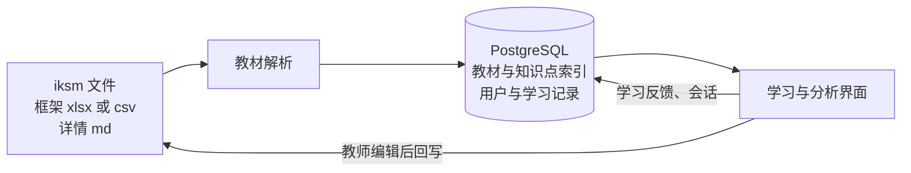

### 2.2 前后端分离，按领域拆模块

浏览器只通过 REST 接口访问后端。前端负责界面、路由和本地交互状态；后端负责鉴权、文件读写、解析、推荐和分析。后端按业务域拆成独立 NestJS 模块，每个模块自带控制器、服务和数据传输对象。

### 2.3 同一种学习体验，多种进入方式

普通学习和智能学习共用知识点详情、Markdown 预览和学习反馈面板。差别只在左侧导航：普通学习是知识树或思维导图，智能学习是推荐列表。反馈写入同一张学习记录表，分析不再区分入口。

### 2.4 编号是框架和详情的主键约定

知识点编号严格采用 `a`、`a.b`、`a.b.c`：

| 层级 | Markdown 标题 | 编号示例 | 含义 |
|------|----------------|----------|------|
| 一级 | `##` | `1` | 大章 |
| 二级 | `###` | `1.1` | 小节 |
| 三级 | `####` | `1.1.1` | 具体知识点 |

空的一级、二级单元格继承上一行，以兼容表格中的合并单元格。缺失编号时按层级自动生成。

### 2.5 变更先写规格，再改代码

功能演进使用 OpenSpec：提案、设计、任务和规格放在 `openspec/changes/`，完成后归档。知识内容与用户数据的边界、角色权限和接口形态以规格为准，避免界面和解析规则各写各的。

---

## 3. 主要模块

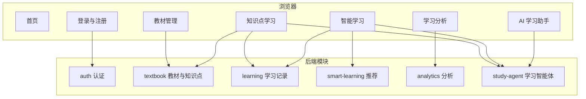

| 模块 | 谁在用 | 做什么 | 主要入口 |
|------|--------|--------|----------|
| 认证 | 全部角色 | 注册、登录、JWT、角色守卫 | `/login`、`/register` |
| 教材管理 | 教师、管理员 | 上传、同步、删除教材；编辑框架和 Markdown；校验框架、数据库与详情是否一致；按提纲扩充知识点 | `/teacher/textbooks`、`/teacher/textbooks/:id` |
| 知识点学习 | 学生、教师 | 树图或思维导图浏览，预览公式和 Mermaid，记录学习反馈 | `/learning/:textbookId` |
| 智能学习 | 学生、教师 | 薄弱点、按重要性、随机三种推荐，界面与普通学习同构 | `/smart-learning` |
| 学习分析 | 学生看自己，教师看班级 | 次数、时长、掌握分布、趋势、薄弱点和导出 | `/analytics/student`、`/analytics/teacher` |
| AI 学习助手 | 已登录用户 | 针对当前知识点对话、追问建议、回答反馈；调用可配置的大模型 | 学习页右下角侧栏 |

角色约定：

| 角色 | 能力 |
|------|------|
| 学生 `STUDENT` | 学习、提交反馈、查看个人分析、使用学习助手 |
| 教师 `TEACHER` | 在学生能力之上管理教材和知识点，查看班级分析 |
| 管理员 `ADMIN` | 在教师能力之上管理账号与系统配置 |

页面与接口对应关系：

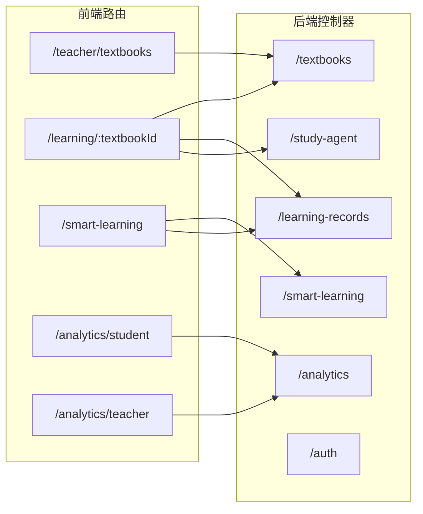

统一响应形如 `{ success, data }`。除登录、注册外，请求携带 `Authorization: Bearer <token>`。

---

## 4. 系统架构

### 4.1 总体架构

系统由独立部署的前端、后端和两类存储组成。前端开发服务器默认端口 `5173`，后端默认端口 `3000`，Swagger 文档在 `/api`。

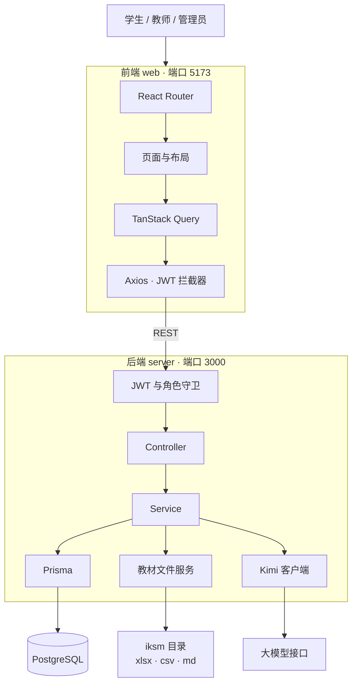

一次典型的“打开知识点并保存反馈”过程如下：

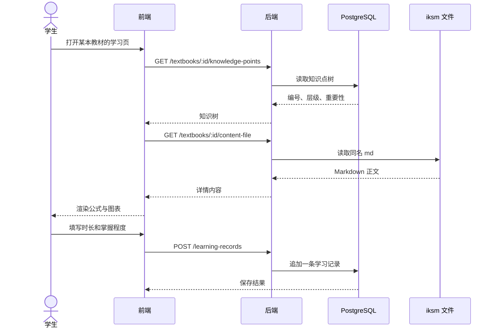

教材从文件进入数据库的过程：

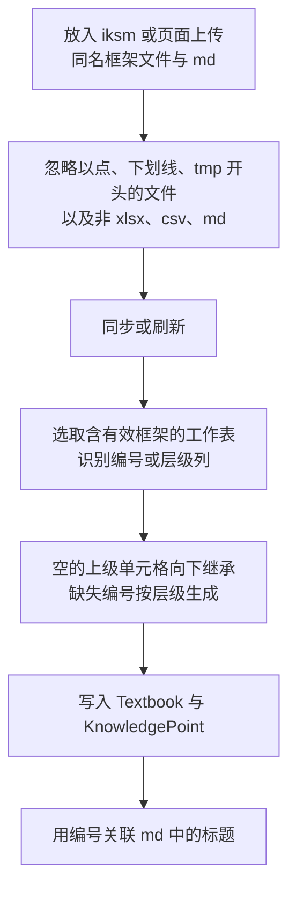

### 4.2 目录结构

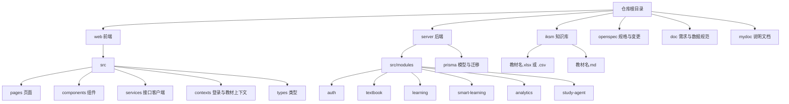

对应到磁盘上的主要位置：

```text
.
├── package.json                 # pnpm workspace 脚本
├── web/                         # React + Vite
│   └── src/
│       ├── App.tsx              # 路由
│       ├── pages/               # 登录、教材、学习、分析
│       ├── components/          # 知识树、预览、反馈、图表
│       └── services/            # 按领域拆分的 API 客户端
├── server/                      # NestJS
│   ├── prisma/schema.prisma     # 数据模型
│   └── src/
│       ├── main.ts              # 端口、CORS、Swagger
│       └── modules/             # 六个业务模块
├── iksm/                        # 教材框架与详情
├── openspec/                    # 提案、规格、归档
├── doc/prompt/                  # 项目目标与知识库规范
└── mydoc/                       # 系统介绍
```

前端页面与后端模块一一落到这些目录，共享类型放在各自的 `types` 或 `dto` 中，不在界面组件里直接访问数据库或文件系统。

### 4.3 技术栈

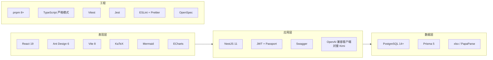

| 层级 | 选型 | 在系统中的用途 |
|------|------|----------------|
| 前端框架 | React 19、TypeScript、Vite | 单页应用与开发服务器 |
| 界面 | Ant Design，主色 `#1890FF` | 布局、表单、表格、反馈 |
| 布局 | Allotment | 学习页多栏可拖拽 |
| 服务端状态 | TanStack Query | 教材、知识点和记录的请求缓存 |
| 数学与图 | KaTeX、Mermaid | Markdown 中的公式和关系图 |
| 分析图 | ECharts | 掌握分布、趋势、热度 |
| 后端 | NestJS、class-validator | 模块、校验、依赖注入 |
| 认证 | bcrypt、JWT | 密码哈希与接口鉴权 |
| 数据 | PostgreSQL、Prisma | 用户数据与知识点索引 |
| 文件解析 | `xlsx`、PapaParse | Excel 与 CSV 框架 |
| 学习助手 | 可配置的 Kimi 接口 | 针对当前知识点答疑 |
| 测试 | Vitest、Jest | 前后端单元测试 |
| 包管理 | pnpm workspace | 根目录同时管理 `web` 与 `server` |

前端默认请求 `http://localhost:3000`，可用 `web/.env` 中的 `VITE_API_BASE_URL` 覆盖。后端 CORS 允许 `5173` 与预览端口 `4173`。

### 4.4 数据结构

核心实体关系：

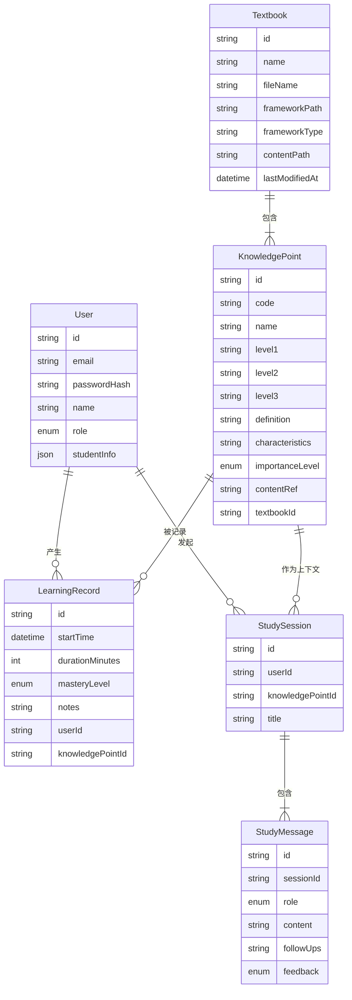

表名使用蛇形复数：`users`、`textbooks`、`knowledge_points`、`learning_records`、`study_sessions`、`study_messages`。同一教材内知识点编号唯一。同一用户对同一知识点只有一个学习助手会话，消息在会话内按时间排列。

两套分级不要混用：

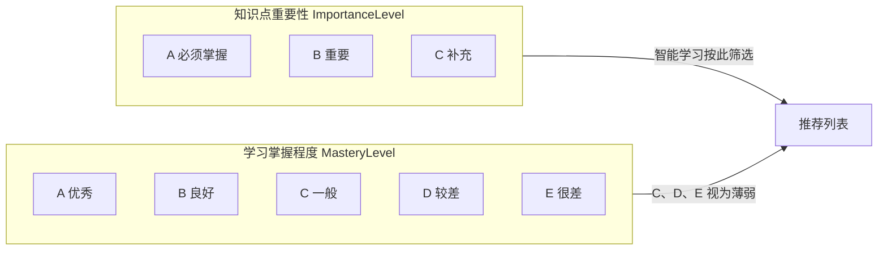

框架文件列与数据库字段的对应：

| 框架列 | 数据库字段 | 说明 |
|--------|------------|------|
| 一级知识点 | `level1` | 必填，可从上一行继承 |
| 二级知识点 | `level2` | 可空，可继承 |
| 三级知识点 | `level3` | 可空，可继承 |
| 定义 | `definition` | 简要定义 |
| 特性 / 运算方式 | `characteristics` | 特性或运算要点 |
| 知识点编号 | `code` | `1`、`1.1`、`1.1.1` |
| 重要性级别 | `importanceLevel` | A / B / C，缺省为 C |

`contentRef` 指向 Markdown 中对应标题的位置。教师在详情页修改知识点时，数据库与 `iksm` 中的框架文件、Markdown 一起更新，并用校验接口检查三者是否仍然一致。

学生扩展信息放在 `studentInfo`（JSON），用于学号、班级等注册资料，不拆成独立表。

---

## 5. 运行方式与指令

命令都在仓库根目录执行。需要 Node.js 18 或更高版本、pnpm 8 或更高版本，以及本机可访问的 PostgreSQL 14 或更高版本。

### 5.1 准备环境

```powershell
pnpm install
Copy-Item server\.env.example server\.env
Copy-Item web\.env.example web\.env
```

编辑 `server/.env`：

| 变量 | 作用 |
|------|------|
| `DATABASE_URL` | PostgreSQL 连接串，库名示例为 `mathtong` |
| `JWT_SECRET` | 签发登录令牌的密钥，生产环境必须更换 |
| `JWT_EXPIRES_IN` | 令牌有效期，默认 `24h` |
| `PORT` | 后端端口，默认 `3000` |
| `IKSM_DIR` | 教材目录的绝对路径，指向本仓库的 `iksm` |
| `KIMI_BASE_URL` / `KIMI_API_KEY` / `KIMI_MODEL` | 学习助手所用的模型接口；不使用助手时可保留占位 |

`web/.env` 中的 `VITE_API_BASE_URL` 默认为 `http://localhost:3000`。

创建数据库并应用迁移：

```powershell
pnpm --filter server prisma migrate dev
pnpm --filter server prisma generate
```

把教材文件放到 `iksm/`。一对文件使用同一主文件名，例如 `math01.xlsx` 与 `math01.md`。以 `.`、`_`、`tmp` 开头的文件会被忽略。

### 5.2 启动

开两个终端，分别启动后端和前端：

```powershell
pnpm dev:server
```

```powershell
pnpm dev
```

| 地址 | 内容 |
|------|------|
| http://localhost:5173 | 前端 |
| http://localhost:3000 | 后端 |
| http://localhost:3000/api | Swagger API 文档 |

浏览器打开前端后注册学生账号，或使用已有教师账号进入教材管理，执行同步，即可在学习页看到知识点。

生产构建与启动：

```powershell
pnpm build
pnpm --filter server start:prod
pnpm --filter web preview
```

预览前端默认使用 Vite 的 `4173` 端口，后端 CORS 已放行该来源。

### 5.3 常用指令

根目录：

| 指令 | 作用 |
|------|------|
| `pnpm dev` | 启动前端开发服务器 |
| `pnpm dev:server` | 启动后端并监听文件变化 |
| `pnpm build` | 构建前端和后端 |
| `pnpm typecheck` | 两端 TypeScript 检查 |
| `pnpm lint` | 两端 ESLint |
| `pnpm format` | 两端 Prettier 格式化 |
| `pnpm test` | 前端 Vitest 与后端 Jest |

只跑一端时加上过滤器，例如 `pnpm --filter web test --run`、`pnpm --filter server test -- src/modules/textbook/textbook.service.spec.ts`。

数据库：

| 指令 | 作用 |
|------|------|
| `pnpm --filter server prisma migrate dev` | 开发环境执行迁移 |
| `pnpm --filter server prisma generate` | 重新生成 Prisma Client |
| `pnpm --filter server prisma studio` | 打开数据库可视化界面 |

### 5.4 本地使用顺序

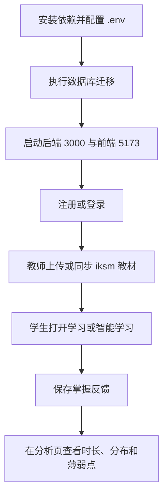
